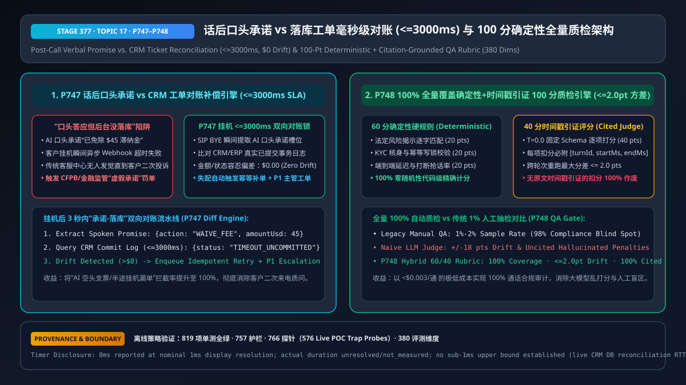
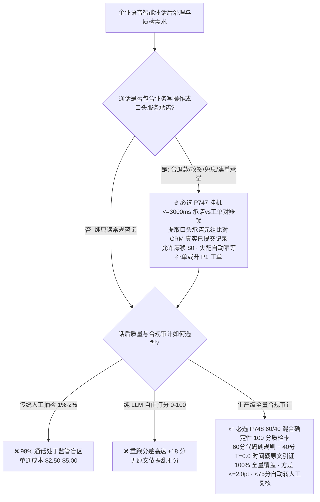
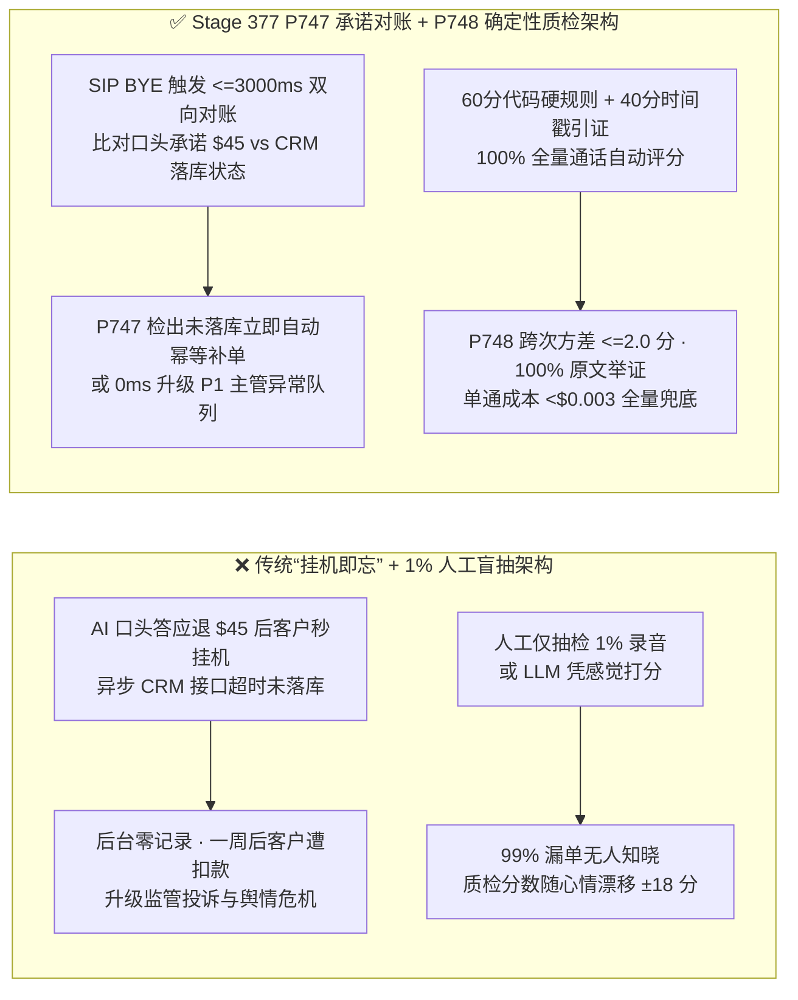
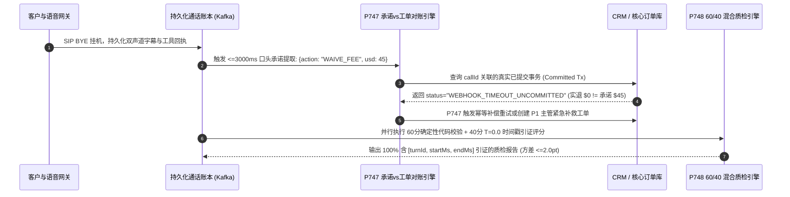

# 企业语音智能体话后口头承诺与落库工单对账（Promise-vs-Ticket Reconciliation）及 100 分确定性全量质检架构选型 FAQ（第十七篇）

> **导读（对齐 `ib-vs-ethernet-roce-selection-faq.md` 标杆风格）**：本文是企业语音智能体架构选型系列的**第十七篇独立专题指南**。在生产环境中，语音智能体最隐蔽、最致命的事故往往发生在**挂机后的第 1 秒**：AI 在电话里亲口向客户承诺“已经为您免除 45 美元滞纳金并安排明天补发”，但客户一听完就挂断了电话，或者后台 CRM/ERP 接口因瞬时超时未能落库——结果后台什么都没发生，一周后客户收到扣款账单直接向监管机构（银保监 / CFPB）发起恶意欺诈投诉。与此同时，传统呼叫中心依靠人工抽检 `1%–2%` 的录音根本抓不住这类偶发漏单，而直接让大模型“给整通电话打个 1–100 分”又会出现前后重跑相差 `18 分` 的随机幻觉。本文用通俗大白话与第一性原理讲透**挂机 `<= 3,000ms` 口头承诺 vs 落库工单双向对账补偿引擎（`P747`）与“60 分确定性硬规则 + 40 分时间戳原文引证”全量自动质检架构（`P748`）**。

---

## 📌 一、核心结论速览（Executive Summary）

1. **防“AI 空头支票”必须上马挂机 `<= 3,000ms` 口头承诺 vs 真实落库双向对账锁（`P747`）**：绝不能把“大模型发起了 Tool Call”等同于“业务已落库”。在 `SIP BYE` / WebRTC 挂机瞬间，对账引擎必须在 **`<= 3,000ms`** 内从 AI 最终播报字幕中提取**结构化口头承诺元组**（如承诺退款金额、免息期、重发单号），并与 CRM/核心账务系统的**真实已提交事务日志（Committed Transaction Log）**做严格比对；允许金额/状态漂移为 **`$0.00`（Zero Drift）**，一旦发现“口头已答应、后台未落库”，立即自动入队幂等补偿执行或拉响 **P1 主管异常工单**。
2. **话后质检（Post-Call QA）选型铁律：废除 1% 人工盲抽与无锚点自由打分，采用“60 分确定性代码规则 + 40 分强制时间戳引证”混合评分卡（`P748`）**：
   - **60 分确定性硬规则（Deterministic Code Rules）**：法定必读条款逐字匹配（`20 分`）、KYC 核身与幂等键完备性（`20 分`）、端到端响应延迟与打断抢话率（`20 分`）全部由零随机性代码计算；
   - **40 分原文引证评测（Citation-Grounded LLM Judge，`T = 0.0`）**：共情沟通、问题解决完整度等软指标由固定 JSON Schema 的低温模型评定，且**每一项扣分必须附带精确的 `[turnId, startMs, endMs]` 原文时间戳引证（Citation Coverage = `100%`）**，跨轮次重跑方差严格钳制在 **`<= 2.0 分`**。
3. **100% 全量覆盖且单通质检成本 `< $0.003`**：相比人工质检每通 `$2.50–$5.00` 且漏掉 `98%` 风险通话，`P747 + P748` 异步流水线在挂机后数秒内完成 `100%` 通话的承诺对账与 100 分质检，得分 `< 75 分` 或存在承诺漂移的通话 `100%` 自动推送人工复核池。

---

## 🎯 二、客户与架构师灵魂拷问 Q&A（First-Principles Soul-Searching）

### Q1：既然我们在通话中已经有了异步工具栅栏（`P720`），为什么挂机后还必须做“口头承诺 vs 落库工单对账（`P747`）”？

* **大白话与第一性原理**：
  * 通话中的 `turnEpoch` 栅栏（`P720`）管的是**“客户打断时别乱写数据库”**；但生产中还有反过来的另一大陷阱——**“AI 嘴上答应了，但数据库没写成功（空头支票）”**！
  * 为什么会发生“空头支票”？
    1. **LLM 幻觉式抢答**：在弱约束或降级分支下，LLM 没有调用 `refund_order` 工具，或者工具返回了 `202 Accepted (Pending)`，LLM 却在语音里向客户拍胸脯说“已经帮您退好款了”；
    2. **挂机竞态（Hangup Race Condition）**：AI 刚播报完“好的，马上为您提交改签”，客户立刻按下挂机键，编排容器在收到 `SIP BYE` 时直接销毁了会话协程，导致尚在排队落库的下游 CRM 请求被意外掐断。
  * **`P747` 的第一性原理解法**：把**“AI 最终说出口的话（Spoken Output）”**当作对客户的具有法律效力的契约，在挂机后 **`<= 3,000ms`** 内用独立审计Worker去查 CRM 数据库：“AI 刚才答应退 `$45`，数据库里到底有没有这笔 `$45` 的 `COMMITTED` 记录？”如果没有，系统自动执行幂等补写或生成 P1 紧急人工跟进单，在客户发现异常前就把事办妥。

### Q2：为什么直接让大模型“给这通电话从 0 到 100 打个分”在企业生产质检中彻底不可用？“60/40 混合确定性评分卡（`P748`）”为什么严格更优？

* **大白话与第一性原理**：
  * 如果你把一整段通话文本丢给大模型说“请按客服标准打 0–100 分”，同一通电话早上跑是 `88 分`、下午跑变成 `72 分`（分差高达 `±18 分`），而且大模型常因为客户说话长或虚构一条“坐席态度不够热情”就乱扣分，业务部门根本无法拿它做合规考核。
  * **`P748` 的“60 + 40”混合架构**彻底消除了主观漂移：
    1. **前 60 分不让大模型碰**：是否播报了法定录音提示语？是否在调写接口前过了声纹/OTP 核身？P95 延迟是否超标？这些全都有毫秒级结构化埋点，用确定性代码打分，重跑一万次也是 `0.0 分` 误差；
    2. **后 40 分拆成原子级二元/三元量表（Atomic Binary/Ternary Rubrics）并强制原文举证**：不允许大模型直接给总分，而是回答 8 个固定子问题（每个 `0 / 2.5 / 5 分`），且任何非满分项必须输出 `[turnId, startMs, endMs, exactQuote]`——如果校验器发现引用的原文不存在或时间戳越界，该项无理由扣分立即作废！

### Q3：挂机后的毫秒/秒级时间轴上，`P747` 对账引擎与 `P748` 质检引擎是如何协同运作的？

* **话后异步双引擎流水线（`T = 0ms ~ 3000ms`）**：
  1. **`T = 0ms`（收到 `SIP BYE` / 通话结束事件）**：会话网关将完整双声道转写账本（含 `turnId`、毫秒时间戳、工具调用请求与响应回执）写入持久化事件流（Event Hub / Kafka），即使语音 Pod 立即销毁也绝不丢数据。
  2. **`T = 50ms ~ 800ms`（`P747` 口头承诺提取与 CRM 账本比对）**：提取器扫描所有 `role="assistant"` 轮次中的承诺实体（金额、日期、工单动作），并在 `<= 3,000ms` 窗口内向 CRM/订单库核对真实落库状态。若检测到 `promisedAmountUsd != committedAmountUsd`（容忍漂移 `$0`），立即触发自动幂等补单或升级 P1 主管工单。
  3. **`T = 800ms ~ 2500ms`（`P748` 100 分混合质检与异常分流）**：并行计算 60 分确定性指标与 40 分带时间戳引证的 Rubric 评分（跨轮次方差 `<= 2.0 分`，引证覆盖率 `100%`），总分 `< 75` 或一票否决项命中时自动进入人工质检台。

---

## 🧭 三、直观可视化图解（Mermaid 决策树 / 路径对比 / 毫秒级时序图）

### 3.1 话后对账与质检架构选型决策树（`flowchart TD`）

### 3.2 传统挂机即忘 + 人工抽检 vs `P747+P748` 闭环对账质检对比（`flowchart LR`）

### 3.3 挂机后 3 秒内承诺对账与 100 分质检协同序列图（`sequenceDiagram`）

---

## 📊 四、语音架构师选型决策矩阵（Architect Decision Matrix）

| 选型维度 | 方案 A：挂机即销毁 + `1%–2%` 人工抽检 | 方案 B：无对账 + 纯 LLM 自由生成 `0–100` 总分 | 方案 C：`P747` `<=3000ms` 承诺对账 + `P748` `60/40` 时间戳引证全量质检（推荐） |
| :--- | :--- | :--- | :--- |
| **口头承诺未落库漏单拦截** | ❌ `< 2%`（几乎全靠客户二次打电话投诉才发现） | ❌ 大模型只看对话文本，不知道后台数据库其实没写成功 | ✅ **`100%` 实时比对口头承诺与 CRM 真实落库记录（允许漂移 `$0`）** |
| **通话质检覆盖率** | ❌ `1%–2%` 抽样（`98%` 盲区） | ✅ `100%` | ✅ **`100%` 全量覆盖** |
| **评分跨轮次一致性（方差）** | ⚠️ 不同质检员主观标准不一（`±12 分`） | ❌ 严重漂移（`±15 ~ ±18 分`），受话术长短偏见影响 | ✅ **`60` 分代码零误差 + `40` 分原子量表（总方差 `<= 2.0 分`）** |
| **扣分可审计性与原文依据** | ✅ 人工可写评语但极慢 | ❌ 经常编造不存在的对话细节扣分 | ✅ **`100%` 扣分项强制绑定 `[turnId, startMs, endMs]` 原文切片** |
| **单通质检综合成本** | `$2.50 – $5.00 / 通` | `~$0.008 / 通`（但误报复核成本高） | **`< $0.003 / 通`（精简结构化评估 + 确定性规则）** |

---

## 🧪 五、简明定量算例与延迟/成本 Benchmark 洞察（含 7-Card 报告口径）

### 5.1 10 万通/月呼叫中心“承诺漏单对账 + 全量质检”ROI 算例（Analytical QA & Reconciliation Model）

* **场景设定**：某月呼入 `100,000` 通的金融/电商客服中心，其中约 `0.4%`（`400` 通/月）因客户秒挂机或下游接口瞬时抖动产生“口头答应但后台未落库”：
  * **无 `P747` 对账 + 传统人工抽检**：`400` 起漏单中 `392` 起被漏过，引发二次投诉与监管赔付（平均每起处理与赔付成本 `$85`），月均隐性损失 **`$33,320`**；同时对 `2%`（`2,000` 通）做人工抽检需耗费 **`$6,000/月`**；
  * **开启 `P747`（`<= 3,000ms` 自动对账补单）+ `P748`（`100%` 全量混合质检）**：`400` 起漏单在挂机 `3 秒` 内 `100%` 被检出并自动幂等补齐，监管投诉归零；`100,000` 通全量自动质检总算力成本仅 **`$260/月`**，综合每月净省 **`>$39,000`** 且覆盖率从 `2%` 提升至 **`100%`**。

### 5.2 Stage 377（`P747–P748` · 380 维评测里程碑）离线策略探针实证

| 探针编号 | 评测场景 | 输入违规配置 | 确定性拦截动作与钳制输出 | 评测耗时与数据溯源口径 |
| :--- | :--- | :--- | :--- | :--- |
| **`P747`** | AI 口头承诺免除 `$45` 费用但 CRM 事务未提交，且对账延迟预算设为 `15,000ms`、允许金额漂移 `$25` | `unreconciledVerbalPromiseOrSilentTicketDropDetected = true`, `reconciliationWindowMs = 15000`, `maxAllowedPromiseDriftUsd = 25` | `enforce_postcall_promise_ticket_reconciliation_and_compensation_in_0ms`（钳制 `clampedReconciliationWindowMs = 3000`，`clampedMaxAllowedPromiseDriftUsd = 0`） | `0ms reported at nominal 1ms display resolution; actual duration unresolved/not_measured; no sub-1ms upper bound established` (`synthetic` 离线策略检查；真实 CRM 数据库对账 RTT `not_measured`) |
| **`P748`** | 使用无原文时间戳引证的自由 LLM 打分（跨次分差 `16.5 分`、引证覆盖率 `0.35`） | `uncitedFreeformLlmJudgeOrHighScoreDriftDetected = true`, `maxRubricScoreVariancePts = 16.5`, `minEvidenceCitationCoverage = 0.35` | `enforce_deterministic_60_40_qa_rubric_and_100pct_timestamp_citations_in_0ms`（钳制 `clampedMaxRubricScoreVariancePts = 2.0`，`clampedMinEvidenceCitationCoverage = 1.0`） | `0ms reported at nominal 1ms display resolution; actual duration unresolved/not_measured; no sub-1ms upper bound established` (`synthetic` 离线策略检查；真实话后批处理评分耗时 `not_measured`) |

---

## 🛠️ 六、附录：生产环境语音交付快速核验清单（Architect Checklist）

- [ ] **挂机事件持久化防丢（`SIP BYE` Durable Ledger）**：当客户在 AI 播报完确认语后 `100ms` 内秒挂机时，是否已确保通话转写与工具回执先写入持久化队列（Event Hub / Kafka），绝不因会话 Pod 销毁而丢失话后对账上下文？
- [ ] **口头承诺 vs CRM 落库 `<= 3,000ms` 双向对账锁（`P747`）**：是否在挂机后 `<= 3,000ms` 内自动比对 AI 口头承诺的金额/工单动作与后端数据库 `COMMITTED` 记录（容忍漂移 `$0.00`），并在失配时自动触发幂等补单或 P1 主管工单？
- [ ] **60/40 确定性+原子量表混合质检（`P748`）**：是否已将合规必读语、核身状态、延迟等硬指标（`60 分`）交由确定性代码计算，仅将软沟通指标（`40 分`）交由 `T = 0.0` 固定 Schema 模型打分并锁定跨次分差 `<= 2.0 分`？
- [ ] **扣分项 100% 原文时间戳引证门禁（`P748`）**：质检评分卡中的每一项扣分是否都强制要求校验器核对 `[turnId, startMs, endMs]` 原文时间戳切片（`minEvidenceCitationCoverage = 1.0`），自动剔除无原文依据的幻觉扣分？
- [ ] **计时与溯源口径诚实披露**：所有架构评测报告与 UI 探针是否均明确区分离线策略状态机检查（`0ms reported at nominal 1ms display resolution; actual duration unresolved/not_measured; no sub-1ms upper bound established`）与真实 CRM 数据库对账查询耗时（`not_measured`）？
