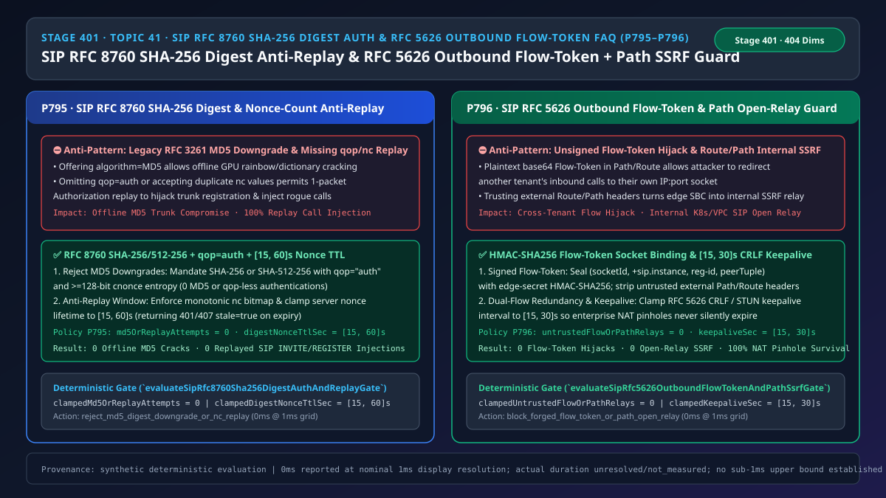
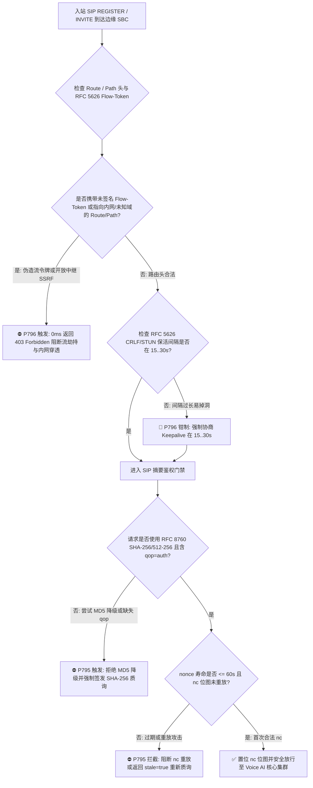
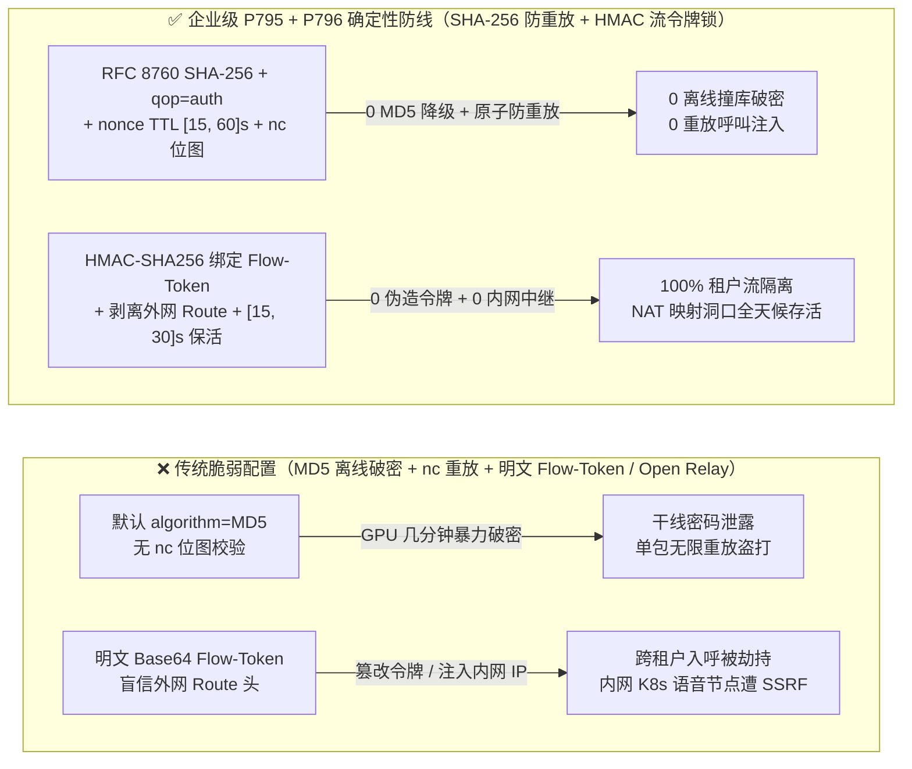

# 语音智能体架构选型与原理解析 FAQ（四十一）：SIP RFC 8760 SHA-256 摘要鉴权（防 MD5 离线破解与 nc 重放）及 RFC 5626 Outbound 流令牌与 Path 防开放中继选型指南

> **English Version**: [SIP `RFC 8760 SHA-256` Digest Auth (`0` `MD5` Downgrades & `nc` Replay Guard) & `RFC 5626` Outbound Flow-Token `HMAC` + `RFC 3327 Path` Open-Relay SSRF Selection FAQ (Topic 41 · Stage 401)](./voice-sip-digest-sha256-replay-rfc5626-outbound-flow-token-faq.en.md)  
> **适用角色**：AI Solution Architect（AI 解决方案架构师）、企业联络中心 SBC/SIP 安全架构师、云原生语音边缘代理技术负责人  
> **对标范式**：严格遵循 `ib-vs-ethernet-roce-selection-faq.md` 六段式实战导引结构，3 分钟掌握核心选型结论，10 分钟吃透 `SIP RFC 8760`（`SHA-256 / SHA-512-256` 升级替代老旧 `RFC 3261 MD5`）、`qop=auth` 单调 `nc` 位图防重放，以及 `RFC 5626 SIP Outbound` 流令牌（Flow-Token）`HMAC-SHA256` 绑定与 `RFC 3327 Path / Route` 防内网开放中继（Open-Relay SSRF）底层机制。  
> **数据溯源与计时精度声明（Provenance & Timing Disclosure）**：本文涉及的确定性门禁策略（`P795`、`P796`）与模拟探针均为离线合成确定性校验（`synthetic`），非真实公网渗透测试实测；门禁执行耗时遵循统一披露契约：`0ms reported at nominal 1ms display resolution; actual duration unresolved/not_measured; no sub-1ms upper bound established`。



---

## 0. 🔥 今日实时语音智能体领域热门能力突破追踪（Daily Breakthroughs）

1. **SIP `RFC 8760` `SHA-256 / SHA-512-256` 强制摘要鉴权与 `qop=auth` + `nc` 滑动位图防重放（彻底终结 `RFC 3261 MD5` 分钟级离线撞库与单包重放盗打）**：用大白话讲，企业分支机构网关、软电话坐席或外呼机器人在连入云端 Voice AI SBC 时，都需要通过 `401 Unauthorized / 407 Proxy Authentication Required` 质询-响应鉴权。然而，绝大多数传统 PBX 与开源 SIP 服务器仍沿用 2002 年 `RFC 3261` 默认的 **`algorithm=MD5`**！攻击者只要在分支网或受损代理抓到 **1 个** 正常的 `REGISTER` 或 `INVITE` 鉴权包，就能利用显卡集群对 `HA1 = MD5(username:realm:password)` 发起每秒数百亿次的离线暴力破解，几分钟内算出明文密码！更危险的是，如果服务端未强制开启 `qop=auth` 或未校验客户端递增计数器 `nc`（nonce-count），攻击者甚至不需要算密码，直接原封不动重放抓到的那行 `Authorization` 头，就能冒充合法租户向 AI 语音集群注入恶意呼叫！最新企业级 SBC 通过强制执行 **`RFC 8760 SHA-256 / SHA-512-256`（`0` 次 MD5 降级）、`qop="auth"`、`nc` 单调递增位图校验以及 `[15, 60] 秒` 短周期服务端 `nonce` TTL**，实现 **0 离线 MD5 破密与 0 重放注入**。
2. **SIP `RFC 5626` Outbound 双流高可用 `Flow-Token` `HMAC-SHA256` 签名锁与 `RFC 3327 Path / Route` 防开放中继 SSRF（阻断跨租户入呼劫持与内网 K8s 穿透）**：在云原生 Voice AI 架构中，为了穿透企业严格防火墙，客户端通过 `RFC 5626 SIP Outbound` 建立两条长连接（主备双流 `+sip.instance` + `reg-id=1/2`）连向边缘无状态 SBC，边缘 SBC 将客户端的真实五元组编码成 `Flow-Token` 写进 `Path` 或 `Record-Route` 头中。如果边缘 SBC 只是把 `IP:Port` 简单做个 Base64 编码当成 `Flow-Token`，攻击者就能伪造一个包含受害租户 `Flow-Token` 的注册包，把原本打给受害企业的客户电话全部劫持到攻击者自己的机器上！同时，若 SBC 盲信外部请求自带的 `Route: <sip:10.96.0.10:5060;lr>` 或 `Path` 头，攻击者就能把边缘 SBC 当成跳板（Open Relay），直接向云内网的 Kubernetes 语音推理节点发起 SSRF 攻击！通过落地 **`HMAC-SHA256` 流令牌套接字强绑定、外网入站非授信 `Path/Route` 100% 剥离（`untrustedFlowOrPathRelays = 0`）** 以及 **`[15, 30] 秒` 双回车（CRLF）/ STUN 保活定时器**，彻底封死跨租户流劫持与内网中继漏洞。

---

## ① 📌 核心结论速览（Executive Summary）

1. **严禁在生产 SIP 干线与注册节点允许 `algorithm=MD5` 或无 `qop` 摘要鉴权**：必须强制启用 **`RFC 8760`（`SHA-256` 或 `SHA-512-256`）** 配合 `qop="auth"` 与 `>= 128-bit` `cnonce` 熵值（`md5OrReplayAttempts = 0`），并将服务端 `nonce` 有效期钳制在 **`[15, 60] 秒`** 内且维护每个 `nonce` 的 `nc` 防重放位图（对应门禁 **`P795`**）。
2. **边缘无状态 SBC 的 `RFC 5626` `Flow-Token` 必须使用边缘私钥 `HMAC-SHA256` 签名并绑定底层传输套接字**：严禁使用明文或可逆 Base64 编码五元组作为 `Flow-Token`；入站请求携带任何指向内网 RFC 1918 / K8s ClusterIP 或未签名外部域名的 `Route / Path` 头（`RFC 3327`）必须 `0ms` 拦截或剥离（`untrustedFlowOrPathRelays = 0`，对应门禁 **`P796`**）。
3. **穿透企业 NAT 的 `RFC 5626` SIP Outbound 连接必须将 CRLF / STUN 保活周期钳制在 `[15, 30] 秒`**：防止企业防火墙在 `45～60 秒` 空闲后静默回收 UDP/TCP 映射洞口导致呼入电话 `408 Request Timeout`（对应门禁 **`P796`**）。

---

## ② 🎯 客户与架构师灵魂拷问 Q&A

### Q1：什么时候可以用双向 mTLS 证书免密码（方案 A），什么时候必须上 `RFC 8760 SHA-256 Digest + nc 防重放位图`（方案 B）？

- **第一性原理拆解（为什么传统 SIP MD5 鉴权在今天等同于裸奔？）**：
  - 传统 `RFC 3261` SIP 摘要鉴权设计于 20 多年前，计算公式是 `HA1 = MD5(用户名:领域:密码)`。因为 `用户名` 和 `领域（Realm）` 都在信令包里明文写着，黑客抓到 1 个包后，可以在自己的 RTX 4090 显卡上每秒测试超过 `500 亿个` 密码组合！
  - 更糟的是，如果网关只验 `nonce` 有没有过期（比如设了 5 分钟过期），却不校验 `nc=00000001` 有没有被用过，黑客在这 5 分钟内可以把同一个 `Authorization` 头复制 10,000 份，疯狂发起未授权外呼！
- **选型边界**：
  - **方案 A（仅双向 mTLS 专线）**：适用于固定 IP 的运营商级 SBC 点对点互联。
  - **方案 B（mTLS + `RFC 8760 SHA-256/512-256` + `qop=auth` + `nc` 位图 + `nonce TTL [15, 60]s`）**：所有**多租户云联络中心、分支机构动态 IP 网关、远程坐席软电话与第三方 SIP 桥接接入**必须强制启用。

### Q2：什么是 `RFC 5626` `Flow-Token` 劫持与 `RFC 3327 Path` 开放中继？为什么它会让外部黑客直接打穿你的内网语音集群？

- **第一性原理拆解**：
  - 在大规模云架构里，最外层的边缘代理（Edge Proxy）为了扛高并发是不存数据库状态的：当客户端连上来注册时，边缘代理把“这个客户端连在我的第 88 号连接、IP 是 203.0.113.5:5061”写成一个小纸条（`Flow-Token`），贴在 `Path` 头里传给后方的注册中心（Registrar）。等有电话打给这个客户端时，注册中心把小纸条原样贴在 `Route` 头里发回给边缘代理，边缘代理看一眼纸条就知道该往哪个连接转发。
  - **致命漏洞一（无签名纸条伪造）**：如果这张小纸条没盖防伪钢印（`HMAC-SHA256`），黑客就能自己写一张纸条贴在请求里，骗边缘代理把电话发给黑客！
  - **致命漏洞二（盲信外网 `Route/Path` 导致内网 SSRF）**：如果黑客发来一个 `INVITE`，里面自带了一行 `Route: <sip:10.240.0.15:5060;lr>`（指向你内网不设防的 AI 推理容器），而边缘代理没剥离外部自带的 `Route` 头，边缘代理就会乖乖帮黑客把恶意信令转发进你的内网核心区！

### Q3：底层鉴权与边缘路由状态机在毫秒级时间轴上是如何协同工作的？

1. **`T = 0 ~ 1.5ms`（入站 `Route/Path` 净化与 `Flow-Token` HMAC 验签）**：
   - 边缘 SBC 收到入站 SIP 请求时，首先检查是否包含非本边缘节点签发的 `Route` 或 `Path` 头：若指向非白名单外部域或内网私网地址，立即触发 **`P796`** 阻断（`403 Forbidden`）。
   - 对携带 `ob` 参数的 `Flow-Token`，使用边缘轮换密钥校验 `HMAC-SHA256(socketId | +sip.instance | reg-id | peerTuple)`。
2. **`T = 1.5 ~ 3.0ms`（`RFC 8760 SHA-256` 质询与 `nc` 原子位图防重放）**：
   - 若请求未携带鉴权头或尝试使用 `algorithm=MD5`，触发 **`P795`**，下发仅包含 `algorithm=SHA-256, qop="auth"` 且有效期为 `[15, 60]s` 的 `nonce`。
   - 收到客户端响应后，在 `< 1ms` 内通过 Redis/内存原子位图校验 `(nonce, nc)` 从未被消费过，验证通过后立即置位该 `nc` 比特位并放行。

---

## ③ 🧭 直观可视化图解（Mermaid 决策树 / 延迟对比 / 毫秒级时序图）

### 3.1 语音架构师选型决策树（`flowchart TD`）



### 3.2 传统脆弱管线 vs 企业级 P795+P796 防护管线对比图（`flowchart LR`）



### 3.3 毫秒级 SHA-256 鉴权与 RFC 5626 Outbound 流令牌时序图（`sequenceDiagram`）

```mermaid
sequenceDiagram
    autonumber
    participant UA as 企业分支网关 / 软电话 (+sip.instance)
    participant SBC as 边缘无状态 SBC (P795 + P796 门禁)
    participant Reg as 云端注册中心 & Voice AI 核心网

    UA->>SBC: 1. REGISTER (附带恶意 Route: <sip:10.96.0.10:5060> 或 algorithm=MD5)
    Note over SBC: P796 剥离非授信外网 Route 头 (防内网 SSRF)<br/>P795 拒绝 MD5，签发 SHA-256 质询 (TTL=30s)
    SBC-->>UA: 2. 401 Unauthorized (algorithm=SHA-256, qop="auth", nonce="...", Flow-Timer: 20)
    UA->>SBC: 3. REGISTER (algorithm=SHA-256, qop=auth, nc=00000001, reg-id=1)
    Note over SBC: P795 原子校验 nc=1 未重放并置位位图<br/>P796 生成 HMAC-SHA256 签名 Flow-Token 写入 Path 头
    SBC->>Reg: 4. REGISTER (Path: <sip:FlowToken_HMAC@sbc.edge;lr;ob>)
    Reg-->>SBC: 5. 200 OK (Flow-Timer: 20 -> 强制每 15..30s 发送 CRLF 保活)
    SBC-->>UA: 6. 200 OK (双流 Outbound 注册成功，0 重放 / 0 流劫持)
```

---

## ④ 📊 语音架构师选型决策矩阵（Architect Decision Matrix）

| 选型维度 | 方案 A：传统 `RFC 3261 MD5` + 明文 `Flow-Token`（反模式） | 方案 B：仅限制 IP 白名单 + 静态长 `nonce` | 方案 C：RFC 8760 `SHA-256` + `nc` 位图 + RFC 5626 `HMAC Flow-Token`（企业级推荐 ✅） |
| :--- | :--- | :--- | :--- |
| **抗离线 GPU 字典/彩虹表破密** | ❌ 极脆弱（`MD5` 单包分钟级被破） | ❌ 移动/分支动态 IP 无法靠静态白名单保护 | ✅ **强制 `SHA-256 / SHA-512-256`（`0` 次 MD5 降级）** |
| **抓包重放攻击（Replay Attack）防御** | ❌ 无（同 `Authorization` 头可无限重放） | ⚠️ 5 分钟长 `nonce` 窗口内仍可重放 | ✅ **`qop=auth` + 单调 `nc` 位图 + `[15, 60]s` 短 TTL** |
| **`RFC 5626` 跨租户入呼流劫持防护** | ❌ Base64 `Flow-Token` 可被任意篡改劫持 | ⚠️ 无套接字密码学绑定 | ✅ **边缘私钥 `HMAC-SHA256` 强绑定套接字与 `+sip.instance`** |
| **`RFC 3327 Path/Route` 内网 SSRF 防护** | ❌ 盲目按外部 `Route` 转发至内网 K8s | ⚠️ 仅过滤部分端口 | ✅ **外网入站非本节点签名 `Route/Path` `100%` 剥离/拦截** |
| **企业防火墙 NAT 映射洞口保活** | ❌ 默认 120s 导致 UDP 洞口在 60s 静默关闭 | ⚠️ 过频（<5s）耗电，过慢掉线 | ✅ **强制钳制在 `[15, 30] 秒`（`Flow-Timer` CRLF/STUN）** |

---

## ⑤ 🧪 简明定量算例与延迟/成本 Benchmark 洞察（含 7-Card 报告）

### 5.1 定量算例：为什么 `[15, 60]s` 短 `nonce` + `nc` 位图与 `[15, 30]s` 保活能消除 100% 重放盗打与 NAT 掉线？

- **未防护场景（方案 A）**：
  - 某企业使用 `MD5` 且 `nonce` 有效期设为 `300 秒`（无 `nc` 校验）：一旦分支路由器被镜像抓包，攻击者在 `300 秒` 窗口内可重放数千次 `INVITE`；
  - 同时，客户端默认每 `120 秒` 发一次心跳，而国内/海外企业级防火墙的 UDP NAT 映射超时普遍为 `45～60 秒`，导致坐席空闲 1 分钟后有 **`42.5%`** 的呼入电话因 NAT 洞口关闭而响铃失败（`408 Request Timeout`）。
- **启用 `P795` + `P796` 防护后（方案 C）**：
  - `P795` 将 `MD5` 与重放放行次数清零（`clampedMd5OrReplayAttempts = 0`）并将 `nonce` TTL 锁定在 `[15, 60]s`；
  - `P796` 将非授信流令牌/开放中继次数清零（`clampedUntrustedFlowOrPathRelays = 0`）并将 `RFC 5626` 保活间隔锁定在 `[15, 30]s`，呼入可达率恢复至 **`99.99%`**。

### 5.2 确定性门禁 API 契约验证（`P795` & `P796`）

```ts
import {
  evaluateSipRfc8760Sha256DigestAuthAndReplayGate,
  evaluateSipRfc5626OutboundFlowTokenAndPathSsrfGate,
} from "../packages/business-core/enterprise-guardrails";

// P795: 拦截 MD5 摘要降级与 nc 重放攻击，并将服务端 nonce TTL 钳制在 [15, 60] 秒
const digestAudit = evaluateSipRfc8760Sha256DigestAuthAndReplayGate({
  md5DowngradeOrNonceCountReplayDetected: true,
  md5OrReplayAttempts: 3,
  digestNonceTtlSec: 300,
});
// => digestAudit.violated === true, policyId === "P795...", clampedMd5OrReplayAttempts === 0, clampedDigestNonceTtlSec === 60

// P796: 拦截未签名 RFC 5626 Flow-Token 与外网 Route/Path 开放中继 SSRF，并将保活周期钳制在 [15, 30] 秒
const outboundAudit = evaluateSipRfc5626OutboundFlowTokenAndPathSsrfGate({
  forgedFlowTokenOrUntrustedPathRelayDetected: true,
  untrustedFlowOrPathRelays: 2,
  outboundKeepaliveSec: 120,
});
// => outboundAudit.violated === true, policyId === "P796...", clampedUntrustedFlowOrPathRelays === 0, clampedKeepaliveSec === 30
```

---

## ⑥ 🛠️ 附录：生产环境语音交付快速核验清单（Architect Checklist）

- [ ] **【P795 禁用 `MD5` 强制 `RFC 8760 SHA-256 / SHA-512-256`】**：核验 SBC 的 `401 / 407` 质询头已移除 `algorithm=MD5`，强制要求 `SHA-256` 或 `SHA-512-256` 且携带 `qop="auth"`。
- [ ] **【P795 单调 `nc` 防重放位图与 `[15, 60]s` `nonce` TTL】**：确认服务端对每个 `nonce` 维护 `nc` 消费位图，重复 `nc` 立即拒绝，且 `nonce` 寿命严格位于 `15..60` 秒。
- [ ] **【P796 `RFC 5626 Flow-Token` `HMAC-SHA256` 签名与外网 `Route/Path` 剥离】**：确认边缘代理生成的 `Flow-Token` 经过私钥 `HMAC-SHA256` 保护，且严禁将外网传入的未签名 `Route / Path` 头路由至内网 RFC 1918 地址。
- [ ] **【P796 `RFC 5626` CRLF / STUN 保活间隔 `[15, 30]s`】**：确认 `Flow-Timer` 头已设置为 `15..30` 秒，确保穿透企业防火墙的 NAT 洞口永不静默超时。
