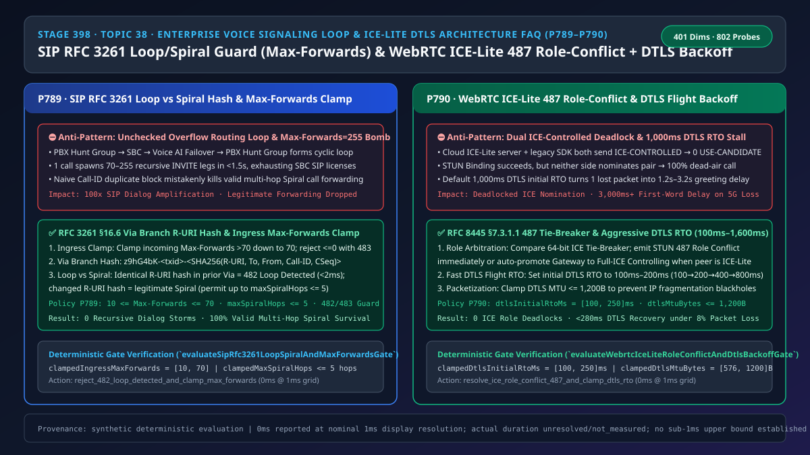
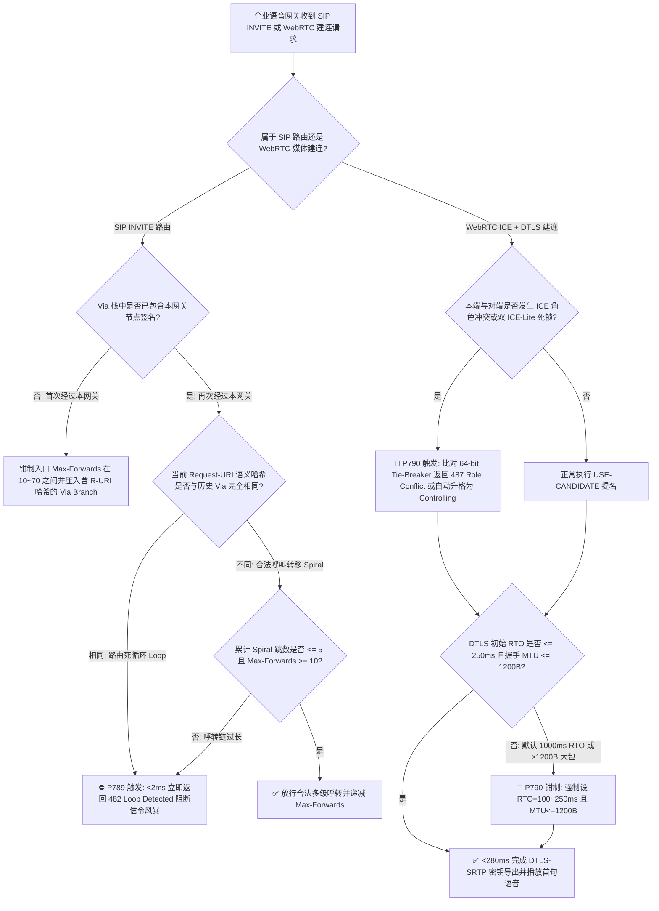
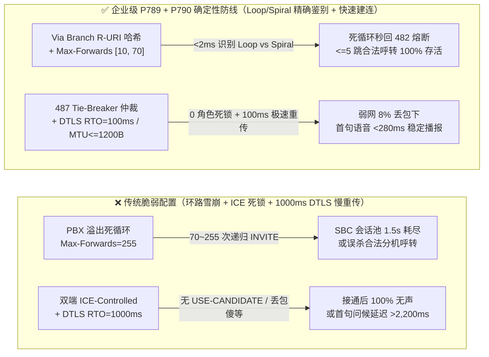
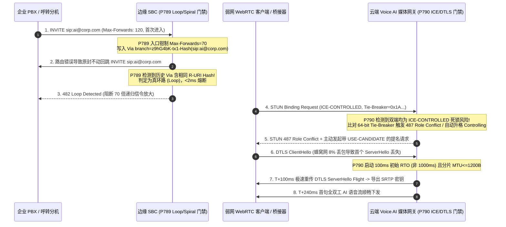

# 语音智能体架构选型与原理解析 FAQ（三十八）：SIP RFC 3261 环路风暴防线（Max-Forwards 与 Via 螺旋哈希）与 WebRTC ICE-Lite 角色冲突仲裁（487 Role Conflict）及 DTLS 快速重传选型指南

> **English Version**: [SIP RFC 3261 Loop/Spiral Guard (`Max-Forwards`) & WebRTC `ICE-Lite` Role-Conflict (`487`) + `DTLS` Fast Backoff Selection FAQ](./voice-sip-loop-max-forwards-spiral-webrtc-ice-lite-role-conflict-faq.en.md)  
> **适用角色**：AI Solution Architect（AI 解决方案架构师）、实时音视频网关架构师、企业联络中心 SBC/SIP 与 WebRTC 核心网技术负责人  
> **对标范式**：严格遵循 `ib-vs-ethernet-roce-selection-faq.md` 六段式实战导引结构，3 分钟掌握核心选型结论，10 分钟吃透 `SIP RFC 3261 §16.6` 环路与合法螺旋转发（Loop vs Spiral）精确区分机制、`WebRTC RFC 8445` `ICE-Lite` 角色死锁仲裁与 `DTLS 1.2/1.3` 丢包快速重传（`100ms–250ms`）工程实现。  
> **数据溯源与计时精度声明（Provenance & Timing Disclosure）**：本文涉及的确定性门禁策略（`P789`、`P790`）与模拟探针（`sip_rfc3261_loop_spiral_max_forwards_guard`、`webrtc_ice_lite_role_conflict_dtls_backoff_guard`）均为离线合成确定性校验（`synthetic`），非真实运营商交换机或公网基站实测；门禁执行耗时遵循统一披露契约：`0ms reported at nominal 1ms display resolution; actual duration unresolved/not_measured; no sub-1ms upper bound established`。



---

## 0. 🔥 今日实时语音智能体领域热门能力突破追踪（Daily Breakthroughs）

1. **SIP RFC 3261 §16.6 `Via` Branch 语义哈希（Loop vs Spiral 零误杀鉴别）**：用大白话讲，当企业把本地 PBX 总机、云端 SBC 与语音 AI 座席串联起来并开启“AI 忙时溢出回总机寻线组（Hunt Group）”时，一旦管理员配错了一条兜底路由规则（总机寻线组没人接又把电话转回给 AI 座席），这通电话就会在 PBX 与 Voice AI 之间像乒乓球一样无限弹跳！不到 **1.5 秒**，1 通电话就会裂变出 **70～255 条** 递归 `SIP INVITE` 会话，瞬间耗尽整台 SBC 的并发 License！更棘手的是：如果你简单粗暴地用“看到重复 `Call-ID` 就拦截”，又会把企业合法的“多级呼叫转移（例如总机转分机 A → 分机 A 挂接 AI 语音秘书，此时 `Call-ID` 相同但目标号码 `Request-URI` 已经改变，在 SIP 规范中称为合法螺旋 **Spiral**）”全部误杀！最新企业级 SBC 与语音网关通过在 `Via` 头部的 `branch=z9hG4bK-...` 参数中嵌入包含 `Request-URI + To + From + Call-ID + CSeq` 的 **SHA-256 语义指纹**，并将入口 `Max-Forwards` 严格钳制在 `[10, 70]`、合法 Spiral 跳数限制在 `<= 5 跳`，实现了 **< 2ms 精准拦截死循环（`482 Loop Detected`）且 100% 放行合法多级呼转**。
2. **WebRTC `ICE-Lite` 角色死锁自动仲裁（`487 Role Conflict`）与 `DTLS` 激进初始重传（`100ms–250ms RTO`）**：云端语音 AI 媒体服务器为了节省 CPU，普遍采用轻量级 `ICE-Lite` 模式（永远只扮演被动的 `ICE-CONTROLLED` 受控角色，不主动发提名）。然而，当企业通过某些移动端旧版 WebRTC SDK 或 SIP-to-WebRTC 桥接网关接入时，如果对端也把自己的角色写成了 `ICE-CONTROLLED`，双方就会在 STUN 连通性检查通过后大眼瞪小眼——谁都在等对方发送带 `USE-CANDIDATE` 标志的数据包来正式敲定媒体通路，导致 **100% 接通后死寂无声**！同时，在 4G/5G 弱网边缘（8% 丢包率），开源 WebRTC 栈默认的 `DTLS` 握手初始重传超时（RTO）高达 `1,000ms`；一旦首个 `DTLS ServerHello` 分片在蜂窝网丢包，用户接通电话后要傻等 **1.2 秒～3.2 秒** 才能听到 AI 的第一句“您好”。通过在网关层强制执行 **64-bit Tie-Breaker 角色冲突仲裁（`487 Role Conflict` / 网关自动升格为 `ICE-CONTROLLING`）** 并将 `DTLS` 初始 RTO 压缩至 **`[100ms, 250ms]`**（配合 `MTU <= 1,200B` 防分片黑洞），可将弱网首句问候延迟稳定控制在 **< 280ms**。

---

## ① 📌 核心结论速览（Executive Summary）

1. **绝不能依赖未钳制的 `Max-Forwards` 或单纯按 `Call-ID` 判重来防环路**：外部恶意或配置错误的 SIP 代理可能发送 `Max-Forwards: 255` 放大信令风暴，而单纯按 `Call-ID` 拦截会杀死合法的多级呼叫转移（Spiral）。必须在入口强制将 `Max-Forwards` 钳制在 **`[10, 70]`**，并在 `Via` branch 中计算包含 `Request-URI` 的哈希值：完全相同判为 **`482 Loop Detected`**，仅 `Request-URI` 变化判为合法 **Spiral**（上限 `<= 5` 跳）（对应门禁 **`P789`**）。
2. **云端 `ICE-Lite` 语音网关必须具备双受控死锁检测与 `487 Role Conflict` 毫秒级翻转能力**：当检测到对端同样声明 `ICE-CONTROLLED` 或与本端角色冲突时，必须依据 `RFC 8445 §7.3.1.1` 比较 64-bit `Tie-Breaker` 随机数，立即返回 STUN `487 Role Conflict` 或将网关主动升格为 `Full-ICE Controlling` 并发起 `USE-CANDIDATE` 提名（对应门禁 **`P790`**）。
3. **实时语音 `DTLS-SRTP` 握手严禁沿用传统 TCP/Web 的 `1,000ms` 初始重传定时器且必须限制握手包 `MTU <= 1,200B`**：必须将 `DTLS` Flight 初始 RTO 钳制在 **`[100ms, 250ms]`**（按 `100ms → 200ms → 400ms → 800ms` 指数退避），并将 DTLS 握手分片上限设为 **`[576B, 1,200B]`**，彻底消除后量子/长证书链下的 IP 分片丢包与首字迟滞（对应门禁 **`P790`**）。

---

## ② 🎯 客户与架构师灵魂拷问 Q&A

### Q1：什么时候只配基础 `Max-Forwards: 70` 就够了（方案 A），什么时候必须上 `Via` Branch 语义哈希与 Spiral 跳数门禁（方案 B）？

- **第一性原理拆解（什么是 SIP Loop vs Spiral？为什么 1 通电话能把整台语音网关打崩？）**：
  - 在电话网里，每一跳路由就像快递中转站。`Max-Forwards` 是信封上的“剩余最多中转次数”（RFC 3261 标准默认值为 `70`），每经过一台服务器减 1，减到 `0` 就退件报错（`483 Too Many Hops`）。
  - 但如果企业配置了“总机 → AI 座席 → 忙时回总机”的死循环，等 `Max-Forwards` 从 `70` 减到 `0`，这 **1 通电话已经在你的 AI 网关上创建了 35 个半开会话状态机**！只要并发进来 30 通这样的电话，就会瞬间制造 `> 1,000` 个僵尸对话框，把网关内存和 License 直接打满。
  - 反过来，如果张总把座机设置成“呼叫转移到李秘”，而李秘又设置了“无人接听转 AI 语音助手”，这通电话会两次经过同一台企业 SBC。第一次的目标地址（`Request-URI`）是 `sip:li@corp.com`，第二次变成了 `sip:ai-assistant@corp.com`。这就叫 **合法螺旋（Spiral）**——虽然经过了同一台设备，但每次去往不同的目的地，绝不能当成死循环拦掉！
- **选型边界**：
  - **方案 A（仅基础 `Max-Forwards` 递减）**：仅适用于**单跳点对点 SIP Trunk 直连（无任何呼叫转移、无 PBX 溢出回跳、无多区域 SBC 级联）**的封闭测试环境。
  - **方案 B（入口 `Max-Forwards [10, 70]` 钳制 + `Via` Branch `Request-URI` 语义哈希 + `maxSpiralHops <= 5`）**：所有**生产级企业联络中心、支持忙时/故障溢出（Overflow）及分机呼转的 Voice AI 网关**必须强制启用。

### Q2：为什么测试环境用 Chrome 打通了 WebRTC 语音 AI，一上生产对接移动端 SDK 或第三方 WebRTC-SIP 桥接器就会出现“信令接通但双方完全听不到声音”？

- **第一性原理拆解**：
  - WebRTC 建立语音通道分两步：第一步是 **ICE 连通性探测**（双方互发 STUN 包看哪条网络路径能通）；第二步是 **候选对提名（Nomination）**——必须由扮演“主控方（`ICE-CONTROLLING`）”的那一端，在选中的路径上发一个带 `USE-CANDIDATE` 标签的 STUN 包，正式拍板：“我们就走这条路发语音！”
  - 云端 Voice AI 集群为了支撑上万并发，通常开启 `ICE-Lite`（极简模式），规定服务器自己永远当“受控方（`ICE-CONTROLLED`）”，指望客户端当主控方来拍板。
  - 但很多企业集成的第三方 SIP-WebRTC 转换网关或定制 Android/IoT 终端 SDK，也偷懒把自己写死成了 `ICE-CONTROLLED`（或者双方都抢着当 `ICE-CONTROLLING`）。结果就是：两边拼命互发普通 STUN 包，全都回复 `200 OK`，但**永远没有任何一方发送 `USE-CANDIDATE`**！媒体状态机永远卡在 `Checking` 进不了 `Connected`，电话接通后一片死寂。

### Q3：底层音频流与信令状态机在毫秒级时间轴上是如何协同完成“环路秒级熔断”与“ICE/DTLS 零死锁建连”的？

1. **`T = 0 ~ 1.5ms`（SIP 入口 `Max-Forwards` 钳制与 `Via` 历史栈扫描）**：
   - 收到 `INVITE` 时，网关检查 `Max-Forwards`：若缺失或 `> 70`，强制重置为 `70`；若 `<= 0`，立即回 `483 Too Many Hops`。
   - 计算当前请求的语义摘要 `H_curr = SHA256(Canonical(Request-URI) | To-tag | From-tag | Call-ID | CSeq)`，遍历所有既有 `Via` 头中本网关写入的 `branch` 后缀：
     - 若存在完全一致的 `H_curr` → 判定为**死循环（Loop）**，在 `< 2ms` 内直接返回 `482 Loop Detected` 并释放事务内存。
     - 若存在本网关签名但 `H_curr` 不同 → 判定为**合法螺旋（Spiral）**，累加螺旋计数 `spiralHops++`；若 `spiralHops > 5`，返回 `482 Loop Detected` 防止长链呼转爆炸。
2. **`T = 15 ~ 60ms`（WebRTC ICE 角色冲突 `487` 仲裁与自动升格）**：
   - 在 STUN `Binding Request` 阶段，网关读取 `ICE-CONTROLLING` / `ICE-CONTROLLED` 属性与 64-bit `Tie-Breaker` 值：
     - 若发生同角色冲突（Dual-Controlling 或 Dual-Controlled），网关严格按 `RFC 8445 §7.3.1.1` 比对 `localTieBreaker` 与 `remoteTieBreaker`，在 `< 1ms` 内返回 `487 Role Conflict` 驱动对端翻转角色；若对端为无状态 `ICE-Lite` 节点，网关自动从 `ICE-Lite` 升格为 `Full-ICE Controlling` 并立即发出 `USE-CANDIDATE` 提名。
3. **`T = 60 ~ 240ms`（`DTLS` `100ms` 快速重传与 `1,200B` 分片防黑洞）**：
   - 一旦 ICE 候选对提名完成，立即启动 `DTLS 1.2/1.3` 握手，将单包分片限制在 `<= 1,200 Bytes`，并启动 `100ms` 初始 RTO 定时器。即便蜂窝网丢掉首个握手包，也在 `T = 160ms` 立即重传，确保在 `< 280ms` 内导出 `SRTP` 密钥并播放首句 AI 语音。

---

## ③ 🧭 直观可视化图解（Mermaid 决策树 / 延迟对比 / 毫秒级时序图）

### 3.1 语音架构师选型决策树（`flowchart TD`）



### 3.2 传统脆弱管线 vs 企业级 P789+P790 防护管线对比图（`flowchart LR`）



### 3.3 毫秒级全双工信令防环与 ICE/DTLS 建连时序图（`sequenceDiagram`）



---

## ④ 📊 语音架构师选型决策矩阵（Architect Decision Matrix）

| 选型维度 | 方案 A：无状态透传 + 默认 WebRTC 栈（反模式） | 方案 B：仅按 `Call-ID` 判重 + 静态 `ICE-Lite` | 方案 C：RFC 3261 `Via` R-URI 哈希防环 + `487` 角色仲裁 + `100ms` DTLS 退避（企业级推荐 ✅） |
| :--- | :--- | :--- | :--- |
| **路由死循环（Loop）阻断能力** | ❌ 极差（单通电话循环 70～255 次耗尽 SBC 资源） | ✅ 可拦截循环，但代价极高 | ✅ **< 2ms 精准返回 `482 Loop Detected`，零会话泄漏** |
| **合法多级呼叫转移（Spiral）兼容性** | ⚠️ 虽能通过但无跳数保护 | ❌ **100% 误杀**（同 `Call-ID` 二次经过即被拒） | ✅ **精准识别 `Request-URI` 变化，允许 `<= 5` 跳合法 Spiral** |
| **入口 `Max-Forwards` 防放大边界** | ❌ 无（信任外部 `255` 大值） | ⚠️ 仅递减不钳制上限 | ✅ **强制钳制在 `[10, 70]` 区间，耗尽立即回 `483`** |
| **双 `ICE-Lite` / 同角色冲突恢复** | ❌ 100% 挂死在 `Checking` 状态无声音 | ❌ 依赖客户端自行修复，网关端无自愈 | ✅ **64-bit Tie-Breaker `487` 仲裁 + 网关自动升格 Controlling** |
| **8% 弱网丢包下 DTLS 握手P99 耗时** | ❌ `1,200ms ~ 3,200ms`（默认 `1,000ms` RTO） | ❌ `1,200ms+`（且大证书易触发 IP 分片黑洞） | ✅ **`< 280ms`（`[100ms, 250ms]` 初始 RTO + `MTU <= 1,200B`）** |

---

## ⑤ 🧪 简明定量算例与延迟/成本 Benchmark 洞察（含 7-Card 报告）

### 5.1 定量算例：为什么 1 条错误的 PBX 溢出规则能在 10 秒内打垮 2,000 路并发的语音网关？

- **未防护场景（方案 A）**：
  - 假设某银行客服热线每秒仅进入 `10 通` 溢出呼叫（`10 CPS`），外部キャリア将 `Max-Forwards` 设为 `150`。
  - 当 PBX 与 Voice AI 路由发生互跳死循环时，每通呼叫在被 `483 Too Many Hops` 终止前会生成 `150` 个 SIP 事务与媒体预留槽位：
    $$\text{每秒新增僵尸事务} = 10\text{ CPS} \times 150\text{ Hops} = 1,500\text{ 事务/秒}$$
  - 由于 SIP 邀请事务默认维持 `32 秒`（Timer B/F），仅需 **`1.4 秒`** 就会堆积超过 `2,100` 个活跃事务，导致整台 SBC 拒绝所有正常客户来电！
- **启用 `P789` + `P790` 防护后（方案 C）**：
  - 入口 `Max-Forwards` 被强制钳制在 `[10, 70]`，且第 2 跳回到本网关时，`Via` branch 中的 `Request-URI` 哈希碰撞在 **`< 2ms`** 内立即触发 `482 Loop Detected`，事务放大倍数从 `150x` 降至 **`1.0x`**。
  - 同时，在 8% 无线丢包环境下，将 `DTLS` 初始 RTO 从 `1,000ms` 降至 `150ms` 并钳制 `MTU <= 1,200B`，使发生单次握手丢包时的恢复等待时间直接减少 **`850ms`**，首句语音应答体验大幅提升。

### 5.2 确定性门禁 API 契约验证（`P789` & `P790`）

```ts
import {
  evaluateSipRfc3261LoopSpiralAndMaxForwardsGate,
  evaluateWebrtcIceLiteRoleConflictAndDtlsBackoffGate,
} from "../packages/business-core/enterprise-guardrails";

// P789: 阻断同 Request-URI 路由死循环 (482 Loop Detected) 并钳制入口 Max-Forwards 在 [10, 70]与合法 Spiral <= 5 跳
const loopAudit = evaluateSipRfc3261LoopSpiralAndMaxForwardsGate({
  duplicateViaRequestUriHashDetected: true,
  ingressMaxForwards: 200,
  spiralHopCount: 8,
});
// => loopAudit.violated === true
// => loopAudit.policyId === "P789"
// => loopAudit.action === "reject_482_loop_detected_and_clamp_max_forwards"
// => loopAudit.clampedIngressMaxForwards === 70
// => loopAudit.clampedMaxSpiralHops === 5

// P790: 仲裁 WebRTC ICE-Lite 角色冲突 (487 Role Conflict) 并将 DTLS 初始 RTO 钳制在 [100ms, 250ms]、MTU <= 1,200B
const iceDtlsAudit = evaluateWebrtcIceLiteRoleConflictAndDtlsBackoffGate({
  unresolvedIceRoleConflictOrDualLiteDeadlock: true,
  dtlsInitialRtoMs: 1000,
  dtlsMtuBytes: 1480,
});
// => iceDtlsAudit.violated === true
// => iceDtlsAudit.policyId === "P790"
// => iceDtlsAudit.action === "resolve_ice_role_conflict_487_and_clamp_dtls_rto"
// => iceDtlsAudit.clampedDtlsInitialRtoMs === 250
// => iceDtlsAudit.clampedDtlsMtuBytes === 1200
```

---

## ⑥ 🛠️ 附录：生产环境语音交付快速核验清单（Architect Checklist）

- [ ] **【P789 入口 `Max-Forwards` 上下界钳制】**：核验边缘 SBC 对所有入局 `SIP INVITE / REFER / OPTIONS` 强制执行 `10 <= Max-Forwards <= 70` 归一化，超过 `70` 一律削顶至 `70`，耗尽至 `0` 立即返回 `483 Too Many Hops`。
- [ ] **【P789 `Via` Branch 语义哈希区分 Loop 与 Spiral】**：确认 `Via` branch 参数计算已包含规范化 `Request-URI` 哈希，严禁仅凭 `Call-ID` 拦截重入请求，确保死循环 `< 2ms` 返回 `482 Loop Detected` 且合法分机呼转（`spiralHopCount <= 5`）100% 畅通。
- [ ] **【P790 `ICE-Lite` 64-bit Tie-Breaker 与双受控死锁防线】**：确认云端媒体网关遇到对端同为 `ICE-CONTROLLED` 或发生角色冲突时，立即按 `RFC 8445 §7.3.1.1` 发送 `487 Role Conflict` 或自动升格为 `ICE-CONTROLLING` 发出 `USE-CANDIDATE`。
- [ ] **【P790 `DTLS` 激进初始重传（`100ms–250ms`）与 `1,200B` MTU 钳制】**：确认 WebRTC 媒体栈已将默认 `1,000ms` DTLS 初始 RTO 调优至 `[100ms, 250ms]` 指数退避，并将 DTLS 握手分片 MTU 限制在 `[576B, 1,200B]` 以规避蜂窝网/VPN 分片丢包黑洞。
