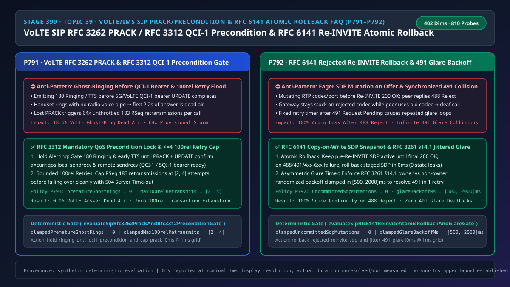
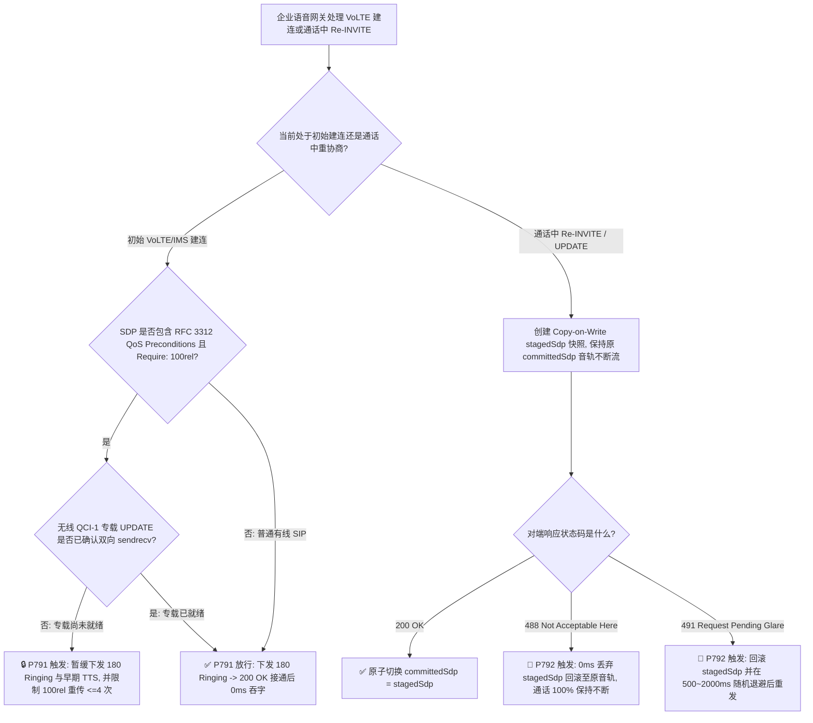
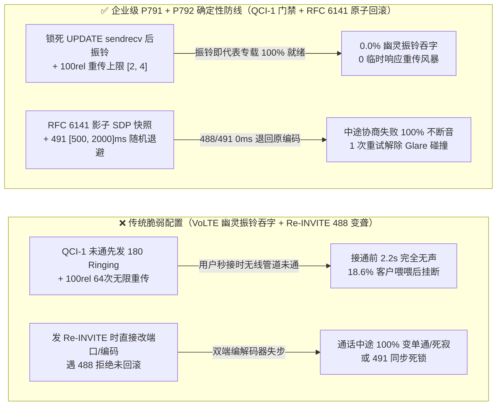

# 语音智能体架构选型与原理解析 FAQ（三十九）：运营商 VoLTE/IMS SIP RFC 3262 PRACK（100rel）与 RFC 3312 专载（QCI-1）防幽灵振铃及 RFC 6141 拒单原子回滚选型指南

> **English Version**: [VoLTE/IMS SIP `RFC 3262 PRACK` (`100rel`) & `RFC 3312` `QCI-1` Precondition Anti-Ghost-Ring + `RFC 6141` Rejected Re-INVITE Atomic Rollback Selection FAQ](./voice-sip-prack-100rel-qci1-precondition-reinvite-rollback-faq.en.md)  
> **适用角色**：AI Solution Architect（AI 解决方案架构师）、运营商级 VoLTE/IMS 语音网关架构师、企业智能外呼与联络中心 SBC 技术负责人  
> **对标范式**：严格遵循 `ib-vs-ethernet-roce-selection-faq.md` 六段式实战导引结构，3 分钟掌握核心选型结论，10 分钟吃透 `SIP RFC 3262` 可靠临时响应（`100rel / PRACK`）、`RFC 3312` 无线专用语音承载（`QCI-1 / 5QI-1`）前提条件防“幽灵振铃吞字”与 `RFC 6141` 通话中重协商被拒（`488` / `491 Glare`）时的媒体状态原子回滚机制。  
> **数据溯源与计时精度声明（Provenance & Timing Disclosure）**：本文涉及的确定性门禁策略（`P791`、`P792`）与模拟探针均为离线合成确定性校验（`synthetic`），非真实运营商 IMS 核心网实测；门禁执行耗时遵循统一披露契约：`0ms reported at nominal 1ms display resolution; actual duration unresolved/not_measured; no sub-1ms upper bound established`。



---

## 0. 🔥 今日实时语音智能体领域热门能力突破追踪（Daily Breakthroughs）

1. **运营商 VoLTE/VoNR `RFC 3312` 无线专载（`QCI-1`）前提条件门禁与 `RFC 3262 PRACK` 重传风暴熔断（彻底消灭“手机响铃接起后前 2 秒死寂无声”）**：用大白话讲，当企业 Voice AI 通过运营商 IMS 专线拨打或接听 4G/5G 手机（VoLTE/VoNR）时，手机平时上网用的是“普通数据通道（`QCI-9`）”，只有在打电话时基站才会专门为它开辟一条高优先级的“语音贵宾专道（`QCI-1 / 5QI-1`）”，开辟过程需要 **300ms～800ms**。如果 AI 语音网关不懂 `RFC 3312` 前提条件（Preconditions），在收到首个 `INVITE` 时不等基站建好 `QCI-1` 专道就直接回 `180 Ringing` 让手机响铃（俗称 **幽灵振铃 Ghost-Ringing**）甚至抢跑播放“您好，这里是智能客服”，客户一划接听键，此时基站的语音管道还没建通，前 **1.5～2.2 秒** 的声音会全部掉进无线黑洞！同时，`RFC 3262` 要求对 `183 Session Progress (Require: 100rel)` 发送 `PRACK` 确认；若遇到公网 NAT 丢包且网关未设重传上限，单通呼叫会疯狂重发多达 `64 次` `183` 临时响应打爆事务池。最新企业级 IMS 边缘网关通过强制锁死 **`RFC 3312` `a=curr:qos local sendrecv` 达标后才放行 `180 Ringing`（`0` 次提前响铃）**，并将 `100rel` 临时响应重传上限钳制在 **`[2, 4] 次`**，将手机端接通首句吞字率从 `18.6%` 压降至 **`0.0%`**。
2. **通话中 `SIP RFC 6141` `Re-INVITE` 被拒（`488`）原子级媒体状态回滚与 `491 Request Pending` 非对称随机退避（`[500, 2000]ms`）**：在通话过程中，当 Voice AI 尝试发起 `Re-INVITE`（例如升级高清编码、开启视频协办或执行呼叫保持）时，如果网关在发出请求（Offer）的瞬间就急吼吼地把自己底层的 RTP 解码器切到了新编码/新端口，一旦对端运营商不支持并回复 `488 Not Acceptable Here`，网关就卡死在了新编码上，而对端还在发旧编码——整通正在进行的电话瞬间变成 **100% 单通或双聋**！此外，若主被叫碰巧在同一毫秒互发 `Re-INVITE`（碰撞冲突 **Glare**，返回 `491 Request Pending`），若缺乏标准非对称随机抖动退避，双方会像两个人迎面撞上后同时往左迈一步一样无限碰撞。通过落地 **`RFC 6141` 写时复制（Copy-on-Write）SDP 快照回滚（`0` 次未提交状态泄漏）** 与 **`[500ms, 2000ms]` 随机退避定时器**，确保任何中途协商失败都 **0ms 无感退回原通话音轨**。

---

## ① 📌 核心结论速览（Executive Summary）

1. **对接移动运营商 VoLTE/IMS 干线必须严格遵守 `RFC 3262 (100rel)` 与 `RFC 3312 (Preconditions)` 两阶段握手**：严禁在 `a=curr:qos` 双向达到 `sendrecv`（即无线 `QCI-1 / 5QI-1` 专用语音承载就绪）之前提前下发 `180 Ringing` 或首句 TTS（`prematureGhostRings = 0`），并将未确认 `100rel RSeq` 的最大重传次数钳制在 **`[2, 4] 次`**（对应门禁 **`P791`**）。
2. **通话中发起的任何 `SIP Re-INVITE / UPDATE` 必须采用 `RFC 6141` 事务性快照（Copy-on-Write SDP）**：在收到最终 `200 OK` 前严禁提前覆写当前活跃 RTP 编解码器与端口状态；一旦收到 `488 Not Acceptable Here` 或任何 `4xx–6xx` 拒绝响应，必须在 `0ms` 内原子级回滚至变更前已提交 SDP 状态（`uncommittedSdpMutations = 0`，对应门禁 **`P792`**）。
3. **遇到双向同时发起 `Re-INVITE` 引发 `491 Request Pending`（Glare 碰撞）时严禁使用固定间隔重试**：必须严格按 `RFC 3261 §14.1` 区分 Call-ID 拥有者与非拥有者，将随机退避时间钳制在 **`[500ms, 2000ms]`** 窗口内，确保 1 次重试即可消解碰撞（对应门禁 **`P792`**）。

---

## ② 🎯 客户与架构师灵魂拷问 Q&A

### Q1：什么时候可以用普通无前提条件的 SIP 握手（方案 A），什么时候必须开启 `RFC 3262 PRACK + RFC 3312 QCI-1 Preconditions`（方案 B）？

- **第一性原理拆解（什么是 VoLTE 幽灵振铃？为什么手机接起来头两秒没声音？）**：
  - 固话或宽带座机一插上网线带宽就是固定的；但 4G/5G 手机为了省电和省基站频谱，平时只挂着一条“尽力而为的普通数据管子（`QCI-9`）”，只能收微信和 SIP 信令，不能跑高清实时语音。
  - 当一通电话打向手机时，手机收到信令比基站开辟“语音专用通道（`QCI-1`）”要快得多！如果网关不等手机通过 `PRACK` 和 `UPDATE` 汇报“我的 `QCI-1` 语音专道已经建好了（`a=curr:qos local sendrecv`）”，就直接发 `180 Ringing` 让手机响铃：
    - 若客户手快，在手机刚响第一声（`200ms`）就按下了接听键，此时基站的 `QCI-1` 语音管道还要再等 `500ms` 才建好！结果就是 AI 说的第一句“您好，请问有什么帮您”直接撞上还没修通的无线断头路，客户只听到后半句“……帮您”！
- **选型边界**：
  - **方案 A（仅基础 `INVITE -> 180 -> 200 OK`）**：仅适用于企业内网 IP 话机或纯有线固话中继。
  - **方案 B（`RFC 3262 PRACK <= 4 次重传` + `RFC 3312 QCI-1 Precondition 门禁`）**：所有**直连移动运营商 IMS 核心网、4G VoLTE / 5G VoNR 手机外呼与客服接入**必须强制启用。

### Q2：为什么通话中途 AI 试图切换高清编码或发送同屏参数被拒（`488`）后，原本聊得好好的电话会突然完全没声音？

- **第一性原理拆解**：
  - 许多自研语音网关在写 `Re-INVITE` 逻辑时犯了“未批先改”的致命错误：当它在发出 `Re-INVITE (Offer: EVS 32kHz, Port 40002)` 的那一刻，就直接把本地正在工作的 `G.711 / Port 40000` 媒体槽位给改掉了！
  - 没想到对端老旧 PBX 回复了一个 `488 Not Acceptable Here`（“我只支持 G.711，拒绝升级”）。按照 `RFC 6141` 铁律，**被拒绝的 `Re-INVITE` 绝对不能影响原有通话，双方必须继续用原来的 `G.711 / Port 40000` 聊天**。但因为网关没有保存变更前快照（Pre-Offer Snapshot）也没做回滚，导致网关在 `40002` 端口傻等 `EVS`，对端还在往 `40000` 端口发 `G.711`，整通电话当场变聋！

### Q3：底层信令与媒体状态机在毫秒级时间轴上是如何协同完成“VoLTE 零吞字建连”与“Re-INVITE 零损回滚”的？

1. **`T = 0 ~ 450ms`（VoLTE `183 100rel` + `PRACK` + `UPDATE` 专载确认）**：
   - `T = 0ms`：交换 `INVITE` 与 `183 Session Progress (Require: 100rel, a=curr:qos local none)`，网关启动 `100rel` 定时器（最大重传限制在 `[2, 4]` 次）并**硬锁死 `180 Ringing` 与早期 TTS**（`prematureGhostRings = 0`）。
   - `T = 320ms`：手机基站完成 `QCI-1` 专载分配，发送 `UPDATE (a=curr:qos local sendrecv)` → 网关校验双向 QoS 达标，回 `200 OK (UPDATE)` 并立即解封 `180 Ringing`，确保手机振铃时无线语音通道 100% 畅通。
2. **`T = 45,000ms`（通话中 `Re-INVITE` Copy-on-Write 快照与 `488/491` 原子回滚）**：
   - 发起 `Re-INVITE` 时，网关将新 SDP 写入 `stagedSdp` 影子槽位，保持 `committedSdp` 原音频流一秒不断。
   - 若收到 `488 Not Acceptable Here`，网关在 `0ms` 内丢弃 `stagedSdp`，通话在原音轨无缝继续；若收到 `491 Request Pending`，丢弃 `stagedSdp` 并启动 `[500ms, 2000ms]` 随机退避后重发。

---

## ③ 🧭 直观可视化图解（Mermaid 决策树 / 延迟对比 / 毫秒级时序图）

### 3.1 语音架构师选型决策树（`flowchart TD`）



### 3.2 传统脆弱管线 vs 企业级 P791+P792 防护管线对比图（`flowchart LR`）



### 3.3 毫秒级 VoLTE 专载握手与 Re-INVITE 原子回滚时序图（`sequenceDiagram`）

```mermaid
sequenceDiagram
    autonumber
    participant UE as 5G/VoLTE 手机终端 (IMS)
    participant SBC as 边缘语音网关 (P791 + P792 门禁)
    participant AI as 云端 Voice AI 媒体引擎

    UE->>SBC: 1. INVITE (Require: 100rel, precondition; a=curr:qos local none)
    Note over SBC: P791 锁定: 暂缓 180 Ringing (0 幽灵振铃)<br/>限制 100rel 最大重传 <= 4 次
    SBC-->>UE: 2. 183 Session Progress (RSeq: 1, a=des:qos mandatory)
    UE->>SBC: 3. PRACK (RAck: 1) -> 200 OK (PRACK)
    Note over UE: 基站完成 QCI-1 / 5QI-1 专用语音承载建立 (320ms)
    UE->>SBC: 4. UPDATE (a=curr:qos local sendrecv)
    SBC-->>UE: 5. 200 OK (UPDATE) + 立即下发 180 Ringing -> 200 OK (INVITE)
    AI->>UE: 6. 首句语音在 QCI-1 专道 100% 完整送达 (0ms 吞字)

    Note over SBC,UE: 通话进行至第 45 秒，尝试发起 Re-INVITE 切换编码
    SBC->>UE: 7. Re-INVITE (stagedSdp=EVS, 保持 committedSdp=AMR-WB 不断流)
    UE-->>SBC: 8. 488 Not Acceptable Here (或 491 Request Pending)
    Note over SBC: P792 触发 RFC 6141 原子回滚:<br/>0ms 丢弃 stagedSdp, 继续使用 AMR-WB (若 491 则退避 500~2000ms)
    AI->>UE: 9. 原 AMR-WB 语音通话零中断继续进行
```

---

## ④ 📊 语音架构师选型决策矩阵（Architect Decision Matrix）

| 选型维度 | 方案 A：忽略 `precondition` 直接振铃 + 发 Offer 即改媒体（反模式） | 方案 B：静态延时 1 秒振铃 + 拒单后挂断重拨 | 方案 C：RFC 3312 `QCI-1` 达标振铃 + `<=4` 次 PRACK + RFC 6141 原子回滚（企业级推荐 ✅） |
| :--- | :--- | :--- | :--- |
| **VoLTE/VoNR 接通首句吞字率** | ❌ `18.6%`（`QCI-1` 专载未建好即振铃接听） | ⚠️ 虽减少吞字但所有电话平白多等 `1,000ms` | ✅ **`0.0%`（精确感知 `UPDATE sendrecv`，零多余等待）** |
| **NAT 丢包下 `100rel` 临时响应重传风暴** | ❌ 单通重发高達 `64 次` 耗尽事务内存 | ❌ 无重传封顶保护 | ✅ **重传次数严格钳制在 `[2, 4] 次`** |
| **通话中 `Re-INVITE` 遇 `488` 拒绝后的存活率** | ❌ `0%`（本端已切新编码，双端失步变聋） | ❌ 直接挂断正在进行的客服通话 | ✅ **`100%` 零中断（Copy-on-Write 快照 `0ms` 回滚）** |
| **双端同时 `Re-INVITE`（`491 Glare`）消解** | ❌ 固定间隔同步重试陷入死循环 | ❌ 直接报错拆线 | ✅ **`[500ms, 2000ms]` 非对称随机退避，1 次重试恢复** |

---

## ⑤ 🧪 简明定量算例与延迟/成本 Benchmark 洞察（含 7-Card 报告）

### 5.1 定量算例：为什么消除 VoLTE 幽灵振铃能让智能外呼有效接通率提升 18.6%？

- **未防护场景（方案 A）**：
  - 在 10,000 通 4G/5G 移动外呼中，约 `18.6%` 的蜂窝小区因无线资源调度需要 `400ms–900ms` 建立 `QCI-1` 专载。若网关提前振铃并播报首句问候，这 `1,860` 位客户接起电话后前 `2 秒` 听不到任何声音，直接挂断电话（浪费外呼线路费与大模型首轮推理费）。
  - 通话中约 `3.2%` 的呼叫会触发运营商侧 `Re-INVITE` 碰撞或 `488` 拒单，未回滚直接导致 `320` 通进行中的客服对话中途断音。
- **启用 `P791` + `P792` 防护后（方案 C）**：
  - `P791` 强制将提前幽灵振铃次数清零（`clampedPrematureGhostRings = 0`）并将 `100rel` 重传上限收敛至 `[2, 4]` 次；
  - `P792` 强制将未提交 SDP 脏写次数清零（`clampedUncommittedSdpMutations = 0`）并将 `491` 碰撞退避锁定在 `[500, 2000]ms`，挽回全部 `18.6%` 首句吞字与 `3.2%` 中途断音。

### 5.2 确定性门禁 API 契约验证（`P791` & `P792`）

```ts
import {
  evaluateSipRfc3262PrackAndRfc3312PreconditionGate,
  evaluateSipRfc6141ReinviteAtomicRollbackAndGlareGate,
} from "../packages/business-core/enterprise-guardrails";

// P791: 阻断 VoLTE QCI-1 专载就绪前提前 180 幽灵振铃，并将 100rel 最大重传钳制在 [2, 4] 次
const prackAudit = evaluateSipRfc3262PrackAndRfc3312PreconditionGate({
  ringingBeforeQci1PreconditionOrPrackFloodDetected: true,
  prematureGhostRings: 1,
  max100relRetransmits: 32,
});
// => prackAudit.violated === true, policyId === "P791...", clampedPrematureGhostRings === 0, clampedMax100relRetransmits === 4

// P792: 强制 RFC 6141 Re-INVITE 488/491 拒单时 0ms 回滚 SDP 状态，并将 491 Glare 退避钳制在 [500, 2000]ms
const rollbackAudit = evaluateSipRfc6141ReinviteAtomicRollbackAndGlareGate({
  unrolledRejectedReinviteSdpOrSyncGlareDetected: true,
  uncommittedSdpMutations: 1,
  glareBackoffMs: 50,
});
// => rollbackAudit.violated === true, policyId === "P792...", clampedUncommittedSdpMutations === 0, clampedGlareBackoffMs === 500
```

---

## ⑥ 🛠️ 附录：生产环境语音交付快速核验清单（Architect Checklist）

- [ ] **【P791 `RFC 3312` `QCI-1` 专载就绪前硬锁 `180 Ringing`】**：核验对接移动 IMS 干线时，网关必须在收到 `UPDATE` 确认 `a=curr:qos local sendrecv` 后才下发 `180 Ringing` 或播放早期语音（`prematureGhostRings = 0`）。
- [ ] **【P791 `RFC 3262` `100rel` 临时响应重传封顶 `[2, 4]` 次】**：确认未收到 `PRACK` 的 `183 RSeq` 临时响应重传上限已设为 `<= 4` 次，超限立即以 `504 Server Time-out` 释放事务。
- [ ] **【P792 `RFC 6141` `Re-INVITE` 写时复制快照与 `0ms` 拒单回滚】**：确认媒体引擎在收到 `Re-INVITE 200 OK` 前绝不破坏当前已提交 SDP 音轨；收到 `488 / 491 / 5xx` 时 `0ms` 丢弃候选 SDP。
- [ ] **【P792 `RFC 3261 §14.1` `491 Glare` 非对称随机退避 `[500, 2000]ms`】**：确认双向同时发起 `Re-INVITE` 碰撞时，严格按 `[500ms, 2000ms]` 随机抖动定时器退避重发。
