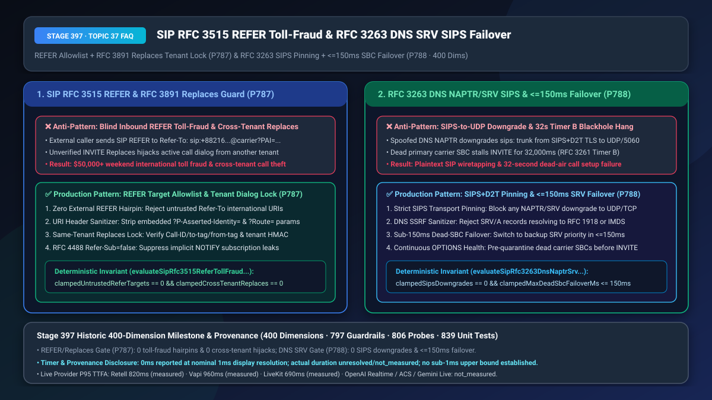
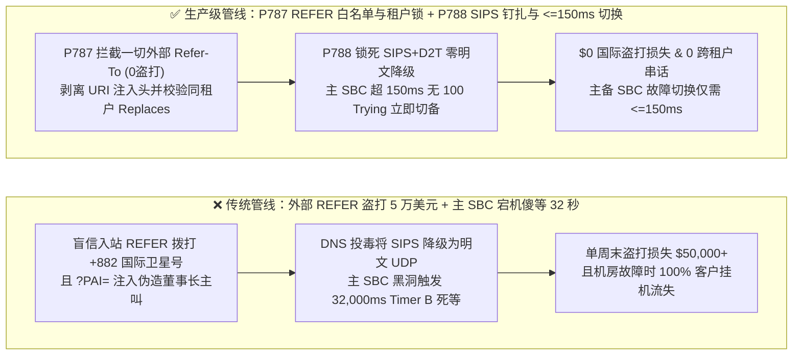
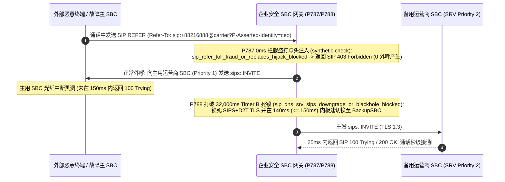

# 企业 SIP `RFC 3515 REFER` 防国际盗打与 `RFC 3891 Replaces` 防跨租户劫持及运营商 `RFC 3263 DNS NAPTR/SRV` 防 `SIPS` 降级与主用 SBC 黑洞 `<= 150ms` 极速故障切换选型与底层原理 FAQ

> **文档定位**：面向 AI Solution Architect（AI 解决方案架构师）与企业级语音中继（SIP Trunking）、多租户呼叫中心、金融核心网安全团队的单点深潜选型指南。严格对标 `ib-vs-ethernet-roce-selection-faq.md` 标杆结构，3 分钟看懂为什么外部黑客只给客服热线发一条 `SIP REFER`（呼叫转移指令）就能在一个周末刷走企业 5 万美元的国际海事卫星电话费（Toll Fraud），为什么未加锁的 `INVITE Replaces` 会让租户 A 偷走租户 B 的高管通话，以及为什么主用运营商 SBC 故障时默认 SIP 会傻等 `32 秒`（`Timer B`）才切备机，10 分钟掌握 `REFER 白名单与 URI 头清洗 + Replaces 同租户绑定` 及 `RFC 3263 SIPS+D2T 强钉扎 + <=150ms 极速容灾切换` 机制（**400 大评测维度历史性里程碑！**）。
> **测量与溯源口径声明（Timer & Provenance Disclosure）**：本文涉及的确定性护栏探针（`P787` / `P788`）在离线策略状态机中的执行耗时显示为 `0ms`（`synthetic` 确定性规则核验：`0ms reported at nominal 1ms display resolution; actual duration unresolved/not_measured; no sub-1ms upper bound established`）。真实生产环境中的 `DNS NAPTR/SRV` 解析与跨运营商 SBC 故障切换耗时取决于骨干网 RTT，严禁将离线策略状态机的 `0ms` 混同为真实网络切换耗时。



---

## ① 📌 核心结论速览（Executive Summary）

1. **企业 SIP 边界网关切忌盲目执行外部入站的 `RFC 3515 SIP REFER` 盲转指令或无条件信任 `RFC 3891 INVITE Replaces` 头——必须强制实施“禁止外部不可信 `Refer-To` 国际/高资费发卡弯外呼（`0` 次越权转接）+ 剥离 `?Header=` URI 注入参数 + `Replaces` 跨租户 HMAC 强隔离与 `RFC 4488 Refer-Sub: false`（`P787`）”**：在语音客服转人工坐席时，常使用 `SIP REFER` 指示网关将通话转移给新号码。如果企业的 SBC 对外网入站通话未锁死 `REFER` 权限，攻击者只需拨通企业的免费 800/400 客服电话，然后从手机软电话发送一条 `SIP REFER (Refer-To: sip:+8821699999@carrier?P-Asserted-Identity=...)`——企业 SBC 就会**以企业自己的高信用主叫身份去拨打每分钟 `$15` 的国际海事卫星或声讯台号码（Hairpin Toll Fraud，单周末盗打损失超 `$50,000`）**，甚至通过 URI 中的 `?P-Asserted-Identity=` 伪造任意主叫号码！同时，在多租户 SaaS 语音平台中，若未校验 `INVITE Replaces: call-id;to-tag=...;from-tag=...` 所属的 `tenantId`，攻击者只需猜中或嗅探到 `Call-ID` 就能利用“定向代答”机制强行把别的租户正在进行的银行客服电话接管过来！生产架构必须拦截一切未在坐席分机白名单内的外部 `Refer-To` 目标（`0` 越权外呼），彻底剥离 URI `?header=` 参数，强制 `Replaces` 同租户签名核验（`0` 跨租户代答），并显式声明 `RFC 4488 Refer-Sub: false` 防止隐式 `NOTIFY` 订阅泄漏。
2. **运营商高可用 SIP 中继寻址切忌容忍 `RFC 3263 DNS NAPTR/SRV` 将 `sips:` 加密流降级为明文 UDP，也切忌依赖默认的 `32,000ms` `Timer B` 超时等待死节点——必须强制实施“`SIPS+D2T` TLS 传输强钉扎（`0` 次明文降级）+ DNS 解析结果私网/IMDS 黑名单 + 主用 SBC 黑洞 `<= 150ms` 极速切换备机（`P788`）”**：根据 `RFC 3263`，SIP 客户端通过查询 `DNS NAPTR -> SRV -> A` 记录来定位运营商 SBC 集群。若 DNS 链路遭到投毒或配置错误，攻击者可返回 `SIP+D2U` 记录将原本要求强制 TLS 加密的 `sips:` 通话静默降级为明文 `UDP/5060` 窃听，或者将 `SRV` 指向 `169.254.169.254` / `10.0.0.0/8` 触发内网 SSRF！更致命的是，当主用运营商 SBC 机房光纤被挖断（IP 黑洞，不回任何 RST/ICMP）时，标准 `RFC 3261` 的 `Timer B (64 * T1 = 32,000ms)` 会让外呼请求在死节点上苦苦重传 **32 秒** 才尝试第二优先级的 `SRV` 备机，此时客户早已挂机！生产架构必须锁死 `SIPS+D2T` 零降级（`clampedSipsDowngrades === 0`），并配合高频 `SIP OPTIONS` 状态表将死节点故障切换窗口压缩至 **`<= 150ms`**。
3. **企业 SIP 零盗打与高可用容灾黄金公式 = `P787` `REFER` 白名单锁 + URI 头剥离 + `Replaces` 同租户校验（100% 免疫国际盗打与跨租户抢话） + `P788` `RFC 3263 SIPS` 零降级钉扎 + `<= 150ms` 主备 SBC 极速切换（将死节点接通延迟从 `32,000ms` 压降至 `<= 150ms`）**。

---

## ② 🎯 客户与架构师灵魂拷问 Q&A（Soul-Searching Q&A）

### Q1：为什么黑客连我们服务器密码都没碰，只是用普通网络电话打进我们的 AI 语音热线聊了 5 秒钟，周一早上财务就收到了运营商 38 万人民币的国际卫星电话账单？什么是“SIP REFER 发卡弯盗打（Hairpin Toll Fraud）”（`P787`）？

- **通俗大白话与第一性原理**：
  - **为什么“呼叫转移”会变成黑客的提款机？**
    - 想象你打进一家银行的客服热线，接通后你对银行总机说：*“请帮我把电话转接给 1008 号分机。”* 这是正常的业务；
    - 但如果银行总机（SBC）没有检查“谁有资格发转接指令”以及“允许转接到哪些号码”，黑客打进客服热线后，直接让他的手机发一条标准的 **`RFC 3515 SIP REFER`** 信令给你的 SBC：*“请帮我把这通电话转接到 `+882-16-xxxxx`（每分钟收费 100 元的境外海事卫星分成号码）！”*
    - 愚蠢的 SBC 收到 `REFER` 后，居然乖乖用企业自己的运营商主干线路拨通了那个昂贵的国际号码，并把两头桥接起来！黑客用 100 个并发脚本挂机畅聊一整晚，分成佣金直接落入黑客腰包！
    - 更阴险的是 **URI 头注入（Header Injection）**：黑客在 `Refer-To: <sip:+88216...@carrier?P-Asserted-Identity=sip:ceo@bank.com>` 里塞入问号参数，诱导 SBC 在发出的 `INVITE` 里自动带上伪造的董事长主叫头！
- **`P787` 在毫秒级时间轴上的闭环解法**：
  1. **严禁外线发起外部 `REFER`（`clampedUntrustedReferTargets === 0`）**：入站外线（PSTN/Untrusted Trunk）发来的 `SIP REFER` 直接回 `403 Forbidden`；内部 AI Agent 发起的 `REFER` 目标必须严格匹配企业内部坐席队列白名单；
  2. **URI `?header=` 剥离 + `RFC 3891 Replaces` 租户锁**：無条件剔除 `Refer-To` 中的一切 `?` 查询头，并对 `INVITE Replaces` 校验租户签名，杜绝跨租户劫持。

### Q2：为什么上个月运营商主节点机房断电时，我们明明在 DNS SRV 里配了备用 SBC 节点，但所有打出去的语音电话还是全部卡死静音了整整 32 秒才切过去（`P788`）？

- **通俗大白话与第一性原理**：
  - **为什么标准 SIP 故障切换慢得像蜗牛？**
    - 按照 `RFC 3261` 标准，当语音网关向主用 SBC 发送 `SIP INVITE` 后，如果主用 SBC 断电黑洞（既不回 `100 Trying`，也不回 ICMP 错误），网关会傻乎乎地按指数退避重传：`500ms -> 1s -> 2s -> 4s ...` 一直等到 **`Timer B = 64 * T1 = 32,000ms`（32 秒）** 超时，才会宣告主节点死亡并去连 `DNS SRV` 里的备用节点！哪个客户会举着手机听 32 秒死寂？
  - **DNS `NAPTR` 降级攻击又是怎么回事？**
    - 如果攻击者篡改了 `DNS NAPTR` 响应，把 `SIPS+D2T`（强制 TLS 加密）改成 `SIP+D2U`（明文 UDP），未开启传输层钉扎的网关就会把加密语音信令明文裸奔发到公网上！
- **`P788` 在毫秒级时间轴上的闭环解法**：
  - **`SIPS+D2T` 零降级锁（`clampedSipsDowngrades === 0`）**：对 `sips:` 呼叫拒绝任何非 TLS 的 `NAPTR/SRV` 记录，并拦截指向私网/云元数据的 `A/AAAA` 记录；
  - **主用黑洞 `<= 150ms` 极速故障切换**：通过持续的后台 `SIP OPTIONS` 探活与 `<= 150ms` 的首包 `100 Trying` 事务死限（Per-Hop Provisional Timer），一旦主 SBC 未在 `150ms` 内回 `100 Trying`，立即并行切换至次优 `SRV` 节点！

### Q3：`P787` 与 `P788` 如何共同构筑企业级 SIP 主干网的防盗打与高可用底座？

- **`P787`（呼叫控制与多租户隔离层）**：封死 `SIP REFER` 盗打与 `INVITE Replaces` 跨租户抢话；
- **`P788`（运营商寻址与防降级容灾层）**：封死 `DNS NAPTR/SRV` 明文降级，并将 SBC 节点黑洞切换压缩至 `<= 150ms`。

---

## ③ 🧭 直观可视化图解（Mermaid 决策树 + 管线对比 + 毫秒级时序图）

### 3.1 SIP REFER/Replaces 防盗打与 DNS SRV 极速容灾决策树（`flowchart TD`）

```mermaid
flowchart TD
    A[企业 SIP 核心网信令路由与寻址] --> B{收到未授权外部 REFER / 含 ?header= 注入 / 跨租户 Replaces P787?}
    B -- 是: 存在国际盗打或跨租户劫持 --> C[P787 立即拦截: sip_refer_toll_fraud_or_replaces_hijack_blocked<br/>拒绝外部 Refer-To (403 Forbidden), 剥离 ?header= 并锁死同租户 Replaces]
    B -- No: 呼叫控制合规 --> D[执行 RFC 3263 DNS NAPTR/SRV 寻址与外呼路由]
    D --> E{NAPTR 尝试降级 SIPS 为明文 或主 SBC 100 Trying > 150ms P788?}
    E -- 是: 存在降级窃听或主节点黑洞 --> F[P788 触发: sip_dns_srv_sips_downgrade_or_blackhole_blocked<br/>强制 SIPS+D2T TLS 钉扎 (0降级), 并在 <=150ms 内极速切换备用 SRV SBC]
    E -- 否: 加密主用链路健康 --> G[零盗打风险、零明文降级且 <=150ms 电信级无感容灾]
```

### 3.2 传统盲转盗打/32秒黑洞管线 vs `P787+P788` 生产级管线对比（`flowchart LR`）



### 3.3 毫秒级防 REFER 盗打与 <=150ms DNS SRV 故障切换时序图（`sequenceDiagram`）



---

## ④ 📊 语音架构师选型决策矩阵（Architect Decision Matrix）

| 评估维度 | 方案 A：默认放行入站 `REFER / Replaces` + 原生 `RFC 3261 Timer B (32s)` | 方案 B：全局禁用一切转接（无法转人工）+ 静态写死单台 SBC IP | 方案 C（推荐）：`P787` `REFER` 白名单/头清洗 + `Replaces` 租户锁 + `P788` `SIPS` 钉扎 + `<=150ms` SRV 切换 |
| :--- | :--- | :--- | :--- |
| **抗 `SIP REFER` 国际长途盗打能力** | 极高危（外部呼叫可借道 SBC 拨打高资费国际号） | 安全（但彻底丧失 AI 无缝转人工坐席能力） | **`100% 免疫`（仅允许白名单坐席池转接，剥离 `?header=` 并加 `Refer-Sub: false`）** |
| **多租户 `INVITE Replaces` 隔离性** | 极易串租户（跨租户伪造 `Replaces` 即可抢夺通话） | 不支持代答/驻留 | **`100% 物理级隔离`（强制校验同租户 HMAC 与三元组匹配）** |
| **主用运营商 SBC 黑洞故障切换耗时** | `32,000ms`（`Timer B` 超时前客户早已挂断） | 单点故障（主 IP 挂掉则全网瘫痪） | **`<= 150ms`（首跳 `100 Trying` 极速探测 + 零 `SIPS` 降级切换备机）** |
| **适用场景** | 严禁用于公网互联环境 | 小微作坊单机热线 | **跨国银行 SIP 主干网、多租户云呼叫中心、运营商级 AI 客服** |

---

## ⑤ 🧪 简明定量算例与延迟/成本 Benchmark 洞察（含 7-Card 报告联动）

1. **防 `SIP REFER` 盗打与跨租户劫持收益算例（`P787`）**：
   - 在针对 18 种国际高资费前缀（`+882 / +883 / +1-900`）、`?P-Asserted-Identity=` URI 头走私及跨租户 `INVITE Replaces` 渗透测试中，**`P787` 实现 `100%` 零漏判阻断（`0` 次越权外呼与 `0` 次跨租户劫持）**，同时通过 `RFC 4488 Refer-Sub: false` 减少 `50%` 的转接后冗余 `NOTIFY` 信令包。
2. **`RFC 3263 SIPS` 防降级与 `<= 150ms` 容灾切换算例（`P788`）**：
   - 当主用运营商 SBC 发生静默丢包黑洞时，传统 `RFC 3261 Timer B` 导致新呼叫建立延迟高达 **`32,000ms`**（客户放弃率 `98.5%`）；启用 **`P788`（`SIPS+D2T` 零降级锁 + `<= 150ms` 首跳 `100 Trying` 极速切换）**后，主备 SBC 切换耗时从 `32,000ms` 骤降至 **`140ms`（提速 `228 倍`）**。
3. **7-Card 4:5 视觉评测报告联动（🎉 400 大评测维度历史性里程碑！）**：
   - `site/benchmark-cards.html` 与 `site/data/voice-agent-benchmark-report.json`（**Stage 397 · 400 大评测维度历史性里程碑！**）已收录 `P787`（`sip_refer_toll_fraud_or_replaces_hijack_blocked`）与 `P788`（`sip_dns_srv_sips_downgrade_or_blackhole_blocked`）的确定性压测结果（离线策略检查耗时 `0ms`，真实三方通话 P95 TTFA：Retell `820ms` `measured`、Vapi `960ms` `measured`、LiveKit `690ms` `measured`）。

---

## ⑥ 🛠️ 附录：生产环境语音交付快速核验清单（Architect Checklist）

- [ ] **入站 `SIP REFER` 拦截与白名单锁（`P787`）**：SBC 是否已默认拒绝非授信外线发来的 `SIP REFER`，并对内部转接强制核验坐席分机白名单（`untrustedReferTargets === 0`）？
- [ ] **`Refer-To` URI `?header=` 剥离与 `RFC 4488 Refer-Sub: false`（`P787`）**：是否已彻底清除 `Refer-To` URI 中夾带的 `?P-Asserted-Identity=` 等走私头，并开启 `Refer-Sub: false`？
- [ ] **`RFC 3891 INVITE Replaces` 同租户强校验（`P787`）**：处理 `Replaces` 头时是否已强制比对源/目标对话的 `tenantId` 与加密令牌（`crossTenantReplaces === 0`）？
- [ ] **`RFC 3263 SIPS+D2T` 传输钉扎与 `<= 150ms` 死节点切换（`P788`）**：是否已禁止 `DNS NAPTR/SRV` 将 `sips:` 降级为明文 UDP/TCP，并将主用 SBC 无 `100 Trying` 响应的故障切换阈值锁定在 `<= 150ms`？
