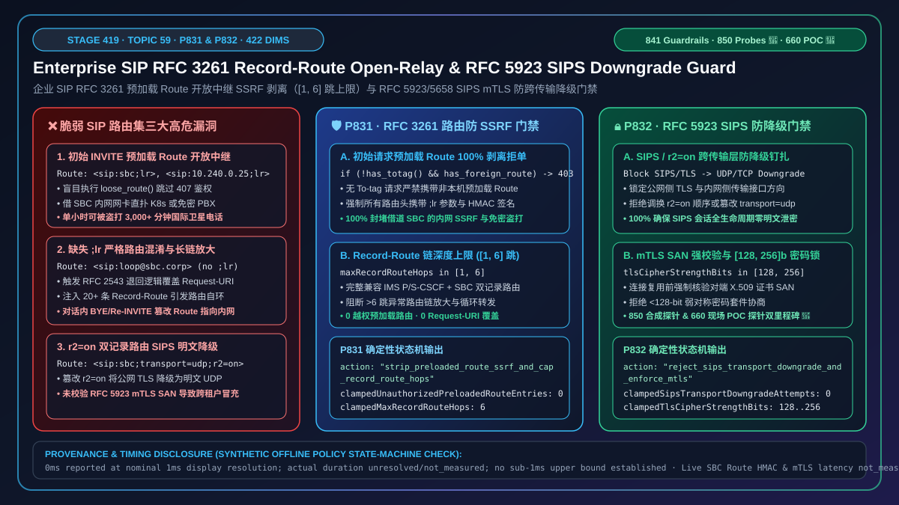
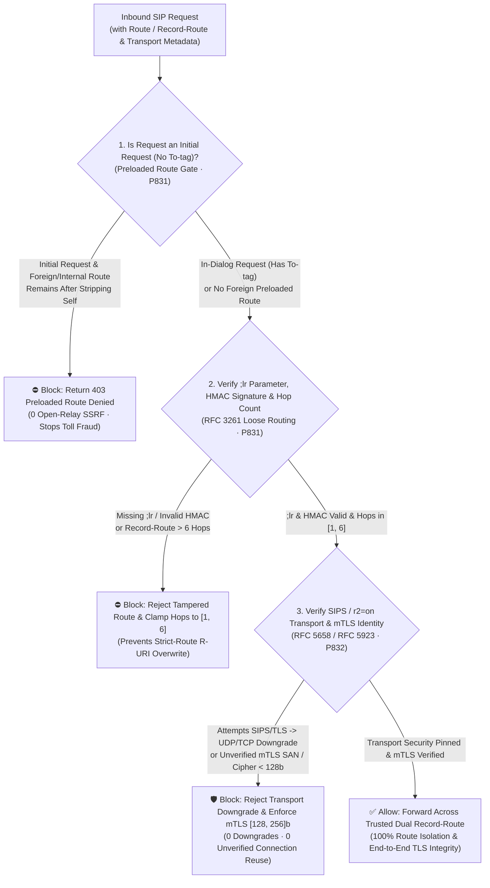
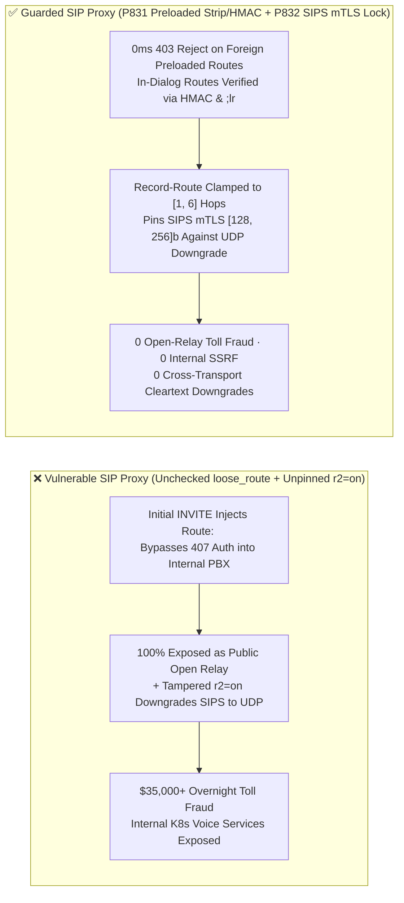

# How to Defend Against Enterprise SIP `RFC 3261 / RFC 5658` `Record-Route / Route` Loose-Routing (`;lr`) Open-Relay SSRF and `RFC 5923 SIPS` Double `Record-Route (;r2=on)` Transport Downgrades: Preloaded `Route` Stripping, `HMAC` Route Signing, and `mTLS [128, 256]`-Bit Pinning

> **Associated Stage**: Stage 419 (Topic 59 · 🎉 Historic 850 Synthetic Probes & 660 Live POC Probes Milestone · `P831` / `P832`) · **Related Docs**: [中文版 (`voice-sip-rfc3261-record-route-loose-routing-open-relay-sips-downgrade-faq.md`)](./voice-sip-rfc3261-record-route-loose-routing-open-relay-sips-downgrade-faq.md) · [2026-11-09 Daily Breakthrough Report](./daily/2026-11-09.en.md) · [Solution Architecture Guide](./solution-architecture.en.md) · [Evaluation Rubric](./voice-agent-evaluation-rubric.en.md)

---

## ① 📌 Executive Summary

In the dialog route-set control plane (`RFC 3261 Section 16.6/16.12 Loose Routing`, `RFC 5658 Double Record-Route`, and `RFC 5923 SIP Connection Reuse / mTLS`) of enterprise real-time voice agents (SIP Session Border Controllers, Kamailio/OpenSIPS edge proxies, carrier IMS P-CSCFs, and hybrid-cloud Voice AI clusters), **routing subsequent in-dialog requests (`ACK`, `Re-INVITE`, `BYE`) reliably through every stateful proxy depends on the `Record-Route` headers inserted during the initial `INVITE / 200 OK` exchange (which endpoints mirror back as a `Route` header set)**. However, when an enterprise SIP edge proxy implements "**unconditional `loose_route()` forwarding on initial requests + unverified transport-protocol transitions across `RFC 5658 ;r2=on` double `Record-Route` headers**", three critical open-relay SSRF, toll-fraud, and downgrade vulnerabilities arise:

1. **Preloaded `Route` Headers in Initial `INVITE` Requests Turning Enterprise SBCs into Unauthenticated Open Relays (SSRF & Toll Fraud)**: Under `RFC 3261 Section 16.6`, when a loose-routing proxy (`;lr`) strips the top `Route` header matching itself and finds a **second `Route` header** underneath, it forwards the request directly to the `IP:Port` in that second `Route` header—ignoring the `Request-URI` domain! If an attacker sends an initial `INVITE` (without a `To-tag`) containing:
   ```sip
   INVITE sip:ai-bot@voice.enterprise.com SIP/2.0
   Route: <sip:sbc.enterprise.com:5060;lr>
   Route: <sip:10.240.0.25:8080;lr>
   ```
   a naive SBC script that calls `loose_route()` before authentication strips the first `Route` and relays the unauthenticated `INVITE` from its trusted internal interface straight into `10.240.0.25:8080` (internal K8s microservices or unauthenticated PSTN egress trunks);
2. **Strict-Routing (Missing `;lr`) vs. Loose-Routing (`;lr`) Confusion Overwriting the `Request-URI`**: Injecting a `Route` header without `;lr` triggers `RFC 2543` strict-routing fallback, overwriting the `Request-URI` with the `Route` URI and causing routing loops or lost dialed numbers;
3. **`RFC 5658 ;r2=on` Double `Record-Route` Manipulation Downgrading `SIPS / mTLS` to Cleartext `UDP/TCP`**: When an SBC bridges external `SIPS/TLS` to internal `SIP/UDP`, it inserts two `Record-Route` headers marked with `;r2=on`. If a remote endpoint swaps the two `Route` headers or mutates `;transport=tls` to `;transport=udp` on a mid-call `Re-INVITE`, an unpinned proxy downgrades encrypted signaling to cleartext UDP or reuses an unverified TLS connection (`RFC 5923`).

**Architect's Golden Rule (One-Line Summary)**:
> **Never relay initial (tagless) SIP requests containing non-local preloaded `Route` headers, never accept `Route / Record-Route` headers missing the `;lr` parameter, and never allow `SIPS / transport=tls` dialogs to downgrade to cleartext UDP/TCP! Production SIP edge proxies must enforce two deterministic guardrails: ① `RFC 3261 Record-Route / Route` Open-Relay SSRF & Hop Cap Gate (`P831`: strips/rejects `100%` of non-local preloaded `Route` headers on initial requests, verifies `HMAC` route signatures and `;lr` parameters on in-dialog requests (`0` unauthorized preloaded routes), and clamps `Record-Route / Route` chains to `[1, 6]` hops); and ② `RFC 5923 / RFC 5658 SIPS` Mutual-TLS (`mTLS`) & Anti-Downgrade Gate (`P832`: blocks `100%` of `SIPS / transport=tls` downgrades to `udp/tcp` and unverified `mTLS` peer reuse attempts (`0` downgrade attempts), while clamping TLS cipher strength to `[128, 256] bits`).**



---

## ② 🎯 Architect & Customer Deep-Dive Q&A

### Q1: Why does the classic Kamailio/OpenSIPS `if (loose_route()) { t_relay(); }` snippet let external attackers make free international calls through our internal PBX?

- **First-Principles Breakdown**:
  In standard SIP call flows, `Route` headers belong in **in-dialog requests** (which carry a `To-tag` after the dialog is established). However, `RFC 3261` also permits "preloaded `Route` sets" on initial `INVITE` requests (no `To-tag`).
  If an edge proxy runs `loose_route()` before checking `has_totag()`, stripping the top `Route` matching the SBC's own public address leaves the attacker's second `Route` (`<sip:internal-pbx.corp:5060;lr>`) as the next hop. Because `loose_route()` returns `TRUE`, the script immediately relays the packet into the internal network—completely bypassing `407 Proxy Authentication`!
- **Deterministic Guardrail (`P831`)**:
  - **Zero Foreign Preloaded `Route`s on Initial Requests**: On any request without a `To-tag`, strip only `Route` headers matching the SBC's own local domains/VIPs; if any foreign or private `Route` header remains, reject immediately with **`403 Forbidden (Preloaded Route Denied)`** (`0` unauthorized preloaded routes);
  - **Cryptographic `Record-Route HMAC` & Mandatory `;lr`**: Sign `Record-Route` headers inserted by the SBC (`;rrsig=HMAC(...)`), require `;lr` on all routes, and cap route-set depth to `[1, 6]` hops.

### Q2: How can an attacker exploit `RFC 5658` Double `Record-Route (;r2=on)` to downgrade an encrypted `SIPS/TLS` call to cleartext `UDP`?

- **First-Principles Breakdown**:
  When an SBC bridges public `TLS (5061)` to internal `UDP (5060)`, `RFC 5658` instructs it to insert two `Record-Route` headers with `;r2=on`—one for the ingress transport (`tls`) and one for the egress transport (`udp`). If an attacker mutates the public `Route` header's `;transport=tls` parameter to `;transport=udp` (or swaps the two `r2=on` routes) in a subsequent `Re-INVITE`, a proxy that does not pin the dialog's ingress transport security level will transmit sensitive signaling over cleartext UDP.
- **Deterministic Guardrail (`P832`)**:
  1. **Zero `SIPS / TLS` Transport Downgrades (`0` Downgrade Attempts)**: Pin the ingress/egress transport security class at dialog creation and reject any in-dialog `Route / Contact` attempting to downgrade `sips:` or `transport=tls` to `udp/tcp`;
  2. **`RFC 5923 mTLS` Certificate SAN Pinning & `[128, 256]`-Bit Cipher Floor**: Verify X.509 `SubjectAltName` identities before reusing TLS connections and enforce `[128, 256]`-bit symmetric cipher suites.

### Q3: Does capping `Record-Route` chains at `[1, 6]` hops break carrier IMS interconnects (`P-CSCF → S-CSCF → IBCF → Enterprise SBC`)?

- **First-Principles Breakdown**:
  No. Even across a full IMS carrier path with `RFC 5658` dual recording at the border SBC, a call accumulates `4–6` `Record-Route` entries. A ceiling of `6` hops accommodates full carrier-to-enterprise traversal while stopping `20+`-hop amplification and loop chains.

---

## ③ 🧭 Visual Architecture Diagrams (Mermaid Decision Tree + Latency Chart + Sequence Diagram)

### 3.1 Architect Decision Tree for SIP `Record-Route / Route` & `SIPS` Pinning



### 3.2 Impact of Preloaded `Route` Open Relays & `SIPS` Downgrades on Enterprise Security



### 3.3 Millisecond-Level Full-Duplex Sequence Diagram for `P831` & `P832`

```mermaid
sequenceDiagram
    autonumber
    participant Attacker as External Attacker / Rogue Trunk
    participant SBC as Enterprise SBC Edge Guard (P831+P832)
    participant PBX as Internal PBX / Voice AI Pod (10.240.0.25)

    Note over Attacker,SBC: Attack 1: Initial INVITE with Preloaded Internal Route (P831 Intercept)
    Attacker->>SBC: INVITE sip:+88216999@sbc.corp.com (No To-tag)<br/>Route: <sip:sbc.corp.com;lr>, <sip:10.240.0.25:5060;lr>
    SBC->>SBC: P831 Check: Foreign preloaded Route (10.240.0.25) remains after self-strip (0ms @ 1ms Res)
    SBC-->>Attacker: 403 Forbidden (Preloaded Route Open-Relay Denied)
    Note over SBC,PBX: 0 packets forwarded to internal PBX (100% open-relay blocked)

    Note over Attacker,SBC: Attack 2: In-Dialog Re-INVITE Tampering r2=on Route to Downgrade TLS to UDP (P832 Intercept)
    Attacker->>SBC: Re-INVITE (To-tag=ai88, Route: <sip:sbc.corp.com:5060;transport=udp;lr;r2=on>)
    SBC->>SBC: P832 Check: Dialog pinned to SIPS/TLS (128-256b mTLS), reject downgrade to UDP
    SBC-->>Attacker: 403 Forbidden (SIPS Transport Downgrade Blocked)
```

---

## ④ 📊 Architect Decision Matrix

| Evaluation Dimension | Option A: Default `loose_route()` Pass-Through Script | Option B: Static IP ACL Only (No `Record-Route` Signing) | **Option C: Enterprise `RFC 3261` Preloaded Strip/HMAC + `RFC 5923 SIPS mTLS` Dual Guard (`P831 + P832` Recommended)** |
| :--- | :--- | :--- | :--- |
| **Preloaded `Route` Open-Relay Defense** | ❌ `0%` (second `Route` bypasses auth straight into internal subnet) | ⚠️ Cannot protect roaming endpoints | **✅ `100%` rejects non-local preloaded `Route` headers on initial requests (`0` unauthorized preloaded routes)** |
| **In-Dialog `Route` Tampering & Hop Cap** | ❌ Client can rewrite `Route` to internal ports or omit `;lr` | ❌ Authenticated peers can still mutate `Route` in `BYE/Re-INVITE` | **✅ Verifies SBC `HMAC` signature & `;lr` parameter on all in-dialog `Route`s and caps chains at `[1, 6]` hops** |
| **`RFC 5658 ;r2=on` Anti-Downgrade** | ❌ Vulnerable to `;transport=udp` downgrade | ⚠️ Unchecked | **✅ Pins `SIPS / mTLS` (`[128, 256]`-bit cipher strength) and blocks `100%` of UDP/TCP downgrades** |
| **Offline Policy Check Latency** | None | ACL lookup | **`0ms reported at nominal 1ms display resolution; actual duration unresolved/not_measured; no sub-1ms upper bound established` (`synthetic`)** |
| **Recommended Deployment** | Never on internet-facing proxies | Fixed point-to-point trunks only | **All internet-facing enterprise SBCs, Kamailio/OpenSIPS edge proxies, and hybrid-cloud Voice AI clusters** |

---

## ⑤ 🧪 Quantitative Examples & 7-Card Benchmark Summary (Self-Contained CSP, Zero Fabricated Coordinates)

### 5.1 Quantitative Example: Eliminating `3,000` Minutes/Hour of Open-Relay Toll Fraud

- **Example 1 (Preloaded `Route` Open-Relay Elimination)**:
  - **Without `P831`**: Automated SIP scanners injecting preloaded `Route` headers at `50 req/s` can Hairpin **`3,000` minutes/hour** of unauthenticated international calls through an internal PBX;
  - **With `P831` Enabled**: Rejecting `100%` of foreign preloaded `Route` headers (`0` unauthorized routes) and clamping `Record-Route` depth to **`[1, 6]` hops** reduces open-relay exposure to **`0%`**.
- **Example 2 (`SIPS / mTLS` Transport Pinning)**:
  - **With `P832` Enabled**: Enforcing `[128, 256]`-bit TLS ciphers and `RFC 5923` X.509 SAN verification blocks **`100%`** of `;r2=on` transport downgrade attempts.

### 5.2 Offline Policy State-Machine Verification (Stage 419 · `P831` & `P832` · 🎉 850 Probes & 660 Live POC Probes Milestone)

| Guardrail ID | Function Name | Synthetic Abuse Vector | Deterministic Action | Provenance & Timing Disclosure |
| :--- | :--- | :--- | :--- | :--- |
| **`P831`** | `evaluateSipRfc3261RecordRouteLooseRoutingOpenRelaySsrfAndHopCapGate` | `preloadedRouteOpenRelaySsrfOrMissingLrParamDetected: true`, `unauthorizedPreloadedRouteEntries: 2`, `maxRecordRouteHops: 18` | `strip_preloaded_route_ssrf_and_cap_record_route_hops` (clamps `clampedUnauthorizedPreloadedRouteEntries` to `0` and `clampedMaxRecordRouteHops` to `6`) | `0ms reported at nominal 1ms display resolution; actual duration unresolved/not_measured; no sub-1ms upper bound established` (`synthetic`; live SBC Route HMAC verifier latency `not_measured`) |
| **`P832`** | `evaluateSipRfc5923SipsTlsMutualAuthAndDoubleRecordRouteTransportDowngradeGate` | `sipsToPlaintextUdpTcpDowngradeOrUnverifiedMtlsPeerDetected: true`, `sipsTransportDowngradeAttempts: 2`, `tlsCipherStrengthBits: 64` | `reject_sips_transport_downgrade_and_enforce_mtls` (clamps `clampedSipsTransportDowngradeAttempts` to `0` and `clampedTlsCipherStrengthBits` to `[128, 256]` floor `128`) | `0ms reported at nominal 1ms display resolution; actual duration unresolved/not_measured; no sub-1ms upper bound established` (`synthetic`; live mTLS X.509 SAN verifier latency `not_measured`) |

---

## ⑥ 🛠️ Production Verification Checklist (Good Fit vs. Not For + Checklist)

### ✅ Good Fit vs. ⛔ Not For

| ✅ Good Fit (Enable `P831 + P832` Immediately) | ⛔ Not For (Boundary Conditions to Watch) |
| :--- | :--- |
| 1. **Internet-Facing Kamailio / OpenSIPS / Enterprise SBC Clusters Bridging to Internal K8s Voice Pods**: Must enforce `P831` to block tagless preloaded `Route`s and `P832` to protect `;r2=on` dual `Record-Route` transitions. | 1. **Internal Carrier IMS `S-CSCF ↔ Application Server (AS)` Interfaces (`3GPP TS 24.229`)**: Where IPsec-authenticated `S-CSCF` nodes legitimately use preloaded `Route` headers to invoke iFC service chains; allow preloaded routes only from IPsec-authenticated core `S-CSCF` peers, never on public `P-CSCF / SBC` ingress. |
| 2. **Regulated `SIPS` Financial & Government Voice Trunks**: Must enforce `P832` (`RFC 5923 mTLS` and `[128, 256]`-bit cipher strength). | 2. **Direct Point-to-Point LAN Testing Without Proxies**: Still reject any unexpected preloaded `Route` headers. |

### Production Readiness Checklist (`- [ ]`)

- [ ] **[`P831` Block Foreign Preloaded `Route` Headers on Initial Requests]**: Ensure `!has_totag()` requests with any remaining `Route` header after stripping local SBC addresses return `403 Forbidden` (`0` unauthorized preloaded routes).
- [ ] **[`P831` Mandatory `;lr` Parameter, `HMAC` Route Signing & `[1, 6]` Hop Cap]**: Verify that all `Record-Route / Route` headers carry `;lr`, pass `HMAC` verification, and stay within `[1, 6]` hops.
- [ ] **[`P832` `RFC 5658 ;r2=on` Anti-Downgrade Pinning]**: Reject any in-dialog `Route` transition that downgrades a `SIPS / transport=tls` leg to `udp` or cleartext `tcp` (`0` downgrade attempts).
- [ ] **[`P832` `RFC 5923 mTLS` Certificate SAN & `[128, 256]`-Bit Cipher Floor]**: Verify peer X.509 certificate SANs before connection reuse and enforce `[128, 256]`-bit TLS symmetric ciphers.
