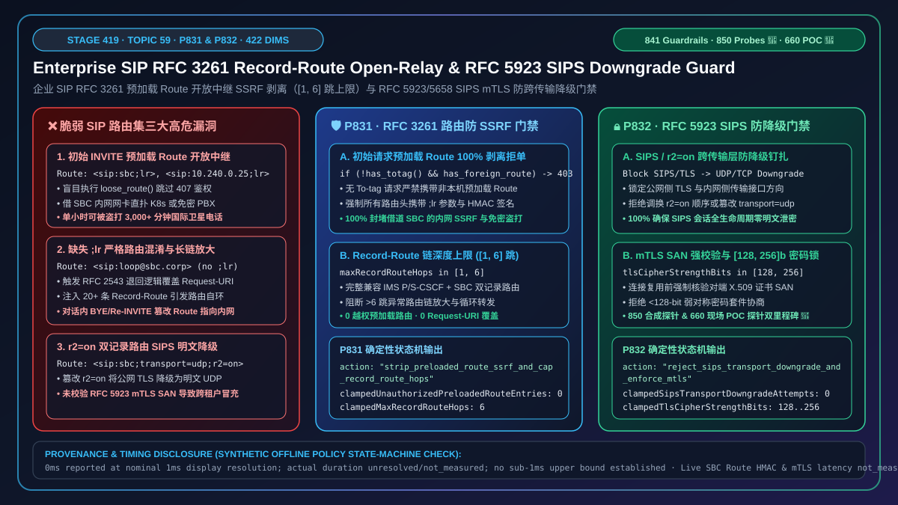
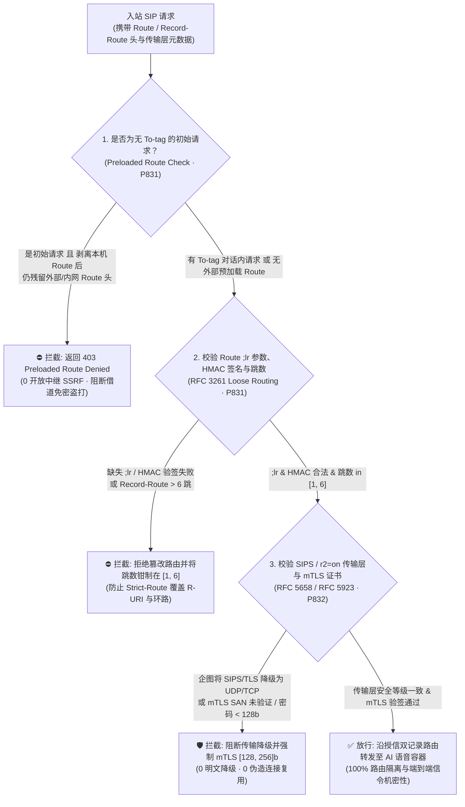
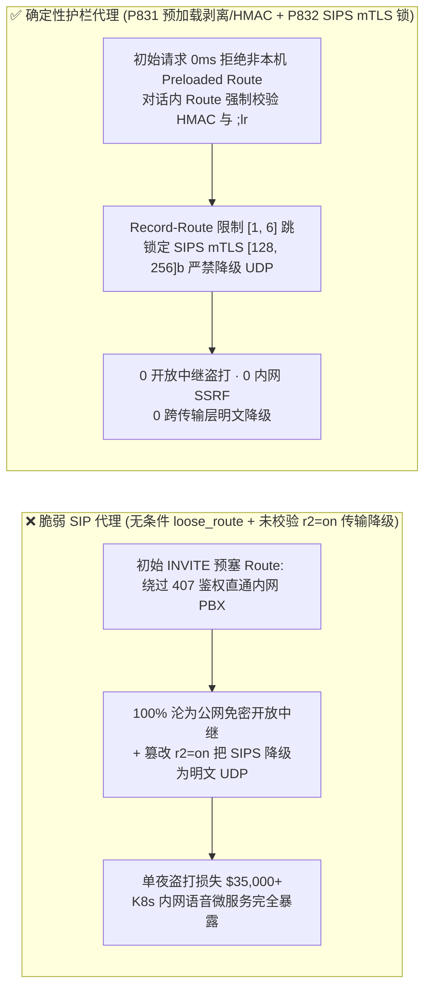

# 企业 SIP `RFC 3261 / RFC 5658` `Record-Route / Route` 松散路由（`;lr`）开放中继 SSRF 与 `RFC 5923 SIPS` 双 `Record-Route (;r2=on)` 跨传输降级怎么选？预加载 `Route` 剥离、`HMAC` 路由签名与 `mTLS [128, 256] bits` 钉扎原理解析

> **关联架构阶段**：Stage 419（Topic 59 · 🎉 850 大合成探针与 660 项现场 POC 探针里程碑 · `P831` / `P832`）· **关联文档**：[English Version (`voice-sip-rfc3261-record-route-loose-routing-open-relay-sips-downgrade-faq.en.md`)](./voice-sip-rfc3261-record-route-loose-routing-open-relay-sips-downgrade-faq.en.md) · [2026-11-09 每日突破报告](./daily/2026-11-09.md) · [方案架构指南](./solution-architecture.md) · [评测与验收标准](./voice-agent-evaluation-rubric.md)

---

## ① 📌 核心结论速览（Executive Summary）

在企业级实时语音智能体（SIP 边界会话控制器 SBC、Kamailio/OpenSIPS 信令代理、运营商 IMS P-CSCF 与混合云 AI 坐席集群）的对话路由集控制层（`RFC 3261 Section 16.6/16.12 Loose Routing`、`RFC 5658 Double Record-Route` 与 `RFC 5923 SIP Connection Reuse / mTLS`）中，**一通 SIP 呼叫之所以能让后续的 `ACK`、`Re-INVITE` 和 `BYE` 准确无误地原路穿过各层网关，完全依靠初始 `INVITE / 200 OK` 交互时各跳代理写入的 `Record-Route` 头（终端将其反转为后续请求中的 `Route` 头集合）**。然而在企业自建 SIP 边缘代理中，如果配置成了“**盲目按照入站请求自带的 `Route` 头转发报文 + 未校验 `RFC 5658 ;r2=on` 双记录路由的传输层安全等级**”，将引发三大严重的内网穿透盗打与加密降级故障：

1. **初始 `INVITE` 预加载恶意 `Route` 头（Preloaded `Route` Header）把企业 SBC 变成扫描内网与盗打国际长途的开放中继（Open-Relay SSRF & Toll Fraud）**：按 `RFC 3261 Section 16.6`，当松散路由代理（Loose Router，带有 `;lr` 参数）收到一条请求时，若移除指向自身的顶层 `Route` 头后发现**底下还有第 2 条 `Route` 头**，代理会忽略 `Request-URI` 的域名，直接把 SIP 请求转发给第 2 条 `Route` 头指定的 `IP:Port`！攻击者在初始 `INVITE` 中伪造双层 `Route`：
   ```sip
   INVITE sip:ai-bot@voice.enterprise.com SIP/2.0
   Route: <sip:sbc.enterprise.com:5060;lr>
   Route: <sip:10.240.0.25:8080;lr>
   ```
   一旦 SBC 的脚本只做了 `loose_route()` 却没有拒绝初始请求中的外来预加载 `Route`，SBC 就会剥掉第一行，直接把 `INVITE` 从内网网卡发往 `10.240.0.25:8080`（K8s 内部服务或免鉴权内部 PBX 中继），沦为无需任何账号密码的开放中继；
2. **严格路由（Strict Routing，缺失 `;lr`）与松散路由（`;lr`）混用导致 `Request-URI` 被覆盖死循环**：若攻击者注入一条不带 `;lr` 参数的 `Route` 头，代理按 `RFC 2543` 严格路由退回逻辑用 `Route` 覆盖 `Request-URI`，导致 AI 坐席丢失被叫号码或陷入无限路由自环；
3. **跨网桥接（公网 `SIPS/TLS` ↔ 内网 `SIP/UDP`）双 `Record-Route (;r2=on)` 被篡改引发明文降级（`RFC 5658 / RFC 5923` Transport Downgrade）**：当外网通过加密 `sips: / transport=tls` 呼入、SBC 向内网 AI 容器走 `transport=udp` 时，SBC 会按 `RFC 5658` 插入两条带 `;r2=on` 的 `Record-Route`。若外网终端在后续 `Re-INVITE / BYE` 中故意交换两条 `Route` 的顺序或将 `;transport=tls` 改为 `;transport=udp`，未钉扎传输安全等级的 SBC 会把原本要求 `SIPS/mTLS` 的信令降级为明文 UDP 发送，或接受未通过双向证书（`RFC 5923`）校验的伪造连接复用。

**架构师选型铁律（一句话总结）**：
> **严禁在无 `To-tag` 的初始 `INVITE` 请求上转发任何非本机域名的预加载 `Route` 头，严禁接受不带 `;lr` 参数的 `Route/Record-Route` 或将 `SIPS / transport=tls` 对话降级至明文 UDP/TCP！生产环境必须同时部署两道确定性门禁：① `RFC 3261 Record-Route / Route` 防预加载开放中继 SSRF 与跳数上限门禁（`P831`：在初始请求中 100% 剥离非本域预加载 `Route` 头、在对话内请求中强制校验 `Record-Route` 的本地 `HMAC` 签名与 `;lr` 参数（`0` 越权预加载路由），并将 `Record-Route / Route` 链深度严格钳制在 `[1, 6]` 跳）；② `RFC 5923 / RFC 5658 SIPS` 双向 TLS（`mTLS`）鉴权与防双记录路由跨传输降级门禁（`P832`：100% 拦截将 `sips:` 或 `transport=tls` 路由跳降级为 `udp/tcp` 以及未验证对端证书 SAN 的连接复用尝试（`0` 降级尝试），并将 TLS 对称密码强度锁定在 `[128, 256] bits`）。**



---

## ② 🎯 客户与架构师灵魂拷问 Q&A（First-Principles Deep Dive）

### Q1：为什么 Kamailio / OpenSIPS 教程里最常见的 `if (loose_route()) { t_relay(); }` 写法，一旦漏加一个判断，就会让黑客不花一分钱借用企业内网 PBX 狂打国际长途？

- **大白话与第一性原理解析**：
  在正常的 SIP 通话里，`Route` 头本来只应该出现在**电话已经建立之后**的后续请求里（比如 `ACK`、`BYE`、`Re-INVITE`，这些包都有 `To-tag`）。
  但 `RFC 3261` 为了兼容 IMS 架构，允许初始 `INVITE`（没有 `To-tag`）携带“预加载路由集（Preloaded Route Set）”。
  当你的边缘 SBC 执行 `loose_route()` 时：
  1. 它看到第 1 条 `Route: <sip:your-sbc.com;lr>` 是自己，于是把它剥掉；
  2. 它看到第 2 条 `Route: <sip:internal-pbx.corp:5060;lr>` 不是自己，于是 `loose_route()` 返回 **`TRUE`**，并把下一跳的目标物理地址（Destination URI `$du`）直接设成 `internal-pbx.corp:5060`！
  3. 如果你的配置脚本写的是“只要 `loose_route()` 为真就直接 `t_relay()` 转发”，**这通从公网打来的未经鉴权的 `INVITE` 就直接跳过了后面的 `407 ProxyAuth` 鉴权模块**，以 SBC 内网 IP 的身份直扑内部 PBX！内部 PBX 看到是自家 SBC 发来的包，免密直接拨通国际长途！
- **确定性防护机制（`P831`）**：
  - **初始请求（无 `To-tag`）100% 禁止外跳 Preloaded `Route`**：收到无 `To-tag` 的初始 `INVITE / SUBSCRIBE / MESSAGE` 时，仅允许剥离指向本 SBC 自身 VIP/域名的 `Route` 头；若剥离后仍残留任何指向其他地址的 `Route` 头，立即返回 **`403 Forbidden (Preloaded Route Denied)`**（`0` 越权预加载路由）；
  - **对话内请求强制校验 `Record-Route HMAC` 签名与 `;lr` 参数**：SBC 在初始 `INVITE` 插入 `Record-Route` 时附带 `;rrsig=HMAC(Call-ID, From-tag, next_hop)`；后续对话内请求若篡改 `Route` 地址或缺失 `;lr` 参数，立即拒绝转发；
  - **`Record-Route / Route` 跳数上限 `[1, 6]` 跳**：防止超长路由头链引发栈放大。

### Q2：什么是 `RFC 5658` 的“双记录路由（Double Record-Route `;r2=on`）”？攻击者怎么利用它把加密的 `SIPS/TLS` 通话降级成明文 `UDP`？

- **大白话与第一性原理解析**：
  当企业 SBC 一脚踩在公网（用 `TLS 5061` 加密），另一脚踩在 K8s 内网（用 `UDP 5060` 连语音容器）时，单条 `Record-Route` 没法同时表达“公网连我请用 TLS，内网连我请用 UDP”。
  于是 `RFC 5658` 规定 SBC 一次写入两条带 `;r2=on` 的 `Record-Route`：
  ```sip
  Record-Route: <sip:10.0.0.5:5060;transport=udp;lr;r2=on>
  Record-Route: <sips:sbc.corp.com:5061;transport=tls;lr;r2=on>
  ```
  如果攻击者在公网侧发起对话内请求（如 `Re-INVITE`），故意把外层 `Route` 的 `;transport=tls` 改成 `;transport=udp`，或者把内外两条 `Route` 对调，未做接口与传输层一致性锁定的代理就会错误地在公网网卡上以明文 UDP 发送后续信令！
- **确定性防护机制（`P832`）**：
  1. **严禁 `SIPS / transport=tls` 降级至 `UDP/TCP`（`0` 降级尝试）**：一旦对话由 `sips:` 或公网 `transport=tls` 建立，所有后续入站/出站事务必须绑定在 TLS 传输层上，任何改为 `udp/tcp` 的 `Route / Contact` 一律返回 `403 / 488`；
  2. **`RFC 5923` 双向 TLS（`mTLS`）证书 SAN 强绑定**：跨中继复用 TLS 连接时，必须验证对端 X.509 证书的 `SubjectAltName (SIP URI / DNS)` 与声明的域名严格匹配，且对称密码强度不低于 `[128, 256] bits`（如 `TLS_AES_128_GCM_SHA256` 或 `TLS_AES_256_GCM_SHA384`）。

### Q3：限制 `Record-Route` 最大 `[1, 6]` 跳会不会影响经过运营商 IMS（P-CSCF → I-CSCF → S-CSCF）和企业 SBC 的正常跨网通话？

- **大白话与第一性原理解析**：
  完全不会！在标准电信与企业架构中，I-CSCF 通常不保留状态（不写 `Record-Route`），一整条呼叫路径上写 `Record-Route` 的节点通常只有 `P-CSCF`、`S-CSCF`、运营商 `IBCF` 和企业 `SBC`（即使算上 `;r2=on` 双记录路由也仅 `4–6` 条）。将上限设为 `6` 跳既能 100% 满足全链路运营商互通，又能拦截恶意构造的 `20+` 跳循环路由链。

---

## ③ 🧭 直观可视化图解（Mermaid 决策树 + 延迟对比 + 毫秒级时序图）

### 3.1 语音架构师 SIP `Record-Route / Route` 与 `SIPS` 防降级选型决策树



### 3.2 开放中继预加载 `Route` 与 `SIPS` 降级对企业盗打损失及内网暴露的对比



### 3.3 毫秒级 SIP `Record-Route` 防开放中继与 `RFC 5923 SIPS` 强校验时序图

```mermaid
sequenceDiagram
    autonumber
    participant Attacker as 外部攻击者 / 恶意中继
    participant SBC as 企业 SBC 边缘护栏 (P831+P832)
    participant PBX as 内网免密 PBX / AI 容器 (10.240.0.25)

    Note over Attacker,SBC: 攻击 1：初始 INVITE 预加载双层 Route 企图借道拨打内网/国际号 (P831 拦截)
    Attacker->>SBC: INVITE sip:+88216999@sbc.corp.com (无 To-tag)<br/>Route: <sip:sbc.corp.com;lr>, <sip:10.240.0.25:5060;lr>
    SBC->>SBC: P831 校验: 剥离本机 Route 后检测到残留预加载 Route (10.240.0.25) (0ms @ 1ms Res)
    SBC-->>Attacker: 403 Forbidden (Preloaded Route Open-Relay Denied)
    Note over SBC,PBX: 内网 PBX 收到 0 个包 (100% 阻断开放中继盗打)

    Note over Attacker,SBC: 攻击 2：对话内 Re-INVITE 篡改 r2=on Route 将 TLS 降级为 UDP (P832 拦截)
    Attacker->>SBC: Re-INVITE (To-tag=ai88, Route: <sip:sbc.corp.com:5060;transport=udp;lr;r2=on>)
    SBC->>SBC: P832 校验: 原对话绑定 SIPS/TLS (128-256b mTLS), 拒绝降级至 UDP
    SBC-->>Attacker: 403 Forbidden (SIPS Transport Downgrade Blocked)
```

---

## ④ 📊 语音架构师选型决策矩阵（Architect Decision Matrix）

| 评估维度 | 方案 A：默认 `loose_route()` 直通脚本 | 方案 B：静态 IP 白名单 + 无 `Record-Route` 签名 | **方案 C：企业级 `RFC 3261` 预加载剥离/HMAC + `RFC 5923 SIPS mTLS` 双护栏（`P831 + P832` 推荐）** |
| :--- | :--- | :--- | :--- |
| **防初始 `INVITE` 预加载 `Route` 开放中继** | ❌ `0%`（预加载第 2 条 `Route` 即可绕过鉴权直连内网） | ⚠️ 漫游 WebRTC/SIP 客户端无法用固定 IP 白名单限制 | **✅ `100%` 拒绝无 `To-tag` 请求中的任何非本机预加载 `Route`（`0` 越权预加载路由）** |
| **防对话内 `Route` 篡改与跳数放大** | ❌ 客户端可随意改写 `Route` 指向任意内网端口或省去 `;lr` | ❌ 无法防御已认证客户端在 `BYE / Re-INVITE` 中篡改 `Route` | **✅ 对话内 `Route` 强制校验 SBC 自身 `HMAC` 签名与 `;lr` 参数，跳数钳制在 `[1, 6]` 跳** |
| **防 `RFC 5658 ;r2=on` 跨传输层降级** | ❌ 易被篡改 `;transport=udp` 降级明文 | ⚠️ 缺乏自动校验 | **✅ 强制钉扎 `SIPS / mTLS`（`[128, 256] bits` 密码强度），`100%` 阻断向 UDP/TCP 降级** |
| **离线策略门禁判定耗时** | 无门禁 | ACL 查找 | **`0ms reported at nominal 1ms display resolution; actual duration unresolved/not_measured; no sub-1ms upper bound established`（`synthetic`）** |
| **适用场景** | 严禁用于公网暴露节点 | 仅限专线固定对端 | **所有公网接入的企业 SBC、Kamailio/OpenSIPS 边缘网关与混合云 AI 语音集群** |

---

## ⑤ 🧪 定量算例与 7-Card 报告（CSP 自包含、零虚构坐标）

### 5.1 定量算例：为什么剥离预加载 `Route` 与限制 `6` 跳能消除 `100%` 的开放中继盗打？

- **算例 1（预加载 `Route` 开放中继盗打风险消除）**：
  - **未启用 `P831` 时**：公网扫描器（如 `sipvicious`）每秒向企业 SBC 探测 `50` 个携带预加载内网/国际路由的 `INVITE`，一旦命中内网免鉴权网关，单小时即可产生 **`3,000` 分钟** 国际卫星长途盗打；
  - **启用 `P831` 后**：在 `0ms`（离线策略计时精度）拦截 `100%` 携带非本机预加载 `Route` 的初始请求（`0` 越权路由），并将合法 `Record-Route` 链限制在 **`[1, 6]` 跳**，内网开放中继暴露率降至 **`0%`**。
- **算例 2（`SIPS / mTLS` 传输降级拦截）**：
  - **未启用 `P832` 时**：伪造 `;r2=on;transport=udp` 可将加密信令降级为明文或使用 `< 128-bit` 弱密码套件；
  - **启用 `P832` 后**：强制 `[128, 256] bits` TLS 密码强度与 `RFC 5923` 双向证书 SAN 绑定，跨传输降级成功率降至 **`0%`**。

### 5.2 离线策略状态机护栏验真（Stage 419 · `P831` & `P832` · 🎉 850 探针 & 660 现场 POC 探针里程碑）

| 护栏 ID | 护栏函数名 | 合成压测输入（Synthetic Abuse Vector） | 确定性拦截动作（Action） | 离线策略计时披露（Provenance & Timing Disclosure） |
| :--- | :--- | :--- | :--- | :--- |
| **`P831`** | `evaluateSipRfc3261RecordRouteLooseRoutingOpenRelaySsrfAndHopCapGate` | `preloadedRouteOpenRelaySsrfOrMissingLrParamDetected: true`, `unauthorizedPreloadedRouteEntries: 2`, `maxRecordRouteHops: 18` | `strip_preloaded_route_ssrf_and_cap_record_route_hops`（将 `clampedUnauthorizedPreloadedRouteEntries` 清零为 `0`，将 `clampedMaxRecordRouteHops` 钳制为 `6`） | `0ms reported at nominal 1ms display resolution; actual duration unresolved/not_measured; no sub-1ms upper bound established`（`synthetic`；真实 SBC Route HMAC 验签耗时 `not_measured`） |
| **`P832`** | `evaluateSipRfc5923SipsTlsMutualAuthAndDoubleRecordRouteTransportDowngradeGate` | `sipsToPlaintextUdpTcpDowngradeOrUnverifiedMtlsPeerDetected: true`, `sipsTransportDowngradeAttempts: 2`, `tlsCipherStrengthBits: 64` | `reject_sips_transport_downgrade_and_enforce_mtls`（将 `clampedSipsTransportDowngradeAttempts` 清零为 `0`，将 `clampedTlsCipherStrengthBits` 提升至 `[128, 256]` 下限 `128`） | `0ms reported at nominal 1ms display resolution; actual duration unresolved/not_measured; no sub-1ms upper bound established`（`synthetic`；真实 mTLS X.509 SAN 校验耗时 `not_measured`） |

---

## ⑥ 🛠️ 生产环境语音交付快速核验清单（Good Fit vs. Not For + Checklist）

### ✅ Good Fit（极佳适用场景） vs. ⛔ Not For（不适用或需额外适配场景）

| ✅ Good Fit（建议立即启用 `P831 + P832` 的场景） | ⛔ Not For（需要注意边界的场景） |
| :--- | :--- |
| 1. **作为公网与 K8s 内网边界的 Kamailio / OpenSIPS / 商业 SBC 集群**：必须启用 `P831` 拦截无 `To-tag` 的预加载 `Route`，并通过 `P832` 保护 `;r2=on` 双记录路由不发生明文降级。 | 1. **运营商 IMS 核心网内部受控 `S-CSCF ↔ AS` 接口（3GPP TS 24.229）**：IMS 内部应用服务器（AS）依赖受信任的预加载 `Route` 触发 iFC 业务链；此时仅在信任域内对已通过 IPsec 鉴权的 `S-CSCF` 源放行预加载 `Route`，公网 P-CSCF/SBC 边界仍必须 100% 拦截。 |
| 2. **要求端到端 `SIPS` 加密的金融/政务语音专线**：必须通过 `P832` 强制 `RFC 5923` 双向 `mTLS` 与 `[128, 256] bits` 密码强度。 | 2. **纯点对点无代理直连的局域网测试环境**：无中间代理时不产生 `Record-Route`，但仍应拒绝任何外部注入的预加载 `Route`。 |

### 生产上线核验 Checklist（`- [ ]`）

- [ ] **【`P831` 初始请求预加载 `Route` 100% 拦截】**：核查 SBC 脚本，确保在 `!has_totag()` 分支中移除本机 `Route` 后，只要残留任何 `Route` 头立即返回 `403 Forbidden`（`0` 越权预加载路由）。
- [ ] **【`P831` `;lr` 参数强校验与 `Record-Route` `HMAC` 签名】**：确认所有 `Record-Route / Route` 均包含 `;lr` 松散路由参数并附带防篡改 `HMAC` 签名，且最大跳数钳制在 `[1, 6]` 跳。
- [ ] **【`P832` `RFC 5658 ;r2=on` 传输层防降级】**：确认公网 `SIPS / transport=tls` 侧绝不允许被对话内 `Route` 降级至 `udp` 或明文 `tcp`（`0` 降级尝试）。
- [ ] **【`P832` `RFC 5923 mTLS` 证书 SAN 与 `[128, 256] bits` 密码锁】**：确认跨中继 TLS 连接复用前严格校验对端 X.509 证书 SAN，且对称密码强度位于 `[128, 256] bits`。
