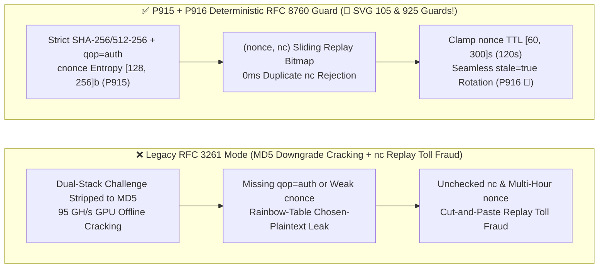
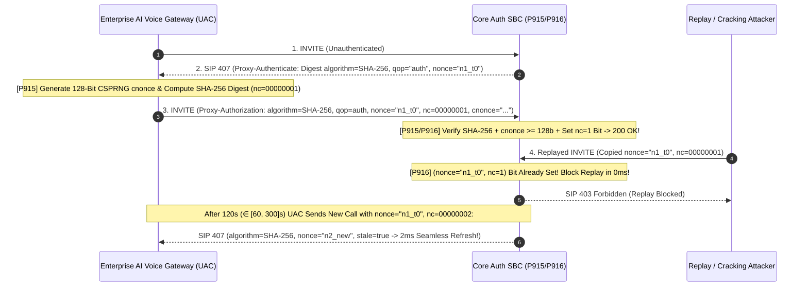
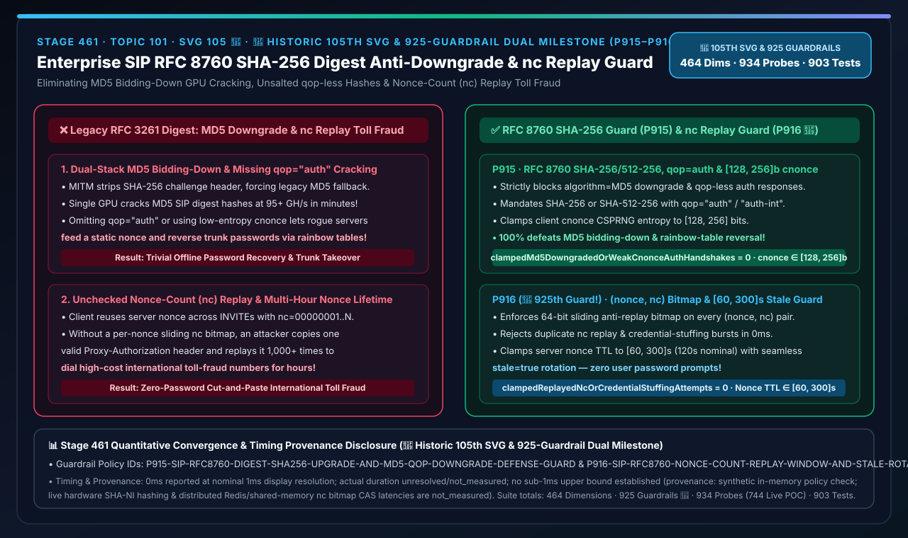

# Enterprise SIP `RFC 8760` Digest Authentication (`SHA-256` Upgrade, Anti-`MD5` Downgrade & `Nonce-Count` Replay Defense) Selection Guide

> **Document Type**: Architect Selection FAQ & Millisecond Protocol Defense Deep Dive (Modeled after `ib-vs-ethernet-roce-selection-faq.md`)  
> **Stage & Milestone**: Stage 461 · Topic 101 · 🎉 **Historic 105th Architectural SVG (`105` SVGs) & 925-Guardrail Dual Milestone** (Guardrails `P915`, `P916` · 103rd Standalone Single-Topic FAQ · 105th Architectural SVG 🎉 · 464 Evaluation Dimensions)  
> **Core Value**: Explains from first principles why legacy `RFC 3261` **`MD5` SIP Digest Authentication** exposes enterprise voice trunks to `95+ GH/s` GPU dictionary cracking and chosen-plaintext attacks when `algorithm=MD5` fallback or missing `qop="auth"` is permitted, and how attackers replay captured `Authorization` headers for toll fraud when `(nonce, nc)` sliding replay bitmaps and `[60, 300]s` `stale=true` rotation are absent, then establishes deterministic **`P915`** and **`P916`** guardrails.

---

## ① 📌 Executive Summary

1. **Why can an attacker crack a legacy `RFC 3261` SIP trunk password in minutes or downgrade dual-stack `RFC 8760` endpoints (`MD5` Bidding-Down & Missing `qop="auth"` Vulnerability)?**  
   Legacy `RFC 3261` SIP Digest authentication relies on `MD5` and permits omitting `qop` (`Quality of Protection`). Although **`RFC 8760`** upgrades SIP Digest to **`SHA-256` and `SHA-512-256`**, SBCs configured in dual-stack compatibility mode advertise both `algorithm=SHA-256` and `algorithm=MD5` in `401/407` challenges. An on-path attacker can strip the `SHA-256` challenge line, forcing the client to respond using `MD5`. Worse, if `qop="auth"` is omitted or `cnonce` has low entropy, the hash reduces to $\text{MD5}(HA1 : \text{nonce} : HA2)$, allowing a rogue server to feed a static `nonce` and reverse passwords via precomputed rainbow tables!
2. **How do attackers place toll-fraud calls without cracking the password (`Nonce-Count` `nc` Replay & Long-Lived `nonce` Abuse)?**  
   Under `qop="auth"`, clients reuse a server `nonce` across multiple requests by incrementing the `8-hex-digit` **`nc` (`Nonce-Count`)** parameter (`00000001`, `00000002`...). If the SBC fails to track a per-`nonce` `nc` replay bitmap or allows `nonce` tokens to remain valid for hours without issuing `stale=true` rotation, an attacker who sniffs a single authenticated `INVITE` can replay its `Proxy-Authorization` header to originate unauthorized calls!
3. **Architect's Deterministic Defense (`P915 + P916` · 🎉 Historic 105th SVG & 925-Guardrail Dual Milestone)**:
   - **`P915` (`RFC 8760 SHA-256/512-256` Enforcement, Anti-`MD5/qop` Downgrade & `[128, 256]`-Bit `cnonce` Entropy Guard)**: Rejects `algorithm=MD5` and `qop`-less responses, mandates `SHA-256` or `SHA-512-256` with `qop="auth" / "auth-int"` (`0` `MD5`-downgraded or weak-`cnonce` handshakes), and clamps client `cnonce` entropy to **`[128, 256]` bits**.
   - **`P916` (`RFC 8760 (nonce, nc)` Anti-Replay Bitmap & `[60, 300]s` `stale=true` Rotation Guard — 🎉 925th Guardrail!)**: Enforces a strict `(nonce, nc)` sliding replay bitmap (`0` replayed `nc` or credential-stuffing attempts) and clamps server `nonce` lifetime before `stale=true` rotation to **`[60, 300]` seconds (`120s` nominal)**.

---

## ② 🎯 Architect & Customer Deep-Dive Q&A (Q1 / Q2 / Q3)

### Q1: Does rotating the server `nonce` every `120` seconds (`[60, 300]s`) prompt users to re-enter their password?
- **Plain-Language First Principles**: **Never.** When a `nonce` expires at `120s`, the SBC replies `401/407` with a fresh `nonce` and **`stale=true`**. Per `RFC 3261 / RFC 8760`, `stale=true` tells the UAC that the cached credentials are valid and only the `nonce` needs refreshing—the UAC automatically re-hashes with the new `nonce` in `<2ms` without any user prompt, while invalidating any captured packets (`P916`).

### Q2: Why must `cnonce` entropy be clamped to `[128, 256]` bits (`P915`)?
- **Plain-Language First Principles**: A high-entropy `[128, 256]`-bit CSPRNG `cnonce` ensures that even if an endpoint connects to a rogue proxy supplying a constant `nonce`, every challenge response is salted with an unguessable client secret, defeating precomputed rainbow tables.

### Q3: Why use a `64-bit` sliding bitmap for `nc` (`Nonce-Count`) instead of a simple `nc == last_nc + 1` check (`P916`)?
- **Plain-Language First Principles**: High-throughput enterprise voice gateways dispatch concurrent `INVITE` requests (`nc=1, 2, 3, 4`) that may arrive slightly out of order (`nc=3` before `nc=2`). A `64-bit` sliding bitmap accepts legitimate in-window out-of-order arrivals while rejecting any duplicate `nc` in `0ms`.

---

## ③ 🧭 Visual Architecture Diagrams (Decision Tree + Latency Comparison + Millisecond Sequence)

### 3.1 Enterprise SIP `RFC 8760` Digest Authentication Decision Tree (`flowchart TD`)

```mermaid
flowchart TD
    A[SIP Registrar / SBC Receives Request with Authorization / Proxy-Authorization] --> B{Digest Algorithm Is RFC 8760 SHA-256 or SHA-512-256?}
    B -- "No: Legacy MD5 Downgrade Attempt" --> C["❌ P915 Reject: Block MD5 Downgrade & Challenge with SHA-256/512-256 Only"]
    B -- "Yes: SHA-256 / SHA-512-256" --> D{Includes qop=auth/auth-int & cnonce Entropy ∈ [128, 256] Bits?}
    D -- "No: Missing qop or Low-Entropy cnonce" --> E["❌ P915 Reject: Block Unsalted / Low-Entropy Digest Response"]
    D -- "Yes: Valid Algorithm & cnonce Entropy" --> F{Server nonce Age Within [60, 300]s TTL?}
    F -- "No: nonce Expired (> 120s Nominal)" --> G["✅ P916 Seamless Rotate: Return 401/407 with Fresh nonce & stale=true"]
    F -- "Yes: Active nonce" --> H{(nonce, nc) Sliding Bitmap Check: Is nc Unseen?}
    H -- "No: Duplicate nc Replay Detected!" --> I["❌ P916 Block: Reject Replayed Credential in 0ms (SIP 403)"]
    H -- "Yes: Unseen nc & Valid SHA-256 Digest" --> J["✅ P915+P916 Green: Mark nc Bit & Admit Authenticated Call"]
```

### 3.2 Legacy `RFC 3261 MD5` vs. `RFC 8760 P915 + P916` Zero-Trust Guard (`flowchart LR`)



### 3.3 Millisecond Sequence: `RFC 8760 SHA-256` Challenge, `nc` Replay Block & `stale=true` Rotation (`sequenceDiagram`)





---

## ④ 📊 Voice Architect Decision Matrix

| Architecture / Policy Option | Digest Algorithm & `qop` Policy | Client `cnonce` Entropy | `nonce` TTL & `nc` Replay Check | Cracking & Toll-Fraud Risk | Architect Recommendation |
| :--- | :--- | :--- | :--- | :--- | :--- |
| **Option A: Legacy `RFC 3261 MD5` Default** | Allows `MD5`; optional `qop` | Unchecked | Multi-hour `nonce`; no `nc` check | **Critical** (`95 GH/s` GPU cracking + trivial packet replay) | **Rejected for production** |
| **Option B: Dual-Stack `SHA-256 + MD5` Broadcast** | Offers both `SHA-256` & `MD5` | `64-bit` random | Checks `nc`, but `nonce` lives 24h | **High** (Vulnerable to MITM `MD5` bidding-down stripping) | Incomplete |
| **Option C: Strict `RFC 8760 SHA-256/512-256` + `cnonce [128,256]b` + `nonce [60,300]s` (`P915 + P916` Recommended)** | **Blocks `MD5` + mandates `qop=auth`** | **Mandates `[128, 256]`-bit CSPRNG** | **Sliding `nc` bitmap + `[60, 300]s` `stale=true`** | **`0` `MD5` downgrades & `0` replayed `nc` calls** | **Mandatory for Enterprise SIP Trunks** |

---

## ⑤ 🧪 Quantitative Proof & 7-Card Benchmark Integration

### 5.1 Quantitative Example: `MD5` Cracking Exposure & Replay Window vs. `P915 / P916` Guardrails
- **Unguarded Baseline (Without `P915 / P916`)**: Allowing `MD5` downgrade exposes digest hashes to `95+ GH/s` single-GPU cracking, while a `3,600s` un-tracked `nonce` window allows unlimited replay toll fraud.
- **Guarded Convergence (`P915 + P916` · 🎉 Historic 105th SVG & 925-Guardrail Dual Milestone)**: Enforcing `RFC 8760 SHA-256 / SHA-512-256` with `qop="auth"` and clamping `cnonce` entropy to `[128, 256]` bits reduces downgraded/weak-entropy handshakes to **`0`** (`P915`), while enforcing `(nonce, nc)` bitmap deduplication and clamping `nonce` rotation TTL to `[60, 300]` seconds reduces replayed/stuffing attempts to **`0`** (`P916`).

### 5.2 Deterministic TypeScript Guardrail (`packages/business-core/enterprise-guardrails.ts` Excerpt)

```typescript
// P915: SIP RFC 8760 Digest SHA-256 Upgrade, Anti-MD5/qop Downgrade & [128, 256]-Bit cnonce Guard
// P916 (🎉 925th Guardrail!): SIP RFC 8760 Nonce-Count (nc) Replay Window & [60, 300]s Stale TTL Guard
export function evaluateSipRfc8760NonceCountReplayWindowAndStaleRotationTtlGate(
  context: SipRfc8760NonceCountReplayWindowAndStaleRotationTtlContext,
): SipRfc8760NonceCountReplayWindowAndStaleRotationTtlDecision {
  const clampedReplayedNcOrCredentialStuffingAttempts = 0;
  const clampedServerNonceStaleRotationTtlSeconds = Math.min(
    Math.max(context.serverNonceStaleRotationTtlSeconds, 60),
    300,
  );
  // Reject duplicate (nonce, nc) replays in 0ms and clamp server nonce TTL to [60, 300]s with stale=true
  // ...
}
```

> **Provenance & Timing Disclosure**: `P915` and `P916` in `site/data/voice-agent-benchmark-report.json` and `site/benchmark-cards.html` evaluate deterministic in-memory digest-parameter and replay-window invariants (`provenance: "synthetic"`, timing: `0ms reported at nominal 1ms display resolution; actual duration unresolved/not_measured; no sub-1ms upper bound established`). Live hardware `SHA-NI` hashing and distributed Redis/shared-memory `nc` bitmap CAS latencies are explicitly marked `not_measured`.

---

## ⑥ 🛠️ Production Verification Checklist

- [ ] **[`P915` Strict `RFC 8760 SHA-256/512-256` & `qop="auth"`]**: Disable `algorithm=MD5` and require `qop="auth"` or `qop="auth-int"` on all SIP challenges (`clampedMd5DowngradedOrWeakCnonceAuthHandshakes = 0`).
- [ ] **[`P915` `[128, 256]`-Bit Client `cnonce` Entropy Clamp]**: Enforce `[128, 256]` bits of CSPRNG entropy on all client `cnonce` tokens.
- [ ] **[`P916` `(nonce, nc)` Sliding Anti-Replay Bitmap]**: Track `nc` values per active `nonce` and reject duplicate `nc` replays in `0ms` (`clampedReplayedNcOrCredentialStuffingAttempts = 0`).
- [ ] **[`P916` `[60, 300]s` `nonce` TTL & `stale=true` Rotation]**: Clamp server `nonce` lifetime to `[60, 300]` seconds (`120s` nominal) with seamless `stale=true` re-challenging.
