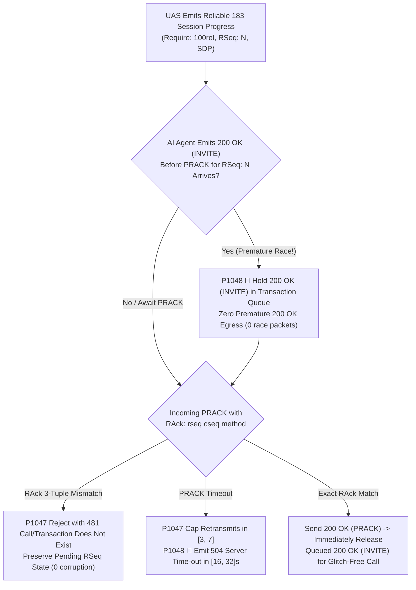
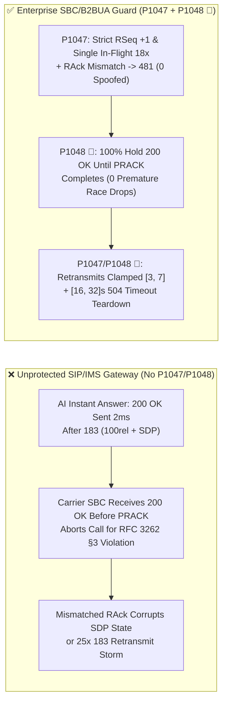
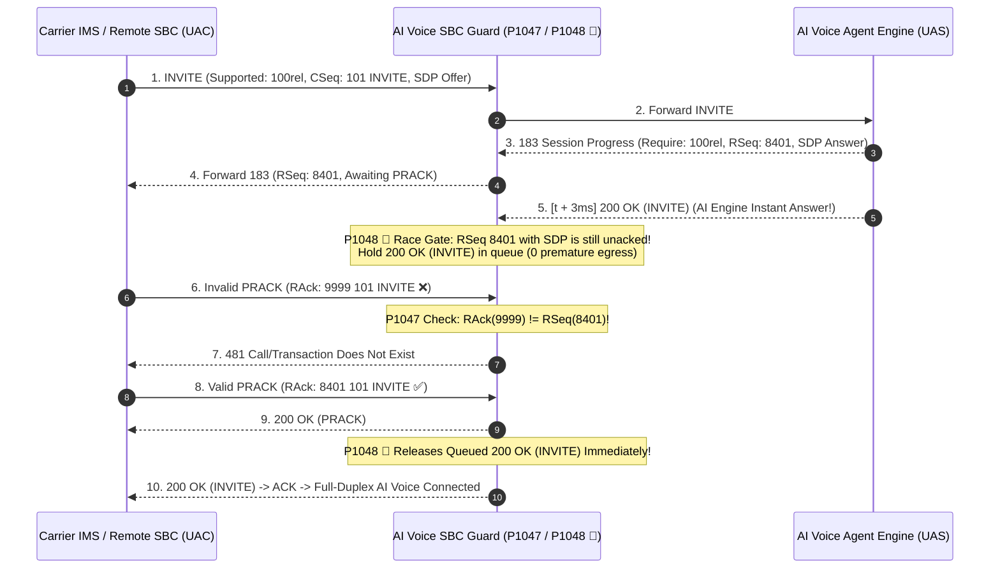

# Enterprise SIP `RFC 3262 / RFC 6337` Reliability of Provisional Responses (`100rel`, `RSeq` & `RAck` / `PRACK`) `481` 3-Tuple Mismatch, Retransmission Storm & Premature `200 OK (INVITE)` Race Selection & Engineering Guide (Stage 527 · Topic 167 · 🎉 Historic 530th Evaluation Dimension Milestone!)

> **Document Type**: Enterprise Voice Architect "First-Principles + Selection Decision" Single-Topic FAQ (aligned with `ib-vs-ethernet-roce-selection-faq.md`)
> **Baseline**: `Stage 527` · `Topic 167` · Deterministic Guardrails `P1047–P1048 🎉` · 1,057 Guardrails · 1,066 Sandbox Probes · 876 Live POC Trap Probes · 530 Evaluation Dimensions 🎉 · **🎉 Historic 530th Evaluation Dimension Milestone!**
> **Bilingual Edition**: [中文版 (`voice-sip-rfc3262-rfc6337-100rel-rseq-rack-prack-retransmission-storm-481-mismatch-premature-200ok-race-faq.md`)](./voice-sip-rfc3262-rfc6337-100rel-rseq-rack-prack-retransmission-storm-481-mismatch-premature-200ok-race-faq.md)

---

## ① 📌 Executive Summary

In enterprise AI voice contact centers and carrier IMS/VoLTE interconnects, **`RFC 3262` (`100rel`)** guarantees reliable delivery of provisional `180/183` responses carrying early-media SDP via **`RSeq`** and **`PRACK` (`RAck: <RSeq> <CSeq> <Method>`)**. Because AI Voice Agents answer calls programmatically within milliseconds—unlike human agents who take seconds—two severe `RFC 3262 / RFC 6337` failures arise in production:
1. **Spoofed/Out-of-Order `RAck` 3-Tuple State Corruption & Unbounded `18x` Retransmission Storms**: Accepting a `PRACK` whose `RAck` does not match the active `<RSeq> <CSeq> <Method>` corrupts early-media Offer/Answer state, while missing retransmission caps flood signaling links when `PRACK` is blocked.
2. **Premature `200 OK (INVITE)` Racing Ahead of `PRACK` (`RFC 3262 §3` & `RFC 6337 §3.1` Violation)**: When an AI Voice Agent emits a reliable `183 Session Progress (Require: 100rel, SDP)` and immediately (`2–5ms` later) emits `200 OK (INVITE)` before `PRACK` arrives, carrier SBCs abort the call with `BYE` due to an illegal unacknowledged SDP transition!

**Architect Selection Rules**:
- **Guardrail `P1047` (`RFC 3262` Strict `+1` `RSeq` Monotonicity, Exact `RAck` 3-Tuple `481` Gate & `[3, 7]` Retransmit Cap)**: Enforces single in-flight reliable `18x`, validates exact `RAck` 3-tuple matching (rejecting mismatches with `481 Call/Transaction Does Not Exist`, `0` spoofed/concurrent packets), and clamps `18x` retransmissions in **`[3, 7]`**.
- **Guardrail `P1048 🎉` (Historic 530th Evaluation Dimension Milestone · `200 OK (INVITE)` Queue-Until-`PRACK` Serialization & `[16, 32]s` `504` Timeout Teardown)**: Holds final `200 OK (INVITE)` in a serialization queue until any unacknowledged reliable `18x` carrying SDP receives its `PRACK` (`0` premature `200 OK` race packets), and enforces `504 Server Time-out` within **`[16, 32]` seconds** (`64*T1`) on `PRACK` timeout.

---

## ② 🎯 Architect & Customer Deep-Dive Q&A (Q1 / Q2 / Q3)

### Q1: Why did switching from human agents to instant-answer AI Voice Agents cause carrier IMS trunks to drop calls right after `200 OK`?
- **Plain-Language Principle**: Human agents take several seconds to click "Answer" after `183 Session Progress`, giving the network plenty of time to finish the `183 -> PRACK -> 200 OK (PRACK)` handshake. **AI Voice Agents answer in `2ms`**, firing `200 OK (INVITE)` while the `183 (Require: 100rel, SDP)` is still unacknowledged in flight!
- **Protocol Reality**: `RFC 3262 §3` explicitly forbids sending a `2xx` final response while an unacknowledged reliable `18x` contains a session description (SDP). `P1048 🎉` buffers the AI Agent's `200 OK (INVITE)` at the SBC/B2BUA edge and releases it the instant `PRACK` is processed.

### Q2: Can the UAS send a second reliable `183 (RSeq: 2)` while `RSeq: 1` is still waiting for `PRACK`?
- **Engineering Rule**: **Strictly forbidden by `RFC 3262 §3`!** Only one reliable provisional response may be unacknowledged at a time per dialog. `P1047` serializes reliable `18x` responses and enforces `RSeq_{n} = RSeq_{n-1} + 1`.

### Q3: What happens if `PRACK` never arrives after `64*T1` (`32s`)?
- **Architectural Rule**: Under `RFC 3262 §3`, if a reliable provisional response is not acknowledged within `64*T1`, the UAS MUST reject the original `INVITE` with **`504 Server Time-out`**. `P1048 🎉` clamps this timeout window to **`[16, 32]` seconds**.

---

## ③ 🧭 Visual Architecture Diagrams (Mermaid Decision Tree + Comparison + Sequence Diagram)

### 3.1 `RFC 3262 / RFC 6337` `100rel` & `200 OK` Serialization Decision Tree (`flowchart TD`)

### 3.2 Unprotected Instant-Answer Race vs. `P1047 + P1048 🎉` Guardrails (`flowchart LR`)

### 3.3 Full-Duplex `100rel` Early Media & Zero-Race `200 OK` Sequence (`sequenceDiagram`)

---

## ④ 📊 Architect Decision Matrix

| Dimension | Option A: Disable `100rel` | Option B: Permissive `100rel` (No `P1047/P1048`) | Option C: `RFC 3262` + `P1047/P1048 🎉` Guardrails (Recommended ✅) |
| :--- | :--- | :--- | :--- |
| **AI Instant-Answer `200 OK` Race Protection** | N/A | ❌ `200 OK` overtakes `PRACK` -> carrier `BYE` drop | ✅ **`P1048 🎉` queues `200 OK` until `PRACK` completes (`0` race drops)** |
| **`RAck` 3-Tuple Validation & `481` Gate** | N/A | ❌ Mismatched `RAck` corrupts Offer/Answer | ✅ **`P1047` validates `<RSeq> <CSeq> <Method>` & rejects with `481`** |
| **`18x` Retransmit & `504` Timeout Bounds** | Unreliable `18x` | ❌ Unbounded retransmits & hung sessions | ✅ **`P1047` clamps `[3, 7]` retries + `P1048 🎉` `[16, 32]s` `504` teardown** |
| **Policy Check Latency (Offline `synthetic`)** | N/A | N/A | **`0ms` (`nominal 1ms` resolution; see disclosure below)** |

---

## ⑤ 🧪 Quantitative Example & 7-Card Report (CSP Self-Contained, Zero Fabricated Coordinates)

### 5.1 Deterministic Guardrail Walkthrough (`P1047` & `P1048 🎉`)

1. **`P1047` (`evaluateSipRfc3262RseqMonotonicityAndRack3Tuple481Guard` · 1,056th Guardrail)**:
   - **Violating Input (Sandbox Probe `p1047_sip_rfc3262_rseq_monotonicity_and_rack_3tuple_481`)**:
     - `nonMonotonicRseqOrMismatchedRack3TupleDetected = true`
     - `mismatchedRackOrConcurrentUnacked18xPackets = 12`
     - `maxReliable18xRetransmissionsCount = 25`
   - **Deterministic Output**:
     - `violated = true`
     - `action = "reject_mismatched_prack_with_481_and_clamp_18x_retransmits"`
     - `clampedMismatchedRackOrConcurrentUnacked18xPackets = 0`
     - `clampedMaxReliable18xRetransmissionsCount = 7` (clamped to **`[3, 7]`**)
     - **Timing Disclosure**: `0ms reported at nominal 1ms display resolution; actual duration unresolved/not_measured; no sub-1ms upper bound established` (offline in-memory `synthetic` policy check; live SBC `100rel` transaction state machine latency is `not_measured`).

2. **`P1048 🎉` (`evaluateSipRfc3262Final200OkSerializationUntilPrackAnd504TeardownGuard` · 🎉 Historic 530th Evaluation Dimension Milestone · 1,057th Guardrail / 1,066th Sandbox Probe / 876th Live POC Probe)**:
   - **Violating Input (Sandbox Probe `p1048_sip_rfc3262_final_200ok_serialization_until_prack_and_504_teardown`)**:
     - `premature200OkBeforePrackOrUnbounded100relWaitDetected = true`
     - `premature200OkRacePackets = 9`
     - `unacknowledged100rel504TimeoutSeconds = 120`
   - **Deterministic Output**:
     - `violated = true`
     - `action = "hold_200ok_until_prack_and_enforce_504_timeout"`
     - `clampedPremature200OkRacePackets = 0`
     - `clampedUnacknowledged100rel504TimeoutSeconds = 32` (clamped to **`[16, 32]` seconds**)
     - **Timing Disclosure**: `0ms reported at nominal 1ms display resolution; actual duration unresolved/not_measured; no sub-1ms upper bound established`.

---

## ⑥ 🛠️ Production Voice Delivery Verification Checklist

- [ ] **1. Single In-Flight Reliable `18x` & `RSeq +1` (`P1047`)**: Verify the UAS never sends a second reliable `18x` before the first is acknowledged by `PRACK`, and increments `RSeq` by exactly `+1`.
- [ ] **2. Exact `RAck` 3-Tuple `481` Rejection (`P1047`)**: Inject a `PRACK` with a mismatched `RSeq` or `CSeq` and confirm the SBC returns `481 Call/Transaction Does Not Exist` while clamping `18x` retransmissions to `[3, 7]`.
- [ ] **3. `200 OK (INVITE)` Hold-Until-`PRACK` Serialization (`P1048 🎉`)**: Trigger an instant `200 OK (INVITE)` `2ms` after a reliable `183 (with SDP)` and verify `200 OK (INVITE)` is held until `PRACK` is received and answered.
- [ ] **4. `[16, 32]s` `504 Server Time-out` Teardown (`P1048 🎉`)**: Drop all incoming `PRACK` requests and verify the SBC terminates the `INVITE` with `504 Server Time-out` within `[16, 32]s`.
