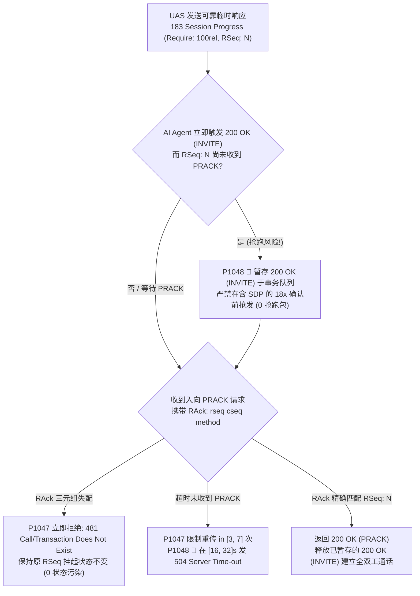
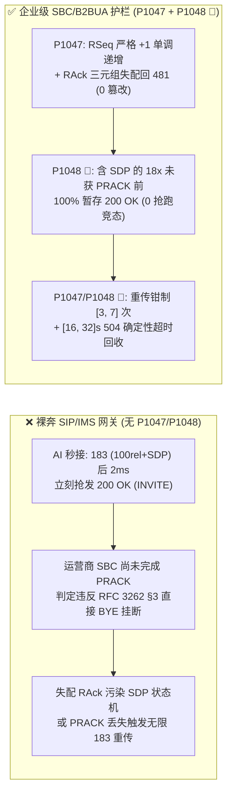
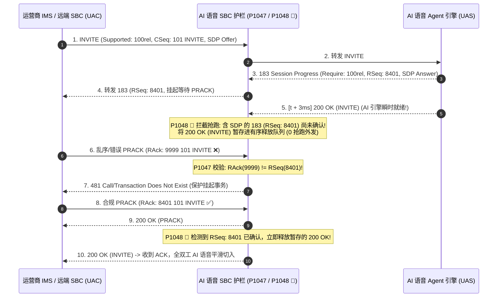

# 企业 SIP `RFC 3262 / RFC 6337` 可靠临时响应（`100rel`、`RSeq` 与 `RAck` / `PRACK`）`481` 三元组失配、重传风暴与 `200 OK (INVITE)` 抢跑竞态选型与工程指南（Stage 527 · Topic 167 · 🎉 历史性第 530 大评测维度里程碑！）

> **文档类型**：企业语音架构师“第一性原理 + 选型决策”单专题 FAQ（对标 `ib-vs-ethernet-roce-selection-faq.md` 通俗透彻规范）
> **关联基准**：`Stage 527` · `Topic 167` · 确定性护栏 `P1047–P1048 🎉` · 1,057 道企业护栏 · 1,066 个沙盒探针 · 876 个现场 POC 探针 · 530 大评测维度 🎉 · **🎉 历史性第 530 大评测维度里程碑！**
> **双语版本**：[English Version (`voice-sip-rfc3262-rfc6337-100rel-rseq-rack-prack-retransmission-storm-481-mismatch-premature-200ok-race-faq.en.md`)](./voice-sip-rfc3262-rfc6337-100rel-rseq-rack-prack-retransmission-storm-481-mismatch-premature-200ok-race-faq.en.md)

---

## ① 📌 核心结论速览（Executive Summary）

在企业 AI 语音外呼、运营商 IMS/VoLTE 互联以及彩铃/早期媒体（Early Media `183 Session Progress`）播报场景中，传统 `RFC 3261` 的 `180/183` 临时响应在 UDP 上是不可靠传输的——一旦丢包，早期媒体 SDP 协商就会卡死。为此，**`RFC 3262`（Reliability of Provisional Responses in SIP，`100rel`）** 引入了类似 TCP 的确认机制：UAS 在 `18x` 中带上 `Require: 100rel` 和递增的 **`RSeq`（可靠序列号）**，UAC 必须回传 **`PRACK`（携带 `RAck: <RSeq> <CSeq> <Method>` 三元组）** 予以确认。然而在 AI 语音 Agent 秒级瞬时接通的生产环境中，`RFC 3262` 联合 **`RFC 6337`（SIP Offer/Answer 最佳实践）** 极易引爆两大致命事故：
1. **伪造/错序 `RAck` 三元组污染状态机与无界 `18x` 重传风暴**：当乱序或恶意 `PRACK` 携带错误的 `RAck`（如 `RSeq` 不匹配当前挂起的 `183`，或 `CSeq` 方法名不等于 `INVITE`），无防护网关若直接放行会彻底错乱早期媒体 SDP 状态；同时若对端 NAT 丢弃了 `PRACK`，缺乏重传上限的 UAS 会无限重发带大包体 SDP 的 `183`。
2. **AI 语音“秒接”引发 `200 OK (INVITE)` 抢跑在 `PRACK` 之前（Premature `200 OK` Race）**：AI 语音 Agent 不需要人工摘机等待，往往在发出可靠 `183 Session Progress (Require: 100rel, RSeq: 1, 带 SDP Answer)` 后仅过 `5ms` 就立刻发出 `200 OK (INVITE)`！按 **`RFC 3262 §3` 与 `RFC 6337 §3.1` 铁律**，只要还有包含未确认 SDP 的可靠 `18x` 尚未收到 `PRACK`，UAS **绝对禁止发送最终 `200 OK (INVITE)`**——否则 UAC 收到比 `PRACK` 更快到达的 `200 OK` 时，会因 Offer/Answer 状态机冲突直接发 `BYE` 挂断通话！

**架构师选型铁律**：
- **护栏 `P1047`（`RFC 3262` `RSeq` 严格 `+1` 单调递增、`RAck` 三元组精确匹配 `481` 拦截与 `[3, 7]` 次重传上限锁）**：严格执行 `RFC 3262 §3 / §4`，强制校验 `RAck: <RSeq> <CSeq-num> <Method>` 与当前未确认可靠 `18x` 100% 匹配，任何失配或重复乱序的非法 `PRACK` 一律回 `481 Call/Transaction Does Not Exist`（`0` 非法状态篡改），并将单个可靠 `18x` 的最大重传次数钳制在 **`[3, 7]` 次**。
- **护栏 `P1048 🎉`（历史性第 530 大评测维度里程碑 · `PRACK` 到达前暂存/串行化 `200 OK (INVITE)` 门禁与 `[16, 32]s` `504` 超时熔断锁）**：严格执行 `RFC 3262 §3` 与 `RFC 6337 §3.1`，当 AI Agent 在可靠 `18x`（尤其含 SDP）未获 `PRACK` 确认前触发接通时，自动将 `200 OK (INVITE)` 放入事务暂存队列，待收到合规 `PRACK` 并回完 `200 OK (PRACK)` 后再毫秒级释放 `200 OK (INVITE)`（`0` 抢跑竞态掉话）；若 `100rel` 确认超时，在 **`[16, 32]` 秒**窗口内确定性回 `504 Server Time-out` 释放资源。

---

## ② 🎯 客户与架构师灵魂拷问 Q&A（Q1 / Q2 / Q3）

### Q1：为什么人工坐席接电话从不出问题，一换成 AI 语音 Agent 自动秒接，运营商 SBC 就频繁报错挂断？
- **通俗原理**：人工坐席从响铃（`180/183 Require: 100rel`）到按下接听键（`200 OK`）通常要隔 `3–10` 秒，这期间网络早就把 `183 -> PRACK -> 200 OK (PRACK)` 跑完了；而 **AI 语音 Agent 是代码自动接听，从发出 `183` 到发出 `200 OK (INVITE)` 往往只隔 `1–5` 毫秒**！
- **毫秒级底层真相**：当 `183 (Require: 100rel, SDP)` 和 `200 OK (INVITE, SDP)` 几乎同时在 UDP 网络上飞向运营商 SBC 时，哪怕没有乱序，运营商 SBC 在还没发出 `PRACK`（或 `PRACK` 还在路上）时就收到了最终 `200 OK`。根据 `RFC 3262 §3`：*"The UAS MAY send a final response to the initial request before having received PRACKs for all unacknowledged reliable provisional responses, **unless the final response is 2xx and any of the unacknowledged reliable provisional responses contained a session description**."* 违反这条铁律会导致运营商 SBC 直接判定协议违例并拆线！`P1048 🎉` 在 SBC/B2BUA 侧提供了确定性的 `PRACK -> 200 OK (INVITE)` 串行化闸门。

### Q2：如果第一条可靠 `183 (RSeq: 1)` 还没收到 `PRACK`，AI 引擎能不能紧接着发第二条带新 SDP 的可靠 `183 (RSeq: 2)`？
- **工程铁律**：**绝对禁止！** 根据 `RFC 3262 §3`：*"After the first reliable provisional response for a request has been acknowledged, the UAS MAY send additional reliable provisional responses. **The UAS MUST NOT send a second reliable provisional response until the first is acknowledged.**"* 在首个可靠 `18x` 未收到 `PRACK` 前，严禁连续叠发第二个可靠 `18x`。

### Q3：`RAck` 头部为什么要同时带 `RSeq`、`CSeq` 数字和 `Method` 三个字段？只比对 `RSeq` 不行吗？
- **安全与并发真相**：在一个 SIP 早期对话（Early Dialog）中，可能同时或先后存在多个事务，且初始 `RSeq` 是 `[1, 2^31 - 1]` 之间的随机数，后续每条可靠 `18x` 严格 `+1`（`RSeq_n = RSeq_{n-1} + 1`）。`RFC 3262 §7.2` 要求同时核验 `<RSeq> <CSeq-num> <Method>` 三元组，正是为了防止跨事务混淆或盲猜注入。一旦三元组失配，`P1047` 立即返回 `481 Call/Transaction Does Not Exist`。

---

## ③ 🧭 直观可视化图解（Mermaid 选型决策树 + 延迟/竞态拆解对比图 + 毫秒级全双工时序图）

### 3.1 `RFC 3262 / RFC 6337` `100rel` 确认与 `200 OK` 串行化决策树（`flowchart TD`）

### 3.2 裸奔秒接竞态 vs `P1047 + P1048 🎉` 确定性 `100rel` 串行护栏对比图（`flowchart LR`）

### 3.3 毫秒级全双工 `100rel` 早期媒体与 `200 OK` 零抢跑时序图（`sequenceDiagram`）

---

## ④ 📊 语音架构师选型决策矩阵（Architect Decision Matrix）

| 选型维度 | 方案 A：禁用 `100rel`（不可靠 `18x`） | 方案 B：启用默认 `100rel`（无 `P1047/P1048` 护栏） | 方案 C：`RFC 3262` + `P1047/P1048 🎉` 确定性护栏（推荐 ✅） |
| :--- | :--- | :--- | :--- |
| **IMS/VoLTE 早期媒体互通合规性** | ❌ 违反 `3GPP TS 24.229` 强选要求 | ⚠️ 表面合规但高并发易崩 | ✅ **100% 符合 `RFC 3262` 与 `RFC 6337` 状态机规范** |
| **AI 秒接 `200 OK` 抢跑 `PRACK` 防护** | 无 `PRACK` | ❌ `200 OK` 抢先到达触发运营商 SBC 拆线 | ✅ **`P1048 🎉` 自动暂存并在 `PRACK` 确认后串行释放（`0` 抢跑）** |
| **`RAck` 三元组防伪与 `481` 隔离** | N/A | ❌ 弱校验允许错误 `RAck` 翻转状态 | ✅ **`P1047` 严格比对 `<RSeq> <CSeq> <Method>` 失配回 `481`** |
| **`18x` 重传风暴与超时清理** | 无重传 | ❌ 无界重传耗尽信令带宽 | ✅ **`P1047` 钳制 `[3, 7]` 次重传 + `P1048 🎉` `[16, 32]s` 回 `504`** |
| **策略判定耗时（离线 `synthetic`）** | N/A | N/A | **`0ms`（`nominal 1ms` 分辨率；见下方披露）** |

---

## ⑤ 🧪 定量算例与 7-Card 报告（CSP 自包含、零虚构坐标）

### 5.1 确定性护栏定量算例（`P1047` & `P1048 🎉`）

1. **`P1047`（`evaluateSipRfc3262RseqMonotonicityAndRack3Tuple481Guard` · 第 1,056 道护栏）**：
   - **异常输入（沙盒探针 `p1047_sip_rfc3262_rseq_monotonicity_and_rack_3tuple_481`）**：
     - `nonMonotonicRseqOrMismatchedRack3TupleDetected = true`
     - `mismatchedRackOrConcurrentUnacked18xPackets = 12`（检测到 `12` 个 `RAck` 三元组失配或前序未确认即叠发的违规 `18x/PRACK` 包）
     - `maxReliable18xRetransmissionsCount = 25`（单条 `183` 重传配置高达 `25` 次，超出 `RFC 3262` `7` 次上限）
   - **确定性输出**：
     - `violated = true`
     - `action = "reject_mismatched_prack_with_481_and_clamp_18x_retransmits"`
     - `clampedMismatchedRackOrConcurrentUnacked18xPackets = 0`（100% 拦截失配 `PRACK` 与并发未确认 `18x`）
     - `clampedMaxReliable18xRetransmissionsCount = 7`（自动钳制回 **`[3, 7]` 次**合规区间）
     - **计时语义披露**：`0ms reported at nominal 1ms display resolution; actual duration unresolved/not_measured; no sub-1ms upper bound established`（离线内存 `synthetic` 策略检查；真实 SBC `100rel` 事务表与 Timer 调度耗时为 `not_measured`）。

2. **`P1048 🎉`（`evaluateSipRfc3262Final200OkSerializationUntilPrackAnd504TeardownGuard` · 🎉 历史性第 530 大评测维度里程碑 · 第 1,057 道护栏 / 第 1,066 沙盒探针 / 第 876 现场探针）**：
   - **异常输入（沙盒探针 `p1048_sip_rfc3262_final_200ok_serialization_until_prack_and_504_teardown`）**：
     - `premature200OkBeforePrackOrUnbounded100relWaitDetected = true`
     - `premature200OkRacePackets = 9`（检测到 `9` 次在含 SDP 的可靠 `18x` 尚未收到 `PRACK` 前抢跑发出的 `200 OK`）
     - `unacknowledged100rel504TimeoutSeconds = 120`（`100rel` 超时等待长达 `120s`，远超 `64*T1 = 32s` 上限）
   - **确定性输出**：
     - `violated = true`
     - `action = "hold_200ok_until_prack_and_enforce_504_timeout"`
     - `clampedPremature200OkRacePackets = 0`（`0` 抢跑 `200 OK` 外发，100% 串行化）
     - `clampedUnacknowledged100rel504TimeoutSeconds = 32`（强制钳制在 **`[16, 32]` 秒** `504` 超时熔断窗口）
     - **计时语义披露**：`0ms reported at nominal 1ms display resolution; actual duration unresolved/not_measured; no sub-1ms upper bound established`。

---

## ⑥ 🛠️ 生产环境语音交付快速核验清单（Checklist）

- [ ] **1. `RSeq` 单调递增与单在途可靠 `18x` 核验（`P1047`）**：验证同一对话内 `RSeq` 严格按 `+1` 递增，且在前一个可靠 `18x` 收到 `PRACK` 前绝不发送第二个可靠 `18x`。
- [ ] **2. `RAck` 三元组精确匹配与 `481` 拒绝核验（`P1047`）**：向 SBC 注入错误 `RSeq` 或错误 `CSeq` 的 `PRACK`，验证其立即返回 `481 Call/Transaction Does Not Exist` 且不破坏挂起的 `18x` 重传定时器（重传上限 `[3, 7]` 次）。
- [ ] **3. AI 秒接 `200 OK (INVITE)` 串行化等待 `PRACK` 核验（`P1048 🎉`）**：模拟 AI Agent 在 `183 (Require: 100rel, SDP)` 后 `1ms` 内立即触发接听，抓包确认 SBC 必须等收到 `PRACK` 并回完 `200 OK (PRACK)` 后才向对端发出 `200 OK (INVITE)`。
- [ ] **4. `[16, 32]s` `504 Server Time-out` 超时拆线核验（`P1048 🎉`）**：模拟防火墙丢弃全部 `PRACK`，确认 SBC 在 `[16, 32]s`（`64*T1`）准时返回 `504 Server Time-out` 并回收媒体端口。
