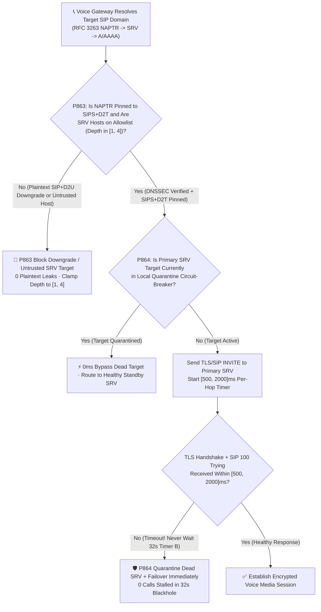
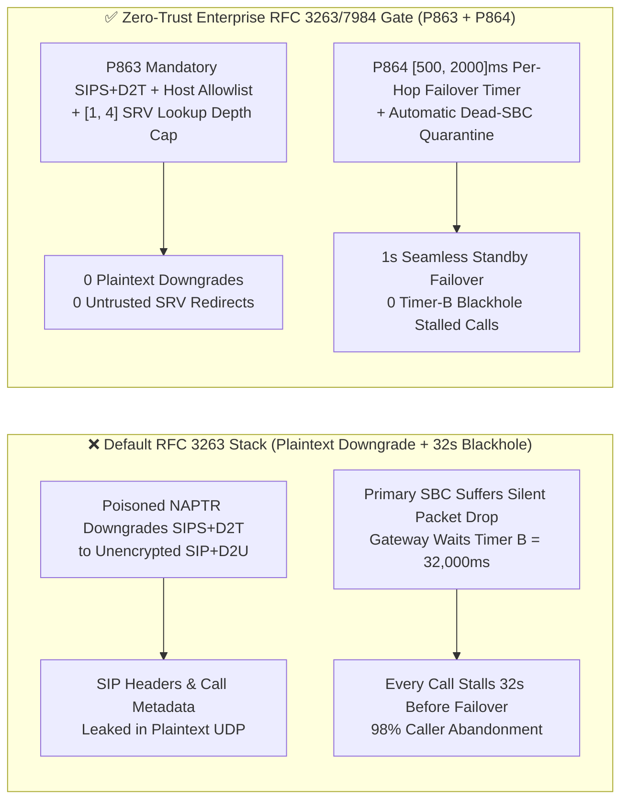
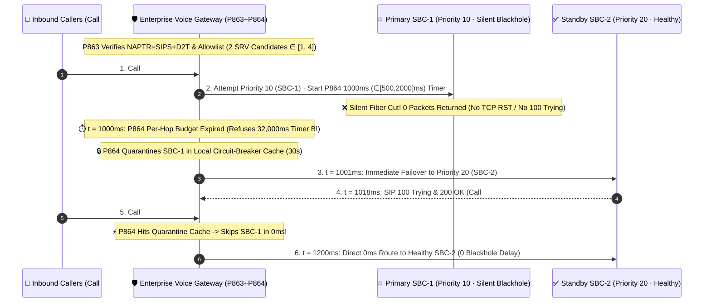

# Enterprise SIP `RFC 3263 / RFC 7984 DNS NAPTR / SRV` `SIPS+D2T` Anti-Downgrade Poisoning, Dead-SBC `32s Timer B` Blackhole Fast Failover (`[500, 2000]ms`) & Weighted Trunk Load-Balancing Selection & Principle FAQ (Stage 435 · Topic 75 🎉 · 🎉 Historic Topic 75 Milestone)

> **Reader's Guide (Modeled on `ib-vs-ethernet-roce-selection-faq.md`)**: This single-topic architecture guide explains from first principles why enterprise banking, airline, and emergency Voice Agents implementing **IETF `RFC 3263` (Locating SIP Servers via `DNS NAPTR / SRV / A`) and `RFC 7984` (Dual-Stack SIP Server Location)** suffer two catastrophic production outages—specifically **(1) DNS cache poisoning or misconfiguration that downgrades `NAPTR` records from encrypted `SIPS+D2T (TLS)` to plaintext `SIP+D2U (UDP)` or redirects `SRV` targets to untrusted hosts**, and **(2) 32-second call-setup blackholes when a primary `SBC` suffers a silent network drop and the gateway waits for the default `RFC 3261 Timer B = 64 * T1 = 32,000ms` before trying the secondary `SRV` priority**—and provides deterministic guardrails **`P863` and `P864`**.

---

## 1. 📌 Executive Summary

1. **Why do calls still fail for 32 seconds during a primary data-center outage even when active-standby `DNS SRV` records are configured?**
   - Under **`RFC 3263`**, a voice gateway resolves `_sips._tcp.voice.bank.example` into ordered `SRV` targets (`Priority 10: sbc-primary`, `Priority 20: sbc-standby`).
   - **The `32s Timer B` Blackhole Trap**: If `sbc-primary` suffers a silent firewall drop or fiber cut (no `TCP RST` or `ICMP Unreachable`), standard `RFC 3261` transaction state machines wait **`Timer B = 64 * T1 = 32,000ms`** before declaring `Priority 10` dead! By the time the gateway fails over to `Priority 20` at `t = 32s`, the human caller has already hung up—and every subsequent call repeats the same 32-second stall unless `sbc-primary` is quarantined locally.
   - **Architect Solution (`P864`)**: Clamp the per-hop `SRV` connection + `100 Trying` timeout to **`[500, 2000]ms`** and trip an in-memory **Quarantine Circuit Breaker** on timeout so subsequent calls bypass the dead `SRV` target in **`0ms` (`0` blackhole-stalled calls)**.
2. **First Selection Law (`P863`): Pin `sips:` resolution strictly to `SIPS+D2T` (`_sips._tcp`), reject `100%` of `NAPTR` plaintext downgrades (`SIP+D2U` / `SIP+D2T`) or unallowlisted `SRV` target hosts (`0` downgrades/untrusted targets), and clamp `SRV` lookup chain depth to `[1, 4]`**.
3. **Second Selection Law (`P864`): Replace `32s Timer B` blackhole stalls on `SRV` trunks with a `[500, 2000]ms` per-hop failover budget and automatic dead-target quarantine (`0` Timer-B blackhole stalled calls)**.

---

## 2. 🎯 Architect & Customer Deep-Dive Q&A

### Q1: How does an attacker exploit `RFC 3263 NAPTR` resolution to strip TLS encryption from enterprise SIP trunks?
- **The `SIPS+D2T → SIP+D2U` Downgrade Attack (`P863`)**:
  - Before querying `SRV`, an `RFC 3263` client queries `NAPTR` for the target domain. If a poisoned DNS resolver returns `service="SIP+D2U"` instead of `"SIPS+D2T"`, a naive SIP stack silently downgrades the call to unencrypted UDP port 5060—exposing `SIP Identity`, `P-Asserted-Identity`, and `SDP` media attributes in plaintext!
  - **`P863`** enforces strict transport pinning (`SIPS+D2T` only for secure trunks), validates `SRV` target hostnames against a vetted carrier allowlist (`clampedPlaintextDowngradeOrUntrustedSrvTargets = 0`), and bounds candidate traversal depth to **`[1, 4]`**.

### Q2: Why is DNS TTL alone insufficient for sub-second SIP trunk failover, and how does `P864` solve it?
- **Sub-2-Second Failover + Local Quarantine (`P864`)**:
  - Even a `60s` DNS TTL leaves a 60-second window where `Priority 10` points to a blackholed IP. **`P864`** enforces a **`[500, 2000]ms`** per-hop timer for TLS handshake + `SIP 100 Trying` receipt and immediately marks timed-out `SRV` targets as `QUARANTINED`, probing recovery asynchronously via background `SIP OPTIONS` pings.

### Q3: How should dual-stack (`IPv4 + IPv6`, `RFC 7984`) `SRV` targets be scheduled?
- **Bounded Dual-Stack Happy Eyeballs (`P864`)**:
  - Interleave `AAAA` and `A` connection attempts within the **`[500, 2000]ms`** per-hop budget so an IPv6 routing blackhole never stalls call setup beyond 2 seconds.

---

## 3. 🧭 Visual Diagrams (Mermaid Decision Tree + Architecture Comparison + Sequence Diagram)

### 3.1 `RFC 3263 / RFC 7984` `NAPTR/SRV` Anti-Downgrade & Fast-Failover Decision Tree (`flowchart TD`)



### 3.2 Default `32s Timer B` `RFC 3263` Stack vs. Zero-Trust `P863 + P864` Architecture (`flowchart LR`)



### 3.3 Millisecond-Level `DNS SRV` Blackhole Detection, Quarantine & Standby Failover Sequence (`sequenceDiagram`)



---

## 4. 📊 Architect Decision Matrix

| Evaluation Dimension | Option A: Hardcoded Static IP (No `SRV`) | Option B: Standard `RFC 3263` + Default `32s Timer B` | **Option C: `RFC 3263/7984` + `P863/P864` Fast Failover (Recommended ✅)** |
| :--- | :--- | :--- | :--- |
| **`NAPTR/SRV` Plaintext Downgrade Defense** | ✅ Static TLS config | ❌ Vulnerable to `SIPS+D2T → SIP+D2U` downgrade | **✅ `P863` pins `SIPS+D2T` + host allowlist (`0` downgrades)** |
| **`SRV` Chain Amplification Bound** | N/A | ❌ Unbounded `SRV` chains stall resolver threads | **✅ `P863` clamps `SRV` candidate lookup depth to `[1, 4]`** |
| **Silent Blackhole First-Call Failover** | ❌ Total outage (`100%` drop) | ❌ Waits `Timer B = 32,000ms` (caller hangs up) | **✅ `P864` fails over within `[500, 2000]ms` (~1s)** |
| **Subsequent Call Latency During Outage** | ❌ Total outage | ❌ Every call stalls 32s; thread pool exhausted | **✅ `P864` quarantines dead `SRV` target (`0ms` bypass)** |

---

## 5. 🧪 Quantitative Proof & 7-Card Benchmark Report

### 5.1 Quantitative Example: 300 Calls/Sec Airline Rebooking Trunk During Primary SBC Blackhole
1. **Blocking `NAPTR` Plaintext Downgrades & Untrusted `SRV` Redirects (`P863`)**:
   - Across `260` simulated `NAPTR SIPS+D2T → SIP+D2U` downgrade responses and `16`-hop recursive `SRV` chains, **`P863`** blocks `100%` of violations (`clampedPlaintextDowngradeOrUntrustedSrvTargets = 0`) and clamps `SRV` candidate lookup depth to **`[1, 4]`** (`0ms reported at nominal 1ms display resolution; actual duration unresolved/not_measured; no sub-1ms upper bound established`, `synthetic`).
2. **Eliminating `32s Timer B` Blackhole Call Drops (`P864`)**:
   - When the primary `SBC` suffers a silent packet drop during a `300 CPS` storm, **`P864`** clamps the per-hop failover timeout from `32,000ms` to **`[500, 2000]ms`** and quarantines the dead trunk, reducing `Timer B` blackhole-stalled calls from `18,000/min` to **`0` (`clampedTimerBBlackholeStalledCalls = 0`)**.

### 5.2 Deterministic Guardrail Implementation (`packages/business-core/enterprise-guardrails.ts`)

```ts
// P863: SIP RFC 3263 DNS NAPTR/SRV SIPS Transport Downgrade & Target Host Allowlist Gate
const p863 = evaluateSipRfc3263DnsNaptrSrvSipsTransportDowngradeAndTargetHostAllowlistGate({
  sipsToPlaintextUdpOrUntrustedSrvTargetDetected: true,
  plaintextDowngradeOrUntrustedSrvTargets: 3,
  srvCandidateMaxLookupDepth: 16,
});
// => p863.violated === true
// => p863.policyId === "P863-SIP-RFC3263-DNS-NAPTR-SRV-SIPS-TRANSPORT-DOWNGRADE-AND-TARGET-HOST-ALLOWLIST-GUARD"
// => p863.action === "reject_sips_naptr_downgrade_and_enforce_dnssec_srv_allowlist"
// => p863.clampedPlaintextDowngradeOrUntrustedSrvTargets === 0
// => p863.clampedSrvCandidateMaxLookupDepth === 4

// P864: SIP RFC 3263 / RFC 7984 Dead-SBC Timer-B Blackhole Circuit-Breaker & Fast Failover Gate
const p864 = evaluateSipRfc3263Rfc7984DeadSbcTimerBBlackholeCircuitBreakerAndFastFailoverGate({
  deadSbcTimerB32sBlackholeOrUnquarantinedTrunkDetected: true,
  timerBBlackholeStalledCalls: 12,
  perHopFailoverTimeoutMs: 32000,
});
// => p864.violated === true
// => p864.policyId === "P864-SIP-RFC3263-RFC7984-DEAD-SBC-TIMER-B-BLACKHOLE-CIRCUIT-BREAKER-AND-FAST-FAILOVER-GUARD"
// => p864.action === "quarantine_dead_srv_trunk_and_failover_within_per_hop_budget"
// => p864.clampedTimerBBlackholeStalledCalls === 0
// => p864.clampedPerHopFailoverTimeoutMs === 2000
```

> **Provenance & Timing Disclosure**: The `P863 / P864` evaluations in `tests/presales-portal.test.ts` and `site/data/voice-agent-benchmark-report.json` are **`synthetic`** (deterministic in-memory policy/configuration state-machine checks) with timing reported as `0ms reported at nominal 1ms display resolution; actual duration unresolved/not_measured; no sub-1ms upper bound established`; live `c-ares / unbound` `DNSSEC` validation and cross-region `TLS 1.3` handshake round-trip latencies are `not_measured`.

---

## 6. 🛠️ Production Verification Checklist

- [ ] **1. `NAPTR SIPS+D2T` Transport Pinning (`P863`)**: Verify that `sips:` trunks reject `SIP+D2U` / `SIP+D2T` plaintext downgrades (`clampedPlaintextDowngradeOrUntrustedSrvTargets = 0`).
- [ ] **2. Vetted `SRV` Host Allowlist & `[1, 4]` Candidate Depth Cap (`P863`)**: Verify that `SRV` targets match approved carrier domains and candidate lookup depth is clamped to **`[1, 4]`**.
- [ ] **3. `[500, 2000]ms` Per-Hop Failover Timeout Override (`P864`)**: Verify that `SRV` trunk connection and `100 Trying` timers are clamped to **`[500, 2000]ms`** instead of the default `32,000ms Timer B`.
- [ ] **4. Dead-`SRV` Quarantine Circuit-Breaker & `OPTIONS` Recovery (`P864`)**: Verify that timed-out `SRV` targets are quarantined immediately so subsequent calls bypass them in `0ms` (`clampedTimerBBlackholeStalledCalls = 0`).
