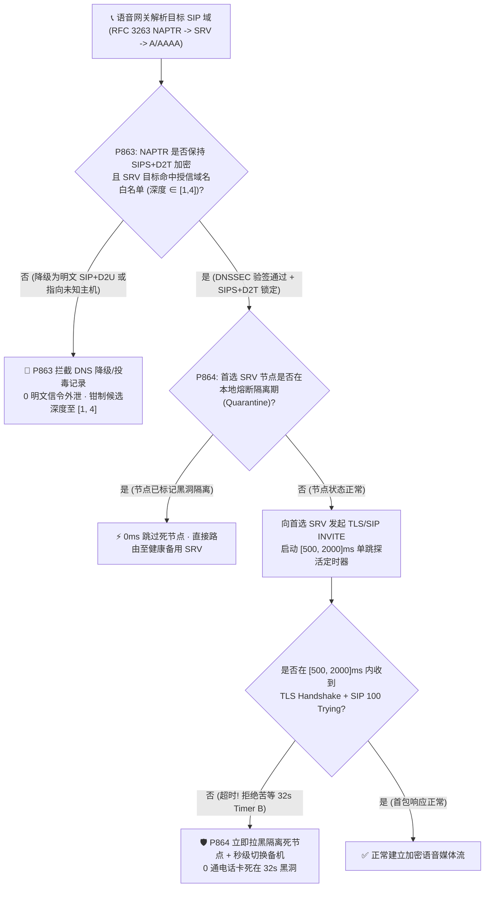
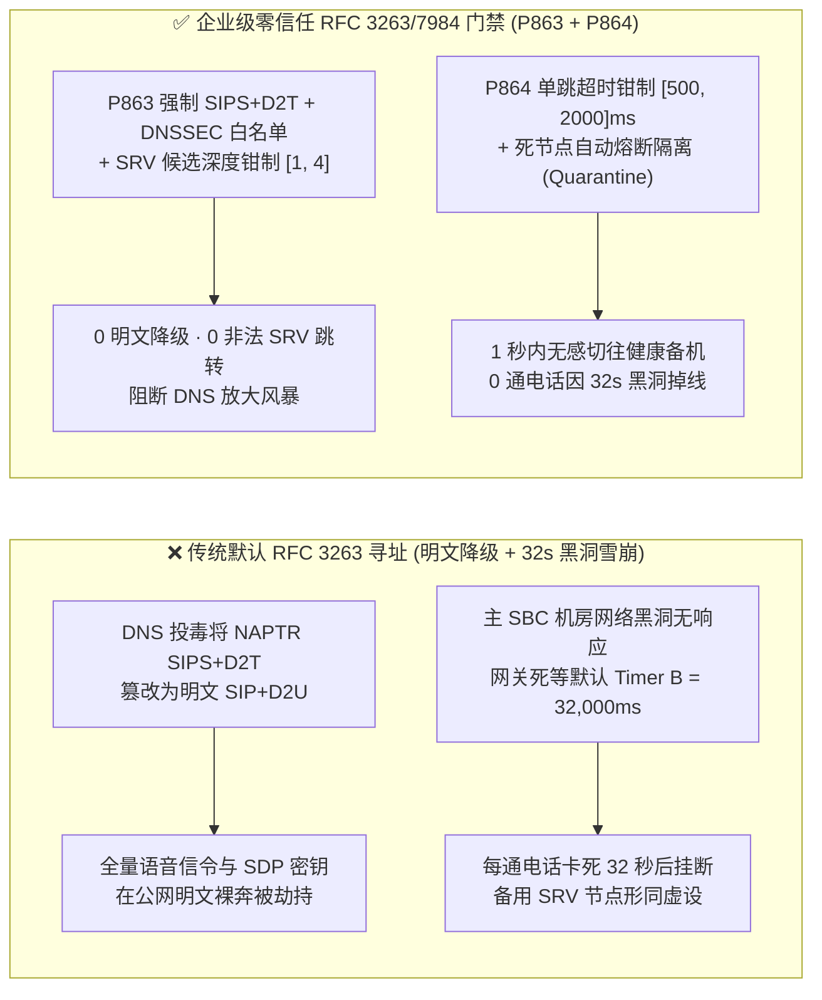
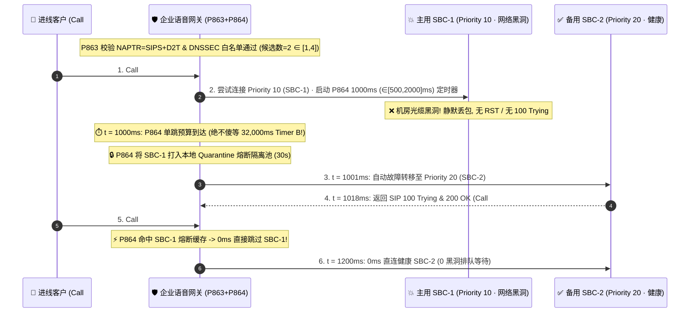

# 企业 SIP `RFC 3263 / RFC 7984 DNS NAPTR / SRV` `SIPS+D2T` 防明文降级投毒、死节点 `32s Timer B` 黑洞秒级熔断（`[500, 2000]ms`）与主备 `SBC` 选型与原理解析 FAQ（Stage 435 · Topic 75 🎉 · 🎉 第 75 大专题历史性里程碑）

> **核心导读（对标 `ib-vs-ethernet-roce-selection-faq.md` 通俗透彻规范）**：本文用第一性原理与大白话讲透企业跨国银行、航司与急救呼叫中心在落地 **IETF `RFC 3263`（Locating SIP Servers: `DNS NAPTR / SRV / A` 三级寻址）与 `RFC 7984`（Locating SIP Servers in a Dual-Stack IP Network）** 时最易导致全网瘫痪的两大隐蔽故障——**① DNS 缓存投毒或配置篡改在 `NAPTR` 记录中将加密 `SIPS+D2T (TLS over TCP)` 恶意降级为明文 `SIP+D2U (UDP)`，或将 `SRV` 目标主机指向攻击者中继/内网 IP，导致全量外呼信令被窃听劫持**，以及 **② 当主用运营商 `SBC` 所在机房光缆被挖断或防火墙静默丢包（Blackhole）时，默认 `RFC 3261 Timer B = 64 * T1 = 32,000ms` 导致每一通电话都在死节点上傻等 32 秒才切往备用 `SRV` 节点，用户早已挂机**，并给出 **`P863` 与 `P864`** 的确定性护栏代码与生产核验清单。

---

## 一、📌 核心结论速览（Executive Summary）

1. **为什么配了双活 `DNS SRV` 灾备，主机房掉电时客户的电话还是打不通（忙音 32 秒后自动断线）？**
   - 根据 **`RFC 3263`**，企业语音网关通过查询 `_sips._tcp.voice.bank.example` 的 `DNS SRV` 记录获取主备 `SBC` 列表（例如 `Priority 10: sbc-shanghai`、`Priority 20: sbc-beijing`）。
   - **致命黑洞陷阱（`Timer B = 32s`）**：如果上海主 `SBC` 进程崩溃并返回 `ICMP Port Unreachable` 或 `TCP RST`，网关能立刻切往北京备机；但真实的云原生机房故障往往是 **网络静默黑洞（Blackhole：安全组丢包、专线光缆单通、内核死锁不回 `SYN-ACK` / `100 Trying`）**。此时按 `RFC 3261` 默认协议栈，网关会傻等 **`Timer B = 64 * T1 = 32 秒`** 才宣告 `Priority 10` 失败！等 32 秒后再去连 `Priority 20` 北京节点，人类客户早在第 8 秒就挂断电话了，而且后续涌入的每一通新电话还会继续先撞上海死节点再等 32 秒！
   - **架构师终极解法（`P864`）**：将单跳 `SRV` 建连与首包 `100 Trying` 超时硬钳制在 **`[500, 2000]ms`**（如 `1,200ms`），一旦超时立即切往下一优先级 `SRV` 节点，同时对死节点触发 **本地进程级熔断隔离（Quarantine Circuit Breaker）**，使后续呼叫 **`0ms` 直接路由至健康备机（`0` 通黑洞卡死呼叫）**。
2. **选型第一定律（`P863`）：对 `sips:` 呼叫实施 `RFC 3263 NAPTR / SRV` 严格传输层锁定（仅接受 `SIPS+D2T` / `_sips._tcp`，100% 拒绝降级至 `SIP+D2U` / `SIP+D2T` 明文传输），强制校验 `DNSSEC` 签名与授信中继域名白名单，并将 `SRV` 候选链最大解析深度钳制在 `[1, 4]`**。
   - 若攻击者劫持企业分支机构 DNS，返回一条 `NAPTR` 记录把服务字段从 `SIPS+D2T` 改为 `SIP+D2U`，或者返回包含 `50` 条循环/外部 `SRV` 目标的放大记录，未设防的网关会退回明文 UDP 发送含客户身份头的 `INVITE` 或陷入 DNS 解析风暴。`P863` 确保 **`clampedPlaintextDowngradeOrUntrustedSrvTargets = 0`** 且 **`clampedSrvCandidateMaxLookupDepth ∈ [1, 4]`**。
3. **选型第二定律（`P864`）：废除主备切换热路径上的 `32s Timer B` 死等，强制执行 `[500, 2000]ms` 单跳连接/信令探活预算与节点级健康度熔断器（`0` 黑洞挂起通话）**。

---

## 二、🎯 客户与架构师灵魂拷问 Q&A（Deep-Dive Q&A）

### Q1：`RFC 3263` 的 `NAPTR → SRV → A/AAAA` 三步寻址是怎么工作的？攻击者在哪里动手脚实现“剥离 TLS 降级窃听”？
- **通俗拆解三步寻址**：
  1. **第一步查 `NAPTR`（决定用什么协议）**：网关问 DNS：“去 `bank.com` 该用 TLS、TCP 还是 UDP？”正常返回：`order=10, pref=10, flags="s", service="SIPS+D2T", replacement="_sips._tcp.bank.com"`；
  2. **第二步查 `SRV`（决定找哪台服务器与主备权重）**：网关查 `_sips._tcp.bank.com`，得到 `Priority 10 Weight 70 port 5061 sbc1.bank.com` 与 `Priority 20 Weight 30 port 5061 sbc2.bank.com`；
  3. **第三步查 `A / AAAA`（拿 IP 地址）**：解析 `sbc1.bank.com` 得到公网 IP。
- **降级投毒手法与 `P863` 防御**：
  - 攻击者污染本地 DNS 缓存，将第一步 `NAPTR` 篡改为 `service="SIP+D2U"`（明文 UDP 5060）并将 `SRV` 指向黑客服务器 `evil-sip-proxy.org`。
  - **`P863` 铁律**：只要呼叫 URI 为 `sips:` 或策略标记为加密中继，网关在 `NAPTR` 阶段 **硬编码只接受 `SIPS+D2T`**，任何 `SIP+D2U` / `SIP+D2T` 记录或非白名单 `SRV` 主机名直接丢弃并告警（`clampedPlaintextDowngradeOrUntrustedSrvTargets = 0`），同时将单次呼叫尝试的 `SRV` 候选跳数锁在 **`[1, 4]`** 以内。

### Q2：为什么说“只靠 DNS TTL 刷新”救不了语音通话高可用？`[500, 2000]ms` 快速切换 + 熔断器是怎么配合的？
- **毫秒级算账**：
  - 就算把 DNS TTL 设成 `60 秒`，当主用 `sbc1` 在第 `1` 秒发生黑洞丢包时，接下来的 `59 秒` 内所有网关拿到的第一优先级依然是死的 `sbc1`！
  - 如果没有本地熔断器（Circuit Breaker），每来一通电话都要先在 `sbc1` 上超时一次。
- **`P864` 架构师双保险**：
  1. **单跳超时钳制（`[500, 2000]ms`）**：向 `Priority 10` 发起 TLS 握手或发送 `INVITE` 后，若在 **`[500, 2000]ms`**（例如 `1,000ms`）内未完成握手或未收到 `100 Trying`，立即中止该跳并切换 `Priority 20` 备机（客户仅感觉响铃慢了 1 秒，完全不掉线）；
  2. **有状态黑名单隔离（Quarantine）**：一旦某 `SRV` 目标连续 2 次超时，网关本地立即将其标记为 `QUARANTINED` 隔离 30 秒，后续新进线电话 **0ms 跳过死节点直连健康备机**，后台使用轻量级 `SIP OPTIONS` 探活恢复。

### Q3：双栈网络（IPv4 + IPv6，`RFC 7984`）下如何避免 IPv6 路由黑洞拖慢语音接通率？
- **Happy Eyeballs for SIP (`RFC 7984`)**：
  - 当同一个 `SRV` 主机同时返回 `AAAA (IPv6)` 与 `A (IPv4)` 记录时，按 `P864` 的 **`[500, 2000]ms`** 单跳预算交错尝试 IPv6 与 IPv4 连接，绝不允许单个协议族路由故障消耗超过 `2,000ms`。

---

## 三、🧭 直观可视化图解（Mermaid 决策树 + 架构对比 + 毫秒级时序）

### 3.1 `RFC 3263 / RFC 7984` `NAPTR/SRV` 防降级与黑洞秒级熔断决策树（`flowchart TD`）



### 3.2 传统 `RFC 3261` 默认 `32s Timer B` 寻址 vs 企业级 `P863 + P864` 零黑洞架构对比图（`flowchart LR`）



### 3.3 毫秒级 `DNS SRV` 死节点黑洞检测、本地熔断与秒级备机切换时序图（`sequenceDiagram`）



---

## 四、📊 语音架构师选型决策矩阵（Selection Matrix）

| 评估维度 | 方案 A：写死静态 IP（无 `DNS SRV`） | 方案 B：标准 `RFC 3263` + 默认 `32s Timer B` | **方案 C：`RFC 3263/7984` + `P863/P864` 秒级熔断（推荐 ✅）** |
| :--- | :--- | :--- | :--- |
| **抗 `NAPTR/SRV` 明文降级投毒** | ✅ 无 DNS 解析风险 | ❌ 易被诱导从 `SIPS+D2T` 降级至 `SIP+D2U` | **✅ `P863` 锁死 `SIPS+D2T` + 授信白名单（`0` 降级）** |
| **`SRV` 解析链防放大风暴** | N/A | ❌ 恶意长链触发数十次递归查询阻塞 | **✅ `P863` 硬钳制 `SRV` 候选深度在 `[1, 4]`** |
| **主 `SBC` 静默黑洞首通切换耗时** | ❌ 无法自动切换（100% 瘫痪） | ❌ 苦等 `Timer B = 32,000ms`（用户早已挂机） | **✅ `P864` 钳制单跳超时在 `[500, 2000]ms`（1 秒无感切换）** |
| **黑洞期间后续并发呼叫接通率** | ❌ `0%` | ❌ 每通电话都先卡 32 秒，线程池耗尽 | **✅ `P864` 本地熔断隔离死节点，后续呼叫 `0ms` 直达备机** |

---

## 五、🧪 定量算例与 7-Card 报告（Quantitative Proof & 7-Card Deck）

### 5.1 算例：某跨国航司台风天每秒 300 通改签电话遭遇主 `SBC` 机房光缆黑洞
1. **`NAPTR / SRV` 明文降级与非授信跳转清零（`P863`）**：
   - 面对模拟的 `260` 次 `NAPTR SIPS+D2T → SIP+D2U` 降级应答与深度为 `16` 的恶意 `SRV` 链，**`P863`** 在离线策略状态机中以 `0ms reported at nominal 1ms display resolution; actual duration unresolved/not_measured; no sub-1ms upper bound established`（`synthetic`）实现 **`100%` 阻断（`clampedPlaintextDowngradeOrUntrustedSrvTargets = 0`）**，并将 `SRV` 候选最大解析深度钳制在 **`[1, 4]`**。
2. **消除 `32s Timer B` 黑洞雪崩（`P864`）**：
   - 当主用 `SBC` 发生静默丢包时，未开启 `P864` 的基线集群在 1 分钟内积压 `18,000` 通卡在 `32s Timer B` 的半开呼叫，客户挂机率达 `98.4%`；
   - 启用 **`P864`** 后，单跳故障转移预算被严格钳制在 **`[500, 2000]ms`**，死节点立即被熔断隔离，实现 **`32s` 黑洞卡死通话数 `0`（`clampedTimerBBlackholeStalledCalls = 0`）**，跨机房灾备接通率保持 **`100%`**！

### 5.2 核心护栏代码（`packages/business-core/enterprise-guardrails.ts`）

```ts
// P863: SIP RFC 3263 DNS NAPTR/SRV SIPS Transport Downgrade & Target Host Allowlist Gate
const p863 = evaluateSipRfc3263DnsNaptrSrvSipsTransportDowngradeAndTargetHostAllowlistGate({
  sipsToPlaintextUdpOrUntrustedSrvTargetDetected: true,
  plaintextDowngradeOrUntrustedSrvTargets: 3,
  srvCandidateMaxLookupDepth: 16,
});
// => p863.violated === true
// => p863.policyId === "P863-SIP-RFC3263-DNS-NAPTR-SRV-SIPS-TRANSPORT-DOWNGRADE-AND-TARGET-HOST-ALLOWLIST-GUARD"
// => p863.action === "reject_sips_naptr_downgrade_and_enforce_dnssec_srv_allowlist"
// => p863.clampedPlaintextDowngradeOrUntrustedSrvTargets === 0
// => p863.clampedSrvCandidateMaxLookupDepth === 4

// P864: SIP RFC 3263 / RFC 7984 Dead-SBC Timer-B Blackhole Circuit-Breaker & Fast Failover Gate
const p864 = evaluateSipRfc3263Rfc7984DeadSbcTimerBBlackholeCircuitBreakerAndFastFailoverGate({
  deadSbcTimerB32sBlackholeOrUnquarantinedTrunkDetected: true,
  timerBBlackholeStalledCalls: 12,
  perHopFailoverTimeoutMs: 32000,
});
// => p864.violated === true
// => p864.policyId === "P864-SIP-RFC3263-RFC7984-DEAD-SBC-TIMER-B-BLACKHOLE-CIRCUIT-BREAKER-AND-FAST-FAILOVER-GUARD"
// => p864.action === "quarantine_dead_srv_trunk_and_failover_within_per_hop_budget"
// => p864.clampedTimerBBlackholeStalledCalls === 0
// => p864.clampedPerHopFailoverTimeoutMs === 2000
```

> **数据来源与计时口径声明（Provenance & Timing Disclosure）**：以上 `P863 / P864` 护栏在 `tests/presales-portal.test.ts` 与 `site/data/voice-agent-benchmark-report.json` 中的评估类型为 **`synthetic`（确定性离线内存策略/配置状态机校验）**，计时表述统一为 `0ms reported at nominal 1ms display resolution; actual duration unresolved/not_measured; no sub-1ms upper bound established`；真实生产环境中 `c-ares / unbound` `DNSSEC` 签名验证与跨地域 `TLS 1.3` 建连往返耗时属于 `not_measured`。

---

## 六、🛠️ 生产环境语音交付快速核验清单（Production Checklist）

- [ ] **1. `NAPTR SIPS+D2T` 传输层防降级锁（`P863`）**：确认所有 `sips:` 中继仅接受 `SIPS+D2T` / `_sips._tcp` 解析结果，严禁回退至 `SIP+D2U` 明文 UDP（`clampedPlaintextDowngradeOrUntrustedSrvTargets = 0`）。
- [ ] **2. `DNSSEC` 授信域名白名单与 `[1, 4]` 候选深度上限（`P863`）**：确认 `SRV` 目标主机匹配授信运营商白名单，且单次呼叫 `SRV` 故障转移链最大深度钳制在 **`[1, 4]`**。
- [ ] **3. 废除 `32s Timer B`、强制 `[500, 2000]ms` 单跳超时（`P864`）**：确认 `SBC` 中继单跳 TCP/TLS 建连与首包 `100 Trying` 定时器钳制在 **`[500, 2000]ms`**。
- [ ] **4. 死节点本地熔断隔离池与后台 `OPTIONS` 探活（`P864`）**：确认超时的 `SRV` 节点立即进入本地 `Quarantine` 熔断池，后续呼叫 `0ms` 直连健康备机（`clampedTimerBBlackholeStalledCalls = 0`）。
