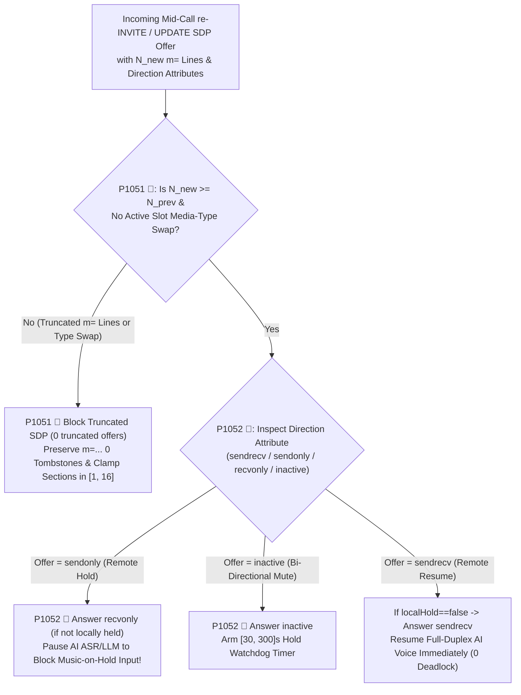
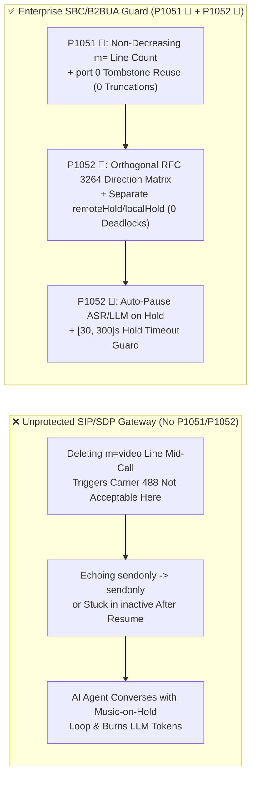
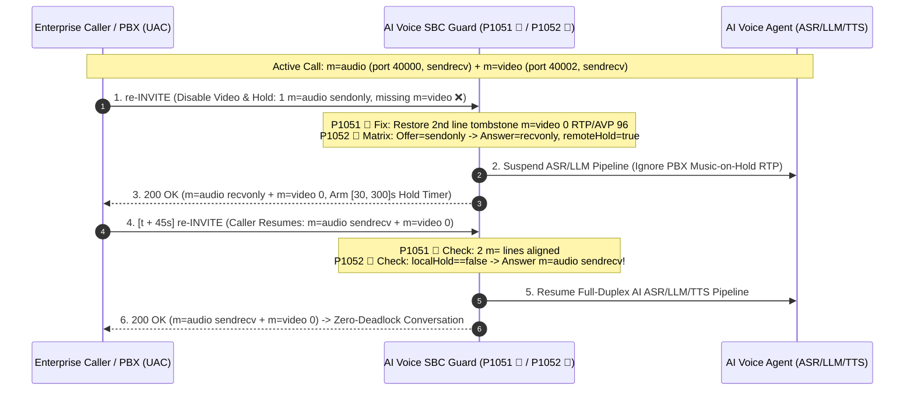

# Enterprise SIP `RFC 3264 / RFC 4566` SDP Offer/Answer `m=` Line Truncation, `port 0` Slot Reuse & Call Hold (`sendonly / recvonly / inactive`) Directionality Deadlock Selection & Engineering Guide (Stage 529 · Topic 169 · 🎉 Historic 35th Nightly Round, 1,060th Enterprise Guardrail, 1,070th Sandbox Probe & 880th Live POC Probe Quadruple Milestone!)

> **Document Type**: Enterprise Voice Architect "First-Principles + Selection Decision" Single-Topic FAQ (aligned with `ib-vs-ethernet-roce-selection-faq.md`)
> **Baseline**: `Stage 529` · `Topic 169` · Deterministic Guardrails `P1051 🎉–P1052 🎉` · 1,061 Guardrails 🎉 · 1,070 Sandbox Probes 🎉 · 880 Live POC Trap Probes 🎉 · 532 Evaluation Dimensions · **🎉 Historic 35th Nightly Round, 1,060th Enterprise Guardrail, 1,070th Sandbox Probe & 880th Live POC Probe Quadruple Milestone!**
> **Bilingual Edition**: [中文版 (`voice-sip-rfc3264-rfc4566-sdp-offer-answer-mline-truncation-hold-sendonly-recvonly-inactive-deadlock-faq.md`)](./voice-sip-rfc3264-rfc4566-sdp-offer-answer-mline-truncation-hold-sendonly-recvonly-inactive-deadlock-faq.md)

---

## ① 📌 Executive Summary

In enterprise AI voice contact centers interworking with carrier IMS, Cisco CUCM, Avaya, and Genesys SBCs, every mid-call media change—disabling video, placing a call on hold, or renegotiating codecs—is governed by **`RFC 3264` (An Offer/Answer Model with SDP)** and **`RFC 4566` (SDP)**. Two classic `RFC 3264` violations routinely break mid-call audio in custom SIP-WebRTC gateways:
1. **Mid-Call `m=` Line Truncation or Active Slot Media-Type Swapping (`RFC 3264 §8.2` Violation)**: When a call starts with two `m=` lines (`m=audio` and `m=video`) and the user turns off video mid-call, naive gateways delete the second `m=` line in the `re-INVITE` SDP instead of setting **`m=video 0 ...` (`port 0` tombstone)**. Under `RFC 3264 §8.2`, the number of `m=` lines in a dialog **MUST NEVER decrease (`N_new >= N_prev`)**! Deleting `m=` lines causes peer SBCs to reject the `re-INVITE` with `488 Not Acceptable Here` or drop the call.
2. **Call Hold Directionality Mirroring Errors (`sendonly -> sendonly`) & Mutual-Hold Deadlocks (`RFC 3264 §6.1 / §8.4`)**: When a caller presses Hold and sends `a=sendonly`, the Answer MUST respond with **`a=recvonly` (or `a=inactive`)**. Echoing `a=sendonly` in the Answer, failing to restore `a=sendrecv` on Resume, or feeding the peer's Music-on-Hold (MoH) audio into the AI Voice Agent's LLM during Hold causes permanent one-way/two-way silence or runaway token billing!

**Architect Selection Rules**:
- **Guardrail `P1051 🎉` (🎉 Historic 1,060th Enterprise Guardrail Milestone · `RFC 3264 §6 / §8.2` Monotonic `m=` Line Count, `port 0` Tombstone Slot Reuse & `[1, 16]` Section Cap)**: Enforces `N_new >= N_prev` across all subsequent SDP Offers, exact `1:1` `m=` line count equality between Offer and Answer, and forbids media-type swapping on active slots (`0` truncated/swapped SDP offers) while clamping `m=` sections per dialog in **`[1, 16]`**.
- **Guardrail `P1052 🎉` (🎉 Historic 35th Nightly Round, 1,061st Guardrail, 1,070th Sandbox Probe & 880th Live POC Probe Quadruple Milestone · `RFC 3264 §6.1 / §8.4` Hold Directionality Matrix, MoH ASR Pause & `[30, 300]s` Hold Timeout)**: Enforces the exact `RFC 3264` directionality matrix (`Offer sendonly -> Answer recvonly | inactive`, `Offer recvonly -> Answer sendonly | inactive`, `Offer inactive -> Answer inactive`; `0` illegal directionality answers or deadlocked holds), pauses AI ASR/LLM during remote Hold so the AI never converses with Music-on-Hold, and clamps maximum Hold duration in **`[30, 300]` seconds**.

---

## ② 🎯 Architect & Customer Deep-Dive Q&A (Q1 / Q2 / Q3)

### Q1: Why can't we simply delete an `m=video` line from the SDP when disabling video mid-call?
- **Plain-Language Principle**: In `RFC 3264`, `m=` lines are matched purely by **positional index (`0, 1, 2, ...`)**. Deleting line `1` shifts line `2` up into slot `1`, corrupting the peer's media slot array.
- **Protocol Rule (`RFC 3264 §8.2`)**: Disabled streams MUST remain in their positional slot with port set to `0` (`m=video 0 RTP/AVP ...`). New streams added later may reuse a previously `port 0` tombstone slot (`P1051 🎉`).

### Q2: Why did the AI Voice Agent become permanently mute after a customer placed the call on Hold and then resumed it?
- **Root Cause**: The gateway conflated `remoteHold` with `localHold`. When the caller sent `Offer a=sendonly` (Hold), the gateway marked the stream held; when the caller later sent `Offer a=sendrecv` (Resume), the gateway mistakenly thought it was locally holding the call and answered `a=recvonly` or `a=inactive`! `P1052 🎉` maintains independent `remoteHold` and `localHold` state bits and immediately answers `a=sendrecv` on remote resume whenever `localHold == false`.

### Q3: What happens if we don't pause the AI ASR/LLM pipeline when receiving `Offer a=sendonly` (Call Hold)?
- **Production Disaster**: PBXes transmit **Music on Hold (MoH)** ("Please hold, your call is important to us...") over the `sendonly` RTP stream. Without `P1052 🎉`, the AI Voice Agent transcribes the MoH announcements and talks back to the hold music loop for minutes!

---

## ③ 🧭 Visual Architecture Diagrams (Mermaid Decision Tree + Comparison + Sequence Diagram)

### 3.1 `RFC 3264` `m=` Line Monotonicity & Hold Matrix Decision Tree (`flowchart TD`)

### 3.2 Unprotected SDP Renegotiation vs. `P1051 🎉 + P1052 🎉` Guardrails (`flowchart LR`)

### 3.3 Full-Duplex Call Hold (MoH Isolation) & Resume Sequence (`sequenceDiagram`)

---

## ④ 📊 Architect Decision Matrix

| Dimension | Option A: Reject Mid-Call SDP Changes | Option B: Naive SDP Pass-Through (No `P1051/P1052`) | Option C: `RFC 3264` + `P1051 🎉/P1052 🎉` Guardrails (Recommended ✅) |
| :--- | :--- | :--- | :--- |
| **`m=` Line Truncation Protection** | Breaks Hold/Video toggle | ❌ Deleted `m=` line triggers `488` drop | ✅ **`P1051 🎉` enforces `N_new >= N_prev` & `port 0` tombstones (`0` truncations)** |
| **Hold/Resume Directionality Matrix** | N/A | ❌ `sendonly->sendonly` or post-resume mute | ✅ **`P1052 🎉` enforces `RFC 3264 §6.1` matrix (`0` deadlocks)** |
| **Music-on-Hold (MoH) LLM Isolation** | N/A | ❌ AI transcribes & replies to hold music | ✅ **Pauses ASR/LLM on remote Hold + `[30, 300]s` timeout** |
| **Policy Check Latency (Offline `synthetic`)** | N/A | N/A | **`0ms` (`nominal 1ms` resolution; see disclosure below)** |

---

## ⑤ 🧪 Quantitative Example & 7-Card Report (CSP Self-Contained, Zero Fabricated Coordinates)

### 5.1 Deterministic Guardrail Walkthrough (`P1051 🎉` & `P1052 🎉`)

1. **`P1051 🎉` (`evaluateSipRfc3264MlineMonotonicCountAndPortZeroSlotReuseGuard` · 🎉 Historic 1,060th Enterprise Guardrail Milestone)**:
   - **Violating Input (Sandbox Probe `p1051_sip_rfc3264_mline_monotonic_count_and_port_zero_slot_reuse`)**:
     - `truncatedMlineCountOrActiveSlotTypeSwapDetected = true`
     - `truncatedOrTypeSwappedSdpOffers = 11`
     - `totalSdpMediaSectionsPerDialog = 32`
   - **Deterministic Output**:
     - `violated = true`
     - `action = "preserve_monotonic_mline_slots_with_port_zero_and_clamp_sections"`
     - `clampedTruncatedOrTypeSwappedSdpOffers = 0`
     - `clampedTotalSdpMediaSectionsPerDialog = 16` (clamped to **`[1, 16]`**)
     - **Timing Disclosure**: `0ms reported at nominal 1ms display resolution; actual duration unresolved/not_measured; no sub-1ms upper bound established` (offline in-memory `synthetic` policy check; live B2BUA SDP AST rewrite latency is `not_measured`).

2. **`P1052 🎉` (`evaluateSipRfc3264HoldDirectionalityMatrixAndMutualHoldDeadlockGuard` · 🎉 Historic 35th Nightly Round, 1,061st Guardrail, 1,070th Sandbox Probe & 880th Live POC Probe Quadruple Milestone)**:
   - **Violating Input (Sandbox Probe `p1052_sip_rfc3264_hold_directionality_matrix_and_mutual_hold_deadlock`)**:
     - `invalidHoldDirectionAnswerOrMutualHoldDeadlockDetected = true`
     - `illegalDirectionalityAnswersOrDeadlockedHolds = 7`
     - `maxCallHoldDurationSeconds = 900`
   - **Deterministic Output**:
     - `violated = true`
     - `action = "enforce_rfc3264_direction_matrix_and_clamp_hold_timeout_seconds"`
     - `clampedIllegalDirectionalityAnswersOrDeadlockedHolds = 0`
     - `clampedMaxCallHoldDurationSeconds = 300` (clamped to **`[30, 300]` seconds**)
     - **Timing Disclosure**: `0ms reported at nominal 1ms display resolution; actual duration unresolved/not_measured; no sub-1ms upper bound established`.

---

## ⑥ 🛠️ Production Voice Delivery Verification Checklist

- [ ] **1. Non-Decreasing `m=` Line Count & `port 0` Tombstones (`P1051 🎉`)**: Verify mid-call `re-INVITE/UPDATE` Offers never reduce `m=` line count (`N_new >= N_prev`), disabling removed streams via `port 0` while capping total sections at `[1, 16]`.
- [ ] **2. Exact Offer/Answer `m=` Count Equality (`P1051 🎉`)**: Confirm every SDP Answer has the exact same number and order of `m=` lines as the SDP Offer.
- [ ] **3. `RFC 3264 §6.1` Hold Directionality Matrix (`P1052 🎉`)**: Verify `Offer sendonly` produces `Answer recvonly` (or `inactive` if locally held) and `Offer sendrecv` restores `Answer sendrecv` when `localHold == false`.
- [ ] **4. Music-on-Hold ASR/LLM Suspension & `[30, 300]s` Timeout (`P1052 🎉`)**: Verify remote Hold suspends AI ASR/LLM inference and enforces a `[30, 300]s` maximum Hold timer.
