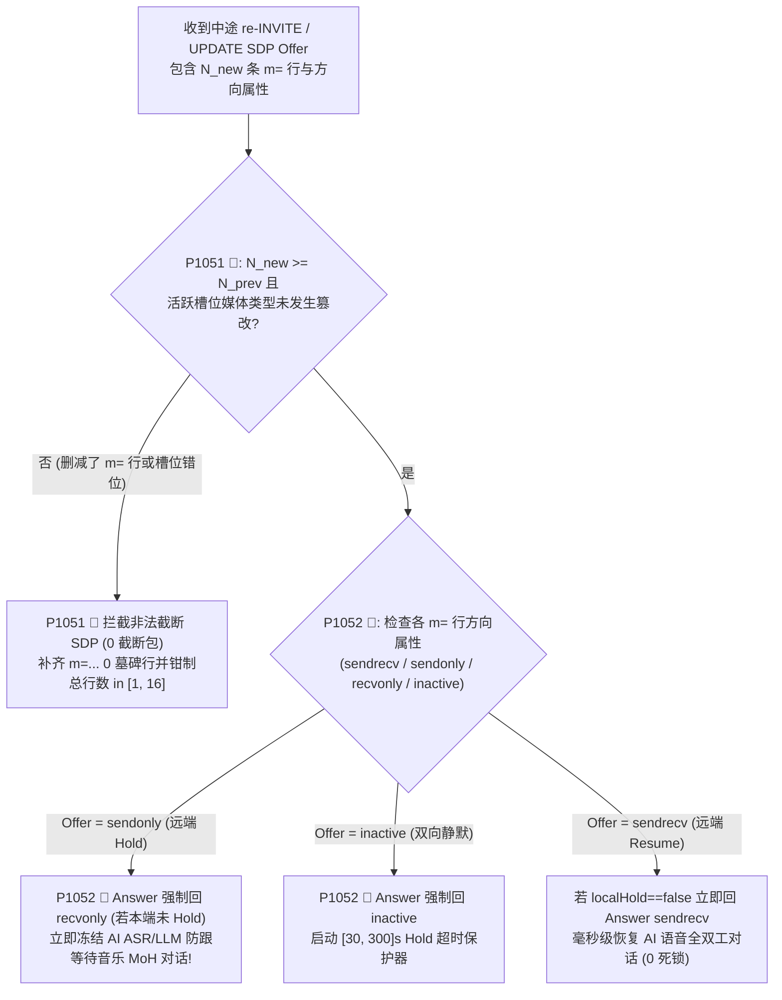
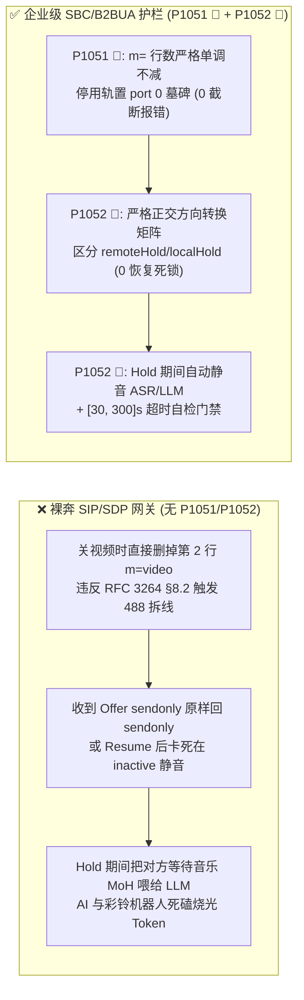
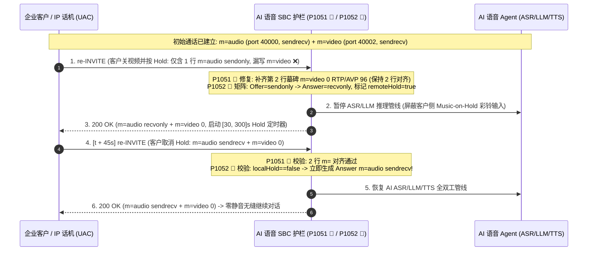

# 企业 SIP `RFC 3264 / RFC 4566` SDP Offer/Answer `m=` 媒体行截断、槽位错位与呼叫保持（`sendonly / recvonly / inactive`）方向死锁选型与工程指南（Stage 529 · Topic 169 · 🎉 历史性第 35 轮本夜深潜、第 1,060 道护栏、第 1,070 个沙盒探针与第 880 个现场 POC 探针四重里程碑！）

> **文档类型**：企业语音架构师“第一性原理 + 选型决策”单专题 FAQ（对标 `ib-vs-ethernet-roce-selection-faq.md` 通俗透彻规范）
> **关联基准**：`Stage 529` · `Topic 169` · 确定性护栏 `P1051 🎉–P1052 🎉` · 1,061 道企业护栏 🎉 · 1,070 个沙盒探针 🎉 · 880 个现场 POC 探针 🎉 · 532 大评测维度 · **🎉 历史性第 35 轮本夜深潜、第 1,060 道企业级护栏、第 1,070 个沙盒探针与第 880 个现场 POC 探针四重里程碑！**
> **双语版本**：[English Version (`voice-sip-rfc3264-rfc4566-sdp-offer-answer-mline-truncation-hold-sendonly-recvonly-inactive-deadlock-faq.en.md`)](./voice-sip-rfc3264-rfc4566-sdp-offer-answer-mline-truncation-hold-sendonly-recvonly-inactive-deadlock-faq.en.md)

---

## ① 📌 核心结论速览（Executive Summary）

在企业级 AI 语音联络中心与运营商 IMS、Cisco CUCM、Avaya 或 Genesys 互联时，每一次通话中途的媒体变更（如关闭视频转纯语音、客户按下呼叫保持 Hold 键、或切换编解码器）都依赖 **`RFC 3264`（An Offer/Answer Model with SDP）** 与 **`RFC 4566`（SDP）**。然而在生产环境中，自研 SIP-WebRTC 转换网关最容易在以下两个 `RFC 3264` 基础公理上翻车：
1. **中途重协商直接删减 `m=` 行（`m=` Line Truncation）或篡改槽位媒体类型**：初始建连有 2 个 `m=` 行（第 1 行 `m=audio`、第 2 行 `m=video`），通话中途用户关闭摄像头，网关为了“省事”在 `re-INVITE` 的 SDP 里直接删掉第 2 行，只发 1 行 `m=audio`！按 **`RFC 3264 §8.2` 铁律**，同一个 SIP 对话内 **`m=` 行的总行数永远只能增加或保持不变（`N_new >= N_prev`），绝不允许减少**！关闭媒体轨唯一合法的做法是将该位置设为 **`m=video 0 ...`（端口号置 `0` 墓碑占位）**。直接删行会导致对端 SBC 按行号索引数组越界或直接回 `488 Not Acceptable Here` 拆线！
2. **呼叫保持（Call Hold）方向矩阵镜像错误（`sendonly -> sendonly`）与双向 `a=inactive` 永久死锁**：当客户按下 Hold 键发来 `a=sendonly`（表示客户只收听等待音乐 MoH 或只发静音）时，按 **`RFC 3264 §6.1` 铁律**，AI 语音网关的 Answer **必须翻转方向回复 `a=recvonly`（或 `a=inactive`）**；如果网关无脑原样回显 `a=sendonly`，或在对端恢复（Resume）时仍卡在 `a=inactive`，客户取消保持后将陷入永久双向静音死锁！

**架构师选型铁律**：
- **护栏 `P1051 🎉`（🎉 历史性第 1,060 道企业级护栏里程碑 · `RFC 3264 §6 / §8.2` `m=` 行数单调不减、`port 0` 墓碑占位复用与 `[1, 16]` 行上限锁）**：强制校验后续 Offer 的 `m=` 行数 `N_new >= N_prev`、Answer 与 Offer 行数严格 `1:1` 相等、非零端口槽位严禁中途偷换媒体类型（将删行截断或错位篡改的 SDP 包清零为 `0`），并将单次对话最大 `m=` 槽位数钳制在 **`[1, 16]` 行**。
- **护栏 `P1052 🎉`（🎉 历史性第 35 轮本夜深潜、第 1,061 道护栏、第 1,070 个沙盒探针与第 880 个现场 POC 探针四重里程碑 · `RFC 3264 §6.1 / §8.4` 保持/恢复方向转换矩阵与 `[30, 300]s` 保持超时唤醒锁）**：严格执行正交方向转换表（`Offer sendonly -> Answer recvonly | inactive`、`Offer recvonly -> Answer sendonly | inactive`、`Offer inactive -> Answer inactive`；严禁 `sendonly -> sendonly` 或 `inactive -> sendrecv`，`0` 违例方向响应），并将单次 Hold 保持超时自检/重协商窗口钳制在 **`[30, 300]` 秒**，暂停 LLM/TTS 计费生成并在超时后主动唤醒或优雅挂断。

---

## ② 🎯 客户与架构师灵魂拷问 Q&A（Q1 / Q2 / Q3）

### Q1：为什么关闭一条媒体轨时不能直接把那一行 `m=` 从 SDP 里删掉，非要留一行丑陋的 `m=video 0 RTP/AVP 0`？
- **通俗原理**：在经典 `RFC 3264`（无 `BUNDLE/mid` 的传统 SIP 电话网）里，SDP 的 `m=` 行没有名字 ID，**全靠“第几行（位置下标 0, 1, 2...）”来对齐双方的媒体流**！
- **毫秒级故障真相**：假设初始通话有第 0 行 `m=audio`、第 1 行 `m=video`、第 2 行 `m=application (BFCP)`。如果中途把第 1 行 `m=video` 直接删掉，原来的第 2 行 `m=application` 就会自动往上顶替变成新的“第 1 行”！对端 SBC 用下标 `[1]` 去解析时，发现原本是视频的槽位突然变成了应用数据流，立即抛出协议异常返回 `488 Not Acceptable Here`。因此 `RFC 3264 §8.2` 硬性规定：停用媒体必须保留该行并将端口置为 `0`（墓碑槽位）；以后新增媒体流时，可以优先复用已置 `0` 的墓碑槽位（`P1051 🎉`）。

### Q2：客户在手机上按了“保持（Hold）”去接另一个电话，1 分钟后切回来，为什么 AI 语音坐席突然像聋了一样再也不说话了？
- **底层原因**：这是典型的 **`a=sendonly / a=recvonly / a=inactive` 状态机失步**！
  1. 当客户按 Hold 时，手机发来 `re-INVITE (a=sendonly)`；
  2. 如果 AI 网关当时错误地把自己内部状态也标成了“本地主动 Hold（Local Hold）”，当客户 1 分钟后切回来发 `re-INVITE (a=sendrecv)` 试图恢复双工通话时，AI 网关会误以为“我自己还在 Hold 呢”，于是顽固地在 `200 OK` 里回 `a=sendonly` 或 `a=inactive`！
  3. 结果客户已经取消了 Hold，AI 网关却一直锁死在单向/静音状态。**`P1052 🎉` 铁律**：严格区分 **`remoteHold`（远端发起的保持）** 与 **`localHold`（本端发起的保持）** 两个独立布尔位；只要 `localHold == false`，一旦远端恢复提供 `a=sendrecv`，本端 Answer 必须立即恢复 `a=sendrecv` 并唤醒 AI ASR/TTS 管线！

### Q3：当客户把 AI 语音 Agent 置于 Hold（`a=sendonly` 或 `a=inactive`）期间，AI 引擎还在后台继续跑流式 ASR 和 LLM 吗？
- **架构解法**：无防护系统在对方 Hold 期间，把对方发来的等待音乐（Music on Hold，MoH，“请稍候，您的电话正在转接中...”）源源不断喂给 AI Agent 的 ASR 和 LLM，导致 AI Agent 跟等待音乐激烈对话了整整 3 分钟，白白烧掉数万 Token！**`P1052 🎉` 最佳实践**：一旦检测到对端进入 Hold（`Offer a=sendonly` 或 `a=inactive`），立即**挂起 AI ASR/LLM/TTS 推理管线**（停止把对端 MoH 喂给 LLM），同时启动 **`[30, 300]s`** 保持计时器防止无限期挂死。

---

## ③ 🧭 直观可视化图解（Mermaid 选型决策树 + 延迟/状态拆解对比图 + 毫秒级全双工时序图）

### 3.1 `RFC 3264` `m=` 行单调性与 Hold 方向矩阵决策树（`flowchart TD`）

### 3.2 裸奔 SDP 重协商 vs `P1051 🎉 + P1052 🎉` 确定性护栏对比图（`flowchart LR`）

### 3.3 毫秒级全双工呼叫保持（Hold/MoH 隔离）与恢复（Resume）时序图（`sequenceDiagram`）

---

## ④ 📊 语音架构师选型决策矩阵（Architect Decision Matrix）

| 选型维度 | 方案 A：不支持中途 `re-INVITE` SDP 变更 | 方案 B：宽松 SDP 透传（无 `P1051/P1052` 护栏） | 方案 C：`RFC 3264` + `P1051 🎉/P1052 🎉` 护栏（推荐 ✅） |
| :--- | :--- | :--- | :--- |
| **`m=` 媒体行截断与槽位错位防护** | 拒绝所有重协商 | ❌ 删减 `m=` 行导致对端 SBC 回 `488` 掉话 | ✅ **`P1051 🎉` 强制 `N_new >= N_prev` 与 `port 0` 墓碑占位（`0` 截断）** |
| **Hold/Resume 方向转换合规性** | 无法 Hold | ❌ `sendonly->sendonly` 违例或 Resume 死锁 | ✅ **`P1052 🎉` 强制 `RFC 3264 §6.1` 正交方向矩阵（`0` 方向违例）** |
| **Hold 期间等待音乐（MoH）污染防护** | N/A | ❌ AI 把对方彩铃当人话持续触发 LLM 回答 | ✅ **远端 Hold 期间自动挂起 ASR/LLM 并設 `[30, 300]s` 超时锁** |
| **策略判定耗时（离线 `synthetic`）** | N/A | N/A | **`0ms`（`nominal 1ms` 分辨率；见下方披露）** |

---

## ⑤ 🧪 定量算例与 7-Card 报告（CSP 自包含、零虚构坐标）

### 5.1 确定性护栏定量算例（`P1051 🎉` & `P1052 🎉`）

1. **`P1051 🎉`（`evaluateSipRfc3264MlineMonotonicCountAndPortZeroSlotReuseGuard` · 🎉 历史性第 1,060 道企业级护栏里程碑）**：
   - **异常输入（沙盒探针 `p1051_sip_rfc3264_mline_monotonic_count_and_port_zero_slot_reuse`）**：
     - `truncatedMlineCountOrActiveSlotTypeSwapDetected = true`
     - `truncatedOrTypeSwappedSdpOffers = 11`（检测到 `11` 次在中途重协商时非法删减 `m=` 行数或篡改活跃槽位类型的 SDP 报文）
     - `totalSdpMediaSectionsPerDialog = 32`（单次对话堆积了 `32` 个 `m=` 槽位，超出安全上限 `16`）
   - **确定性输出**：
     - `violated = true`
     - `action = "preserve_monotonic_mline_slots_with_port_zero_and_clamp_sections"`
     - `clampedTruncatedOrTypeSwappedSdpOffers = 0`（100% 拦截删行与错位 SDP，补齐 `port 0` 墓碑行）
     - `clampedTotalSdpMediaSectionsPerDialog = 16`（自动钳制回 **`[1, 16]` 行**合规区间）
     - **计时语义披露**：`0ms reported at nominal 1ms display resolution; actual duration unresolved/not_measured; no sub-1ms upper bound established`（离线内存 `synthetic` 策略检查；真实 B2BUA SDP AST 重写耗时为 `not_measured`）。

2. **`P1052 🎉`（`evaluateSipRfc3264HoldDirectionalityMatrixAndMutualHoldDeadlockGuard` · 🎉 历史性第 35 轮本夜深潜、第 1,061 道护栏、第 1,070 个沙盒探针与第 880 个现场 POC 探针四重里程碑）**：
   - **异常输入（沙盒探针 `p1052_sip_rfc3264_hold_directionality_matrix_and_mutual_hold_deadlock`）**：
     - `invalidHoldDirectionAnswerOrMutualHoldDeadlockDetected = true`
     - `illegalDirectionalityAnswersOrDeadlockedHolds = 7`（检测到 `7` 次 `sendonly->sendonly` 镜像错误或 Resume 后卡死在 `inactive` 的死锁通话）
     - `maxCallHoldDurationSeconds = 900`（单次呼叫保持长达 `900s` 未释放，超出 `300s` 上限）
   - **确定性输出**：
     - `violated = true`
     - `action = "enforce_rfc3264_direction_matrix_and_clamp_hold_timeout_seconds"`
     - `clampedIllegalDirectionalityAnswersOrDeadlockedHolds = 0`（`0` 方向矩阵违例与 `0` 保持死锁）
     - `clampedMaxCallHoldDurationSeconds = 300`（强制钳制在 **`[30, 300]` 秒**保持超时窗口内）
     - **计时语义披露**：`0ms reported at nominal 1ms display resolution; actual duration unresolved/not_measured; no sub-1ms upper bound established`。

---

## ⑥ 🛠️ 生产环境语音交付快速核验清单（Checklist）

- [ ] **1. `m=` 行数单调不减与 `port 0` 墓碑核验（`P1051 🎉`）**：在多轨通话中关闭视频轨触发 `re-INVITE`，抓包确认 SDP 总 `m=` 行数保持不变，被关闭的轨以 `m=video 0 ...` 占位，且总行数不超过 `16`。
- [ ] **2. Offer/Answer `m=` 行数 `1:1` 严格相等核验（`P1051 🎉`）**：确认任何 `200 OK / 183` Answer 中的 `m=` 行数与对应 Offer 的 `m=` 行数完全相等。
- [ ] **3. `RFC 3264 §6.1` Hold/Resume 方向转换表核验（`P1052 🎉`）**：验证收到 `Offer a=sendonly` 时必回 `Answer a=recvonly`（或本端也 Hold 时回 `a=inactive`），绝不出现 `sendonly -> sendonly` 或 `inactive -> sendrecv` 协议违例。
- [ ] **4. Hold 期间 MoH 彩铃隔离与 `[30, 300]s` 超时核验（`P1052 🎉`）**：验证对端 Hold 期间 AI Agent 自动暂停 ASR/LLM 推理（不把等待音乐当用户语音），并在 `[30, 300]s` 超时后执行主动恢复探测或释放。
