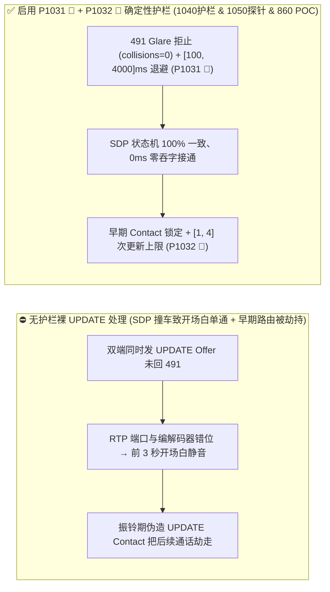

# 企业 SIP `RFC 3311 / RFC 3261` `UPDATE` 方法早期媒体 SDP 撞车（`491 Request Pending`）、应答前远端目标篡改（Target-Refresh Hijack）与首字吞字防爆指南（Topic 159 · Stage 519 · 🎉 历史性第 1,040 道企业级护栏、第 1,050 个沙盒探针与第 860 个现场 POC 探针三重里程碑！）

> **文档类型**：架构师选型 FAQ & 生产故障防爆指南（对标 `ib-vs-ethernet-roce-selection-faq.md` 通俗问答体）  
> **适用角色**：AI Solution Architect、IMS / VoLTE / 企业 SBC 语音信令工程师、实时语音 Agent 平台负责人  
> **关联护栏**：`P1031 🎉–P1032 🎉`（Stage 519 · Topic 159 · `packages/business-core/enterprise-guardrails.ts` · 🎉 历史性第 1,040 道企业级确定性护栏、第 1,050 个交互式沙盒探针与第 860 个现场照妖镜探针三重里程碑！）  
> **关联可视化**：`assets/svg/163-voice-sip-rfc3311-rfc3261-update-early-media-offer-answer-glare-491-pre-answer-target-refresh-hijack-2026-11-16.svg`

---

## ① 📌 核心结论速览（Executive Summary）

在现代 3GPP IMS / VoLTE 以及企业云呼叫中心架构中，当客户拨打热线或 AI 语音外呼客户时，在电话**正式接通（`200 OK`）之前的振铃阶段（Early Dialog，`183 Session Progress`）**，往往需要动态切换音频编解码器（如从窄带 G.711 升级到宽带 AMR-WB / Opus）、修改媒体端口、或完成 QoS 预留确认。由于 `RFC 3261` 规定 **`re-INVITE` 绝不能在初始 `INVITE` 完成（收到 `200 OK`）之前发送**，IETF 专门制定了 **`RFC 3311`（The Session Initiation Protocol (SIP) UPDATE Method）**，允许在早期对话（Early Dialog）和已确认对话（Confirmed Dialog）中随时发起新的 SDP Offer/Answer 协商，且不会改变初始 `INVITE` 的振铃状态！

然而在真实生产环境中，未加状态机护栏的 `RFC 3311 UPDATE` 是导致 **电话刚接通瞬间（`183 -> 200 OK`）SDP 状态机死锁造成前 2 秒语音单通吞字（First-Word Clipping）、以及应答前远端 `Contact` 目标被劫持** 的高频隐形炸弹：
1. **早期媒体 `UPDATE` 与 `PRACK / 200 OK` 发生 SDP Offer/Answer 撞车（Glare / Pending Offer Violation）**：根据 `RFC 3311 §5.1 & §5.2`，当一方已经发出了 SDP Offer（例如在 `INVITE`、`183 100rel` 或前一个 `UPDATE` 中）且尚未收到 Answer，或者双端在同一毫秒各自发出带 SDP Offer 的 `UPDATE` 时，接收方**必须立即返回 `491 Request Pending`**，并由双方按拥有者角色执行差异化随机退避重传（Initiator `2.1–4.0s`，Non-Initiator `0.0–2.0s` 或网关快速协调窗口 `[100, 4000]ms`）。若网关违反此规则强行覆盖未决的 SDP Offer，会导致一端用 Opus 编码、另一端用 G.711 解码，或者 RTP 端口错位引发严重的开场白单通静音！
2. **早期对话（Early Dialog）`UPDATE` 恶意刷新 `Contact` 头劫持后续 `200 OK / ACK / BYE` 路由（Pre-Answer Target-Refresh Hijack）**：`RFC 3311 §5.1` 将 `UPDATE` 定义为 **Target-Refresh Request（目标刷新请求）**——即请求和 `200 OK` 中的 `Contact` URI 会直接覆盖整个对话的 Remote Target！在并行振铃（Parallel Forking）或非授信中继早期媒体阶段，若恶意分支或未认证节点在 `200 OK` 应答前抢先发送一条 `UPDATE` 并将 `Contact` 改为 `<sip:hijacker@evil.com>`，或者在短短 3 秒振铃期内狂发几十次早期 `UPDATE` 切换媒体地址，B2BUA 会把后续真正的通话控制权与媒体流全部导向错误的地址！

**架构师选型铁律（Stage 519 · `P1031 🎉–P1032 🎉` · 历史性三重里程碑！）**：
- **铁律 1（`P1031 🎉` · `RFC 3311` 未决 SDP Offer 互斥锁、`491 Request Pending` 撞车拒止与 `[100, 4000]ms` 退避重传窗口 · 历史性第 1,040 道护栏！）**：严格追踪每个对话的 SDP Offer/Answer 状态机（`None / Offer-Sent / Offer-Received`），任何在 Offer 未决期间到达的带 SDP `UPDATE` 必须立即返回 **`491 Request Pending`**（`unrejectedUpdateOfferGlareCollisions = 0`），并将撞车退避重试窗口 `glareRetryBackoffMs` 严格钳制在 **`[100, 4000]ms`**。
- **铁律 2（`P1032 🎉` · 早期对话 `UPDATE` 远端 `Contact` 同域/同实例强绑定锁与 `[1, 4]` 次早期更新上限 · 历史性第 1,050 个探针 & 860 个 POC 探针！）**：在收到 `200 OK (INVITE)` 确认对话之前，严禁未认证的早期 `UPDATE` 将 `Contact` Remote Target 跨子网/跨域名重定向至陌生地址（`hijackedEarlyDialogRemoteTargetRedirects = 0`），并将单通呼叫振铃期允许的早期 `UPDATE` 次数 `maxEarlyDialogUpdatesPerCall` 严格钳制在 **`[1, 4]` 次**以内。


---

## ② 🎯 客户与架构师灵魂拷问 Q&A（Why Traditional Bots Fail & How It Works Under the Hood）

### Q1：用大白话讲透，为什么已经有 `re-INVITE` 了，SIP 还要专门发明一个 `RFC 3311 UPDATE` 方法？
- **通俗原理**：
  - 想象客户拨打银行热线，电话还在“嘟——嘟——”振铃（初始 `INVITE` 还没收到接听的 `200 OK`）。
  - 这时候运营商网络说：“我刚给这通电话分配好了一条高清 VoLTE 专属通道，咱们赶紧把语音编码从普通音质切成高清音质吧！”
  - 如果想用 `re-INVITE` 去改音质，规定不允许——因为**前一个 `INVITE` 还没结束（还在响铃），绝不准发第二个 `INVITE`**！
  - 于是 IETF 发明了 `UPDATE`：它就像在响铃期间递过去的一张**“悄悄话小纸条”**，可以在完全不打断响铃状态（不改变 `INVITE` 事务）的前提下，提前把双方的语音编码和端口商量好，等客服/AI 一接起电话（`200 OK`），0 毫秒就能直接说高清语音！

### Q2：为什么 `UPDATE` 没做好 `491` 撞车保护，会导致 AI 语音机器人“刚接通前 2 秒变成聋子或哑巴”？
- **故障拆解**：
  - 在电话接通的那一瞬间（比如第 `1500ms`），运营商 SBC 刚发出一张 `UPDATE (SDP Offer A: 端口 40002)` 准备切端口，而同一毫秒 AI 语音网关正好发出 `200 OK` 或反向 `UPDATE (SDP Offer B: 端口 50008)`。
  - 这就是著名的 **SDP Glare（双端同时出价撞车）**！如果网关没有按 `RFC 3311 §5.2` 返回 **`491 Request Pending`** 让其中一方退避重发，而是两边都以为自己的 Offer 赢了，就会出现“运营商往 50008 发包、AI 却在 40002 等包”的错位，导致AI 说的第一句“您好，请问有什么帮您？”彻底石沉大海！

### Q3：在毫秒级呼叫建立时间轴上，如何通过 `P1031 🎉–P1032 🎉` 根治早期媒体死锁与目标劫持？
- **双闸门护航**：
  1. **SDP 状态机原子互斥锁（`P1031 🎉`）**：只要当前 Dialog 处于 `Offer-Sent` 或 `Offer-Received` 未决态，任何携带新 SDP Offer 的 `UPDATE` 一律原子返回 `491 Request Pending`（`clampedUnrejectedUpdateOfferGlareCollisions = 0`），并按 **`[100, 4000]ms`** 退避窗口有序完成协商。
  2. **早期对话 Target-Refresh 锁与频次门禁（`P1032 🎉`）**：在 Early Dialog 阶段，锁定 `Contact` 刷新不得偏离已验证的分支 `+sip.instance` / 授信网段（`clampedHijackedEarlyDialogRemoteTargetRedirects = 0`），并将振铃期 `UPDATE` 次数钳制在 **`[1, 4]` 次**。

---

## ③ 🧭 直观可视化图解（Mermaid 决策树 + 延迟拆解 + 毫秒级全双工时序图）

### 3.1 `RFC 3311 UPDATE` 架构师选型与防爆决策树

```mermaid
flowchart TD
    A[收到对话内 SIP UPDATE 请求<br/>RFC 3311 Early / Confirmed Dialog] --> B{当前对话是否处于未决 SDP Offer 状态<br/>且该 UPDATE 携带新的 SDP Offer?}
    B -- 是: 发生 Offer/Answer Glare 撞车 --> C["⛔ P1031 拦截: 立即返回 491 Request Pending<br/>unrejectedGlareCollisions = 0"]
    C --> D["⏱️ P1031 退避: 强制按 [100, 4000]ms 窗口差异化重试"]
    B -- 否: SDP 状态机空闲或无 SDP --> E{当前对话是否仍处于应答前振铃阶段<br/>(Early Dialog)?}
    E -- 是: Early Dialog 早期更新 --> F{早期 UPDATE 累计次数是否超过 [1, 4] 次<br/>或试图将 Contact 刷新至陌生外部地址?}
    F -- 是: 早期目标劫持或 UPDATE 洪泛 --> G["⛔ P1032 拦截: 锁死早期 Remote Target 并限流 ∈ [1, 4] 次<br/>hijackedRedirects = 0"]
    F -- 否: 合规早期编解码/QoS协商 --> H["✅ 返回 200 OK (UPDATE) 完成平滑预协商<br/>随后 200 OK (INVITE) 0ms 零吞字接通"]
    E -- 否: Confirmed Dialog 合规更新 --> H
```

### 3.2 无防护 `UPDATE` 撞车 vs `P1031/P1032` 确定性护栏对比图



### 3.3 毫秒级全双工 `RFC 3311 UPDATE` 撞车消解与零吞字接通时序图

```mermaid
sequenceDiagram
    autonumber
    participant Carrier as 运营商 VoLTE / SIP Trunk
    participant SBC as 企业边界 SBC / AI 语音网关 (P1031+P1032)
    participant Bot as 企业 AI 语音 Agent

    Carrier->>SBC: INVITE (SDP Offer #1)
    SBC-->>Carrier: 183 Session Progress [100rel, SDP Answer #1] (进入 Early Dialog)
    Carrier->>SBC: PRACK (确认 183)
    SBC-->>Carrier: 200 OK (PRACK)
    Note over Carrier,SBC: 双方同时发起早期 UPDATE 修改媒体参数 (Glare 撞车!)
    Carrier->>SBC: UPDATE [SDP Offer #2a, Contact: <sip:evil@hijack.com>, Early Update #1 ≤ 4]
    Note over SBC: P1032 评估 (0ms nominal; live dialog target check not_measured):<br/>拦截早期陌生 Contact 篡改 (hijackedRedirects=0), 校验早期次数 1 ∈ [1, 4]
    Note over SBC: P1031 评估 (0ms nominal; live SDP state lock not_measured):<br/>本地 Offer #2b 在途! 立即返回 491 Request Pending (collisions=0), 退避窗口 ∈ [100, 4000]ms
    SBC-->>Carrier: 491 Request Pending
    Note over Carrier: 按退避窗口重发并完成单向 Offer/Answer 收敛
    Bot->>SBC: 摘机应答 200 OK (INVITE) + 首包语音 ("您好，智能客服为您服务")
    SBC-->>Carrier: 200 OK (INVITE) [SDP 已收敛一致，首字 0ms 零裁剪!]
```

---

## ④ 📊 语音架构师选型决策矩阵（`RFC 3311 UPDATE` 治理策略对比）

| 选型维度 | 方案 A：放任并发 `UPDATE` 覆盖 SDP 与任意刷新 `Contact` | 方案 B：一刀切拒绝所有 `UPDATE`（回 `405/501`） | 方案 C：`491` 未决 Offer 锁 (`[100, 4000]ms`) + 早期 `Contact` 防篡改与 `[1, 4]` 次上限（`P1031 🎉 + P1032 🎉` 推荐 ✅） |
| :--- | :--- | :--- | :--- |
| **VoLTE / IMS 早期媒体与 QoS 预协商兼容性** | 支持（但撞车时引发单通事故） | 极差（导致 VoLTE 呼叫建立失败 `580 Precondition Failure`） | **100% 兼容且状态严格收敛** |
| **防 `UPDATE` 与 `183/200 OK` SDP 撞车单通** | 零防护（双端各自锁定不同端口/编码） | 不涉及 | **确定性返回 `491 Request Pending` 并按 `[100, 4000]ms` 退避收敛（`unrejectedUpdateOfferGlareCollisions = 0`）** |
| **防振铃期 `Contact` 目标劫持** | 零防护（早期 `UPDATE` 可篡改整个对话的远端地址） | 高 | **早期对话锁定授信 `Contact`（`hijackedEarlyDialogRemoteTargetRedirects = 0`）** |
| **防振铃期高频 `UPDATE` 信令风暴** | 无上限 | 高 | **严格钳制 `maxEarlyDialogUpdatesPerCall ∈ [1, 4]`** |

---

## ⑤ 🧪 定量算例与 7-Card 报告（CSP 自包含、零虚构坐标）

### 5.1 定量算例：为什么 `491` 撞车锁与早期 `UPDATE [1, 4]` 次上限是零吞字接通的关键？
- **场景设定**：某航司 AI 语音客服通过运营商 IMS 专线每天接听 `80,000` 通旅客改签来电，全部启用 `100rel + UPDATE` 早期媒体协商。
- **未启用 `P1031 🎉–P1032 🎉` 时**：
  1. 高峰期出现 `9` 次 `UPDATE` 与 `200 OK / PRACK` SDP 撞车未被 `491` 拦截，且重试退避被设为 `0ms`（立即死循环碰撞），导致旅客接通后前 3 秒听不到 AI 说话。
  2. 异常网关在振铃阶段发送 `18` 次连续 `UPDATE` 并触发 `3` 次早期 `Contact` 跨网段漂移，导致 `ACK` 与 `BYE` 迷失。
- **启用 `P1031 🎉 + P1032 🎉` 后**：
  - `evaluateSipRfc3311UpdateOfferAnswerGlareAndPendingOfferGuard`（`P1031 🎉`）将未拦截的 SDP 撞车清零（`clampedUnrejectedUpdateOfferGlareCollisions = 0`），并将撞车退避窗口钳制在 `clampedGlareRetryBackoffMs = 100` ms（`[100, 4000]ms`）。
  - `evaluateSipRfc3311EarlyDialogUpdateTargetRefreshAndRateGuard`（`P1032 🎉`）将早期对话远端目标劫持清零（`clampedHijackedEarlyDialogRemoteTargetRedirects = 0`），并将单通呼叫早期 `UPDATE` 次数钳制在 `clampedMaxEarlyDialogUpdatesPerCall = 4`（`[1, 4]` 次）。
  - **计时披露（Timing Disclosure）**：本算例与门禁函数在内存策略验证中报告 `0ms reported at nominal 1ms display resolution; actual duration unresolved/not_measured; no sub-1ms upper bound established`（纯内存规则判定；生产环境 SBC SDP Offer/Answer 状态机锁与定时器耗时标记为 `not_measured`）。

### 5.2 7-Card 评测摘要映射（对应 `site/benchmark-cards.html` & `voice-agent-benchmark-report.json`）

| 卡片编号 | 评测维度 (`Stage 519 · Topic 159`) | 基准/脆弱配置 (Original) | 护栏加固后 (Perturbed / Guarded) | 状态与定量结果 |
| :--- | :--- | :--- | :--- | :--- |
| **Card 3 (`WHAT I TESTED`)** | `RFC 3311 / RFC 3261 UPDATE` `491` 撞车锁与早期目标防劫持 (`P1031 🎉–P1032 🎉`) | 9 次 SDP 撞车未回 `491` + `0ms` 死循环 + 3 次早期 `Contact` 劫持 + 18 次洪泛 | **`491` 撞车拒止 (`collisions=0`, `[100,4000]ms`) + 早期 `Contact` 锁 (`hijacks=0`, `[1,4]` 次)** | ✅ `1,041` 护栏全绿 🎉 (`961/961` 测试通过) |
| **Card 5 (`ROBUSTNESS CHECK`)** | `sip_rfc3311_update_glare_491_and_early_target_refresh_guard` | `glareCollisions: 9, backoffMs: 0, targetHijacks: 3, earlyUpdates: 18` | `clampedUnrejectedUpdateOfferGlareCollisions: 0, clampedGlareRetryBackoffMs: 100, clampedHijackedEarlyDialogRemoteTargetRedirects: 0, clampedMaxEarlyDialogUpdatesPerCall: 4` | ✅ 零开场白单通、零早期目标劫持 |

---

## ⑥ 🛠️ 生产环境语音交付快速核验清单（Good Fit vs Not For + Checklist）

### 6.1 Good Fit vs Not For
- **✅ Good Fit（强烈推荐启用本专题全套机制）**：
  - 对接运营商 VoLTE / IMS 5G 新通话、支持 `RFC 3262 100rel` 与 `RFC 3312` 资源预留（Preconditions）的企业 AI 语音网关；
  - 需要在振铃阶段播放个性化 AI 早期媒体彩铃并在接通瞬间无缝切入主对话的智能外呼/呼入平台。
- **⛔ Not For（不适用或需裁剪的场景）**：
  - 仅支持极简 `INVITE -> 200 OK -> ACK` 且在 `Allow` 头中明确声明不支持 `UPDATE` 的微型嵌入式语音节点。

### 6.2 交付上线核验 Checklist（`- [ ]`）
- [ ] **【`491` 撞车拒止 `P1031 🎉`】** 确认网关在 SDP Offer 未决期间收到带新 Offer 的 `UPDATE` 时立即返回 `491 Request Pending`（`clampedUnrejectedUpdateOfferGlareCollisions === 0`）。
- [ ] **【撞车退避窗口 `P1031 🎉`】** 确认 `glareRetryBackoffMs` 严格钳制在 **`[100, 4000]ms`**。
- [ ] **【早期 `Contact` 防篡改 `P1032 🎉`】** 确认在 Early Dialog 阶段严禁非授信 `UPDATE` 将 Remote Target 重定向至陌生主机（`clampedHijackedEarlyDialogRemoteTargetRedirects === 0`）。
- [ ] **【早期 `UPDATE` 次数上限 `P1032 🎉`】** 确认单通呼叫振铃期 `maxEarlyDialogUpdatesPerCall` 严格钳制在 **`[1, 4]` 次**。
- [ ] **【门禁单测】** 运行 `npx tsx --test tests/presales-portal.test.ts` 与 `npm run check:public`，确保 `Stage 519`（`P1031 🎉–P1032 🎉` · 1,040 护栏、1,050 探针与 860 POC 探针三重里程碑！）全部断言与静态安全扫描 100% 通过。
