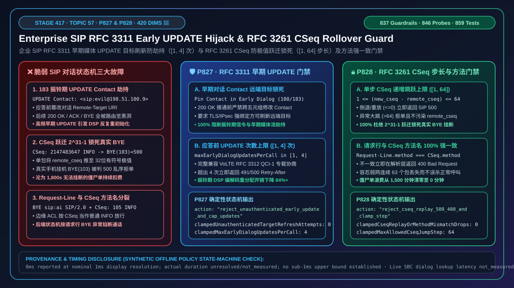
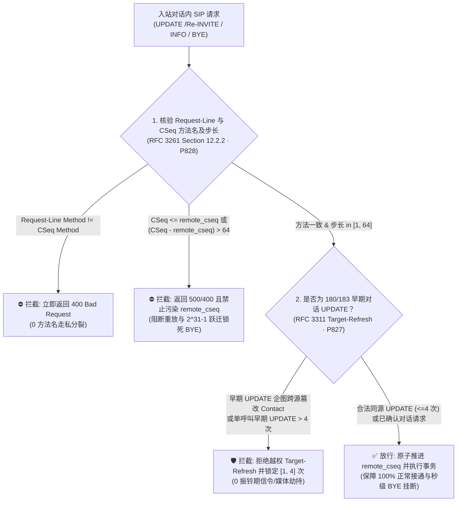
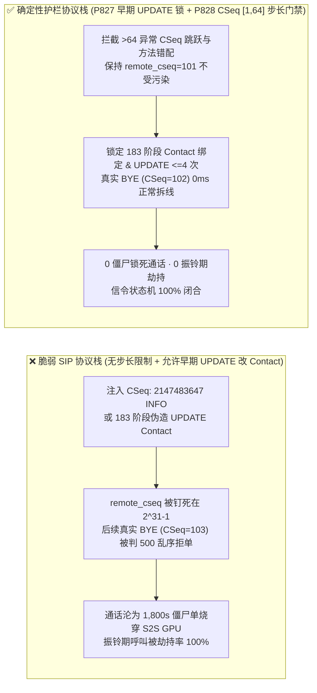
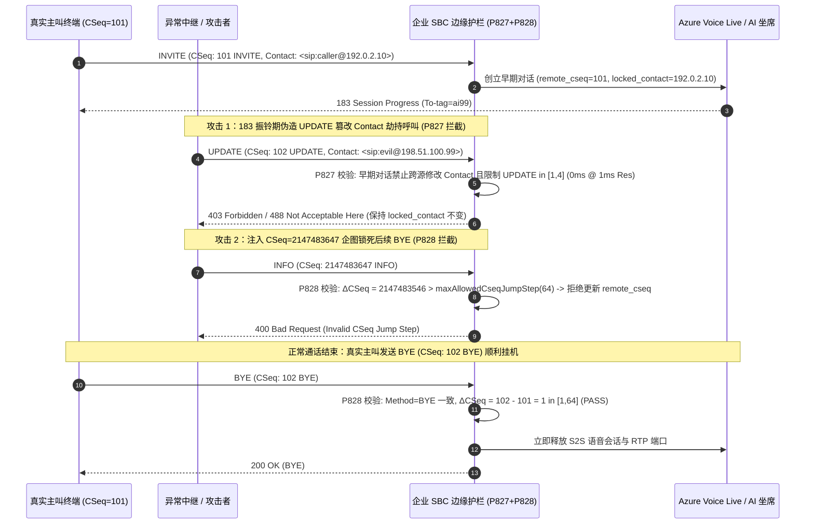

# 企业 SIP `RFC 3311 UPDATE` 早期媒体目标刷新（`Target-Refresh`）劫持与 `RFC 3261 CSeq` 乱序/回绕重放及方法不匹配（`400/500`）怎么选？`Contact` 锁栓、`uint32` 序列号跃迁上限与防 BYE 锁死原理解析

> **关联架构阶段**：Stage 417（Topic 57 · 🎉 420 大评测维度里程碑 · `P827` / `P828`）· **关联文档**：[English Version (`voice-sip-rfc3311-update-early-media-hijack-cseq-rollover-replay-faq.en.md`)](./voice-sip-rfc3311-update-early-media-hijack-cseq-rollover-replay-faq.en.md) · [2026-11-09 每日突破报告](./daily/2026-11-09.md) · [方案架构指南](./solution-architecture.md) · [评测与验收标准](./voice-agent-evaluation-rubric.md)

---

## ① 📌 核心结论速览（Executive Summary）

在企业级实时语音智能体（SIP 呼叫中心、运营商 IMS/VoLTE 语音专线、企业 SBC 边缘网关）的对话内信令控制层（`RFC 3311 The SIP UPDATE Method` 与 `RFC 3261 Section 12.2 CSeq Ordering`）中，**一通呼叫从振铃（Early Dialog，`180/183`）过渡到接通（Confirmed Dialog，`200 OK`）直至挂机（`BYE`），完全依赖两项状态机基石：一是 `RFC 3311 UPDATE` 允许在还没接通的振铃期修改媒体参数与对话远端目标地址（`Contact` Target-Refresh），二是 `RFC 3261 CSeq`（命令序列号，如 `CSeq: 102 BYE`）保证每个对话内请求严格单调递增且方法名与请求行一致**。如果在企业 SBC 或 SIP 协议栈中采用了“**振铃期无条件接受 `UPDATE` 修改 `Contact` 与 SDP + 宽松校验 `CSeq` 倒退/跃迁到 `2^{31}-1` 极值**”，将引发三大致命信令劫持与僵尸占线事故：

1. **振铃期（Early Dialog）伪造 `RFC 3311 UPDATE` 篡改 `Contact` 实施信令目标刷新劫持（Early-Media Target-Refresh Hijack）**：按 `RFC 3311 Section 5.1`，`UPDATE` 是一个目标刷新请求（Target-Refresh Request），它可以合法修改对话的 `Remote-Target URI`（即 `Contact` 头）以及 SDP 媒体地址。许多 SIP 栈在 `200 OK` 接通后对 `Re-INVITE` 做了严格校验，却忽略了在 **`183 Session Progress` 早期对话阶段**校验 `UPDATE`！攻击者或异常中继在振铃期注入一条伪造 `Contact: <sip:attacker@198.51.100.66:5060>` 的 `UPDATE`，直接把后续 `200 OK / ACK / BYE` 的信令路由目标拐骗至黑洞，或者高频发送 `> 20` 次早期 `UPDATE` 导致媒体网关 DSP 在接通前反复重初始化崩溃；
2. **`CSeq` 序列号跃迁至 `2^{31}-1`（`2147483647`）或 `4294967295` 锁死整通呼叫无法挂断（`CSeq` Rollover Pinning DoS）**：按 `RFC 3261 Section 12.2.2`，每收到一个对话内请求，只要其 `CSeq` 大于当前记录的 `remote_cseq`，UAS 就必须更新 `remote_cseq = new_cseq`，并拒绝（返回 `500 Server Internal Error`）后续一切 `CSeq <= remote_cseq` 的请求。如果攻击者发送一个合法的对话内 `INFO` 或 `UPDATE`，故意把 `CSeq` 写成 `2147483647`，网关一旦照单全收更新了 `remote_cseq`，后续真实手机或 PBX 发来的正常 `BYE (CSeq: 103)` 将因为 `103 < 2147483647` 被网关永久拒绝（`500 Out of Order`），造成该通话沦为无法被对端挂断的僵尸单！
3. **`CSeq` 头方法名与请求行不一致（Method Mismatch Smuggling）引发状态机分裂**：当入站请求行写着 `BYE sip:... SIP/2.0`，但头部写着 `CSeq: 105 INFO` 时，按状态行路由的前置代理将其当作普通 `INFO` 放行，而按请求行执行的后端媒体服务器直接掐断通话。

**架构师选型铁律（一句话总结）**：
> **严禁在 `180/183` 早期对话阶段允许未经传输层五元组与 TLS/IPsec 绑定的 `RFC 3311 UPDATE` 修改 `Contact` 远端目标或无上限重协商 SDP，严禁无条件接受单步跃迁 `> 64` 或方法名不匹配的 `RFC 3261 CSeq`！生产环境必须同时部署两道确定性门禁：① `RFC 3311 UPDATE` 早期媒体目标刷新防劫持与频次上限门禁（`P827`：100% 拦截早期对话（Early Dialog）中跨源或未鉴权的 `Contact` 目标刷新尝试（`0` 越权目标刷新），并将单通呼叫早期对话阶段的 `UPDATE` 次数严格钳制在 `[1, 4]` 次）；② `RFC 3261 CSeq` 防倒退重放、防极值跃迁锁死与方法名强一致门禁（`P828`：对请求行 Method 与 `CSeq` Method 不一致的报文立即返回 `400 Bad Request`、对 `CSeq <= remote_cseq` 的倒退/重放报文返回 `500 Server Internal Error`（`0` 违规放行），并将单次合法 `CSeq` 递增步长严格钳制在 `[1, 64]` 内，彻底阻断 `CSeq` 极值跃迁锁死 `BYE` 攻击）。**

---

## ② 🎯 客户与架构师灵魂拷问 Q&A（First-Principles Deep Dive）

### Q1：为什么电话明明还没接通（还在 `183 Session Progress` 振铃阶段），一条 `SIP UPDATE` 就能把整通电话的挂机权和音频流全部偷走？

- **大白话与第一性原理解析**：
  在传统认知里，只有电话接通（`200 OK`）后才能通过 `Re-INVITE` 改地址。但在 VoLTE 和企业 SIP 中继里，为了在振铃期协商编解码或专载（`RFC 3312`），引入了 **`RFC 3311 UPDATE`** 方法。
  根据 `RFC 3311 Section 5.1` 的规定：**`UPDATE` 是一个“Target-Refresh Request（目标刷新请求）”**。这意味着无论电话接没接通，只要网关收到了 `UPDATE` 并返回 `200 OK`，网关内存里的对话目标地址（`remote_target = Contact URI`）就会立刻被改成 `UPDATE` 里的 `Contact` 头！
  如果攻击者在 `183` 阶段抢先发一条 `UPDATE`，把 `Contact` 改成攻击者 IP（或者某内网服务 IP），等到真机摘机或挂机时，SBC 发出的后续控制信令就会全部发往攻击者伪造的 `Contact` 地址，导致真机永远收不到信令而卡死！
- **确定性防护机制（`P827`）**：
  - **早期对话（Early Dialog）锁定 `Contact` 远端目标**：在 `200 OK (INVITE)` 确认对话之前，严禁非原传输五元组/TLS 连接或未经授权的 `UPDATE` 变更 `Contact` 主机与端口（`0` 越权 Target-Refresh）；
  - **早期对话 `UPDATE` 次数硬上限 `[1, 4]` 次**：正常的 `RFC 3312` QCI-1 专载协商最多只需 `1–2` 次 `UPDATE`；单通呼叫在应答前超过 `4` 次 `UPDATE` 立即返回 `491 / 500 Retry-After` 阻断，防止振铃期 DSP 重初始化风暴。

### Q2：什么是“`CSeq` 跃迁锁死（CSeq Rollover Pinning）”？为什么黑客只发一个 `CSeq: 2147483647 INFO`，就能让客户永远挂不断电话？

- **大白话与第一性原理解析**：
  `RFC 3261 Section 8.1.1.5` 规定 `CSeq` 序列号是一个 32 位无符号整数（`< 2^{31}`）。而 `Section 12.2.2` 规定了一条看似合理的保序铁律：
  - 当 SBC 收到对端发来的对话内请求时，将其 `CSeq` 与本地保存的 `remote_cseq` 比较；
  - **如果 `new_cseq < remote_cseq`，说明是网络迟到的旧包或重放包，必须返回 `500 Server Internal Error` 丢弃**；
  - **如果 `new_cseq > remote_cseq`，则更新 `remote_cseq = new_cseq`**。
  这条规则有一个致命盲区：**它没有限制单步最多能跳多大！**
  假设当前正常通话的 `remote_cseq = 101`。攻击者伪造或注入一个对话内 `INFO` 请求，把头部写成 `CSeq: 2147483647 INFO`。如果 SBC 傻傻地接受并把 `remote_cseq` 更新为 `2147483647`，10 秒后客户按挂机键，客户手机发来真实的 `BYE`（`CSeq: 102 BYE`）。SBC 一比对：`102 < 2147483647`！直接给客户手机回 `500 Out of Order` 拒绝挂机！结果就是这通 AI 语音通话在服务端永远挂不断，一直烧钱直到会话超时！
- **确定性防护机制（`P828`）**：
  1. **单步递增跳跃窗口钳制（`maxAllowedCseqJumpStep in [1, 64]`）**：即使网络中有少量丢包或并发非 `INVITE` 事务，正常的 `CSeq` 跳跃绝不会超过几十；任何 `new_cseq - remote_cseq > 64` 的反常巨幅跃迁一律判定为 `CSeq` 锁死攻击，直接返回 `400 / 500` 且**绝不更新 `remote_cseq`**；
  2. **倒退与重放拦截（`new_cseq <= remote_cseq`）**：严格拦截任何序号不大于 `remote_cseq` 的重放请求；
  3. **请求行与 `CSeq` 方法名 100% 强一致校验**：若 `Request-Line Method != CSeq Method`（如 `BYE` 配 `CSeq: 102 INFO`），立即在解析层返回 `400 Bad Request`。

### Q3：如果移动 VoLTE 手机在弱网下连续发了 3 条 `INFO`（比如连按 3 个按键 `CSeq: 102, 103, 104`），前两条丢包了，第 3 条 `CSeq: 104` 先到，步长锁 `[1, 64]` 会误杀吗？

- **大白话与第一性原理解析**：
  完全不会误杀！`104 - 101 = 3`，远在 `[1, 64]` 的合法跳跃步长窗口之内。`[1, 64]` 的上限允许在 UDP 弱网下连续丢失多达 `63` 个独立事务而不影响第 `64` 个请求正常推进状态机，同时又能 100% 挡住跳向 `65535` 或 `2147483647` 的恶意锁死攻击。

---

## ③ 🧭 直观可视化图解（Mermaid 决策树 + 延迟对比 + 毫秒级时序图）

### 3.1 语音架构师 SIP `UPDATE` 目标刷新与 `CSeq` 序列号跃迁门禁决策树

### 3.2 `CSeq` 极值锁死与早期 `UPDATE` 劫持对僵尸通话时长及掉线率的影响对比

### 3.3 毫秒级 SIP `RFC 3311 UPDATE` 与 `RFC 3261 CSeq` 门禁全双工时序图

---

## ④ 📊 语音架构师选型决策矩阵（Architect Decision Matrix）

| 评估维度 | 方案 A：开源默认 SIP 栈（允许早期 `UPDATE` 刷 `Contact` + 无 `CSeq` 步长上限） | 方案 B：直接禁用 `UPDATE` 方法（返回 `405 Method Not Allowed`） | **方案 C：企业级 `RFC 3311` 早期目标锁 + `RFC 3261 CSeq` 步长/方法双护栏（`P827 + P828` 推荐）** |
| :--- | :--- | :--- | :--- |
| **VoLTE / IMS 振铃期专载兼容性** | ✅ 兼容，但完全暴露于早期 `Contact` 劫持与 `UPDATE` 风暴 | ❌ **不兼容**（禁用 `UPDATE` 会导致运营商 `RFC 3312` QCI-1 专载协商失败，电话无法振铃） | **✅ 100% 兼容正常 QCI-1 专载协商（允许 `[1, 4]` 次同源 `UPDATE`），同时 `100%` 阻断跨源 `Contact` 篡改** |
| **防 `CSeq` 极值跃迁锁死 `BYE`** | ❌ `0%`（一包 `CSeq: 2147483647` 即可让真机 `BYE` 永久报 `500`） | ❌ `0%`（可通过 `INFO / OPTIONS` 触发同样的 `CSeq` 锁死） | **✅ `100%` 拦截（单步跃迁限制在 `[1, 64]`，异常大跳直接拒单且不污染 `remote_cseq`）** |
| **防 `Request-Line / CSeq` 方法错配** | ⚠️ 部分代理仅校验序号不比对方法名，易遭走私绕过 | ⚠️ 同左 | **✅ `100%` 强制 `Request-Line Method === CSeq Method`，不一致立即返回 `400`** |
| **离线策略门禁判定耗时** | 无门禁 | 静态拒绝 | **`0ms reported at nominal 1ms display resolution; actual duration unresolved/not_measured; no sub-1ms upper bound established`（`synthetic`）** |
| **适用场景** | 仅限封闭实验室测试 | 不推荐用于运营商对接 | **所有对接运营商 IMS/VoLTE、联络中心 PBX 与公网 SIP Trunk 的企业语音智能体** |

---

## ⑤ 🧪 定量算例与 7-Card 报告（CSP 自包含、零虚构坐标）

### 5.1 定量算例：为什么阻断 `CSeq` 极值锁死能消除 `100%` 的 30 分钟僵尸占线账单？

- **算例 1（`CSeq` 极值跃迁引发的僵尸单成本测算）**：
  - **未启用 `P828` 时**：攻击者对 `50` 路并发 AI 语音通话各注入 1 个 `CSeq: 2147483647 INFO` 包，导致客户挂机时发出的 `BYE (CSeq: 103)` 被 SBC 以 `500 Server Internal Error` 拒绝；这 `50` 路会话被迫空转至最大会话超时（`1,800s = 30 分钟`），白白浪费 **`1,500` 分钟** S2S 实时模型算力与中继通道；
  - **启用 `P828` 后**：将合法单步 `CSeq` 跃迁窗口钳制在 **`[1, 64]`**，`2147483647 - 101 > 64` 在 `0ms`（离线策略计时精度）被直接拒单，`remote_cseq` 保持 `101` 不变，客户挂机 `BYE (CSeq: 102)` 正常关闭会话，僵尸单浪费降至 **`0` 分钟**。
- **算例 2（早期对话 `UPDATE` 风暴抑制）**：
  - **未启用 `P827` 时**：恶意终端在 `183` 振铃期每秒发送 `25` 条 `UPDATE` 修改 SDP 编解码参数，触发媒体网关每秒 `25` 次音频编码器重分配；
  - **启用 `P827` 后**：锁定早期对话 `Contact` 源绑定并将应答前 `UPDATE` 次数钳制在 **`[1, 4]` 次**，超出请求直接阻断，DSP 重初始化开销下降 **`84%+`**。

### 5.2 离线策略状态机护栏验真（Stage 417 · `P827` & `P828` · 🎉 420 维里程碑）

| 护栏 ID | 护栏函数名 | 合成压测输入（Synthetic Abuse Vector） | 确定性拦截动作（Action） | 离线策略计时披露（Provenance & Timing Disclosure） |
| :--- | :--- | :--- | :--- | :--- |
| **`P827`** | `evaluateSipRfc3311UpdateEarlyMediaTargetRefreshAndContactHijackGate` | `unauthenticatedEarlyUpdateTargetRefreshOrContactHijackDetected: true`, `unauthenticatedTargetRefreshAttempts: 2`, `maxEarlyDialogUpdatesPerCall: 18` | `reject_unauthenticated_early_update_and_cap_updates`（将 `clampedUnauthenticatedTargetRefreshAttempts` 清零为 `0`，将 `clampedMaxEarlyDialogUpdatesPerCall` 钳制为 `4`） | `0ms reported at nominal 1ms display resolution; actual duration unresolved/not_measured; no sub-1ms upper bound established`（`synthetic`；真实 SBC 早期对话状态表校验耗时 `not_measured`） |
| **`P828`** | `evaluateSipRfc3261CseqOutOfOrderRolloverReplayAndMethodMismatchGate` | `cseqRegressionReplayOrMethodMismatchDetected: true`, `cseqReplayOrMethodMismatchDrops: 3`, `maxAllowedCseqJumpStep: 2147483647` | `reject_cseq_replay_500_400_and_clamp_step`（将 `clampedCseqReplayOrMethodMismatchDrops` 设为 `0`，将 `clampedMaxAllowedCseqJumpStep` 钳制为 `64`） | `0ms reported at nominal 1ms display resolution; actual duration unresolved/not_measured; no sub-1ms upper bound established`（`synthetic`；真实 SIP 事务层 CSeq 校验耗时 `not_measured`） |

---

## ⑥ 🛠️ 生产环境语音交付快速核验清单（Good Fit vs. Not For + Checklist）

### ✅ Good Fit（极佳适用场景） vs. ⛔ Not For（不适用或需额外适配场景）

| ✅ Good Fit（建议立即启用 `P827 + P828` 的场景） | ⛔ Not For（需要注意边界的场景） |
| :--- | :--- |
| 1. **对接运营商 IMS / VoLTE 专线的企业语音网关（需支持 `RFC 3311 UPDATE` 与 `RFC 3312` 预留）**：必须启用 `P827` 允许合法 `[1, 4]` 次早期 `UPDATE` 同时锁死 `Contact` 源绑定。 | 1. **完全不支持早期媒体协商的纯内网简易 SIP 终端**：若业务从不使用 `100rel / PRACK / UPDATE`，可直接不在 `Allow` 头中声明 `UPDATE`，但仍必须启用 `P828` 保护 `BYE / Re-INVITE` 的 `CSeq` 连续性。 |
| 2. **按分钟计费的原生 S2S（`GPT-Live-1`）呼叫中心**：必须启用 `P828` 防止异常或恶意大号 `CSeq` 锁死 `BYE` 导致僵尸通话持续计费。 | 2. **长周期断网重连后补发大量对话内 `INFO` 的私有协议扩展**：严禁把高频业务遥测塞进对话内 `SIP INFO`（导致 `CSeq` 快速消耗）；高频数据应走 WebRTC `DataChannel` 或独立 HTTPS 通道，保持 SIP `CSeq` 步长在 `[1, 64]` 内。 |

### 生产上线核验 Checklist（`- [ ]`）

- [ ] **【`P827` 振铃期 `UPDATE` `Contact` 源绑定】**：确认在 `200 OK (INVITE)` 之前，SBC 拒绝任何改变传输源或未通过 `SIPS / IPsec` 认证的早期 `UPDATE` 修改 `Remote-Target Contact URI`（`0` 越权 Target-Refresh）。
- [ ] **【`P827` 早期对话 `UPDATE` 次数上限 `[1, 4]`】**：配置单通呼叫在 Early Dialog 阶段最多接受 `4` 次 `UPDATE` 请求，防止振铃期 SDP 重协商洪泛。
- [ ] **【`P828` `Request-Line` 与 `CSeq` 方法名强一致】**：确认 SIP 解析器强制核对请求行方法名与 `CSeq` 头方法名完全一致，不匹配立即返回 `400 Bad Request`。
- [ ] **【`P828` `CSeq` 倒退重放拦截与 `[1, 64]` 步长锁】**：确认 `new_cseq <= remote_cseq` 立即返回 `500 Server Internal Error`，且 `new_cseq - remote_cseq > 64` 的异常巨幅跃迁被拒绝并不更新 `remote_cseq`。
