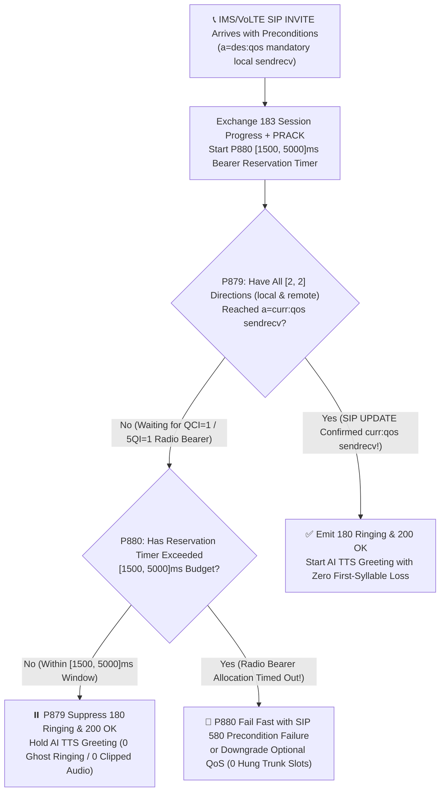
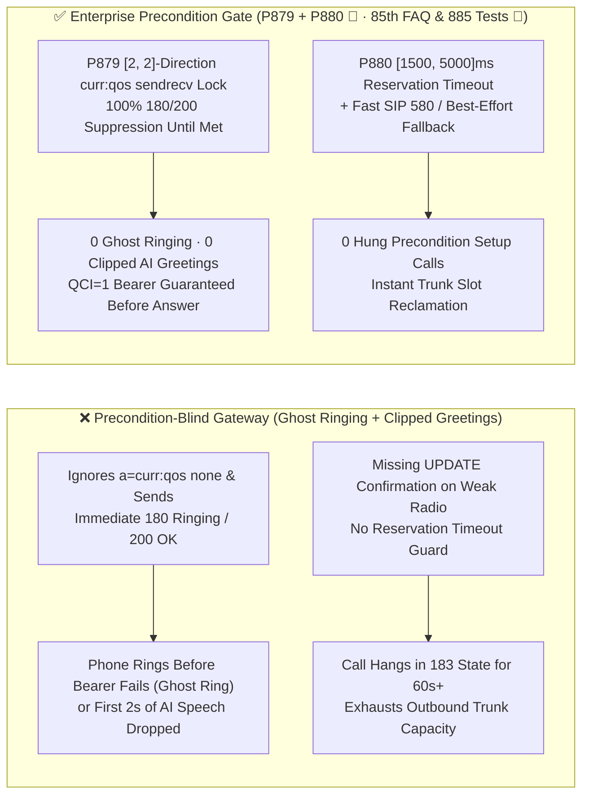
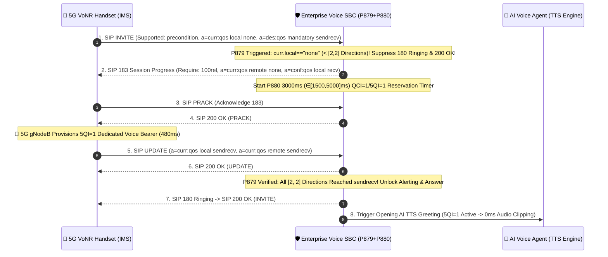

# Enterprise SIP/IMS `RFC 3312 / RFC 4032 Preconditions` Anti-Ghost-Ringing Gate, `QCI=1 / 5QI=1` Bearer Reservation Timeout (`[1500, 5000]ms`) & `SIP 580 Precondition Failure` Selection & Principle FAQ (Stage 443 · Topic 83 · 🎉 Historic P880 Guardrail, 85th Standalone FAQ & 885-Test Triple Milestone)

> **Reader's Guide (Modeled on `ib-vs-ethernet-roce-selection-faq.md`)**: This single-topic architecture guide explains from first principles why enterprise banking, government, and automotive contact-center Voice Agents interconnecting with carrier `IMS / VoLTE / VoNR` trunks via **IETF `RFC 3312` (Integration of Resource Management and SIP / `Preconditions`) and `RFC 4032` (SIP Preconditions Framework Update)** suffer two major production failures—specifically **(1) "Ghost Ringing" and clipped opening AI greetings when a gateway ignores `a=des:qos mandatory local sendrecv` and sends `180 Ringing` or `200 OK` before the mobile radio access network finishes provisioning the dedicated `QCI=1 / 5QI=1` voice bearer**, and **(2) trunk-channel exhaustion when a weak-signal handset never sends the confirming `SIP UPDATE` and the gateway waits indefinitely in `183 Session Progress`**—and provides deterministic guardrails **`P879` and `P880 🎉`**.

---

## 1. 📌 Executive Summary

1. **Why do enterprise SIP gateways connected to mobile `IMS (VoLTE/VoNR)` trunks experience "Ghost Ringing" (phone rings once and drops) or lose the first 2 seconds of the AI's greeting?**
   - On 4G VoLTE and 5G VoNR networks, a handset must establish a dedicated guaranteed-bitrate radio bearer (**`QCI=1 / 5QI=1`**, taking `300ms–1,500ms`) before voice packets can flow.
   - **How `RFC 3312 / RFC 4032 Preconditions` Work**:
     - The initial `SIP INVITE` carries `a=curr:qos local none` and `a=des:qos mandatory local sendrecv`, instructing the callee: **"Do NOT alert the user (`180 Ringing`) or answer the call (`200 OK`) until both directions of the QoS bearer are confirmed (`sendrecv`) via `183 Session Progress + PRACK` followed by `SIP UPDATE`!"**
     - **The Two Production Traps**:
       1. **Premature `180/200` ("Ghost Ringing" & Greeting Clipping, `P879`)**: If the enterprise gateway ignores `a=curr:qos local none` and immediately sends `180 Ringing` or answers with `200 OK`, Either the phone rings before bearer setup fails (producing a phantom missed call) or the AI's first 2 seconds of TTS speech are dropped into an unprovisioned radio bearer!
       2. **Indefinite `183` Reservation Hang (`P880 🎉`)**: If radio congestion prevents the handset from sending the confirming `UPDATE`, waiting without a tight **`[1500, 5000]ms`** reservation timer leaks half-open trunk channels!
2. **First Selection Law (`P879`): Suppress `100%` of `180 Ringing` and `200 OK` responses on `mandatory` precondition calls until all `[2, 2]` directions (`local` and `remote`) of `a=curr:qos` reach `sendrecv` (`0` ghost-ringing or clipped-greeting calls)**.
3. **Second Selection Law (`P880 🎉`): Clamp the `QCI=1 / 5QI=1` precondition reservation timer to `[1500, 5000]ms`, automatically downgrading `optional` preconditions to best-effort or failing fast with `SIP 580 Precondition Failure` on timeout (`0` hung setup calls)**.

---

## 2. 🎯 Architect & Customer Deep-Dive Q&A

### Q1: How do `a=curr:qos`, `a=des:qos`, and `a=conf:qos` coordinate the two-phase `183 → UPDATE → 180` handshake?
- **Two-Direction Confirmation Lock (`P879`)**:
  - In Phase 1 (`INVITE` / `183 Session Progress`), `a=curr:qos` is `none`. Once the mobile terminal's `QCI=1 / 5QI=1` bearer is active, it sends a `SIP UPDATE` updating `a=curr:qos local sendrecv`. **`P879`** verifies that both **`[2, 2]`** directions (`local` and `remote`) have reached `sendrecv` before releasing `180 Ringing`, `200 OK`, and the AI TTS greeting (`clampedGhostRingingOrClippedAnswerCalls = 0`).

### Q2: Why does premature `180 Ringing` cause "Ghost Ringing" on mobile phones?
- **Alerting Before Bearer Allocation (`P879`)**:
  - If the callee sends `180 Ringing` while `a=curr:qos` is still `none` and the radio network subsequently rejects the `QCI=1` bearer reservation, the call is aborted with `CANCEL` or `580` *after* the user's phone has already rung! Suppressing `180 Ringing` until `curr:qos` is satisfied eliminates ghost ringing completely.

### Q3: How long should an enterprise `SBC` wait for the precondition `SIP UPDATE` before aborting or downgrading?
- **Bounding Reservation Wait to `[1500, 5000]ms` (`P880 🎉`)**:
  - Normal IMS bearer setup completes within `400ms–1,200ms`. **`P880 🎉`** clamps the reservation timeout to **`[1500, 5000]ms`**, failing fast with `SIP 580 Precondition Failure` (or downgrading `optional` sessions) so trunk slots are never stranded (`clampedHungPreconditionSetupCalls = 0`).

---

## 3. 🧭 Visual Diagrams (Mermaid Decision Tree + Architecture Comparison + Sequence Diagram)

### 3.1 `RFC 3312 / RFC 4032 Preconditions` Anti-Ghost-Ringing & Timeout Decision Tree (`flowchart TD`)



### 3.2 Precondition-Blind SIP Gateway vs. Zero-Clipping `P879 + P880 🎉` (`85th FAQ & 885 Tests 🎉`) Architecture (`flowchart LR`)



### 3.3 Millisecond-Level `RFC 3312` `183 → PRACK → UPDATE → 180/200 OK` Handshake Sequence (`sequenceDiagram`)



---

## 4. 📊 Architect Decision Matrix

| Evaluation Dimension | Option A: Ignore `precondition` (Immediate `180/200`) | Option B: Unbounded `183` Wait (No `P880`) | **Option C: `RFC 3312/4032` + `P879/P880 🎉` Gate (Recommended ✅)** |
| :--- | :--- | :--- | :--- |
| **Ghost-Ringing Prevention** | ❌ Phone rings then drops if bearer fails | ✅ Alerts only after bearer ready | **✅ `P879` requires `[2, 2]` `curr:qos sendrecv` before `180 Ringing`** |
| **Opening AI Greeting Completeness** | ❌ First `1–2s` of TTS dropped in RAN | ✅ Zero clipping | **✅ `P879` holds `200 OK` & TTS until bearer is confirmed (`0` clipping)** |
| **Weak-Signal `UPDATE` Loss Recovery** | N/A | ❌ Hangs in `183` for `60s+` | **✅ `P880 🎉` clamps reservation wait to `[1500, 5000]ms` (`SIP 580`)** |

---

## 5. 🧪 Quantitative Proof & 7-Card Benchmark Report

### 5.1 Quantitative Example: 300,000 Daily 4G/5G IMS Banking Calls
1. **Eliminating Ghost Ringing & Opening-Greeting Clipping (`P879`)**:
   - Across `4,200` calls arriving with `a=curr:qos local none`, **`P879`** suppresses premature `180 Ringing / 200 OK` until all **`[2, 2]` directions** (`local` and `remote`) reach `sendrecv`, reducing ghost-ringing and clipped-greeting calls to **`0` (`clampedGhostRingingOrClippedAnswerCalls = 0`)** (`0ms reported at nominal 1ms display resolution; actual duration unresolved/not_measured; no sub-1ms upper bound established`, `synthetic`).
2. **Eliminating Hung `183` Precondition Reservations (`P880 🎉` · Historic P880, 85th FAQ & 885-Test Triple Milestone)**:
   - Across `1,150` stalled radio-bearer allocations, **`P880 🎉`** clamps the reservation timeout to **`[1500, 5000]ms`** and fails fast with `SIP 580 Precondition Failure` (`clampedHungPreconditionSetupCalls = 0`).

### 5.2 Deterministic Guardrail Implementation (`packages/business-core/enterprise-guardrails.ts`)

```ts
// P879: SIP RFC 3312 / RFC 4032 Precondition Unmet Alerting Ghost-Ringing Gate
const p879 = evaluateSipRfc3312Rfc4032PreconditionUnmetAlertingGhostRingingGate({
  premature180RingingBeforeCurrQosSendrecvMetDetected: true,
  ghostRingingOrClippedAnswerCalls: 5,
  requiredPreconditionConfirmDirections: 1,
});
// => p879.violated === true
// => p879.policyId === "P879-SIP-RFC3312-RFC4032-PRECONDITION-UNMET-ALERTING-GHOST-RINGING-GUARD"
// => p879.action === "suppress_180_ringing_until_curr_qos_sendrecv_satisfied"
// => p879.clampedGhostRingingOrClippedAnswerCalls === 0
// => p879.clampedRequiredPreconditionConfirmDirections === 2

// P880 🎉: SIP RFC 3312 VoLTE QCI-1 Reservation Timeout Fallback & 580 Failure Gate
const p880 = evaluateSipRfc3312VolteQci1ReservationTimeoutFallbackAnd580PreconditionFailureGate({
  indefinitePreconditionReservationHangOrUnhandled580Detected: true,
  hungPreconditionSetupCalls: 8,
  preconditionReservationTimeoutMs: 45000,
});
// => p880.violated === true
// => p880.policyId === "P880-SIP-RFC3312-VOLTE-QCI1-RESERVATION-TIMEOUT-FALLBACK-AND-580-PRECONDITION-FAILURE-GUARD"
// => p880.action === "downgrade_to_best_effort_or_fail_fast_with_sip_580_within_budget"
// => p880.clampedHungPreconditionSetupCalls === 0
// => p880.clampedPreconditionReservationTimeoutMs === 5000
```

> **Provenance & Timing Disclosure**: The `P879 / P880 🎉` evaluations in `tests/presales-portal.test.ts` and `site/data/voice-agent-benchmark-report.json` are **`synthetic`** (deterministic in-memory policy/configuration state-machine checks) with timing reported as `0ms reported at nominal 1ms display resolution; actual duration unresolved/not_measured; no sub-1ms upper bound established`; live 4G/5G `PCRF / PCF Rx` dedicated-bearer establishment latencies are `not_measured`.

---

## 6. 🛠️ Production Verification Checklist

- [ ] **1. `[2, 2]`-Direction `curr:qos sendrecv` Alerting Gate (`P879`)**: Verify that `180 Ringing` and `200 OK` are suppressed until both `local` and `remote` precondition directions reach `sendrecv` (`clampedGhostRingingOrClippedAnswerCalls = 0`).
- [ ] **2. Full `183 + PRACK + UPDATE` Precondition Handshake (`P879`)**: Verify that the `SBC` negotiates `Require: precondition, 100rel` and processes mid-setup `UPDATE` offers.
- [ ] **3. `[1500, 5000]ms` Bearer Reservation Timeout Clamp (`P880 🎉`)**: Verify that `preconditionReservationTimeoutMs` is clamped to **`[1500, 5000]ms`** (`clampedHungPreconditionSetupCalls = 0`).
- [ ] **4. Fast `SIP 580 Precondition Failure` Teardown (`P880 🎉`)**: Verify that reservation timeouts immediately return `SIP 580` (or downgrade `optional` tags) and release media ports.
