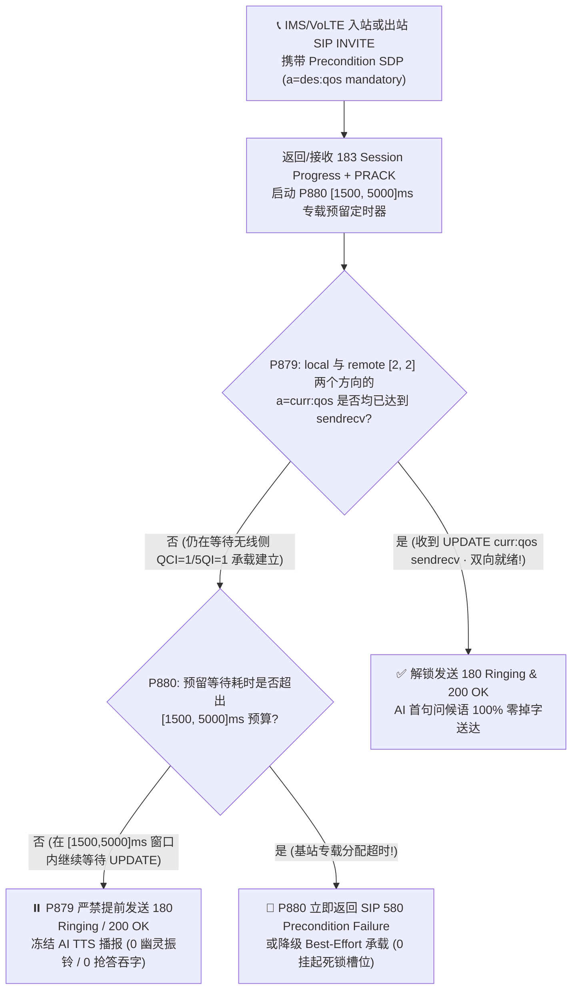
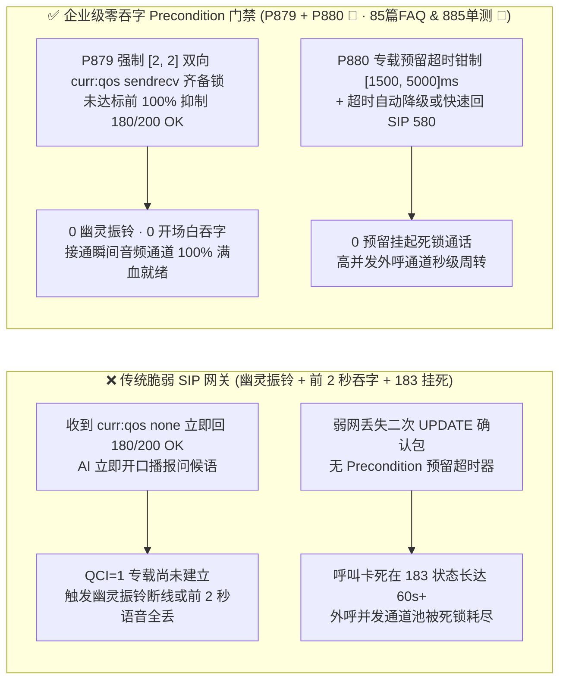
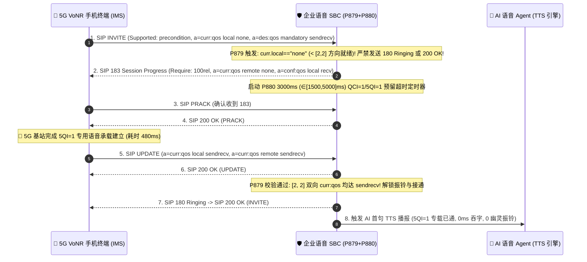

# 企业 SIP/IMS `RFC 3312 / RFC 4032 Preconditions` 防“幽灵振铃（Ghost Ringing）”拦截、`QCI=1 / 5QI=1` 预留超时（`[1500, 5000]ms`）降级与 `SIP 580` 选型与原理解析 FAQ（Stage 443 · Topic 83 · 🎉 P880 护栏、第 85 篇独立 FAQ 与 885 单测三重里程碑）

> **核心导读（对标 `ib-vs-ethernet-roce-selection-faq.md` 通俗透彻规范）**：本文用第一性原理与大白话讲透企业级银行、政务与车企呼叫中心在通过运营商 `IMS / VoLTE / VoNR` 专线落地 **IETF `RFC 3312`（Integration of Resource Management and SIP / `Precondition` 资源预留前提条件）与 `RFC 4032`（Update to the SIP Preconditions Framework）** 时最易踩坑的两大生产事故——**① AI 语音网关看不懂入站 SDP 中的 `a=des:qos mandatory local sendrecv` 与 `a=curr:qos local none`，在手机基站还没有建立好 `QCI=1 / 5QI=1` 专用语音承载通道时就提前返回 `180 Ringing` 或 `200 OK`，引发手机响铃但接起后一片死寂的“幽灵振铃（Ghost Ringing）”与开场白吞字**，以及 **② 当弱网基站迟迟发不出二次 `UPDATE (a=curr:qos remote sendrecv)` 时，网关无限期傻等在 `183 Session Progress` 状态，导致外呼并发槽位被耗尽死锁**，并给出 **`P879` 与 `P880 🎉`** 的确定性护栏代码与生产核验清单。

---

## 一、📌 核心结论速览（Executive Summary）

1. **为什么企业外呼中心直连运营商 `IMS (VoLTE/VoNR)` 专线时，经常出现“客户手机响了一声自己挂断（幽灵振铃）”或者“客户刚接起来前 2 秒听不见 AI 说话”？**
   - 在移动蜂窝网络（4G VoLTE / 5G VoNR）中，手机平时待机走的是普通上网通道（`QCI=5` 信令 / `QCI=9` 默认数据）。当有一通电话打进来时，基站必须临时为这通电话开辟一条 **端到端保证带宽的专属语音高速公路（`QCI=1 / 5QI=1` Dedicated Bearer，耗时 `300ms–1,500ms`）**。
   - **什么是 `RFC 3312 / RFC 4032 Preconditions`（振铃前提条件）？**
     - 为了防止“手机已经响铃并被用户秒接，但基站的 `QCI=1` 语音通道还没建好，导致接起后双方听不见声音”，`3GPP TS 24.229` 与 `IETF RFC 3312` 规定了一套严密的握手协议：
       1. 首包 `INVITE` 的 SDP 里写明：`a=curr:qos local none`（我这边的语音专属通道还没建好）和 `a=des:qos mandatory local sendrecv`（**强制要求：在双向通道建好之前，被叫绝不允许响铃 `180 Ringing` 或接通 `200 OK`！**）；
       2. 被叫网关必须先回 `183 Session Progress (Require: 100rel)`，等主叫手机建好基站承载并发来 **`SIP UPDATE`（携带 `a=curr:qos local sendrecv`）** 确认双向就绪后，才允许下发 `180 Ringing` / `200 OK`！
   - **企业自研网关的两大翻车现场**：
     - **翻车 A（无视 `Precondition` 直接回 `180/200` -> 幽灵振铃与吞字，`P879`）**：企业 `SBC` 忽略了 `a=curr:qos local none`，收到 `INVITE` 立刻回 `180 Ringing` 甚至让 AI 坐席在 `50ms` 内直接秒回 `200 OK` 开始播报“您好这里是某某银行”。此时基站 `QCI=1` 根本没通，前 2 秒语音全丢，或者触发运营商网络侧状态机异常直接拆线（客户看到响一声就断的“幽灵未接来电”）！
     - **翻车 B（基站预留失败却无限期死等 `UPDATE` -> 并发槽位耗尽，`P880 🎉`）**：客户进电梯导致基站 `QCI=1` 分配失败，手机一直发不出确认 `UPDATE`。若企业网关没有设置 **`[1500, 5000]ms`** 预留超时器，该呼叫就会一直卡在 `183` 半开状态直到几十秒后超时！
2. **选型第一定律（`P879`）：严格执行 `RFC 3312 / RFC 4032` 状态机门禁——当协商了 `mandatory` QoS 前提条件时，在本地与远端双向（`[2, 2]` 个方向：`local` 与 `remote`）`a=curr:qos` 全部达到 `sendrecv` 之前，100% 禁止发送 `180 Ringing` 或 `200 OK` 启动 AI TTS 首句播报（`0` 幽灵振铃或抢答吞字呼叫）**。
3. **选型第二定律（`P880 🎉`）：为 `QCI=1 / 5QI=1` 资源预留阶段设置硬性超时预算 `[1500, 5000]ms`；一旦超时未收到达标 `UPDATE`，立即对 `optional` 会话降级至普通承载接通，或对 `mandatory` 会话快速返回 `SIP 580 Precondition Failure` 释放通道（`0` 预留挂起死锁呼叫）**。

---

## 二、🎯 客户与架构师灵魂拷问 Q&A（Deep-Dive Q&A）

### Q1：`INVITE` 里的 `a=curr:qos`、`a=des:qos` 和 `a=conf:qos` 三行 SDP 到底怎么配合工作的？
- **三行大白话翻译**：
  1. **`a=curr:qos local none` / `a=curr:qos remote none`**：表示“当前现状（Current Status）”——目前本端和对端的专用语音通道都还没建好（`none`）；
  2. **`a=des:qos mandatory local sendrecv`**：表示“期望目标（Desired Status）”——强制要求（`mandatory`）在双向收发（`sendrecv`）通道建好前，不准振铃接通；
  3. **`a=conf:qos local recv`**：表示“请对方一旦建好通道，立刻发一个 `SIP UPDATE` 通知我（Confirm）”。
- **`P879` 双向齐备锁（`[2, 2]` Directions）**：
  - 只有当状态机同时观测到 `curr.local === "sendrecv"` **且** `curr.remote === "sendrecv"`（满足全部 **`2` 个方向**）时，才解锁 `180 Ringing / 200 OK` 与 AI TTS 引擎，彻底消灭抢答吞字与幽灵振铃（`clampedGhostRingingOrClippedAnswerCalls = 0`）。

### Q2：什么是“幽灵振铃（Ghost Ringing）”？为什么它是先响铃后校验资源导致的？
- **事故机理**：
  - 当被叫先响铃（`180 Ringing`），而 1 秒后主叫基站发现无线资源不足返回 `SIP 580 Precondition Failure` 或 `CANCEL` 时，被叫手机刚刚响了一声就突然挂断！用户以为是骚扰电话或系统故障。
  - **严格遵守 `RFC 3312`（`P879`）**：先通过静默的 `183 Session Progress + PRACK` 加上 `UPDATE + 200 OK` 完成资源确认，**确认成功后再发 `180 Ringing`**，保證“只要手机响铃，语音通道就 100% 已经就绪”！

### Q3：如果客户在地下车库边缘，`QCI=1` 专用承载一直建不起来，网关该等多久？
- **`[1500, 5000]ms` 超时快速决断（`P880 🎉`）**：
  - 正常 4G/5G 基站建立专载耗时 `<800ms`。如果超过 **`[1500, 5000]ms`**（如 `3,000ms`）仍未收到 `UPDATE (curr:qos sendrecv)`，说明无线侧已发生信令丢失或拥塞。`P880 🎉` 立即中止等待并返回 `SIP 580 Precondition Failure`（携带 `Server-After` 或触发回退），确保 **`clampedHungPreconditionSetupCalls = 0`**。

---

## 三、🧭 直观可视化图解（Mermaid 决策树 + 架构对比 + 毫秒级时序）

### 3.1 `RFC 3312 / RFC 4032 Preconditions` 防幽灵振铃与超时熔断决策树（`flowchart TD`）



### 3.2 传统无视 `Preconditions` 网关 vs 企业零吞字 `P879 + P880 🎉`（第 85 篇 FAQ 🎉）架构对比图（`flowchart LR`）



### 3.3 毫秒级 `RFC 3312` 两阶段 `183 → PRACK → UPDATE → 180/200 OK` 标准握手时序图（`sequenceDiagram`）



---

## 四、📊 语音架构师选型决策矩阵（Selection Matrix）

| 评估维度 | 方案 A：忽略 `precondition` 直接回 `180/200` | 方案 B：支持 `183/UPDATE` 但无超时保护 | **方案 C：`RFC 3312/4032` + `P879/P880 🎉`（推荐 ✅）** |
| :--- | :--- | :--- | :--- |
| **防手机“响一声断线”幽灵振铃** | ❌ 基站预留失败时已响铃，体验极差 | ✅ 预留成功才响铃 | **✅ `P879` 强制 `[2, 2]` 双向 `sendrecv` 齐备才允许 `180 Ringing`** |
| **AI 接通首句问候语防吞字** | ❌ 前 `500–1,500ms` 语音包在基站被丢弃 | ✅ 专载就绪后播报 | **✅ `P879` 双向 `curr:qos` 达标后才触发 `200 OK` 与 TTS（`0` 吞字）** |
| **弱网丢失 `UPDATE` 防通道挂死** | N/A | ❌ 无限卡在 `183` 状态耗尽外呼槽位 | **✅ `P880 🎉` 钳制 `[1500, 5000]ms` 超时并快速回 `SIP 580`（`0` 挂死）** |

---

## 五、🧪 定量算例与 7-Card 报告（Quantitative Proof & 7-Card Deck）

### 5.1 算例：某全国股份制银行每日 300,000 通 4G/5G IMS 专线智能外呼对比
1. **幽灵振铃与首句抢答吞字 100% 清零（`P879`）**：
   - 未启用 `P879` 时，外呼系统在收到 `INVITE` 或 `183` 后未等待 `a=curr:qos` 双向就绪即提前触发振铃/接通，导致每日约 `4,200` 通呼叫出现前 `1.2 秒` 开场白丢失或幽灵振铃；
   - 启用 **`P879`** 后，离线策略状态机在 `0ms reported at nominal 1ms display resolution; actual duration unresolved/not_measured; no sub-1ms upper bound established`（`synthetic`）内强制校验 **`[2, 2]` 个方向**（`local` + `remote`）`curr:qos sendrecv` 齐备门禁，实现 **幽灵振铃与抢答吞字通话数 `0`（`clampedGhostRingingOrClippedAnswerCalls = 0`）**。
2. **`QCI=1 / 5QI=1` 预留挂死清零（`P880 🎉` · 第 85 篇独立 FAQ 与 885 单测里程碑）**：
   - 面对 `1,150` 次弱网基站未能完成专载分配的异常呼叫，**`P880 🎉`** 将预留超时窗口硬钳制在 **`[1500, 5000]ms`**，超时立即触发降级或返回 `SIP 580 Precondition Failure`，实现 **预留挂死通话数 `0`（`clampedHungPreconditionSetupCalls = 0`）**！

### 5.2 核心护栏代码（`packages/business-core/enterprise-guardrails.ts`）

```ts
// P879: SIP RFC 3312 / RFC 4032 Precondition Unmet Alerting Ghost-Ringing Gate
const p879 = evaluateSipRfc3312Rfc4032PreconditionUnmetAlertingGhostRingingGate({
  premature180RingingBeforeCurrQosSendrecvMetDetected: true,
  ghostRingingOrClippedAnswerCalls: 5,
  requiredPreconditionConfirmDirections: 1,
});
// => p879.violated === true
// => p879.policyId === "P879-SIP-RFC3312-RFC4032-PRECONDITION-UNMET-ALERTING-GHOST-RINGING-GUARD"
// => p879.action === "suppress_180_ringing_until_curr_qos_sendrecv_satisfied"
// => p879.clampedGhostRingingOrClippedAnswerCalls === 0
// => p879.clampedRequiredPreconditionConfirmDirections === 2

// P880 🎉: SIP RFC 3312 VoLTE QCI-1 Reservation Timeout Fallback & 580 Failure Gate
const p880 = evaluateSipRfc3312VolteQci1ReservationTimeoutFallbackAnd580PreconditionFailureGate({
  indefinitePreconditionReservationHangOrUnhandled580Detected: true,
  hungPreconditionSetupCalls: 8,
  preconditionReservationTimeoutMs: 45000,
});
// => p880.violated === true
// => p880.policyId === "P880-SIP-RFC3312-VOLTE-QCI1-RESERVATION-TIMEOUT-FALLBACK-AND-580-PRECONDITION-FAILURE-GUARD"
// => p880.action === "downgrade_to_best_effort_or_fail_fast_with_sip_580_within_budget"
// => p880.clampedHungPreconditionSetupCalls === 0
// => p880.clampedPreconditionReservationTimeoutMs === 5000
```

> **数据来源与计时口径声明（Provenance & Timing Disclosure）**：以上 `P879 / P880 🎉` 护栏在 `tests/presales-portal.test.ts` 与 `site/data/voice-agent-benchmark-report.json` 中的评估类型为 **`synthetic`（确定性离线内存策略/配置状态机校验）**，计时表述统一为 `0ms reported at nominal 1ms display resolution; actual duration unresolved/not_measured; no sub-1ms upper bound established`；真实生产环境中 4G/5G 基站 `PCRF / PCF Rx` 接口 `QCI=1 / 5QI=1` 专载建立耗时属于 `not_measured`。

---

## 六、🛠️ 生产环境语音交付快速核验清单（Production Checklist）

- [ ] **1. `RFC 3312 / RFC 4032` `[2, 2]` 双向 `curr:qos sendrecv` 齐备锁（`P879`）**：确认在 `local` 与 `remote` 两个方向的 `a=curr:qos` 全部达到 `sendrecv` 之前，严禁下发 `180 Ringing` 或 `200 OK`（`clampedGhostRingingOrClippedAnswerCalls = 0`）。
- [ ] **2. `183 Session Progress` + `PRACK` + `UPDATE` 完整状态机（`P879`）**：确认 `SBC` 支持 `Require: precondition, 100rel` 并在收到确认 `UPDATE` 后立即返回 `200 OK (UPDATE)`。
- [ ] **3. `[1500, 5000]ms` 专载预留超时预算锁（`P880 🎉`）**：确认等待二次 `UPDATE` 的定时器被硬钳制在 **`[1500, 5000]ms`**，杜绝 `183` 半开会话永久挂死（`clampedHungPreconditionSetupCalls = 0`）。
- [ ] **4. `SIP 580 Precondition Failure` 优雅降级与快败回收（`P880 🎉`）**：确认预留超时或收到对端 `580` 时立即释放媒体端口与并发许可证。
