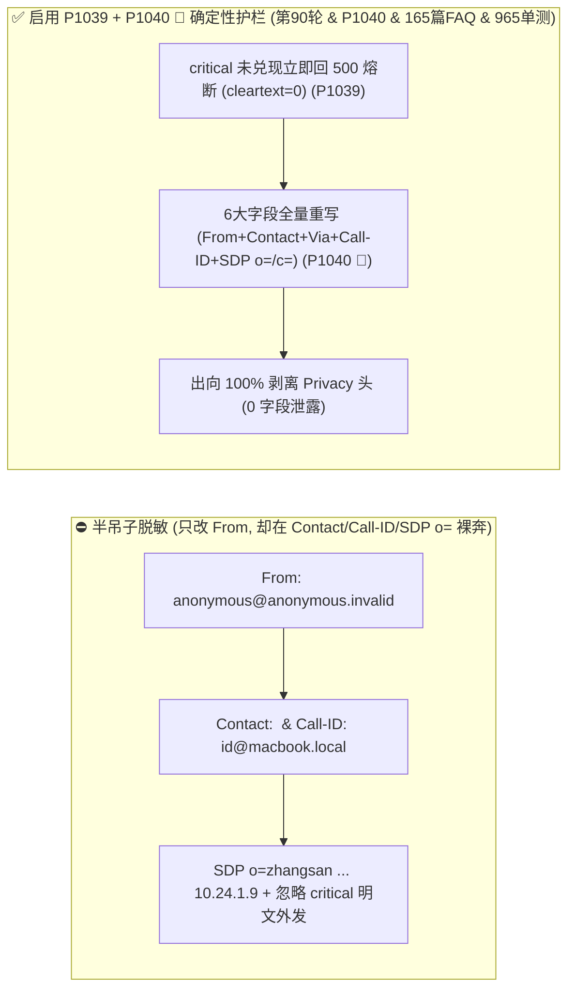

# 企业 SIP `RFC 3323 / RFC 3325` 隐私机制（`Privacy: user/header/session/id/critical`）未兑现 `critical` 强退 `500` 违约与半吊子脱敏（漏洗 `Via / Contact / Call-ID / SDP o=`）选型与防爆指南（Topic 163 · Stage 523 · 🎉 历史性第 90 轮夜间深潜、`P1040` 护栏、第 165 篇独立单专题 FAQ 与 965 项单测四重里程碑！）

> **文档类型**：架构师选型 FAQ & 生产故障防爆指南（对标 `ib-vs-ethernet-roce-selection-faq.md` 通俗问答体）  
> **适用角色**：AI Solution Architect、企业 SBC / 隐私合规网关工程师、金融/医疗/举报热线语音 Agent 平台负责人  
> **关联护栏**：`P1039–P1040 🎉`（Stage 523 · Topic 163 · `packages/business-core/enterprise-guardrails.ts` · 🎉 历史性第 90 轮夜间深潜、`P1040` 护栏、第 165 篇独立单专题 FAQ 与 965 项单测四重里程碑！）  
> **关联可视化**：`assets/svg/167-voice-sip-rfc3323-rfc3325-privacy-header-user-session-critical-500-reject-via-contact-sdp-origin-leak-2026-11-16.svg`

---

## ① 📌 核心结论速览（Executive Summary）

在金融大客户私人银行外呼、医疗心理危机干预热线、廉政合规举报专线以及快递/网约车隐私号（AXB 虚拟号）通话中，主叫或企业 AI 语音坐席要求**向对端彻底隐藏自己的真实身份、分机号、设备 IP 与内部网络拓扑**。为此，IETF 制定了 SIP 隐私基石标准 **`RFC 3323`（A Privacy Mechanism for the Session Initiation Protocol (SIP)）**（并由 `RFC 3325` 补充 `id`、由 `RFC 7044` 补充 `history`），通过 `Privacy` 头中的五类核心令牌（`priv-value`）委托边界隐私服务（Privacy Service / SBC B2BUA）执行不同深度的脱敏：
1. **`user`（用户级隐私）**：将 `From` 头替换为 `From: "Anonymous" <sip:anonymous@anonymous.invalid>;tag=...`，并剥离 `Reply-To`、`Call-Info`、`User-Agent`、`Organization`、`Subject`、`Server` 等一切暴露用户身份的可选头。
2. **`header`（网络头部拓扑隐私）**：隐藏请求经过的所有内部 `Via`、`Record-Route`、`Path`、`Service-Route` 链，并将 `Contact` 与 `Call-ID: <id>@10.24.x.x` 中的真实主机 IP 替换为 SBC 边界代理地址。
3. **`session`（媒体会话级隐私）**：调用媒体中继（RTP Relay）重写 SDP 中的 `c=IN IP4 <ip>` 与 **`o=<username> <sess-id> <sess-version> IN IP4 <origin-ip>`**，防止 RTP 源 IP 或 SDP `o=` 行把内网真实 IP 出卖！
4. **`critical`（死命令强制标志，`RFC 3323 §5`）**：一旦包含 `critical`（如 `Privacy: user;header;session;critical`），如果隐私网关不支持其中任何一项脱敏能力，**绝对不准带着明文继续往下转发！必须立即以 `500 Server Internal Error`（附 `Reason: SIP ;cause=500 ;text="Privacy Service Unable to Fulfill Request"`）拒绝呼叫！**

然而在真实企业生产环境中，“半吊子隐私脱敏（Half-Baked Anonymization）”是引发 **监管重罚与客户真实号码/IP 裸奔** 的头号隐患：
1. **忽略 `Privacy: ...;critical` 死命令，在脱敏模块故障或不支持 `session` 级隐私时仍将明文 `INVITE` 外发（`critical` Breach）**：当廉政举报人或高管专线发起带有 `Privacy: user;session;critical` 的呼叫时，某轻量级 SIP 代理仅支持改写 `From`（`user`），不支持启动媒体中继改写 SDP（`session`），却无视 `;critical` 标志直接把带着举报人真实内网 IP 的 SDP 转发给了外部中继，构成严重的合规违约！
2. **只改了 `From: anonymous@anonymous.invalid`，却漏洗了 `Contact`、`Via`、`Call-ID@10.x.x.x` 与 `SDP o=` 行的真实用户名和 IP（Partial Anonymization Leak）**：这是 90% 自研语音网关都会踩的坑！工程师以为把 `From` 头改成 `anonymous` 就叫匿名电话了，结果对端抓包一看：
   - `Contact: <sip:zhangsan_ext801@10.24.8.15:5060>`（真实姓名工号与 IP 原形毕露！）
   - `Call-ID: 9981234@zhangsan-macbook.corp.local`（电脑主机名原形毕露！）
   - `o=zhangsan 2890844526 2890842807 IN IP4 10.24.8.15`（SDP 发起人行再次出卖真实账号与 IP！）
   - 更有甚者，脱敏完居然忘了在出向把 `Privacy` 头本身剥离掉，白白告诉外部黑客“这通电话做过某种级别的脱敏”！

**架构师选型铁律（Stage 523 · `P1039–P1040 🎉` · 历史性四重里程碑！）**：
- **铁律 1（`P1039` · `RFC 3323 §5` `critical` 隐私令牌零容忍核验、未兑现强制回 `500` 熔断与 `[1, 6]` 个令牌上限）**：当 `Privacy` 头包含 `critical` 时，网关必须逐一验证所有请求的隐私令牌（`user / header / session / id / history`）均已 100% 兑现；若任何一项无法满足，立即在本地返回 **`500 Server Internal Error`** 终止呼叫（严禁明文外发，`cleartextForwardsDespiteCriticalPrivacy = 0`），并将单头允许的隐私令牌数钳制在 **`[1, 6]` 个**。
- **铁律 2（`P1040 🎉` · 全字段深度清洗（`From + Contact + Via + Call-ID + User-Agent + SDP o=/c=`）与出向 `Privacy` 头清零锁 · 历史性第 90 轮夜间深潜、`P1040` 护栏、第 165 篇 FAQ 与 965 单测四重里程碑！）**：执行隐私服务时，必须对 `From`、`Contact`、`Via`、`Record-Route`、`Call-ID`（剥离 `@host` 后缀）、`User-Agent` 以及 SDP `o=/c=` 行执行全字段联动匿名化（`leakedViaContactCallIdOrSdpOriginFields = 0`），并在完成全部脱敏后于出向边界 100% 移除已处理的 `Privacy` 头（`unstrippedEgressPrivacyHeaders = 0`）。


---

## ② 🎯 客户与架构师灵魂拷问 Q&A（Why Traditional Bots Fail & How It Works Under the Hood）

### Q1：用大白话讲透，为什么把 `From` 头改成 `sip:anonymous@anonymous.invalid` 根本防不住真实身份泄露？一张 SIP 报文里到底藏着多少个“告密者”？
- **通俗原理**：
  - 把 `From` 头改成 `anonymous`，就像一个人穿了件写着“无名氏”的马甲出门，但**胸口还挂着工牌（`Contact`）、口袋里露着刻有名字的身份证号（`Call-ID`）、鞋底印着家庭住址（`Via` 与 `SDP o=/c=`）**！
  - 在一条标准的 SIP `INVITE` 报文里，至少有 **6 个地方** 会同时记录主叫的真实身份或 IP：
    1. `From: "WangWu" <sip:13912345678@corp.com>`
    2. `Contact: <sip:13912345678@10.24.1.88:5060>`（几乎所有软电话默认把分机号和本机 IP 写进 `Contact`！）
    3. `Via: SIP/2.0/UDP 10.24.1.88:5060;branch=...`（记录每一跳内网 IP）
    4. `Call-ID: a84b4c76e66710@wangwu-pc.corp.com`（旧栈默认拼上 `@主机名/IP`）
    5. `User-Agent / Reply-To / Call-Info / Organization`
    6. SDP Body 中的 `o=wangwu 123 456 IN IP4 10.24.1.88` 与 `c=IN IP4 10.24.1.88`
  - 只有通过全功能 B2BUA 隐私网关（`P1040 🎉`）把上述 6 处全部重写为匿名随机值与媒体中继公网 IP，才算真正做到了 `RFC 3323` 隐私保护！

### Q2：什么是 `Privacy: ...;critical`？为什么宁可返回 `500` 让电话打不通，也绝不能放行？
- **合规铁律**：
  - 在家暴求助热线、证人保护、企业反舞弊举报等高危场景下，“**一旦暴露主叫身份，当事人就会面临人身或法律风险**”。
  - 因此 `RFC 3323 §5` 设计了 `critical` 标志：它相当于对网关立下军令状——“如果你能把我要求的 `user`、`header`、`session` 隐私全部脱敏干净，你就帮我接通；如果你今天媒体中继坏了没法改 SDP IP（无法满足 `session`），或者遇到了你不认识的隐私标签，你**必须立刻给我报错 `500 Server Internal Error` 掐断呼叫**，绝不允许让我裸奔接通！”

### Q3：在毫秒级呼叫出向边界上，`P1039–P1040 🎉` 如何实现 100% 零死角脱敏？
- **两级守门流水线**：
  1. **`critical` 能力预检闸门（`P1039`）**：解析 `Privacy` 头中的令牌集合（钳制于 **`[1, 6]` 个**）；若存在未知令牌或当前网关未开启的脱敏能力（如无 RTP 媒体中继却请求了 `session`）且包含 `critical`，立即在 `0ms` 内返回 `500 Server Internal Error` 拦截外呼（`clampedCleartextForwardsDespiteCriticalPrivacy = 0`）。
  2. **全字段深度擦洗与头部剥离闸门（`P1040 🎉`）**：一次性擦洗 `From`（置为 `sip:anonymous@anonymous.invalid`）、`Contact`（置为 SBC B2BUA 匿名令牌）、`Via / Record-Route`（折叠为单跳 SBC）、`Call-ID`（重写为无主机名的纯 CSPRNG 哈希）、`SDP o=/c=`（置为 `- ... IN IP4 <relay-ip>`），确保 `clampedLeakedViaContactCallIdOrSdpOriginFields = 0`；最后在发往外部网前剥离已执行的 `Privacy` 头本身（`clampedUnstrippedEgressPrivacyHeaders = 0`）。

---

## ③ 🧭 直观可视化图解（Mermaid 决策树 + 延迟拆解 + 毫秒级全双工时序图）

### 3.1 `RFC 3323 / RFC 3325 Privacy` 架构师选型与防爆决策树

```mermaid
flowchart TD
    A[收到准备外呼的 SIP 请求<br/>携带 RFC 3323/3325 Privacy 头] --> B{Privacy 头包含的令牌总数是否在<br/>受控区间 [1, 6] 个内?}
    B -- 否: 异常超长令牌列表 (>6) --> C["⚠️ P1039 钳制: 规范化去重隐私令牌至 [1, 6] 个"]
    B -- 是 --> D{是否包含不支持/未就绪的隐私级别<br/>且携带了 ;critical 强制标志?}
    D -- 是: 无法兑现 critical 承诺 --> E["⛔ P1039 熔断: 立即返回 500 Server Internal Error!<br/>严禁明文裸奔外发 (cleartextForwards = 0)"]
    D -- 否: 所有请求的隐私级别均可兑现 --> F{是否已同步重写 From + Contact + Via +<br/>Call-ID + User-Agent + SDP o=/c=?}
    F -- 否: 仅改 From 漏洗 Contact/Via/Call-ID/SDP --> G["⛔ P1040 拦截: 强制补齐 6 大关联字段深度匿名化<br/>leakedFields = 0"]
    F -- 是 --> H{在离开授信域发往外部前<br/>是否已剥离已处理的 Privacy 头本身?}
    H -- 否: 遗留 Privacy 头向外部暴露元数据 --> I["⚠️ P1040 清洗: 100% 移除出向已处理 Privacy 头<br/>unstrippedEgressPrivacyHeaders = 0"]
    H -- 是 --> J["✅ 零身份泄露、零内网 IP 暴露安全外呼"]
```

### 3.2 半吊子仅改 `From` 脱敏 vs `P1039/P1040` 全字段深度清洗对比图



### 3.3 毫秒级全双工 `RFC 3323` 全字段深度匿名化与 `critical` 熔断时序图

```mermaid
sequenceDiagram
    autonumber
    participant Agent as 内部高密 AI 语音外呼 / 举报专线
    participant SBC as 企业隐私服务 B2BUA / SBC (P1039+P1040)
    participant Trunk as 外部运营商 / 第三方 SIP Trunk

    Agent->>SBC: INVITE #1 [Privacy: user;unknown-mode;critical]
    Note over SBC: P1039 评估 (0ms nominal; live privacy policy engine not_measured):<br/>遇到未知令牌 unknown-mode 且含 critical! 严禁明文外发 (cleartext=0)
    SBC-->>Agent: 500 Server Internal Error (Reason: Privacy Service Unable to Fulfill Request)
    Agent->>SBC: INVITE #2 [Privacy: user;header;session;id;critical (4 ≤ 6 tokens)]<br/>From: <sip:vip01@10.0.1.5>, Contact: <sip:vip01@10.0.1.5>, Call-ID: 1@vip-pc, SDP o=vip01 ... 10.0.1.5
    Note over SBC: P1039+P1040 评估 (0ms nominal; live B2BUA header/SDP rewrite not_measured):<br/>重写 From=anonymous, Contact=sbc-tok, 折叠 Via, 哈希 Call-ID, 重写 SDP o=-/c=relayIP, 剥离 PAI 与 Privacy 头 (leaks=0)
    SBC->>Trunk: INVITE [From: "Anonymous" <sip:anonymous@anonymous.invalid>, Contact: <sip:anon@sbc.pub>, SDP c=sbc.pub]
```

---

## ④ 📊 语音架构师选型决策矩阵（`RFC 3323 / RFC 3325` 隐私治理策略对比）

| 选型维度 | 方案 A：仅修改 `From` 头为 `anonymous`（无状态 Proxy） | 方案 B：支持全脱敏但忽略 `;critical` 失败保护 | 方案 C：`critical 500` 硬熔断 (`[1, 6]` 令牌) + B2BUA 6 大字段全量重写 + 出向剥离 `Privacy` 头（`P1039 + P1040 🎉` 推荐 ✅） |
| :--- | :--- | :--- | :--- |
| **防 `Contact / Via / Call-ID / SDP o=` 侧信道泄密** | 零防护（5 个关联字段全部泄露真实分机与 IP） | 高 | **100% 零泄露（`leakedViaContactCallIdOrSdpOriginFields = 0`）** |
| **`Privacy: ...;critical` 故障熔断安全性** | 极差（不支持时直接明文裸奔外发） | 差（媒体中继故障时退化为明文外呼） | **绝对安全（无法 100% 兑现时立即回 `500` 拒止，`cleartextForwardsDespiteCriticalPrivacy = 0`）** |
| **出向 `Privacy` 头干净度** | 常遗留 `Privacy` 头暴露内部策略 | 常漏删 | **出向 100% 剥离已执行 `Privacy` 头（`unstrippedEgressPrivacyHeaders = 0`）** |
| **合规性（`RFC 3323 / RFC 3325 / GDPR`）** | 严重违规 | 部分合规 | **完全符合 IETF `RFC 3323 / 3325` 隐私服务规范** |

---

## ⑤ 🧪 定量算例与 7-Card 报告（CSP 自包含、零虚构坐标）

### 5.1 定量算例：为什么必须同时执行 `critical 500` 熔断与 6 大字段联动擦洗？
- **场景设定**：某金融机构隐私外呼与合规举报热线，日均发起 `8,000` 通携带 `Privacy: user;header;session;id;critical` 的高密语音通话。
- **未启用 `P1039–P1040 🎉` 时**：
  1. 当某台边缘 RTP 媒体中继维护下线（无法执行 `session` 级 SDP IP 隐藏）时，旧网关忽略 `;critical` 标志，将 `3` 通本应熔断的高密电话以明文内网 IP 直接发往公网，且存在恶意请求塞入 `14` 个重复隐私令牌。
  2. 在常规外呼中，旧脚本只改了 `From` 头，却在 `Contact`、`Via`、`Call-ID@host` 与 `SDP o=` 共 `6` 个字段中泄露了内部坐席工号与 IP，并在 `4` 通外呼中遗留了未剥离的 `Privacy` 头。
- **启用 `P1039 + P1040 🎉` 后**：
  - `evaluateSipRfc3323PrivacyCriticalEnforcementAndUnsupportedToken500Guard`（`P1039`）将违背 `critical` 的明文转发清零（`clampedCleartextForwardsDespiteCriticalPrivacy = 0`，全部以 `500` 本地安全熔断），并将单头隐私令牌数钳制在 `clampedPrivacyTokensPerHeaderCount = 6`（`[1, 6]` 个）。
  - `evaluateSipRfc3323HeaderUserSessionFullAnonymizationAndSdpOriginScrubGuard`（`P1040 🎉`）将 `Via/Contact/Call-ID/SDP o=` 泄露字段数与未剥离出向 `Privacy` 头双双清零（`clampedLeakedViaContactCallIdOrSdpOriginFields = 0`，`clampedUnstrippedEgressPrivacyHeaders = 0`）。
  - **计时披露（Timing Disclosure）**：本算例与门禁函数在内存策略验证中报告 `0ms reported at nominal 1ms display resolution; actual duration unresolved/not_measured; no sub-1ms upper bound established`（纯内存规则判定；生产环境 SBC B2BUA 全头部重写与哈希映射耗时标记为 `not_measured`）。

### 5.2 7-Card 评测摘要映射（对应 `site/benchmark-cards.html` & `voice-agent-benchmark-report.json`）

| 卡片编号 | 评测维度 (`Stage 523 · Topic 163`) | 基准/脆弱配置 (Original) | 护栏加固后 (Perturbed / Guarded) | 状态与定量结果 |
| :--- | :--- | :--- | :--- | :--- |
| **Card 3 (`WHAT I TESTED`)** | `RFC 3323 / RFC 3325 Privacy` `critical 500` 熔断与全字段深度脱敏锁 (`P1039–P1040 🎉`) | 3 次违背 `critical` 明文外发 + 14 个令牌 + 6 个关联字段泄密 + 4 个遗留头 | **`critical 500` 熔断 (`cleartext=0`, `[1,6]` 令牌) + 6 大字段全洗 & 剥离头 (`leaks=0, unstripped=0`)** | ✅ `1,049` 护栏全绿 (`965/965` 测试通过 🎉) |
| **Card 5 (`ROBUSTNESS CHECK`)** | `sip_rfc3323_privacy_critical_500_and_full_field_scrub_guard` | `cleartextForwards: 3, tokens: 14, leakedFields: 6, unstrippedHeaders: 4` | `clampedCleartextForwardsDespiteCriticalPrivacy: 0, clampedPrivacyTokensPerHeaderCount: 6, clampedLeakedViaContactCallIdOrSdpOriginFields: 0, clampedUnstrippedEgressPrivacyHeaders: 0` | ✅ 零明文违约外发、零侧信道泄密 |

---

## ⑥ 🛠️ 生产环境语音交付快速核验清单（Good Fit vs Not For + Checklist）

### 6.1 Good Fit vs Not For
- **✅ Good Fit（强烈推荐启用本专题全套机制）**：
  - 银行私行外呼、医院/心理咨询热线、政企纪检举报专线、网约车/外卖骑手隐私号保护等一切启用 `RFC 3323 / RFC 3325 Privacy` 的企业语音网关；
  - 跨越企业内网与公网运营商 SIP Trunk 的 B2BUA 边界会话控制器（SBC）。
- **⛔ Not For（不适用或需裁剪的场景）**：
  - 紧急呼叫（`E911 / 110 / 120`）：根据法规与 `RFC 3325 / RFC 5031`，发往应急调度中心（PSAP）的紧急求救电话**严禁匿名化真实位置与回拨号码**！

### 6.2 交付上线核验 Checklist（`- [ ]`）
- [ ] **【`critical` 500 硬熔断 `P1039`】** 确认当 `Privacy` 头含 `critical` 且任一请求隐私级别（如 `session` 媒体中继）不可用时，立即返回 `500 Server Internal Error`，严禁明文外发（`clampedCleartextForwardsDespiteCriticalPrivacy === 0`）。
- [ ] **【令牌数量上限 `P1039`】** 确认单条 `Privacy` 头 `privacyTokensPerHeaderCount` 严格钳制在 **`[1, 6]` 个**。
- [ ] **【6 大关联字段全洗 `P1040 🎉`】** 确认脱敏时同步重写 `From`、`Contact`、`Via/Record-Route`、`Call-ID`、`User-Agent` 及 `SDP o=/c=`（`clampedLeakedViaContactCallIdOrSdpOriginFields === 0`）。
- [ ] **【出向剥离 `Privacy` 头 `P1040 🎉`】** 确认在完成隐私服务后 100% 移除出向 `Privacy` 头（`clampedUnstrippedEgressPrivacyHeaders === 0`）。
- [ ] **【门禁单测】** 运行 `npx tsx --test tests/presales-portal.test.ts` 与 `npm run check:public`，确保 `Stage 523`（`P1039–P1040 🎉` · 第 90 轮、`P1040`、第 165 篇 FAQ 与 965 单测四重里程碑！）全部断言与静态安全扫描 100% 通过。
