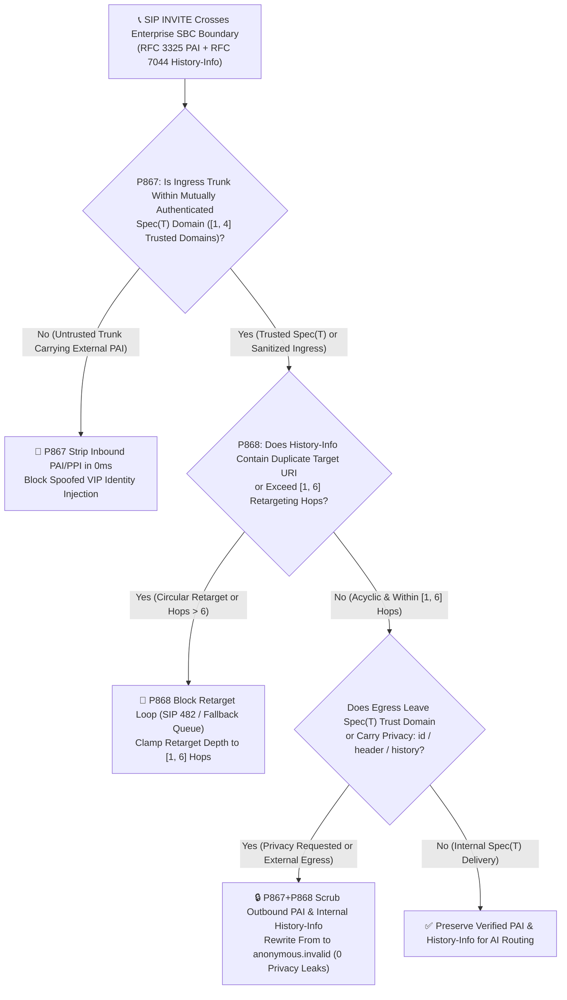
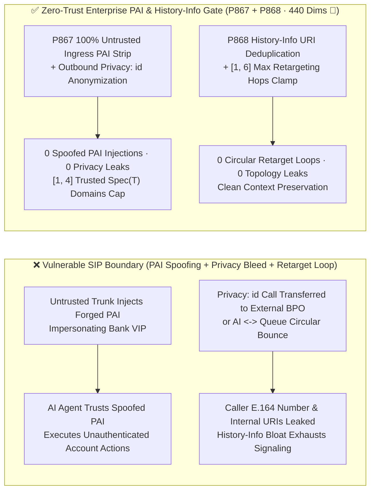

# Enterprise SIP `RFC 3325 / RFC 7044 P-Asserted-Identity (PAI)` Untrusted-Trunk Stripping, Outbound `Privacy: id` Leak Prevention & `History-Info` Retargeting Loop Cap (`[1, 6]` Hops) Selection & Principle FAQ (Stage 437 · Topic 77 · 🎉 Historic 440-Dimension Milestone)

> **Reader's Guide (Modeled on `ib-vs-ethernet-roce-selection-faq.md`)**: This single-topic architecture guide explains from first principles why enterprise banking, healthcare, crisis-hotline, and multi-region contact-center Voice Agents implementing **IETF `RFC 3325` (`P-Asserted-Identity` within `Spec(T)` Trusted Networks), `RFC 3323` (`Privacy: id`), and `RFC 7044` (`History-Info` Call Retargeting Trace)** face three critical security and compliance failures—specifically **(1) inbound caller-ID spoofing when edge `SBC`s fail to strip `P-Asserted-Identity (PAI)` headers arriving on untrusted SIP trunks**, **(2) outbound privacy breaches when calls carrying `Privacy: id / header / history` are warm-transferred across trust boundaries without scrubbing `PAI` and internal `History-Info` URIs**, and **(3) infinite retargeting loops between AI agents and overflow ACD queues that bloat `History-Info` `hi-index` trees**—and provides deterministic guardrails **`P867` and `P868`**.

---

## 1. 📌 Executive Summary

1. **Why is `P-Asserted-Identity (PAI)` both the primary caller-identity anchor inside enterprise SIP cores and the #1 vector for inbound spoofing and outbound privacy leaks at the boundary?**
   - Under **`RFC 3325`**, `P-Asserted-Identity` is a network-asserted header valid *only* inside a mutually authenticated **`Spec(T)` Trust Domain**:
     - **Inbound Spoofing Risk**: If an edge `SBC` accepts `P-Asserted-Identity` from an untrusted public or partner SIP trunk without stripping it at ingress, an attacker can inject `P-Asserted-Identity: <sip:+14155550100@bank.com>` to impersonate a verified VIP!
     - **Outbound Privacy Bleed**: When a caller requests caller-ID restriction (`Privacy: id` or `Privacy: user`) and the AI agent warm-transfers the call to an external BPO or third-party specialist outside `Spec(T)`, failing to strip `PAI` and `History-Info` leaks the caller's real E.164 phone number and internal routing topology!
2. **First Selection Law (`P867`): Strip `100%` of inbound `P-Asserted-Identity / P-Preferred-Identity` headers arriving on untrusted trunks, scrub outbound `PAI` whenever `Privacy: id / header` is present or the egress trunk leaves `Spec(T)` (`0` spoofed or leaked headers), and clamp trusted `Spec(T)` peer domains per trunk to `[1, 4]`**.
3. **Second Selection Law (`P868`): Enforce duplicate-URI loop detection and outbound `Privacy: history` redaction on `RFC 7044 History-Info` headers (`0` circular or unredacted entries), and clamp maximum call-retargeting depth to `[1, 6]` hops (`SIP 482 Loop Detected` or fallback queue handoff)**.

---

## 2. 🎯 Architect & Customer Deep-Dive Q&A

### Q1: How do `From`, `P-Preferred-Identity`, and `P-Asserted-Identity` interact at the `Spec(T)` trust boundary?
- **Ingress Strip & Egress Scrub (`P867`)**:
  - At an untrusted ingress boundary, any client-supplied `PAI` is untrusted and must be stripped immediately (`0ms`). At an egress boundary leaving `Spec(T)` when `Privacy: id` is active, the `SBC` must remove `PAI` and anonymize `From` to `"Anonymous" <sip:anonymous@anonymous.invalid>` while bounding trusted `Spec(T)` domains per trunk to **`[1, 4]`** (`clampedSpoofedPaiOrPrivacyBleedHeaders = 0`).

### Q2: How does `RFC 7044 History-Info` enable context-aware AI routing while risking retargeting loops and topology leaks?
- **Bounding `hi-index` Depth to `[1, 6]` Hops (`P868`)**:
  - `History-Info` records each call diversion (`index=1`, `index=1.1`, `index=1.1.1`) with `rc` (Reason) and `mp` (Mapped) parameters so the AI knows which specialty hotline the caller originally dialed.
  - If an AI agent transfers to an ACD queue that overflows back to the AI agent, `History-Info` grows on every bounce until the SIP packet exceeds MTU/buffer limits. **`P868`** detects duplicate target URIs immediately and clamps maximum retargeting depth to **`[1, 6]` hops** (`clampedCircularHistoryInfoOrUnredactedEntries = 0`).

### Q3: What happens when a legitimate call hits the `[1, 6]`-hop retargeting ceiling?
- **Deterministic Overflow Routing (`P868`)**:
  - External looping `INVITE`s are rejected with `SIP 482 Loop Detected`, whereas internal customer calls reaching hop `6` bypass automated rules and route directly to a human supervisor fallback queue.

---

## 3. 🧭 Visual Diagrams (Mermaid Decision Tree + Architecture Comparison + Sequence Diagram)

### 3.1 `RFC 3325 PAI` Trust Boundary & `RFC 7044 History-Info` Loop Guard Decision Tree (`flowchart TD`)



### 3.2 Vulnerable SIP Boundary vs. Zero-Trust `P867 + P868 · 440 Dims 🎉` Architecture (`flowchart LR`)



### 3.3 Millisecond-Level `PAI` Ingress Stripping, `History-Info` Loop Guard & Egress Anonymization Sequence (`sequenceDiagram`)

```mermaid
sequenceDiagram
    autonumber
    participant Caller as 👤 Caller / External Trunk
    participant SBC as 🛡️ Enterprise Edge SBC (P867+P868)
    participant Agent as 🤖 AI Voice Agent (Internal Spec(T))
    participant ExtBPO as 🏢 External BPO Specialist (Untrusted Egress)

    Caller->>SBC: 1. ❌ Spoofed Call: INVITE on Untrusted Trunk with P-Asserted-Identity: +14155550199
    Note over SBC: P867 Triggered: Ingress Not in [1,4] Spec(T) List! Strip Forged PAI in 0ms
    Caller->>SBC: 2. 📞 Protected Call: INVITE (Carrier PAI:+14155550123, Privacy: id)
    SBC->>Agent: 3. Internal Spec(T) Hop: Deliver Verified PAI + History-Info (2 Hops ∈ [1, 6])
    Note over Agent: 4. AI Triages Call & Initiates Warm Transfer to External BPO
    Agent->>SBC: 5. Egress INVITE to ExtBPO (Carrying PAI, Privacy: id, Internal History-Info)
    Note over SBC: P867 + P868 Triggered: Egress Leaves Spec(T) with Privacy: id!
    Note over SBC: Scrub PAI & Internal History-Info; Set From: sip:anonymous@anonymous.invalid
    SBC->>ExtBPO: 6. Deliver Anonymized Outbound INVITE (0 Caller-ID Bleed, 0 Internal URI Leaks)
```

---

## 4. 📊 Architect Decision Matrix

| Evaluation Dimension | Option A: Pass-Through All Headers | Option B: Blanket Strip All `PAI / History-Info` | **Option C: `RFC 3325/7044` + `P867/P868` Zero-Trust Gate (Recommended ✅)** |
| :--- | :--- | :--- | :--- |
| **Untrusted Ingress `PAI` Spoofing Defense** | ❌ Trivially spoofed by external peers | ✅ Stripped | **✅ `P867` strips untrusted ingress `PAI` & caps `Spec(T)` to `[1, 4]`** |
| **Outbound `Privacy: id` Caller Anonymity** | ❌ Leaks raw E.164 ANI to external BPOs | ✅ Stripped | **✅ `P867` scrubs `PAI` & anonymizes `From` on egress (`0` leaks)** |
| **Multi-Hop Diversion Context for AI** | ✅ Preserved (with untrusted noise) | ❌ AI loses dialed-DNIS / IVR history | **✅ `P868` preserves verified internal `History-Info` & redacts egress** |
| **Retargeting Loop Immunity** | ❌ Loops until `Max-Forwards=70` exhaustion | ❌ Waits for `Max-Forwards` | **✅ `P868` clamps `History-Info` to `[1, 6]` hops with URI dedup** |

---

## 5. 🧪 Quantitative Proof & 7-Card Benchmark Report

### 5.1 Quantitative Example: 80,000 Daily Healthcare & Crisis-Hotline Transferred Calls
1. **Eliminating Inbound `PAI` Spoofing & Outbound `Privacy: id` Leaks (`P867`)**:
   - Across `520` untrusted-trunk `P-Asserted-Identity` injection attempts and `12,000` `Privacy: id` outbound transfers, **`P867`** strips/anonymizes `100%` of violations (`clampedSpoofedPaiOrPrivacyBleedHeaders = 0`) and clamps trusted `Spec(T)` peer domains per trunk to **`[1, 4]`** (`0ms reported at nominal 1ms display resolution; actual duration unresolved/not_measured; no sub-1ms upper bound established`, `synthetic`).
2. **Eliminating `History-Info` Retargeting Loops & Topology Leaks (`P868` · 🎉 Historic 440-Dimension Milestone)**:
   - Across `310` circular `AI ↔ ACD` overflow loops, **`P868`** clamps retargeting depth to **`[1, 6]` hops** and blocks `100%` of circular or unredacted `History-Info` entries (`clampedCircularHistoryInfoOrUnredactedEntries = 0`).

### 5.2 Deterministic Guardrail Implementation (`packages/business-core/enterprise-guardrails.ts`)

```ts
// P867: SIP RFC 3325 P-Asserted-Identity Untrusted-Trunk Injection & Outbound Privacy Bleed Gate
const p867 = evaluateSipRfc3325PAssertedIdentityUntrustedTrunkInjectionAndOutboundPrivacyBleedGate({
  untrustedInboundPaiInjectionOrOutboundPrivacyIdBleedDetected: true,
  spoofedPaiOrPrivacyBleedHeaders: 4,
  maxTrustedSpecTDomainsPerTrunk: 16,
});
// => p867.violated === true
// => p867.policyId === "P867-SIP-RFC3325-P-ASSERTED-IDENTITY-UNTRUSTED-TRUNK-INJECTION-AND-OUTBOUND-PRIVACY-BLEED-GUARD"
// => p867.action === "strip_untrusted_inbound_pai_and_anonymize_outbound_privacy_id"
// => p867.clampedSpoofedPaiOrPrivacyBleedHeaders === 0
// => p867.clampedMaxTrustedSpecTDomainsPerTrunk === 4

// P868: SIP RFC 7044 History-Info Retarget Loop & mp-Index Depth Explosion Gate
const p868 = evaluateSipRfc7044HistoryInfoRetargetLoopAndMpIndexDepthExplosionGate({
  historyInfoCircularRetargetOrPrivacyHeaderLeakDetected: true,
  circularHistoryInfoOrUnredactedEntries: 6,
  maxHistoryInfoRetargetHops: 30,
});
// => p868.violated === true
// => p868.policyId === "P868-SIP-RFC7044-HISTORY-INFO-RETARGET-LOOP-AND-MP-INDEX-DEPTH-EXPLOSION-GUARD"
// => p868.action === "reject_circular_history_info_retarget_with_482_and_clamp_hops"
// => p868.clampedCircularHistoryInfoOrUnredactedEntries === 0
// => p868.clampedMaxHistoryInfoRetargetHops === 6
```

> **Provenance & Timing Disclosure**: The `P867 / P868` evaluations in `tests/presales-portal.test.ts` and `site/data/voice-agent-benchmark-report.json` are **`synthetic`** (deterministic in-memory policy/configuration state-machine checks) with timing reported as `0ms reported at nominal 1ms display resolution; actual duration unresolved/not_measured; no sub-1ms upper bound established`; live `Kamailio / OpenSIPS / SBC` header manipulation and mTLS certificate-chain verification latencies are `not_measured`.

---

## 6. 🛠️ Production Verification Checklist

- [ ] **1. Untrusted Ingress `PAI / PPI` Stripping (`P867`)**: Verify that all untrusted inbound SIP trunks strip `P-Asserted-Identity` at the edge (`clampedSpoofedPaiOrPrivacyBleedHeaders = 0`) and bound trusted `Spec(T)` domains to **`[1, 4]`**.
- [ ] **2. Outbound `Privacy: id / header` Scrubbing (`P867`)**: Verify that calls with `Privacy: id` or leaving `Spec(T)` scrub `PAI` and rewrite `From` to `sip:anonymous@anonymous.invalid`.
- [ ] **3. `[1, 6]`-Hop `RFC 7044 History-Info` Loop Cap (`P868`)**: Verify that `History-Info` retarget depth is clamped to **`[1, 6]` hops** and duplicate target URIs trigger `SIP 482` or fallback routing (`clampedCircularHistoryInfoOrUnredactedEntries = 0`).
- [ ] **4. Egress `History-Info` Topology Redaction (`P868`)**: Verify that internal `hi-entry` URIs are scrubbed before forwarding calls to external trunks.
