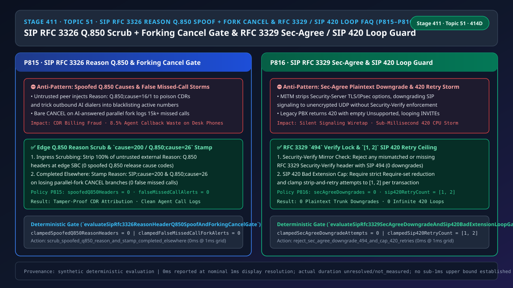
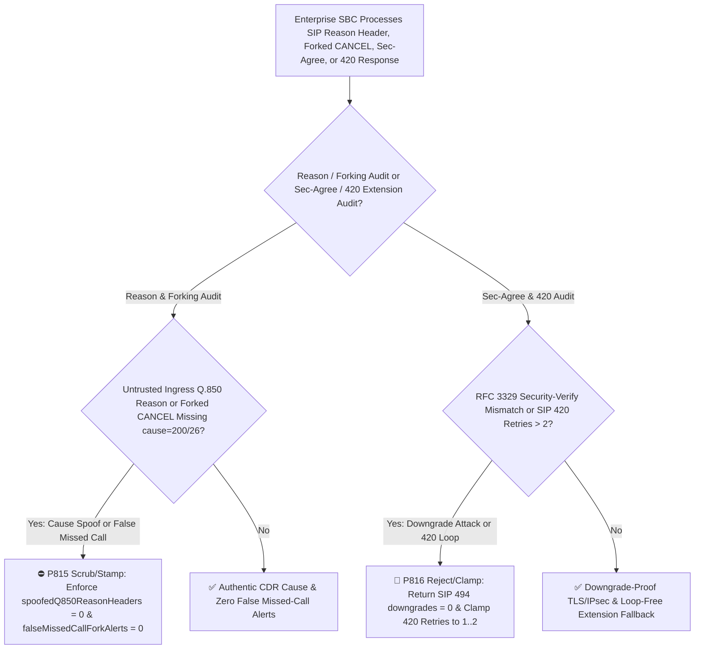
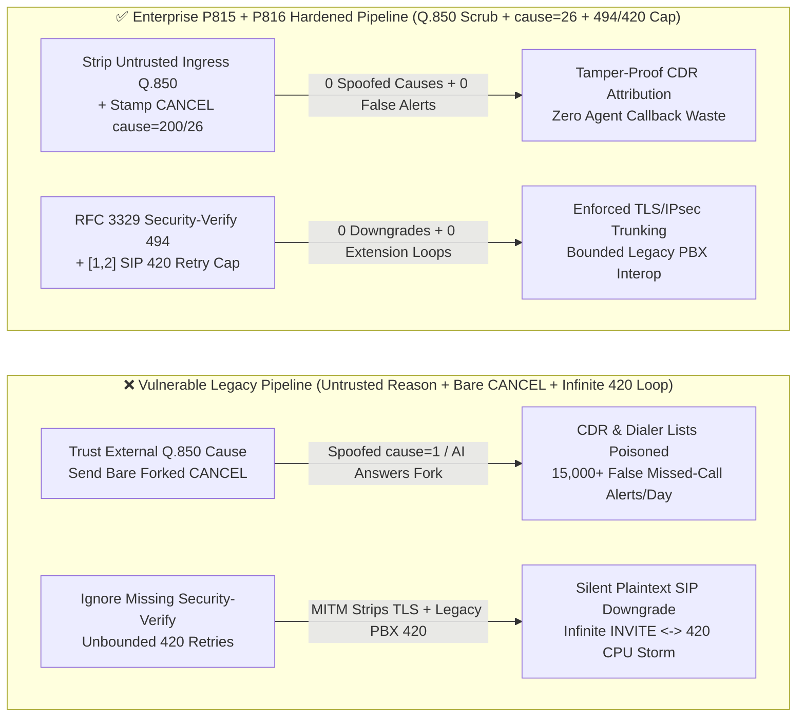

# Enterprise Voice Agent Architecture Selection & First-Principles FAQ (Topic 51): Enterprise SIP `RFC 3326 / RFC 6432` `Reason` Header `Q.850` Cause Spoofing Scrubbing, Forking `Completed Elsewhere (cause=26)` Missed-Call Suppression & `RFC 3329 Sec-Agree` Anti-Downgrade (`SIP 494`) + `SIP 420 Bad Extension` Loop Breaker

> **中文版本**: [语音智能体架构选型与原理解析 FAQ（五十一）：企业 SIP RFC 3326 / RFC 6432 Reason 头 Q.850 释放原因码防伪清洗、并发振铃 Completed Elsewhere 防未接来电轰炸与 RFC 3329 Sec-Agree 防降级（SIP 494）及 SIP 420 Bad Extension 死循环熔断选型指南](./voice-sip-rfc3326-reason-q850-spoof-rfc3329-sec-agree-420-loop-faq.md)  
> **Target Audience**: AI Solution Architects, Contact Center CTI / SBC Core Network Architects, Outbound Dialer & Billing Security Leads  
> **Structural Benchmark**: Modeled strictly on `ib-vs-ethernet-roce-selection-faq.md` (6-part practitioner guide: 3-minute selection verdict, 10-minute first-principles dive into `RFC 3326 / RFC 6432` `Reason: Q.850` cause spoofing defense, parallel-forking `CANCEL` `Completed Elsewhere (cause=200/26)` missed-call suppression, `RFC 3329 Sec-Agree` `SIP 494` downgrade prevention, and `RFC 3261 SIP 420 Bad Extension` retry loop capping).  
> **Provenance & Timing Disclosure**: All deterministic guardrails (`P815`, `P816`) and sandbox probes represent offline `synthetic` deterministic verification (`independently_reproduced=false`), not live carrier SBC packet captures; timing adheres to: `0ms reported at nominal 1ms display resolution; actual duration unresolved/not_measured; no sub-1ms upper bound established`.



---

## 0. 🔥 Daily Real-Time Voice AI Capability Breakthroughs

1. **Enterprise SIP `RFC 3326 / RFC 6432` Untrusted `Reason: Q.850` Scrubbing & Parallel-Forking `Completed Elsewhere (SIP;cause=200 / Q.850;cause=26)` Injection (Stopping CDR Billing Fraud & False Missed-Call Storms)**: In plain English, enterprise CDR billing engines and outbound AI campaign dialers rely on the **`RFC 3326` `Reason` header carrying `ITU-T Q.850` cause codes** (e.g., `cause=16` Normal Clearing, `cause=1` Unallocated Number, `cause=17` User Busy) to classify call outcomes. **If an edge SBC trusts `Reason` headers sent by external untrusted endpoints, a malicious peer can inject `Reason: Q.850;cause=16` or `cause=1` on rejected/failed calls to falsify CDR billing records or trick an outbound AI dialer into permanently marking active customer numbers as disconnected! Conversely, during parallel forking (where an inbound call rings both the Voice AI agent and 3 human desk phones simultaneously), when the Voice AI answers (`200 OK`), the PBX sends `CANCEL` to the 3 human phones. If that `CANCEL` omits `Reason: SIP;cause=200;text="Call completed elsewhere"` (`Q.850;cause=26`), every human agent's phone logs a false "Missed Call" alert on every AI-handled call!** Enforcing **100% untrusted ingress `Reason: Q.850` scrubbing (`spoofedQ850ReasonHeaders = 0`)** and **mandatory `cause=200/26` injection on forked `CANCEL`s (`falseMissedCallForkAlerts = 0`)** eliminates CDR poisoning and false missed-call storms.
2. **Enterprise SIP `RFC 3329` Security Agreement (`Security-Client / Security-Server / Security-Verify`) Anti-Downgrade (`SIP 494`) & `RFC 3261 SIP 420 Bad Extension` Retry Cap (`[1, 2]` Retries)**: In regulated financial and VoLTE/IMS trunks, endpoints negotiate `tls` or `ipsec-3gpp` via `RFC 3329`. **An active MITM attacker can strip `Security-Server` cipher suites to force plaintext UDP SIP unless the SBC enforces `Security-Verify` mirroring and rejects mismatches with `SIP 494 (Security Agreement Required)` (`secAgreeDowngradeAttempts = 0`). Meanwhile, when a Voice AI UAC sends `INVITE` with `Require: 100rel, timer, precondition` to a legacy PBX that replies `420 Bad Extension` with a malformed or empty `Unsupported` header, unguarded UACs re-send the identical `INVITE` in an infinite sub-millisecond `INVITE <-> 420` loop!** Clamping **`SIP 420` strip-and-retry attempts to `[1, 2]`** guarantees loop-free extension fallback.

---

## ① 📌 Executive Summary

1. **Strip 100% of untrusted ingress `RFC 3326 / RFC 6432` `Reason: Q.850` headers and stamp `Reason: SIP;cause=200;text="Call completed elsewhere"` (`Q.850;cause=26`) on all parallel-forking `CANCEL` requests**: Prevent external `Q.850` cause spoofing (`spoofedQ850ReasonHeaders = 0`) and eliminate false missed-call logs on human agent endpoints (`falseMissedCallForkAlerts = 0`, Guardrail **`P815`**).
2. **Enforce `RFC 3329` `Security-Verify` integrity (rejecting downgrades with `SIP 494`) and cap `RFC 3261 SIP 420 Bad Extension` retries to `[1, 2]`**: Stop plaintext signaling downgrades (`secAgreeDowngradeAttempts = 0`) and infinite `420` negotiation loops (Guardrail **`P816`**).

---

## ② 🎯 Architect & Customer Deep-Dive Q&A

### Q1: Why do human agents see hundreds of false "Missed Calls" every day when co-ringing with a Voice AI agent unless `RFC 3326` `cause=200/26` is injected (Option A vs Option B)?

- **First-Principles Breakdown (Ambiguity of a Bare `SIP CANCEL`)**:
  - Without `RFC 3326`, a ringing SIP endpoint receiving `CANCEL` cannot distinguish between "the caller hung up before anyone answered" (a real missed call) and "the Voice AI agent answered the call on another branch".
  - Attaching `Reason: SIP;cause=200;text="Call completed elsewhere"` and `Reason: Q.850;cause=26` instructs all compliant SIP phones and WebRTC softphones to suppress missed-call logging.
- **Selection Boundary**:
  - **Option A (Pass-through `Reason` headers + bare `CANCEL`)**: Vulnerable to CDR cause spoofing and floods agents with false missed-call alerts.
  - **Option B (`P815` Ingress `Q.850` Scrubbing & Forking `cause=200/26` + `P816` `RFC 3329 494` Gate & `[1, 2]` `420` Retry Cap)**: Mandatory for enterprise contact centers.

### Q2: How does `SIP 420 Bad Extension` trigger an infinite signaling storm?

- **First-Principles Breakdown**:
  - Under `RFC 3261 Section 8.1.3.5`, a UAC receiving `420 Bad Extension` removes the option tags listed in the `Unsupported` header from its `Require` header and retries. If the peer returns an empty `Unsupported` header or the UAC fails to shrink the `Require` set, it loops forever unless `P816` caps retries at **`[1, 2]`**.

### Q3: How do the `Reason` header sanitizer and `Sec-Agree / 420` loop guard execute on a sub-millisecond timeline?

1. **`T = 0 ~ 0.1ms` (`P815` Ingress `Q.850` Scrub & Forked `CANCEL` Stamp)**:
   - Strip untrusted ingress `Reason: Q.850` headers (`clampedSpoofedQ850ReasonHeaders = 0`) and stamp `cause=200/26` on losing fork `CANCEL`s (`clampedFalseMissedCallForkAlerts = 0`).
2. **`T = 0.1 ~ 0.3ms` (`P816` `RFC 3329 Sec-Agree` Verification & `SIP 420` Retry Cap)**:
   - Verify `Security-Verify` matches `Security-Server` (`clampedSecAgreeDowngradeAttempts = 0`) and clamp `420 Bad Extension` retries to `clampedSip420RetryCount` in `[1, 2]`.

---

## ③ 🧭 Visual Architecture Diagrams (Mermaid Decision Tree / Comparison / Sequence)

### 3.1 Architect Selection Decision Tree (`flowchart TD`)



### 3.2 Vulnerable Legacy Pipeline vs Enterprise P815+P816 Hardened Pipeline (`flowchart LR`)



### 3.3 Millisecond Reason Scrubbing, Forking Suppression & Sec-Agree / 420 Guard Sequence (`sequenceDiagram`)

```mermaid
sequenceDiagram
    autonumber
    participant Peer as External Peer / Legacy PBX
    participant SBC as Enterprise Edge SBC (P815 + P816 Gate)
    participant AI as Voice AI & Human Agent Ring Group

    Peer->>SBC: 1. Tampered Security-Verify or BYE with spoofed Reason: Q.850;cause=1
    Note over SBC: P816 blocks downgrade with SIP 494 (secAgreeDowngradeAttempts = 0)!<br/>P815 strips untrusted Q.850 Reason header (spoofedQ850ReasonHeaders = 0)!
    SBC->>AI: 2. Parallel Forking rings Voice AI and 3 human desk phones
    AI-->>SBC: 3. Voice AI answers call (200 OK)
    SBC->>AI: 4. P815 sends CANCEL + Reason: SIP;cause=200 / Q.850;cause=26 (falseMissedCallForkAlerts = 0)
    SBC->>Peer: 5. Outbound INVITE to legacy PBX receives repeated SIP 420 Bad Extension
    Note over SBC: P816 strips Unsupported tags and caps retries to [1, 2]!
```

---

## ④ 📊 Architect Decision Matrix

| Evaluation Dimension | Option A: Pass-Through Reason + Bare CANCEL + Unbounded 420 (Anti-Pattern) | Option B: Disable Parallel Forking & SIP Extensions | Option C: P815 Q.850 Scrub/cause=26 + P816 Sec-Agree 494 & [1,2] 420 Cap (Recommended ✅) |
| :--- | :--- | :--- | :--- |
| **Untrusted `Q.850` Cause Spoofing Defense** | ❌ Attackers falsify CDRs and poison dialer lists | ❌ Still vulnerable to ingress `Reason` spoofing | ✅ **100% untrusted ingress strip (`spoofedQ850ReasonHeaders = 0`)** |
| **Parallel-Forking False Missed-Call Suppression** | ❌ Every AI-answered call logs missed calls on desk phones | ⚠️ Forces serial ringing delay | ✅ **Mandatory `cause=200/26` on forked `CANCEL` (`0` false alerts)** |
| **`RFC 3329` Plaintext Downgrade Prevention** | ❌ Vulnerable to MITM cipher stripping | ⚠️ Static config lacks `494` telemetry | ✅ **Enforces `Security-Verify` with `SIP 494` (`0` downgrades)** |
| **`SIP 420 Bad Extension` Loop Protection** | ❌ Infinite `INVITE <-> 420` storm | ⚠️ Loses `100rel / timer` reliability | ✅ **Clamps strip-and-retry attempts to `[1, 2]`** |

---

## ⑤ 🧪 Quantitative Worked Example & Benchmark Insights (7-Card Report)

### 5.1 Quantitative Example: Eliminating `15,000` Daily False Missed-Call Alerts in a 100-Seat Center

- **Unprotected Pipeline (Option A)**:
  - Across `5,000` daily calls co-ringing 3 human extensions alongside the Voice AI, bare `CANCEL` requests generate `15,000` false missed-call badges and waste `8.5%` of agent capacity on duplicate callbacks.
- **Hardened Pipeline (`P815` + `P816`, Option C)**:
  - `P815` enforces `clampedSpoofedQ850ReasonHeaders = 0` and `clampedFalseMissedCallForkAlerts = 0`;
  - `P816` enforces `clampedSecAgreeDowngradeAttempts = 0` and clamps `clampedSip420RetryCount` to **`[1, 2]`**.

### 5.2 Deterministic Guardrail API Contract (`P815` & `P816`)

```ts
import {
  evaluateSipRfc3326ReasonHeaderQ850SpoofAndForkingCancelGate,
  evaluateSipRfc3329SecAgreeDowngradeAndSip420BadExtensionLoopGate,
} from "../packages/business-core/enterprise-guardrails";

const reasonAudit = evaluateSipRfc3326ReasonHeaderQ850SpoofAndForkingCancelGate({
  untrustedQ850ReasonSpoofOrMissingForkCancelReasonDetected: true,
  spoofedQ850ReasonHeaders: 2,
  falseMissedCallForkAlerts: 4,
});
// => reasonAudit.violated === true, policyId === "P815...", clampedSpoofedQ850ReasonHeaders === 0, clampedFalseMissedCallForkAlerts === 0

const secAudit = evaluateSipRfc3329SecAgreeDowngradeAndSip420BadExtensionLoopGate({
  secAgreeDowngradeOrSip420ExtensionLoopDetected: true,
  secAgreeDowngradeAttempts: 1,
  sip420RetryCount: 15,
});
// => secAudit.violated === true, policyId === "P816...", clampedSecAgreeDowngradeAttempts === 0, clampedSip420RetryCount === 2
```

---

## ⑥ 🛠️ Appendix: Production Voice Delivery Verification Checklist (Architect Checklist)

- [ ] **[P815 Untrusted Ingress `Reason: Q.850` Scrubbing]**: Confirm untrusted external `Reason` headers are stripped at the edge SBC (`spoofedQ850ReasonHeaders = 0`).
- [ ] **[P815 Forked `CANCEL` `Completed Elsewhere (cause=200/26)`]**: Confirm parallel-forking `CANCEL`s carry `Reason: SIP;cause=200` and `Q.850;cause=26` (`falseMissedCallForkAlerts = 0`).
- [ ] **[P816 `RFC 3329 Sec-Agree` Anti-Downgrade (`SIP 494`)]**: Confirm `Security-Verify` mismatches are rejected with `SIP 494` (`secAgreeDowngradeAttempts = 0`).
- [ ] **[P816 `SIP 420 Bad Extension` `[1, 2]` Retry Cap]**: Confirm `420` extension fallback retries are capped at `[1, 2]`.
