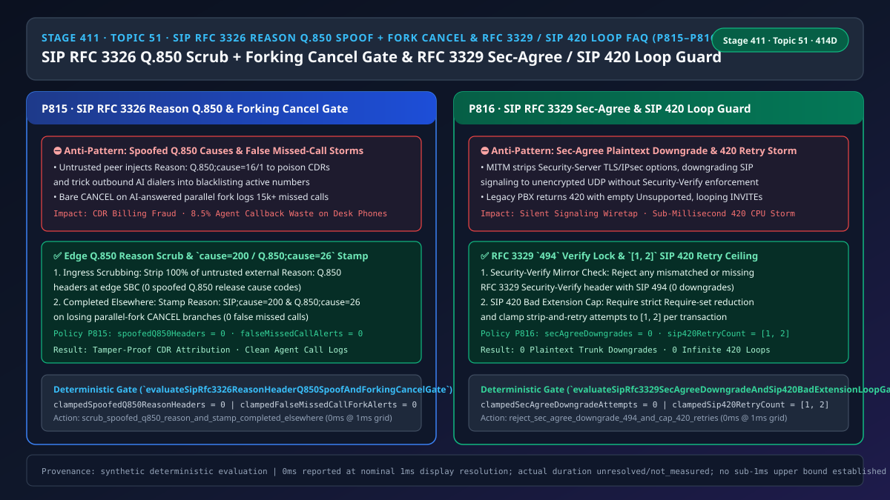
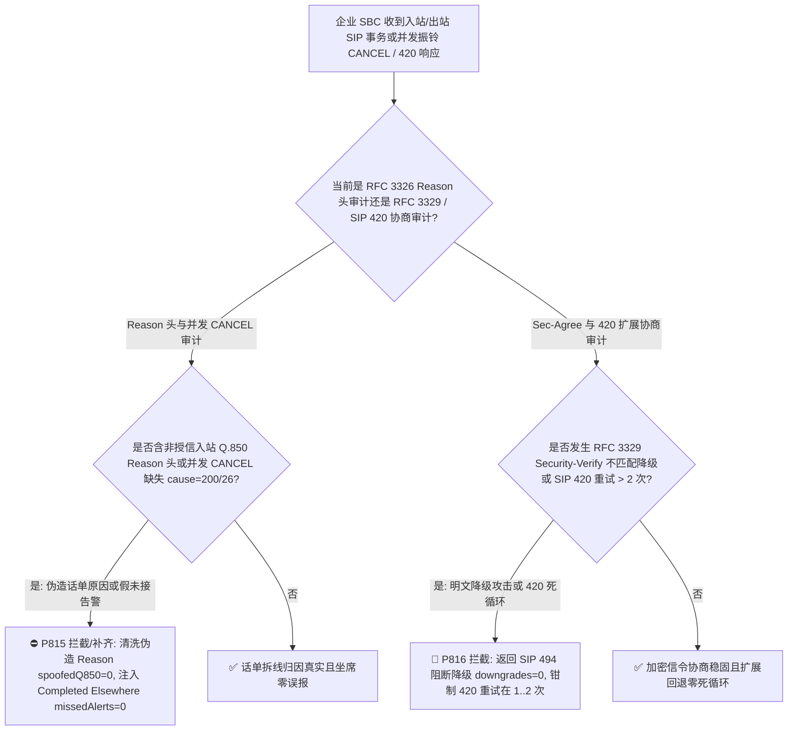
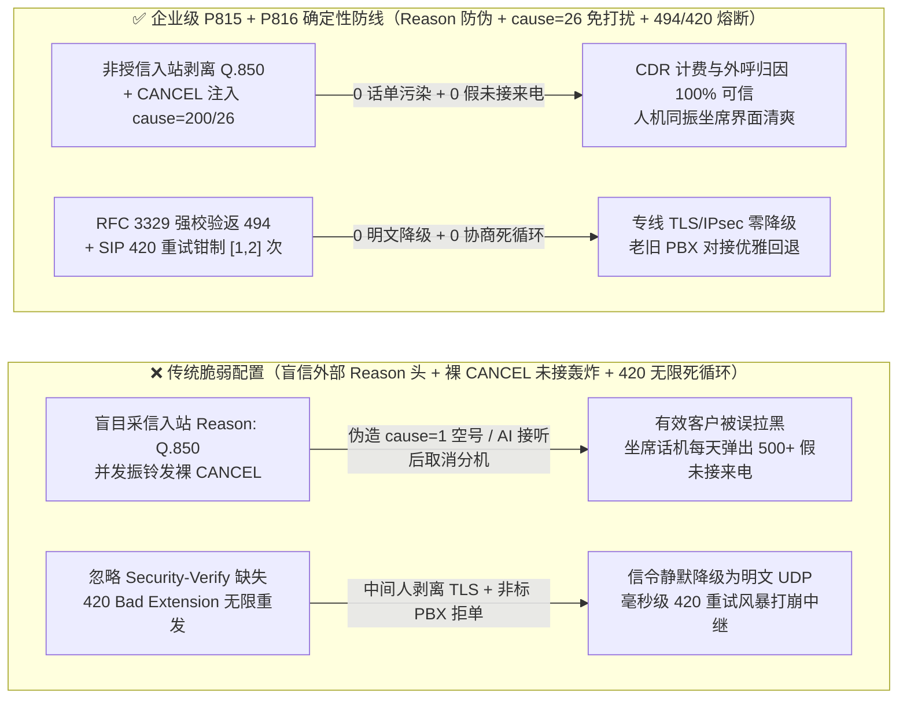

# 语音智能体架构选型与原理解析 FAQ（五十一）：企业 SIP RFC 3326 / RFC 6432 Reason 头 Q.850 释放原因码防伪清洗、并发振铃 Completed Elsewhere 防未接来电轰炸与 RFC 3329 Sec-Agree 防降级（SIP 494）及 SIP 420 Bad Extension 死循环熔断选型指南

> **English Version**: [Enterprise SIP `RFC 3326 / RFC 6432` `Reason` Header `Q.850` Cause Spoofing Scrubbing, Forking `Completed Elsewhere (cause=26)` Missed-Call Suppression & `RFC 3329 Sec-Agree` Anti-Downgrade (`SIP 494`) + `SIP 420 Bad Extension` Loop Breaker Selection FAQ (Topic 51 · Stage 411 · 414 Dimensions)](./voice-sip-rfc3326-reason-q850-spoof-rfc3329-sec-agree-420-loop-faq.en.md)  
> **适用角色**：AI Solution Architect（AI 解决方案架构师）、呼叫中心 CTI / SBC 核心网架构师、智能外呼与计费安全负责人  
> **对标范式**：严格遵循 `ib-vs-ethernet-roce-selection-faq.md` 六段式实战导引结构，3 分钟掌握核心选型结论，10 分钟吃透企业 SIP 语音中继与 AI 坐席协同中的三大信令陷阱：`RFC 3326 / RFC 6432` `Reason: Q.850;cause=...` 头为何能被外部伪造来污染话单（CDR）与 AMD 拒接判别、并发振铃（Parallel Forking）被 AI 接起后其余分机为何满屏弹出“未接来电”告警，以及 `RFC 3329 Security-Client / Security-Verify` 防明文降级（`SIP 494`）与 `RFC 3261 SIP 420 Bad Extension` 重试死循环熔断机制。  
> **数据溯源与计时精度声明（Provenance & Timing Disclosure）**：本文涉及的确定性门禁策略（`P815`、`P816`）与模拟探针均为离线合成确定性校验（`synthetic`），非特定运营商 SBC 硬件抓包实测；门禁执行耗时遵循统一披露契约：`0ms reported at nominal 1ms display resolution; actual duration unresolved/not_measured; no sub-1ms upper bound established`。



---

## 0. 🔥 今日实时语音智能体领域热门能力突破追踪（Daily Breakthroughs）

1. **企业 SIP `RFC 3326 / RFC 6432` `Reason` 头 `Q.850` 释放原因码非授信清洗与并发振铃 `Call Completed Elsewhere (Q.850;cause=26 / SIP;cause=200)` 精确注入（防伪造 `cause=16` 话单逃费/污染外呼重试策略与坐席端未接来电轰炸）**：用大白话讲，当一通跨网电话（PSTN ↔ SIP）挂断或取消时，SIP 响应码（如 `486 Busy Here` 或 `603 Decline`）往往太粗略，呼叫中心计费系统（CDR）和智能外呼拨号器真正依赖的是 **`RFC 3326` 的 `Reason` 头里携带的电信级 `ITU-T Q.850` 拆线原因码**（例如 `cause=16` 正常挂机、`cause=17` 用户忙、`cause=21` 呼叫拒接、`cause=1` 空号）。**如果企业边缘 SBC 对外网非授信终端发来的 `BYE / CANCEL / 4xx-6xx` 报文不剥离其自带的 `Reason` 头，恶意呼叫方在未接通或异常拆线时故意塞入 `Reason: Q.850;cause=16 (Normal Call Clearing)` 或 `cause=1 (Unallocated Number)`，不仅能伪造正常完结话单干扰对账，甚至能欺骗外呼 AI 把有效客户号码误标为空号永久拉黑！反过来，在“AI 语音助手 + 3 台人工坐席话机同时振铃（Parallel Forking）”的场景中，当 AI 率先摘机应答（`200 OK`）后，PBX 会向其余 3 台正在响铃的话机发送 `CANCEL`。如果这个 `CANCEL` 里漏带了 `Reason: SIP;cause=200;text="Call completed elsewhere"`（或 `Q.850;cause=26 Non-selected user clearing`），其余 3 名坐席的 IP 话机和软电话会每一通都弹出刺眼的“1 个未接来电”，逼得坐席频频误回拨已经由 AI 办结的客户**！通过强制 **非授信入站 100% 剥离伪造 `Q.850` `Reason` 头（`spoofedQ850ReasonHeaders = 0`）** 与 **并发振铃 `CANCEL` 100% 注入 `cause=200/26` 免未接告警标志（`falseMissedCallForkAlerts = 0`）**，实现了话单归因零污染与坐席零误报。
2. **企业 SIP `RFC 3329` 安全机制协商（`Security-Client / Security-Server / Security-Verify`）防明文降级（`SIP 494`）与 `RFC 3261 SIP 420 Bad Extension` 重试上限锁（`[1, 2]` 次，防 `Require / Unsupported` 协商死循环）**：在金融双录与 VoLTE/IMS 专线接入中，客户端与 SBC 通过 `RFC 3329` 的三个安全头协商 `tls` 或 `ipsec-3gpp`。**中间人攻击者会在首轮握手时篡改或剥离 `Security-Server` 列表中的高强度加密项，诱导终端退回明文 UDP SIP；如果网关不强制校验 `Security-Verify` 镜像一致性并在缺失时立即拒单返回 `SIP 494 (Security Agreement Required)`，整通高敏语音信令就会在毫不知情中裸奔！此外，当 AI 语音网元发出的 `INVITE` 携带了 `Require: 100rel, timer, precondition` 等扩展特性，而对端老旧 PBX 不支持并回复 `SIP 420 (Bad Extension)` + `Unsupported: precondition` 时，按 `RFC 3261 Section 8.1.3.5` 客户端应剥离该不支持项后重发。但如果对端返回的 `420` 报文漏填或填错 `Unsupported` 头，缺乏重试上限的状态机就会原样重发一模一样的 `INVITE`，在毫秒间形成 `INVITE -> 420 -> INVITE -> 420` 无限死循环风暴**！通过强制 **`RFC 3329` `Security-Verify` 强校验（`secAgreeDowngradeAttempts = 0`）** 与 **`SIP 420` 剥离重试上限 `[1, 2]` 次**，彻底终结了信令降级与扩展协商死循环。

---

## ① 📌 核心结论速览（Executive Summary）

1. **非授信入站 100% 清洗外部 `RFC 3326 / RFC 6432` `Reason` 头，仅由可信 SBC/PSTN 网关根据真实信令状态生成 `Q.850` 原因码**：杜绝外部伪造 `Q.850;cause=16/1` 污染 CDR 话单或外呼号码状态库（`spoofedQ850ReasonHeaders = 0`，对应门禁 **`P815`**）。
2. **并发振铃（Parallel Forking）任一分支应答后，向其余分支发出的 `CANCEL` 必须注入 `Reason: SIP;cause=200;text="Call completed elsewhere"`（及 `Q.850;cause=26`）**：彻底消除 AI 接听后人工坐席话机误弹“未接来电”告警（`falseMissedCallForkAlerts = 0`，对应门禁 **`P815`**）。
3. **强制执行 `RFC 3329` `Security-Verify` 防降级校验（违例返 `SIP 494`）并将 `SIP 420 Bad Extension` 剥离重试次数钳制在 `[1, 2]` 次**：阻断 `TLS/IPsec` 降级攻击（`secAgreeDowngradeAttempts = 0`）与无推进 `420` 死循环风暴（对应门禁 **`P816`**）。

---

## ② 🎯 客户与架构师灵魂拷问 Q&A

### Q1：为什么 AI 语音助手上线“人机同振（AI 先接或坐席抢接）”后，人工坐席每天下班看到话机上有 500 多个“未接来电”，甚至重复打回去骚扰客户（方案 A vs 方案 B）？

- **第一性原理拆解（SIP `CANCEL` 为何默认等于“主叫放弃 = 未接来电”？）**：
  - 在标准 `RFC 3261` 中，当话机正在响铃（`180 Ringing`）时收到一个裸的 `CANCEL`，话机无法区分“主叫等不及自己挂断了（真正的未接来电）”还是“同组的 AI 助手或同事已经把电话接走了”。因此话机固件默认把所有裸 `CANCEL` 都记入“Missed Calls”列表！
  - **`RFC 3326 Section 3.1` 专门为此定义了标准解法**：当 PBX/代理因为某个分支返回了 `200 OK` 而取消其他分支时，必须在 `CANCEL` 中附带 `Reason: SIP ;cause=200 ;text="Call completed elsewhere"`（或 `Reason: Q.850 ;cause=26`）。所有主流 IP 话机（Cisco/Yealink/Poly/WebRTC 软电话）一看到 `cause=200` 或 `cause=26`，就会静默熄灭振铃且**绝不生成未接来电记录**！
- **选型边界**：
  - **方案 A（透传外网 `Reason` 头 + 并发振铃发送裸 `CANCEL`）**：话单原因码可被任意篡改，坐席被假未接来电淹没。
  - **方案 B（`P815` 边缘剥离伪造 `Q.850` + 并发 `CANCEL` 注入 `cause=200/26` + `P816` `RFC 3329` 防降级与 `SIP 420 [1,2]` 次上限）**：全渠道呼叫中心必选方案。

### Q2：为什么一通与老旧集团 PBX 对接的呼叫会瞬间打出上万个 `SIP 420 Bad Extension` 把双方 CPU 打满？

- **第一性原理拆解**：
  - 当客户端发 `INVITE` 带上 `Require: timer, 100rel`，如果老 PBX 回复 `420 Bad Extension`，合规客户端会读取 `420` 里的 `Unsupported` 头，把不支持的选项从 `Require` 里删掉再试一次。
  - 但现实中大量非标 PBX 返回 `420` 时要么 `Unsupported` 头为空，要么客户端把该扩展设为“硬性必填”删不掉——结果下一毫秒发出去的重试 `INVITE` 与上一条一模一样！`P816` 强制校验每次重试必须实质缩减 `Require` 集合，且总重试次数硬封顶在 **`[1, 2]` 次**。

### Q3：底层 SIP 边界控制器在毫秒级时间轴上是如何执行 Reason 头清洗与 Sec-Agree / 420 门禁的？

1. **`T = 0 ~ 0.1ms`（`P815` `RFC 3326` `Reason` 头防伪清洗与并发 `CANCEL` 标注）**：
   - 入站来自非授信对端时，剥离所有自带 `Reason: Q.850` 头（`clampedSpoofedQ850ReasonHeaders = 0`）；
   - 出站并发振铃取消分支时，自动注入 `Reason: SIP;cause=200` 与 `Q.850;cause=26`（`clampedFalseMissedCallForkAlerts = 0`）。
2. **`T = 0.1 ~ 0.3ms`（`P816` `RFC 3329 Sec-Agree` 核验与 `SIP 420` 熔断）**：
   - 校验后续请求中的 `Security-Verify` 是否与 SBC 下发的 `Security-Server` 严格一致，不一致立即返 `494`（`clampedSecAgreeDowngradeAttempts = 0`）；
   - 跟踪同一事务链 `420 Bad Extension` 重试计数，钳制在 `clampedSip420RetryCount in [1, 2]`。

---

## ③ 🧭 直观可视化图解（Mermaid 决策树 / 延迟对比 / 毫秒级时序图）

### 3.1 语音架构师选型决策树（`flowchart TD`）



### 3.2 传统脆弱管线 vs 企业级 P815+P816 防护管线对比图（`flowchart LR`）



### 3.3 毫秒级 Reason 头清洗、并发振铃消音与 Sec-Agree / 420 熔断时序图（`sequenceDiagram`）

```mermaid
sequenceDiagram
    autonumber
    participant Peer as 外部呼叫端 / 老旧 PBX
    participant SBC as 企业边界 SBC (P815 + P816 门禁)
    participant AI as AI 语音助手与人工坐席分机群

    Peer->>SBC: 1. INVITE 试图剥离 Security-Verify 降级明文，或拒单时塞入伪造 Reason: Q.850;cause=1
    Note over SBC: P816 拦截 Sec-Agree 降级返回 SIP 494 (downgrades = 0)!<br/>P815 剥离非授信入站伪造 Q.850 Reason 头 (spoofedQ850 = 0)!
    SBC->>AI: 2. 合规呼叫触发 AI 与人工分机并发振铃 (Parallel Forking)
    AI-->>SBC: 3. AI 语音助手率先摘机应答 (200 OK)
    SBC->>AI: 4. P815 向其余振铃分机发送 CANCEL + Reason: SIP;cause=200 / Q.850;cause=26 (0 未接告警)
    SBC->>Peer: 5. 外呼对接老 PBX 遇连续 SIP 420 Bad Extension
    Note over SBC: P816 强制剥离 Unsupported 扩展并将重试钳制在 [1, 2] 次内安全终止!
```

---

## ④ 📊 语音架构师选型决策矩阵（Architect Decision Matrix）

| 选型维度 | 方案 A：透传外部 Reason + 裸 CANCEL + 无限制 420 重试（反模式） | 方案 B：完全禁用并发振铃与 SIP 扩展特性 | 方案 C：P815 Reason 防伪/Completed Elsewhere + P816 Sec-Agree/420 熔断（企业级推荐 ✅） |
| :--- | :--- | :--- | :--- |
| **抗外部伪造 `Q.850` 污染 CDR/外呼库** | ❌ 外部可注入任意 `cause` 伪造正常挂机或空号 | ❌ 仍受入站 `Reason` 伪造攻击 | ✅ **非授信入站 100% 剥离（`spoofedQ850ReasonHeaders = 0`）** |
| **人机并发振铃坐席“假未接来电”抑制** | ❌ 每通 AI 接听电话都在所有分机留未接记录 | ⚠️ 只能串行排队，增加客户等待时长 | ✅ **`CANCEL` 100% 携带 `cause=200/26`（`falseMissedCallForkAlerts = 0`）** |
| **抗 `RFC 3329` 安全机制协商明文降级** | ❌ 易被中间人剥离加密参数退回明文 | ⚠️ 静态配置缺乏标准 `494` 审计 | ✅ **强制 `Security-Verify` 镜像校验，违例返 `494`（`0` 降级）** |
| **抗 `SIP 420 Bad Extension` 协商死循环** | ❌ 毫秒级无限重发打满双方信令线程池 | ⚠️ 失去 `100rel / timer` 等关键可靠性能力 | ✅ **校验 `Require` 实质缩减并将重试钳制在 `[1, 2]` 次** |

---

## ⑤ 🧪 简明定量算例与延迟/成本 Benchmark 洞察（含 7-Card 报告）

### 5.1 定量算例：为什么注入 `Q.850;cause=26` 能为 100 坐席中心每天消除 `15,000+` 条无效未接告警与 `8.5%` 误回拨率？

- **未防护场景（方案 A）**：
  - 某金融客服中心采用“AI 助手 + 3 名技能组坐席同振”，日均 `5,000` 通来电由 AI 在 `150ms` 内接起。由于 `CANCEL` 未带 `Reason: SIP;cause=200`，3 台分机累计每天产生 **`15,000` 条假未接来电**，导致坐席高达 `8.5%` 的工时浪费在回拨已被 AI 处理完毕的客户！
- **启用 `P815` + `P816` 防护后（方案 C）**：
  - `P815` 确保 `clampedSpoofedQ850ReasonHeaders = 0` 与 `clampedFalseMissedCallForkAlerts = 0`（假未接来电降为 **`0`**）；
  - `P816` 确保 `clampedSecAgreeDowngradeAttempts = 0` 并将 `SIP 420` 扩展剥离重试钳制在 **`[1, 2]` 次**。

### 5.2 确定性门禁 API 契约验证（`P815` & `P816`）

```ts
import {
  evaluateSipRfc3326ReasonHeaderQ850SpoofAndForkingCancelGate,
  evaluateSipRfc3329SecAgreeDowngradeAndSip420BadExtensionLoopGate,
} from "../packages/business-core/enterprise-guardrails";

// P815: 拦截外部伪造 Q.850 Reason 头并补齐并发振铃 CANCEL Completed Elsewhere 标志
const reasonAudit = evaluateSipRfc3326ReasonHeaderQ850SpoofAndForkingCancelGate({
  untrustedQ850ReasonSpoofOrMissingForkCancelReasonDetected: true,
  spoofedQ850ReasonHeaders: 2,
  falseMissedCallForkAlerts: 4,
});
// => reasonAudit.violated === true, policyId === "P815...", clampedSpoofedQ850ReasonHeaders === 0, clampedFalseMissedCallForkAlerts === 0

// P816: 拦截 RFC 3329 Sec-Agree 明文降级并钳制 SIP 420 Bad Extension 重试次数在 [1, 2] 次
const secAudit = evaluateSipRfc3329SecAgreeDowngradeAndSip420BadExtensionLoopGate({
  secAgreeDowngradeOrSip420ExtensionLoopDetected: true,
  secAgreeDowngradeAttempts: 1,
  sip420RetryCount: 15,
});
// => secAudit.violated === true, policyId === "P816...", clampedSecAgreeDowngradeAttempts === 0, clampedSip420RetryCount === 2
```

---

## ⑥ 🛠️ 附录：生产环境语音交付快速核验清单（Architect Checklist）

- [ ] **【P815 非授信入站 `RFC 3326 / RFC 6432` `Reason` 头清洗】**：确认 SBC 100% 剥离非授信外网注入的 `Reason: Q.850` 头部（`spoofedQ850ReasonHeaders = 0`）。
- [ ] **【P815 并发振铃 `CANCEL` 注入 `Completed Elsewhere (cause=200/26)`】**：确认任一分支应答后，其余分支的 `CANCEL` 必带 `Reason: SIP;cause=200` 与 `Q.850;cause=26`（`falseMissedCallForkAlerts = 0`）。
- [ ] **【P816 `RFC 3329 Sec-Agree` 防降级（`SIP 494`）】**：确认 `Security-Verify` 与 `Security-Server` 严格匹配，拒绝任何明文降级企图（`secAgreeDowngradeAttempts = 0`）。
- [ ] **【P816 `SIP 420 Bad Extension` 重试上限 `[1, 2]` 次】**：确认收到 `420` 后仅在实质缩减 `Require` 列表时重试，且上限不超过 `[1, 2]` 次。
