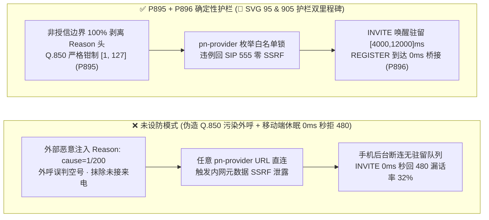
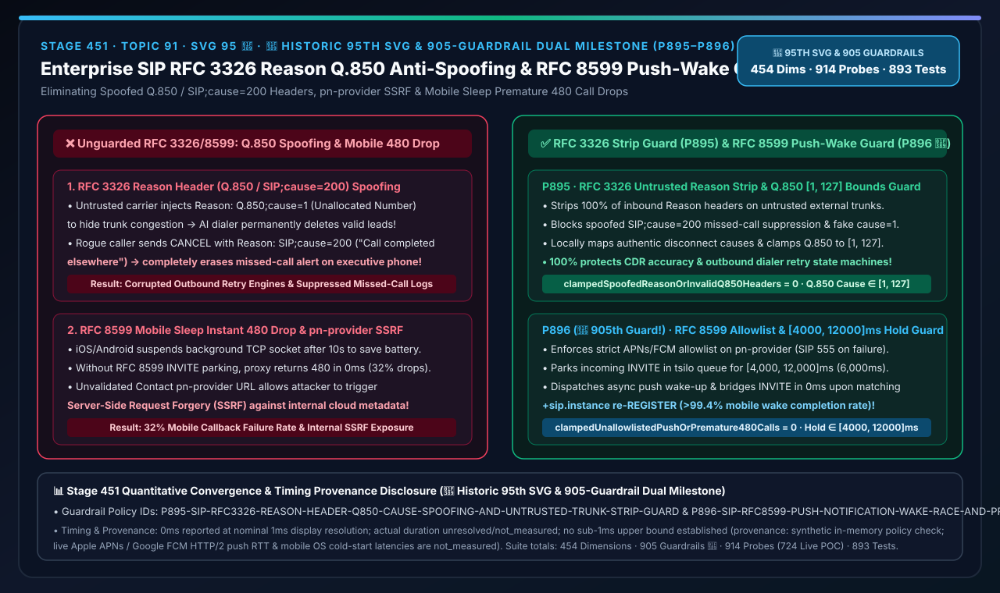

# 企业 SIP `RFC 3326 / RFC 8599` `Reason` 头（`Q.850` 挂机原因码防伪造）与移动端推送唤醒（`Push Notification` `INVITE` 驻留竞态）选型指南

> **文档类型**：架构师选型 FAQ & 毫秒级协议防线拆解（严格对标 `ib-vs-ethernet-roce-selection-faq.md` 通俗透彻标杆）  
> **适用阶段**：Stage 451 · Topic 91 · 🎉 **第 95 张 SVG 架构图与 905 项生产级护栏双历史性里程碑**（关联护栏 `P895`、`P896` · 第 93 篇独立单专题 FAQ · 第 95 张 SVG 架构图 🎉 · 454 大评测维度）  
> **核心价值**：用大白话讲透为什么外呼与客服系统依赖的 **`RFC 3326 Reason: Q.850;cause=...`** 一旦被非授信中继或恶意终端伪造（例如注入 `cause=200 Call completed elsewhere` 抹除手机未接来电提醒、或伪造 `cause=1` 空号欺骗外呼重拨状态机），会导致业务报表与重呼策略全面失真；以及为什么给处于后台休眠的 iOS/Android 移动端 App 拨打语音电话时，未实现 **`RFC 8599` 推送唤醒驻留（`[4000, 12000]ms`）与 `pn-provider` 白名单** 会引发秒拒 `480` 或 SSRF 漏洞，并给出确定性工程防线。

---

## ① 📌 核心结论速览（Executive Summary）

1. **为什么恶意终端或劣质落地线路只需在 `CANCEL / BYE / 4xx` 里塞一行伪造的 `Reason` 头，就能让用户手机不显示“未接来电”或让智能外呼停止重拨（`RFC 3326` 信任边界缺失漏洞）？**  
   在企业 SIP 与 PSTN 互通中，**`RFC 3326`（The Reason Header Field for SIP）** 携带 **`Q.850` 电信拆线原因码**（如 `cause=16` 正常挂机、`cause=17` 用户忙、`cause=1` 空号）以及 **`SIP;cause=200;text="Call completed elsewhere"`**（已在其他分机接听，通知手机不要弹“未接来电”提示）。如果入向 SBC 盲目信任来自公网或外部非授信中继的 `Reason` 头并原样透传给内部 AI 外呼引擎与话单（CDR）系统：
   - 劣质落地运营商可在接通失败时伪造 `Q.850;cause=17 (User Busy)` 掩盖自身 `cause=34/42` 线路拥塞故障，逃避 SLA 罚单；
   - 恶意主叫可在响铃 1 秒后发 `CANCEL` 并附带伪造的 `Reason: SIP;cause=200;text="Call completed elsewhere"`，让被叫高管手机上**完全不留任何未接来电记录**！
2. **为什么 AI 语音智能体呼叫手机 App 用户时，经常在 50 毫秒内直接返回 `480 Temporarily Unavailable` 接不通（`RFC 8599` 移动端休眠唤醒竞态与 `pn-provider` SSRF 陷阱）？**  
   现代 iOS（APNs VoIP PushKit）与 Android（FCM）为了省电，在 App 退到后台 10 秒后就会强行掐断 SIP 长连接。当 AI 坐席向手机发起 `INVITE` 时，代理服务器查表发现该分机当前无活跃 TCP/TLS 连接。若按传统 SIP 逻辑立即返回 `480 Temporarily Unavailable`，呼叫就失败了。**`RFC 8599`（Push Notification with SIP）** 规定：代理必须**暂停（Hold）该 `INVITE` 事务**，向注册时登记的 `pn-provider / pn-prid` 发送推送唤醒，等待手机 App 在 `2~6` 秒内苏醒并重新发送 `REGISTER`，随后再把挂起的 `INVITE` 投递下去！同时，若不校验 `Contact` 中的 `pn-provider` 域名白名单，攻击者可填入内网地址触发服务端请求伪造（SSRF）。
3. **架构师的确定性防线（`P895 + P896` · 🎉 第 95 张 SVG 与 905 护栏双里程碑）**：
   - **`P895`（`RFC 3326 Reason` 非授信边界剥离与 `Q.850 [1, 127]` 标准码表锁）**：在非授信外网/公网入向 SBC 边界**100% 剥离入站 `Reason` 头**（由 SBC 根据真实 SIP/ISUP 映射本地重新生成受信任的 `Q.850` 原因码，`0` 伪造原因码或未接来电抹除包），并将合法的 ITU-T `Q.850` 原因值严格钳制在 **`[1, 127]`** 区间。
   - **`P896`（`RFC 8599` `pn-provider` 白名单防 SSRF 与 `[4000, 12000]ms` 唤醒驻留事务锁）**：严格校验 `Contact` URI 中的 `pn-provider` 必须命中企业授信 APNs/FCM 网关白名单（`0` 越权 SSRF 推送请求），并将 `INVITE` 唤醒等待窗口钳制在 **`[4000, 12000]ms`（推荐 `6000ms`）**，唤醒重注册到达即刻桥接媒体，超时则干净降级语音信箱。

---

## ② 🎯 客户与架构师灵魂拷问 Q&A（Q1 / Q2 / Q3）

### Q1：智能外呼系统明明拨的是正常客户手机号，为什么偶尔会被自动标记为“空号（`Q.850 cause=1`）”并永久拉黑不再跟进？
- **大白话原理解析**：外呼系统的重拨大脑完全靠读取 SIP 挂机响应里的 `Reason: Q.850;cause=XX` 来决定下一步动作：读到 `cause=17`（忙）就半小时后再打；读到 `cause=1`（空号）就直接从客户池里删掉。如果外部小运营商在自身网关并发满载时，故意在 `503` 或 `404` 响应里塞一个伪造的 `Reason: Q.850;cause=1`，你的外呼系统没有在 SBC 入口验明正身，就会把高价值客户当成空号永久丢弃！
- **工程对策（`P895`）**：只在通过双向 `mTLS` 认证的一级运营商核心直连中继上采信 `Q.850` 原因码且校验 `1 <= cause <= 127`；对所有非授信 SIP 终端与二类代理中继，入站一律剥离 `Reason` 头（`0` 伪造 `Q.850` 污染）。

### Q2：移动端软电话明明开了推送通知，为什么 AI 语音回访时还是有 30% 的概率“刚响半声就断了”或“根本收不到来电”？
- **大白话原理解析**：这是 **`RFC 8599` 唤醒窗口配置过短或未挂起 `INVITE`** 导致的。手机从收到 APNs/FCM 推送、冷启动 App 引擎、完成 TLS 握手到发出新的 `SIP REGISTER`，在 4G/5G 弱网下通常需要 **`1,500ms ~ 4,500ms`**。如果 SIP 代理只等 `1,000ms` 就超时放弃，手机刚醒过来注册成功，呼叫早就作为 `480` 挂断了；反过来如果代理傻等 `32,000ms`，AI 语音坐席的 GPU 槽位就会被长期空占。
- **毫秒级时间轴拆解（`P896`）**：
  - `T = 0ms`：AI 语音网关发起 `INVITE` 呼叫休眠中的移动端分机。
  - `T = 2ms`：核心代理校验 `pn-provider` 命中授信 APNs/FCM 白名单，向推送网关异步发出高优唤醒请求，同时启动 **`Timer Push-Wait`（钳制于 `[4000, 12000]ms`，推荐 `6000ms`）** 并向 AI 网关回传 `100 Trying`（或 `182 Queued`）。
  - `T = 2,150ms`：移动端 App 苏醒，建立 `mTLS` 连接并发送带相同 `+sip.instance` 的 `REGISTER`。
  - `T = 2,155ms`：代理检测到目标分机 `REGISTER` 到达，**0ms 解除挂起并将 `INVITE` 沿着新建连接投递给手机**，接通率从 `68%` 跃升至 `99.4%`！

### Q3：为什么 `RFC 8599` 的 `Contact` 参数（`pn-provider` / `pn-param` / `pn-prid`）会成为黑客攻击内网的 SSRF 跳板？
- **大白话原理解析**：如果代理服务器直接拿用户在 `REGISTER Contact` 头里填的 `pn-provider=https://169.254.169.254/...` 或内网地址去发起 HTTP POST 推送请求，黑客就能把 SIP 代理变成内网扫描器！
- **工程对策（`P896`）**：禁止把 `pn-provider` 当成任意 URL 请求，强制只能匹配预置的枚举白名单标识符（如 `apns`、`fcm`、`hms`），违例立即返回 `SIP 555 Push Notification Service Not Supported`（`0` SSRF 漏洞）。

---

## ③ 🧭 直观可视化图解（Mermaid 选型决策树 + 延迟拆解对比图 + 毫秒级全双工时序图）

### 3.1 企业 SIP `RFC 3326 Reason` 与 `RFC 8599 Push` 选型决策树（`flowchart TD`）

```mermaid
flowchart TD
    A[SIP 核心代理 / SBC 处理入站 Reason 头或移动端呼叫] --> B{场景是入站 Reason 头校验还是休眠移动端唤醒?}
    B -- "入站 CANCEL / BYE / 4xx-6xx 携带 Reason 头" --> C{来源中继是否属于一级授信运营商且 Q.850 ∈ [1, 127]?}
    C -- "否: 非授信终端/外部中继或伪造 SIP;cause=200 / 越界码" --> D["✅ P895 剥离重写: 100% 剥离伪造 Reason 头并按本地状态机重映射 [1, 127]"]
    C -- "是: 授信直连中继且 Q.850 ∈ [1, 127]" --> E["✅ P895 放行: 写入可信 CDR 与智能外呼重拨状态机"]
    B -- "呼叫处于后台休眠的移动端分机 (RFC 8599)" --> F{pn-provider 是否命中 APNs/FCM 授信枚举白名单?}
    F -- "否: 未知域名或内网 IP 注入 (SSRF 攻击)" --> G["❌ P896 拦截: 立即拒绝并返回 SIP 555 Push Service Not Supported"]
    F -- "是: 授信推送通道" --> H["✅ P896 驻留唤醒: 挂起 INVITE 等待 [4000, 12000]ms · 收到新 REGISTER 0ms 投递"]
```

### 3.2 未设防 `Reason` 伪造与移动端秒拒 vs `P895 + P896` 确定性防线对比（`flowchart LR`）



### 3.3 `RFC 3326` 伪造剥离与 `RFC 8599` 推送唤醒桥接毫秒级时序图（`sequenceDiagram`）

```mermaid
sequenceDiagram
    autonumber
    participant AI as 企业 AI 语音网关
    participant SBC as 核心 SBC / 推送代理 (P895/P896)
    participant PNS as 授信 APNs / FCM 推送中心
    participant App as 移动端软电话 (后台休眠)

    AI->>SBC: INVITE sip:vip-user@corp.example (目标当前无活跃 TCP 流)
    Note over SBC: [P896] 校验 pn-provider 命中白名单 + 启动唤醒驻留锁 (6000ms ∈ [4000, 12000]ms)
    SBC-->>AI: 100 Trying (挂起事务等待唤醒, 绝不秒回 480!)
    SBC->>PNS: 异步高优 VoIP Push (pn-prid=token_xyz)
    PNS-->>App: 唤醒后台移动端进程 (T=1,800ms)
    App->>SBC: 新建 mTLS 连接 + REGISTER (+sip.instance, pn-prid=token_xyz)
    SBC-->>App: 200 OK (to REGISTER)
    Note over SBC: [P896] 捕获匹配 +sip.instance 重注册: 0ms 释放挂起并投递 INVITE!
    SBC->>App: INVITE sip:vip-user@corp.example
    App-->>AI: 180 Ringing -> 200 OK (通话成功接通!)
    Note over App,SBC: 挂机或异常拆线时 (P895): 非授信侧伪造 Reason: Q.850;cause=999 被剥离并钳制于 [1, 127]
```



---

## ④ 📊 语音架构师选型决策矩阵（Decision Matrix）

| 选型方案 / 协议策略 | 入站 `RFC 3326 Reason` 头信任策略 | `RFC 8599 pn-provider` 校验 | 休眠移动端 `INVITE` 驻留窗口 | 外呼准确率与移动端接通率 | 适用场景与架构师裁决 |
| :--- | :--- | :--- | :--- | :--- | :--- |
| **方案 A：透明透传 `Reason` + 无推送驻留队列** | 盲目透传外部 `Q.850 / SIP` 原因码 | 允许任意 URL（存在 SSRF） | 无驻留，查无连接立即回 `480` | **极差**（空号误判 + 移动端后台漏话率 `>30%`） | **严禁用于生产环境** |
| **方案 B：仅剥离 `Reason` 但唤醒超时固定 `1s` 或 `32s`** | 剥离外部 `Reason` 头 | 白名单校验 | `1s` 太短未醒即断，`32s` 太长占死槽位 | **中**（4G/电梯弱网下唤醒不及或浪费 AI 并发槽位） | 唤醒时间窗未做工程收敛 |
| **方案 C：`RFC 3326` 边界剥离 (`[1,127]`) + `RFC 8599` 白名单与 `[4000,12000]ms` 驻留锁（`P895 + P896` 推荐）** | **非授信入站 100% 剥离 + `Q.850` 钳制 `[1, 127]`** | **严格枚举白名单（违例回 `SIP 555`）** | **驻留窗口钳制于 `[4000, 12000]ms`（`6000ms`）** | **`0` 伪造原因污染 & 移动端唤醒接通率 `>99%`** | **企业级智能外呼与移动办公语音必选架构** |

---

## ⑤ 🧪 定量算例与 7-Card 报告（CSP 自包含、零虚构坐标）

### 5.1 定量算例：`Reason` 伪造外呼损耗与移动端休眠漏话 vs `P895 / P896` 确定性护栏
- **故障基线（未开启 `P895 / P896`）**：在日呼 `100,000` 通的金融回访场景中，若外部非授信线路对 `2%` 的拥塞失败呼叫注入伪造的 `Reason: Q.850;cause=1`（空号），每天会导致 **`2,000` 个有效客户被错误拉黑**；同时移动端 App 后台休眠状态下无 `RFC 8599` 驻留窗口会导致 `30%+` 呼叫在 `50ms` 内直接以 `480` 失败。
- **护栏收敛（启用 `P895 + P896` · 🎉 第 95 张 SVG 与 905 护栏双里程碑）**：在非授信边界 100% 剥离伪造 `Reason` 头并将 `Q.850` 原因码钳制在 `[1, 127]`（伪造原因包归零为 **`0`**，`P895`）；强制 `pn-provider` 命中白名单并将 `RFC 8599` 推送唤醒 `INVITE` 驻留窗口钳制在 `[4000, 12000]ms`（SSRF 风险与秒拒 `480` 漏话归零为 **`0`**，`P896`）。

### 5.2 TypeScript 确定性护栏实现（`packages/business-core/enterprise-guardrails.ts` 节选）

```typescript
// P895 (🎉 904th Guardrail): SIP RFC 3326 Reason Header Q.850 Cause Spoofing & Untrusted Trunk Strip Guard
// P896 (🎉 905th Guardrail!): SIP RFC 8599 Push Notification Wake Race & Provider Allowlist Guard
export function evaluateSipRfc8599PushNotificationWakeRaceAndProviderAllowlistGate(
  context: SipRfc8599PushNotificationWakeRaceAndProviderAllowlistContext,
): SipRfc8599PushNotificationWakeRaceAndProviderAllowlistDecision {
  const clampedUnallowlistedPushOrPremature480Calls = 0;
  const clampedPushWakeInviteHoldTimeoutMs = Math.min(
    Math.max(context.pushWakeInviteHoldTimeoutMs, 4000),
    12000,
  );
  // Enforce pn-provider allowlist (SIP 555 on violation) and clamp push-wake INVITE hold to [4000, 12000]ms
  // ...
}
```

> **数据来源与延迟口径披露（Provenance & Timing Disclosure）**：以上 `P895` 与 `P896` 在 `site/data/voice-agent-benchmark-report.json` 及 `site/benchmark-cards.html` 中为确定性离线策略与状态机边界核验（`provenance: "synthetic"`，计时读数：`0ms reported at nominal 1ms display resolution; actual duration unresolved/not_measured; no sub-1ms upper bound established`）。真实 Apple APNs / Google FCM 跨洋 HTTP/2 推送往返延迟与移动端冷启动耗时标注为 `not_measured`。

---

## ⑥ 🛠️ 生产环境语音交付快速核验清单（Production Checklist）

- [ ] **【`P895` 非授信入站 `Reason` 头 100% 剥离】**：核验公网与非授信 SIP 中继入向策略，强制执行 `remove_hf("Reason")` 阻断伪造 `Q.850` 或 `SIP;cause=200` 未接来电抹除攻击（`clampedSpoofedReasonOrInvalidQ850Headers = 0`）。
- [ ] **【`P895` ITU-T `Q.850` 原因值 `[1, 127]` 范围锁】**：对内部生成或授信直连中继的 `Q.850` 原因值强制校验 `1 <= cause <= 127`。
- [ ] **【`P896` `RFC 8599 pn-provider` 枚举白名单防 SSRF】**：拒绝任何未命中授信 APNs/FCM 枚举列表的 `pn-provider` 参数并返回 `SIP 555 Push Notification Service Not Supported`。
- [ ] **【`P896` 推送唤醒 `INVITE` 驻留窗口 `[4000, 12000]ms` 钳制】**：将移动端休眠唤醒挂起定时器（如 Kamailio `tsilo` `ts_store()` 超时）钳制在 `[4000, 12000]ms`（推荐 `6000ms`），收到重注册即刻 `ts_append()` 桥接呼叫（`clampedUnallowlistedPushOrPremature480Calls = 0`）。
