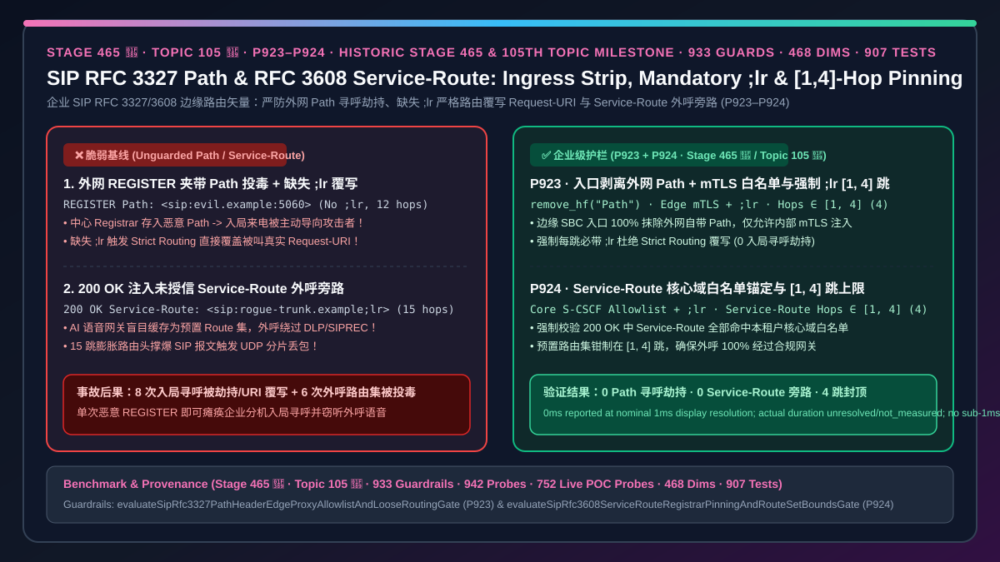
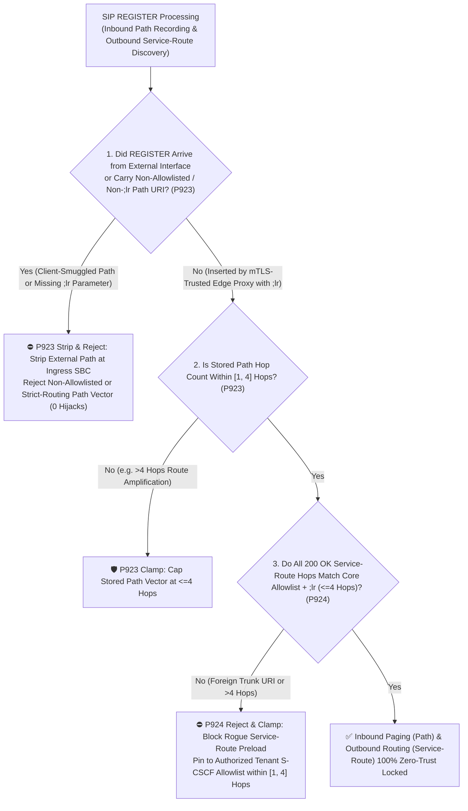
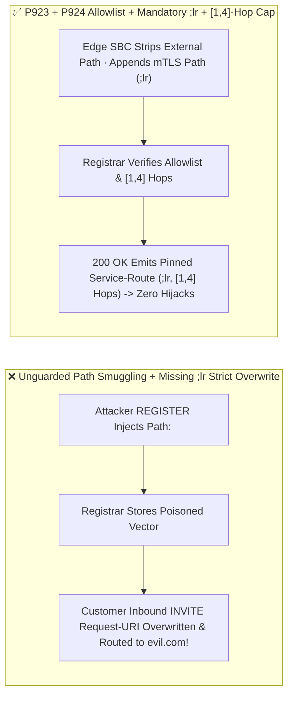

# Enterprise SIP `RFC 3327 / RFC 3608` Edge Routing Vectors (`Path` & `Service-Route` Header Poisoning, Missing `;lr` Strict-Routing `Request-URI` Overwrite & Outbound Core Bypass) Selection & Zero-Trust Pinning Guide

> **Document Type**: Enterprise Voice Agent Architect Selection & First-Principles Guide (Standalone Selection & Architecture FAQ · **Topic 105 🎉 / Stage 465 🎉 · Historic Stage 465 & 105th Topic Dual Milestone**)  
> **Target Audience**: AI Solution Architects, IMS/SIP Core & Edge SBC Architects, Real-Time Voice Gateway Engineers & Security/Compliance Leads  
> **Canonical Baseline**: `packages/business-core/enterprise-guardrails.ts` (`P923–P924`), `tests/presales-portal.test.ts`, `site/data/voice-agent-benchmark-report.json` (7-Card 4:5 Benchmark Report)  
> **Visual Summary**: `assets/svg/109-voice-sip-rfc3327-rfc3608-path-service-route-header-poisoning-strict-routing-bypass-2026-11-14.svg`

---

## ① 📌 Executive Summary

In multi-region enterprise AI voice contact centers and carrier IMS/VoLTE architectures, AI voice gateways and agent endpoints connect to a central Registrar (S-CSCF) through distributed Edge Proxies / SBCs (P-CSCF). To allow the central Registrar to route future **inbound** calls back through the exact Edge SBC that holds the endpoint's NAT pinhole or TLS flow, the IETF standardized **`RFC 3327` (`Path` Extension Header)**; conversely, to allow the Registrar to instruct the endpoint which core policy/DLP/billing proxies every **outbound** call must traverse, the IETF standardized **`RFC 3608` (`Service-Route` Discovery during Registration)**. In production, failing to sanitize and pin these two registration-time routing vectors opens two critical call-hijacking attack surfaces:
1. **External `REGISTER` `Path` Header Poisoning & Missing `;lr` Strict-Routing `Request-URI` Overwrite (`RFC 3327` Inbound Call Hijacking)**: `RFC 3327 Section 6` explicitly warns that `Path` headers must only be inserted by trusted Edge Proxies. If an ingress SBC fails to strip a pre-existing `Path: <sip:attacker.evil.example:5060;lr>` header supplied by an external client in its `REGISTER` request, the central Registrar stores the attacker's URI in its location database (`usrloc`). Every subsequent customer `INVITE` destined for that enterprise extension is then routed directly to `attacker.evil.example`! Worse yet, if the injected `Path` URI omits the `;lr` (Loose Routing) parameter, `RFC 3261 Section 16.4` legacy **Strict Routing** rules force the core proxy to **overwrite the customer's target `Request-URI` with the `Path` URI**, erasing the called DID/skill-group identity.
2. **Untrusted `200 OK` `Service-Route` Injection Bypassing Outbound DLP/SIPREC Gateways (`RFC 3608` Outbound Route Hijacking)**: When an AI Voice Gateway receives a `200 OK` to its `REGISTER` request, blindly caching an unverified `Service-Route: <sip:rogue-trunk.example;lr>` causes the gateway to preload that rogue URI as the topmost `Route` header on every outbound `INVITE`—exfiltrating outbound customer calls and bypassing mandatory compliance recording (`SIPREC`) and fraud controls.

| Decision Dimension | Vulnerable / Default Setup (High Production Risk) | Enterprise Golden Rule (`P923–P924` Deterministic Guardrails) | Quantitative Impact |
| :--- | :--- | :--- | :--- |
| **`RFC 3327 Path` Ingress Strip, mTLS Edge Allowlist & Mandatory `;lr` (`P923`)** | Forwarding client-supplied `Path` headers, allowing missing `;lr` strict-routing URIs, or `12`-hop chains | **Strip 100% of external `Path` headers at the ingress SBC, require mTLS-trusted Edge Proxy allowlist + `;lr` on every hop, and clamp `Path` hops to `[1, 4]`** | **0** poisoned inbound `Path` registrations or `Request-URI` overwrites (clamps 8 hijacked registrations to **0** and bounds hops from `12` to **`4`**) |
| **`RFC 3608 Service-Route` Core Domain Pinning & Preloaded Route Cap (`P924`)** | Trusting arbitrary `Service-Route` URIs in `200 OK` or allowing `15`-hop route bloat | **Verify all `Service-Route` URIs against the tenant's authorized S-CSCF/Core Proxy allowlist with `;lr` and clamp hops to `[1, 4]`** | **0** hijacked outbound `Service-Route` dialogs (clamps 6 rogue outbound route sets to **0** and bounds hops from `15` to **`4`**) |



---

## ② 🎯 Architect & Customer Deep-Dive Q&A (First-Principles Deep Dive)

### Q1: What is the exact architectural difference between `Record-Route` (`RFC 3261`), `Path` (`RFC 3327`), and `Service-Route` (`RFC 3608`)?
- **First-Principles Breakdown**:
  1. **`Record-Route` (Dialog-Scoped, established during `INVITE`)**: Inserted by proxies as an initial `INVITE` traverses the network so that subsequent **in-dialog** requests (`ACK`, `BYE`, `re-INVITE`) stay on the same proxy path. It cannot tell a Registrar how to reach a registered endpoint for the very first packet of a new inbound call.
  2. **`Path` (Registration-Scoped Inbound Vector, `RFC 3327`)**: Recorded during **`REGISTER`** as the request travels from the endpoint through Edge SBCs to the central Registrar. The Registrar saves the `Path` vector alongside the `Contact` binding; when a new **inbound `INVITE`** arrives hours later, the Registrar copies the stored `Path` vector into the `INVITE`'s preloaded `Route` set so the call traverses the exact Edge SBC that owns the endpoint's NAT/TLS flow.
  3. **`Service-Route` (Registration-Scoped Outbound Vector, `RFC 3608`)**: Returned by the Registrar in the **`200 OK` response to `REGISTER`**, instructing the endpoint which preloaded `Route` headers it must attach to all future **outbound `INVITE`s** so outbound calls traverse core policy, DLP, and billing proxies.

### Q2: How does an attacker hijack all inbound customer calls to an enterprise number by injecting a `Path` header without `;lr`?
- **Engineering Reality**:
  1. **Inbound Call Redirection via `Path` Smuggling**: If an ingress SBC appends its own `Path` header without first stripping any `Path` header sent by the untrusted external UAC (`remove_hf("Path")`), the Registrar stores the attacker's URI in the location service. Every inbound customer call to that AoR is routed out to the attacker's proxy!
  2. **The Missing `;lr` Strict-Routing Trap (`RFC 3261 Section 16.4`)**: When a proxy pops a `Route` header (derived from `Path`) that lacks the `;lr` parameter, `RFC 3261` backward-compatibility rules for `RFC 2543` Strict Routing require the proxy to **overwrite the `Request-URI` with the popped `Route` URI** and push the original `Request-URI` to the bottom of the `Route` stack—corrupting the destination AoR/DID seen by downstream AI voice gateways.
  3. **`P923` Deterministic Defense**: Unconditionally strips external `Path` headers at the edge ingress, validates that all `Path` hops stored by the Registrar belong to the mTLS-authenticated Edge Proxy allowlist and include `;lr`, and clamps the `Path` vector length to **`[1, 4]` hops**.

### Q3: Why must AI Voice Gateways validate `Service-Route` headers against a tenant domain allowlist before preloading outbound `Route` sets?
- **First-Principles Breakdown**:
  - If a compromised intermediary or misconfigured multi-tenant registrar injects a foreign URI into `Service-Route`, the AI voice gateway will automatically route every outbound callback through that untrusted proxy—bypassing tenant SIPREC recording and STIR/SHAKEN signing.
  - **`P924` Deterministic Defense**: Verifies that every `Service-Route` hop matches the tenant's pinned core proxy domain allowlist, carries `;lr` over encrypted transport, and clamps the `Service-Route` vector to **`[1, 4]` hops**.

---

## ③ 🧭 Visual Architecture Diagrams (Mermaid Decision Tree + Attack Chain + Millisecond Sequence)

### 3.1 SIP `RFC 3327 Path` & `RFC 3608 Service-Route` Zero-Trust Decision Tree



### 3.2 `Path / Service-Route` Poisoning vs. `P923+P924` Bi-Directional Pinning



### 3.3 Millisecond-Level SIP Registration & Bi-Directional Route Vector Pinning Sequence

```mermaid
sequenceDiagram
    autonumber
    participant UA as AI Voice Gateway / Endpoint
    participant SBC as Edge Access SBC (P-CSCF · P923 Gate)
    participant Reg as Core Registrar (S-CSCF · P923/P924 Gate)

    UA->>SBC: 1. REGISTER (Smuggled Path: <sip:evil.example:5060> without ;lr)
    Note over SBC: 🛡️ P923 Ingress Sanitizer: Strips 100% of External Path Headers<br/>Appends mTLS-Verified Self Path: <sip:edge01.voice.internal:5061;lr;ob>
    SBC->>Reg: 2. REGISTER (Supported: path · Path: <sip:edge01.voice.internal:5061;lr;ob>)
    Note over Reg: 🛡️ P923 Verifies mTLS Edge Allowlist, Mandatory ;lr & Hops ∈ [1, 4]<br/>🛡️ P924 Builds Pinned Core Service-Route with ;lr & Hops ∈ [1, 4]
    Reg-->>SBC: 3. 200 OK (Path: <sip:edge01...:5061;lr;ob> · Service-Route: <sip:core-dlp.voice.internal:5061;lr>)
    SBC-->>UA: 4. 200 OK (UA Validates P924 Core Domain Allowlist Before Caching Route Set)
    Note over UA,Reg: Future Inbound INVITEs Traverse edge01 Cleanly; Outbound INVITEs Traverse core-dlp!
```

---

## ④ 📊 Architect Decision Matrix (`Path` & `Service-Route` Governance)

| Architecture Option | Target Scenario | Pros | Cons & Production Traps | Recommendation |
| :--- | :--- | :--- | :--- | :--- |
| **Option A: Transparently Forwarding Client `Path` Headers & Unverified `Service-Route` Sets** | Prohibited in all public or multi-tenant networks | Zero proxy header stripping config | **Critical inbound/outbound call hijacking**—attackers redirect inbound customer calls via smuggled `Path` headers or corrupt `Request-URI` via missing `;lr` | ⛔ **Never in Production** |
| **Option B: Storing `Path` Without `;lr` Validation, Hop Limits, or `Service-Route` Pinning** | Isolated single-VLAN lab | Supports basic multi-hop registration | **Vulnerable to strict-routing URI overwrite, MTU bloat (`>12` hops), and outbound compliance bypass** | ⚠️ **High-Risk Partial Setup** |
| **Option C: Ingress `Path` Strip + mTLS Edge/Core Allowlist + Mandatory `;lr` + `[1, 4]`-Hop Cap (`P923 + P924`)** | **All Multi-Region Enterprise AI Voice Contact Centers, IMS/VoLTE Interconnects & Hybrid Cloud Gateways** | **100% immunity against `Path` poisoning, Strict-Routing `Request-URI` overwrite, and `Service-Route` outbound bypass** | Requires `remove_hf("Path")` on edge ingress and domain allowlist validation on the Registrar and UAC | ✅ **Production Mandatory (Recommended)** |

---

## ⑤ 🧪 Quantitative Walkthrough & 7-Card 4:5 Benchmark Report

### 5.1 Quantitative Example: Multi-Region Registration `Path` Smuggling & `Service-Route` Bloat Defense
- **Scenario**: An external probe injects `8` forged `Path` headers (omitting `;lr` and bloating the vector to `12` hops) into `REGISTER` requests while a rogue proxy injects `6` unauthorized cross-tenant `Service-Route` headers (`15` hops total).
  - **Without Guardrails (Vulnerable Baseline)**:
    - The Registrar stores the `12`-hop poisoned `Path`, causing **`8` enterprise AI voice extensions to have inbound calls hijacked or lose their `Request-URI` via Strict Routing**;
    - The AI gateway caches the `15`-hop `Service-Route`, causing **`6` outbound calls to bypass SIPREC compliance recording and fragment over UDP**.
  - **With `P923 + P924` Deterministic Guardrails**:
    - `P923` strips external `Path` headers at the ingress SBC, enforces mTLS Edge Proxy allowlisting and mandatory `;lr` (**`0`** poisoned `Path` registrations), and clamps `Path` hops from `12` to **`4`**;
    - `P924` pins `Service-Route` to the authorized tenant core domain allowlist with `;lr` (**`0`** hijacked outbound route sets) and clamps `Service-Route` hops from `15` to **`4`**.

### 5.2 7-Card 4:5 Report Mapping (`site/benchmark-cards.html` & `report.json`)
1. **Card 1 (`HANDS-ON · VOICE ARCHITECTURE`)**: 468-dimension workbench overview highlighting Stage 465 🎉 / Topic 105 🎉 `P923 / P924`.
2. **Card 2 (`SCENARIO: SIP RFC 3327 PATH & RFC 3608 SERVICE-ROUTE`)**: Input probe `untrustedIngressPathHeaderOrMissingLrStrictRoutingDetected=true, maxPathVectorHops=12, maxServiceRouteVectorHops=15` -> `Act automatically` clamping both vectors to `4` hops and `0` hijacks.
3. **Card 3 (`WHAT I TESTED`)**: Row 468 in the evaluation matrix (`PASS · 0ms @ 1ms Res (Synthetic)`, zero `✕` misses).
4. **Card 4 (`UNDER THE HOOD`)**: Deterministic contract for `evaluateSipRfc3327PathHeaderEdgeProxyAllowlistAndLooseRoutingGate` & `evaluateSipRfc3608ServiceRouteRegistrarPinningAndRouteSetBoundsGate`.
5. **Card 5 (`ROBUSTNESS CHECK`)**: Option-order and hop-boundary invariance across `Path` and `Service-Route` vectors.
6. **Card 6 (`LATENCY`)**: Explicit offline timing provenance: `0ms reported at nominal 1ms display resolution; actual duration unresolved/not_measured; no sub-1ms upper bound established` (`synthetic`; live Registrar `usrloc` database write latency is `not_measured`).
7. **Card 7 (`MY TAKE`)**: Good fit vs. Not for summary and production sign-off checklist.

---

## ⑥ 🛠️ Production Readiness Checklist

- [ ] **1. Unconditional External `Path` Header Stripping at Edge Ingress (`P923`)**: Verify that ingress SBCs execute `remove_hf("Path")` on all `REGISTER` requests arriving on untrusted external interfaces before appending their own `Path` URI.
- [ ] **2. mTLS Edge Proxy Allowlist & Mandatory `;lr` Enforcement (`P923`)**: Confirm that the central Registrar validates every `Path` hop against an mTLS-authenticated internal Edge Proxy allowlist and rejects any URI missing the `;lr` Loose Routing parameter.
- [ ] **3. `Path` Vector Hop Count Clamped to `[1, 4]` Hops (`P923`)**: Ensure the maximum number of `Path` hops stored per registration binding is clamped to `[1, 4]` hops.
- [ ] **4. `RFC 3608 Service-Route` Core Domain Pinning & `;lr` Validation (`P924`)**: Verify that AI voice gateways accept `Service-Route` headers only from authenticated Registrars when every hop matches the tenant's authorized core proxy allowlist and includes `;lr`.
- [ ] **5. `Service-Route` Preloaded Route Set Clamped to `[1, 4]` Hops (`P924`)**: Confirm that outbound preloaded `Route` sets derived from `Service-Route` are capped at `[1, 4]` hops.
