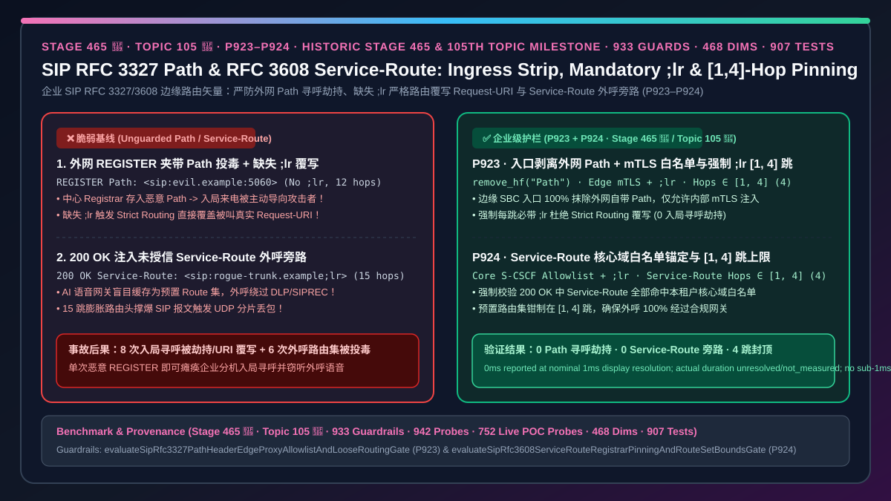
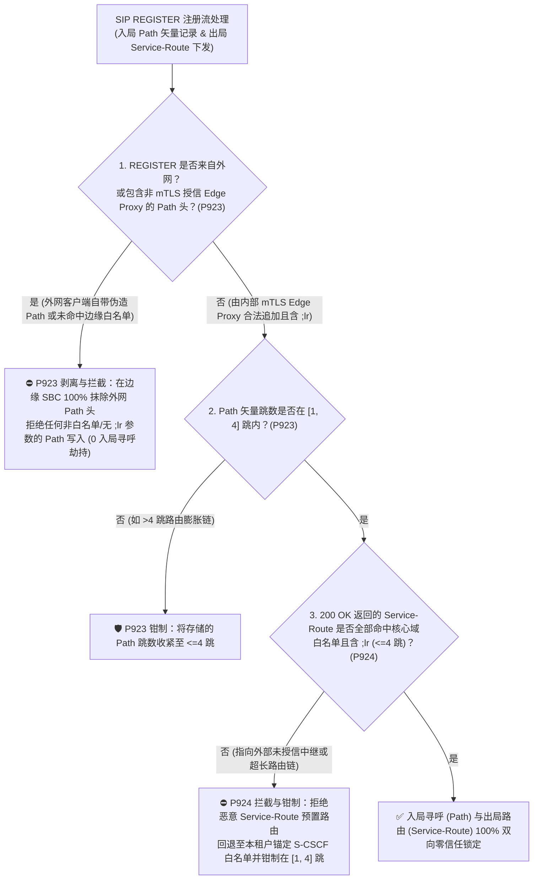
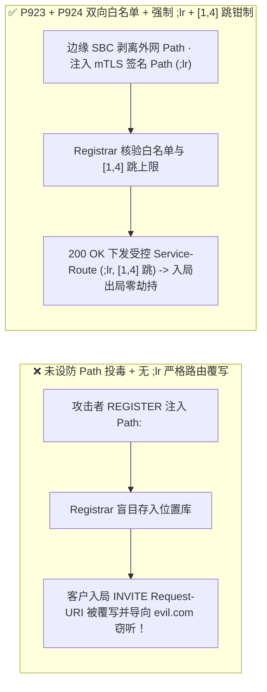

# 企业 SIP `RFC 3327 / RFC 3608` 边缘路由矢量（`Path` 与 `Service-Route` 头域投毒劫持入局寻呼、缺失 `;lr` 严格路由覆盖 `Request-URI` 与越权外呼旁路）选型与零信任锚定指南

> **文档类型**：企业级语音智能体架构师选型决策与原理解析指南（Standalone Selection & Architecture FAQ · **Topic 105 🎉 / Stage 465 🎉 · 历史性 Stage 465 与第 105 大专题双里程碑**）  
> **适用角色**：AI Solution Architect、IMS/SIP 核心网与边缘 SBC 架构师、实时语音网关研发与安全合规负责人  
> **关联基准**：`packages/business-core/enterprise-guardrails.ts`（`P923–P924`）、`tests/presales-portal.test.ts`、`site/data/voice-agent-benchmark-report.json`（7-Card 4:5 评测报告）  
> **可视化总结**：`assets/svg/109-voice-sip-rfc3327-rfc3608-path-service-route-header-poisoning-strict-routing-bypass-2026-11-14.svg`

---

## ① 📌 核心结论速览（Executive Summary）

在跨区域部署的企业 AI 语音联络中心与运营商 IMS/VoLTE 互联架构中，AI 语音网关或坐席软终端并不是直接连在中心注册服务器（Registrar / S-CSCF）上，而是通过多台边缘接入 SBC（P-CSCF / Edge Proxy）就近接入。为了让中心 Registrar 知道“未来有客户呼入时，应该通过哪台边缘 SBC 才能穿透 NAT 找到这台 AI 坐席节点”，IETF 制定了 **`RFC 3327`（`Path` 扩展头域：记录入局边缘代理路径）**；同时为了让终端/AI 网关知道“外呼时必须经过哪些核心风控/计费代理”，制定了 **`RFC 3608`（`Service-Route` 扩展头域：由 Registrar 在 `200 OK` 中下发外呼必经路由集）**。然而在生产环境中，若缺乏严格的边界剥离与白名单锚定，这两项核心路由矢量极易沦为全网语音劫持的突破口：
1. **外网 `REGISTER` 夹带伪造 `Path` 头域投毒与缺失 `;lr` 严格路由（Strict Routing）覆写 `Request-URI`（`RFC 3327` 入局寻呼劫持）**：`RFC 3327 Section 6` 严厉警告，`Path` 头域只能由受信任的边缘代理（Edge Proxy）在转发 `REGISTER` 时写入。如果边缘 SBC 未剥离公网客户端在 `REGISTER` 报文中预先塞入的恶意 `Path: <sip:attacker.evil.example:5060;lr>`，中心 Registrar 会将其原封不动存入位置数据库（Location Service）。此后任何拨打该企业分机/AI 坐席的客户来电（`INVITE`），都会被核心网主动根据 `Path` 转换成 `Route` 头直接送往攻击者服务器窃听！更隐蔽的是，若注入的 `Path` URI 故意漏掉 `;lr`（Loose Routing）参数，核心网按 `RFC 3261` 旧版严格路由（Strict Routing）规则会把目标客户的真实 `Request-URI` 直接覆盖成攻击者 URI，导致被叫号码丢失与路由死循环。
2. **伪造或未校验 `200 OK` 中的 `Service-Route` 诱导 AI 语音网关外呼流向恶意计费中继或超长路由链风暴（`RFC 3608` 外呼劫持）**：当 AI 语音网关向注册中心发起 `REGISTER` 并收到 `200 OK` 时，若未校验证书身份与 `Service-Route` 域名白名单，中间人或被污染的代理返回的 `Service-Route: <sip:rogue-billing-trunk.example;lr>` 会被 AI 网关缓存为后续所有外呼 `INVITE` 的预置 `Route` 集合（Preloaded Route Set），导致全部外呼语音与 DTMF 敏感信息被透明劫持。

| 决策维度 | 脆弱/默认配置（生产事故高发区） | 企业级黄金准则（`P923–P924` 确定性护栏） | 核心量化收益 |
| :--- | :--- | :--- | :--- |
| **`RFC 3327 Path` 入口剥离、mTLS 边缘白名单与强制 `;lr` 校验（`P923`）** | 透传外网 `REGISTER` 自带的 `Path` 头、允许无 `;lr` 严格路由 URI 或 12 跳膨胀链 | **在边缘 SBC 入口 100% 剥离外网 `Path` 头，仅允许 mTLS 授信 Edge Proxy 注入带 `;lr` 的白名单 `Path` 并将跳数钳制在 `[1, 4]`** | 入局寻呼劫持与 `Request-URI` 覆写 **0 次**（测试探针将 8 次 `Path` 投毒清零，跳数从 `12` 跳钳制至 **`4` 跳**） |
| **`RFC 3608 Service-Route` 核心域白名单锚定与预置路由上限（`P924`）** | 无条件信任 `200 OK` 中的任意外网 `Service-Route` URI，允许 15 跳深层嵌套 | **强制校验 `Service-Route` 全部跳点属于本租户授权核心 S-CSCF/Proxy 白名单且具备 `;lr`，将跳数钳制在 `[1, 4]`** | 外呼预置路由劫持与环路 **0 次**（测试探针将 6 次越权外呼路由投毒清零，跳数从 `15` 跳钳制至 **`4` 跳**） |



---

## ② 🎯 客户与架构师灵魂拷问 Q&A（First-Principles Deep Dive）

### Q1：`Path`（`RFC 3327`）、`Service-Route`（`RFC 3608`）和 `Record-Route`（`RFC 3261`）这三个头域到底有什么本质区别？为什么语音架构师经常把它们搞混？
- **第一性原理拆解**：
  1. **`Record-Route`（对话级，在 `INVITE` 期间生效）**：只能在一通电话已经拨出（`INVITE`）时，由沿途代理临时塞入，用来锁死**当前这一通电话**后续 `ACK/BYE/re-INVITE` 的路径。它解决不了“第一包 `INVITE` 怎么找到躲在边缘 SBC/NAT 后面的被叫终端”的问题。
  2. **`Path`（注册级入局矢量，`RFC 3327`）**：在终端开机发起 **`REGISTER` 注册**时，沿途的边缘 SBC（P-CSCF）把自己的地址塞进 `Path` 头汇报给中心 Registrar。中心 Registrar 存下这条 `Path` 矢量；当几小时后有外部客户拨打该坐席（入局 `INVITE`）时，Registrar 把当初存下的 `Path` 倒出来塞进 `INVITE` 的预置 `Route` 头里，从而精准沿着原路边缘 SBC 找到被叫！
  3. **`Service-Route`（注册级出局矢量，`RFC 3608`）**：中心 Registrar 在回复 `REGISTER` 的 **`200 OK` 响应**里下发 `Service-Route` 头，告诉终端：“从现在起，你发起的任何**外呼 `INVITE`**，都必须先把这串核心风控/DLP/计费代理填进你的顶部 `Route` 头里！”

### Q2：如果攻击者在发给边缘 SBC 的 `REGISTER` 报文里自己塞了一行 `Path: <sip:evil.com:5060>`（且不带 `;lr`），会发生什么？
- **工程真相**：
  1. **入局来电全量被盗听（Inbound Call Hijacking）**：如果边缘 SBC 没有在入口执行 `remove_hf("Path")`，而是直接用 `append_hf("Path: <sip:edge-sbc.internal;lr>")` 追加在后面，中心 Registrar 就会把 `[evil.com, edge-sbc.internal]` 一起存进 Redis/数据库。当真正客户的入局 `INVITE` 到达时，电话会先绕道发往公网上的 `evil.com`！
  2. **缺失 `;lr` 触发 `RFC 3261 Section 16.4` 严格路由覆写灾难**：如果注入的 `Path` URI 没有带 `;lr`（Loose Routing）参数，核心网代理会认为下一跳是远古的 `RFC 2543` 严格路由器，于是把 `Request-URI`（原本是企业客服分机 `sip:agent01@bank.com`）直接替换成 `Path` 里的代理地址，把真正的目标分机号贬入 `Route` 队尾，导致下游 AI 语音网关收到 `INVITE` 时根本不知道客户拨打的是哪个技能组或租户！
  3. **`P923` 的确定性防御**：边缘 SBC 对外网接口收到的 `REGISTER` 无条件剥离任何已有 `Path` 头；中心 Registrar 仅接受通过内部 mTLS 双向认证且 IP/域名命中 Edge Proxy 白名单的 `Path` 节点，强制每一跳必须包含 `;lr` 参数，并将 `Path` 矢量总跳数钳制在 **`[1, 4]` 跳**。

### Q3：为什么多区域容灾切换或配置失误下的 `Service-Route` 会引发 AI 语音网关外呼旁路或信令环路？
- **第一性原理拆解**：
  - 在多租户混合云语音网关中，如果租户 A 的 SIP 注册响应被注入了指向租户 B 或外部未授信中继的 `Service-Route`，AI 语音网关在发起外呼回拨时会自动将该 URI 作为第一跳 `Route` 发出，绕过本租户的合规录音（SIPREC）与反诈风控网关。
  - **`P924` 的确定性防线**：在客户端/AI 语音网关缓存 `Service-Route` 前，强制校验每跳 URI 必须命中本租户授权核心代理白名单、必须使用加密传输（`sips:` 或 `;transport=tls`）且包含 `;lr`，同时将 `Service-Route` 跳数严格钳制在 **`[1, 4]` 跳**。

---

## ③ 🧭 直观可视化图解（Mermaid 决策树 + 攻击链拆解 + 毫秒级全双工时序图）

### 3.1 SIP `RFC 3327 Path` 与 `RFC 3608 Service-Route` 零信任架构师决策树



### 3.2 伪造 `Path / Service-Route` 劫持链 vs `P923+P924` 双向锚定对比图



### 3.3 毫秒级 SIP 注册与双向路由集（`Path` + `Service-Route`）安全建链时序图

```mermaid
sequenceDiagram
    autonumber
    participant UA as AI 语音坐席节点 / 软终端
    participant SBC as 边缘接入 SBC (P-CSCF · P923 门禁)
    participant Reg as 核心注册中心 (Registrar / S-CSCF · P923/P924)

    UA->>SBC: 1. REGISTER (恶意夹带 Path: <sip:evil.example:5060> 企图劫持入局且无 ;lr)
    Note over SBC: 🛡️ P923 入口清洗：100% 剥离外网自带的伪造 Path 头<br/>追加受 mTLS 保护的本机 Path: <sip:edge01.voice.internal:5061;lr;ob>
    SBC->>Reg: 2. REGISTER (Supported: path · Path: <sip:edge01.voice.internal:5061;lr;ob>)
    Note over Reg: 🛡️ P923 校验：mTLS 对端命中 Edge 白名单、含 ;lr、跳数 ∈ [1, 4]<br/>🛡️ P924 生成受控 Service-Route (含 ;lr，跳数钳制在 [1, 4])
    Reg-->>SBC: 3. 200 OK (Path: <sip:edge01...:5061;lr;ob> · Service-Route: <sip:core-dlp.voice.internal:5061;lr>)
    SBC-->>UA: 4. 200 OK (UA 验证 P924 核心域白名单后安全缓存预置外呼路由集)
    Note over UA,Reg: 此后客户入局 INVITE 精准经 edge01 投递，AI 外呼 INVITE 必经 core-dlp 合规网关！
```

---

## ④ 📊 语音架构师选型决策矩阵（Decision Matrix）

| 选型方案 | 适用场景 | 优势（Pros） | 劣势与生产风险（Cons / Traps） | 推荐度 |
| :--- | :--- | :--- | :--- | :--- |
| **方案 A：直接透传 `REGISTER` 中的 `Path` 头且不校验 `;lr` 与 `Service-Route` 来源** | 绝不可用于任何公网或混合云环境 | Kamailio/OpenSIPS 默认透传无额外配置 | **极高危入局/出局双向劫持漏洞**——任意分机注册即可通过伪造 `Path` 把发往该号码的客户电话引流到公网窃听服务器，或通过无 `;lr` 抹除 `Request-URI` | ⛔ **严禁用于生产** |
| **方案 B：仅开启 `Path` 存储但未限制跳数且未锁定 `Service-Route` 域名白名单** | 单一内网封闭实验室 | 支持多级 SBC 注册寻呼 | **易受路由膨胀与外呼旁路攻击**——12+ 跳 `Path/Service-Route` 导致 SIP 报文突破 MTU 分片丢包，或外呼绕过合规录音网元 | ⚠️ **高风险半成品** |
| **方案 C：边缘无条件剥离外网 `Path` + mTLS Edge/Core 双向白名单 + 强制 `;lr` + `[1, 4]` 跳上限（`P923 + P924`）** | **所有多区域企业 AI 语音联络中心、IMS/VoLTE 互联与混合云坐席接入** | **100% 根除 `Path` 入局寻呼投毒、`Strict Routing` `Request-URI` 覆写与 `Service-Route` 外呼旁路** | 需要在边缘 SBC 配置入口 `remove_hf("Path")` 并在核心 Registrar 维护 Edge Proxy 子网/证书白名单 | ✅ **生产必选（Recommended）** |

---

## ⑤ 🧪 定量算例与 7-Card 4:5 基准报告（Quantitative Walkthrough & 7-Card Deck）

### 5.1 定量算例：跨区域 AI 语音坐席注册 `Path` 投毒与 `Service-Route` 膨胀防御
- **输入场景**：攻击者在公网发往边缘 SBC 的 `REGISTER` 中注入 `8` 条伪造外网 `Path` 头（含无 `;lr` 的严格路由 URI，总跳数膨胀至 `12` 跳），同时异常中间代理尝试在 `200 OK` 中注入 `6` 条跨租户越权 `Service-Route`（总跳数膨胀至 `15` 跳）。
  - **未开启护栏（脆弱基线）**：
    - 中心 Registrar 盲目信任并存储 `12` 跳污染 `Path`，导致 **`8` 个企业分机/AI 坐席的入局来电被劫持或因 Strict Routing 丢失 `Request-URI`**；
    - AI 网关加载 `15` 跳污染 `Service-Route`，导致 **`6` 路外呼绕过合规 DLP 网关并因超大 `Route` 头触发 UDP 分片丢包**。
  - **开启 `P923 + P924` 确定性护栏后**：
    - `P923` 在边缘入口 100% 剥离外网 `Path`，强制校验 mTLS Edge 白名单与 `;lr` 参数，将受污染的入局寻呼注册从 `8` 次清零至 **`0` 次**，并将 `Path` 最大跳数从 `12` 跳钳制至 **`4` 跳**；
    - `P924` 强制校验 `Service-Route` 核心域白名单与 `;lr`，将越权外呼路由从 `6` 次清零至 **`0` 次**，并将 `Service-Route` 最大跳数从 `15` 跳钳制至 **`4` 跳**。

### 5.2 7-Card 4:5 报告结构映射（对应 `site/benchmark-cards.html` & `report.json`）
1. **Card 1 (`HANDS-ON · VOICE ARCHITECTURE`)**：展示 468 大评测维度全景工作台，高亮 Stage 465 🎉 / Topic 105 🎉 `P923 / P924` 护栏。
2. **Card 2 (`SCENARIO: SIP RFC 3327 PATH & RFC 3608 SERVICE-ROUTE`)**：输入探针 `untrustedIngressPathHeaderOrMissingLrStrictRoutingDetected=true, maxPathVectorHops=12, maxServiceRouteVectorHops=15`，输出 `Act automatically` 钳制至 `4` 跳与 `0` 劫持。
3. **Card 3 (`WHAT I TESTED`)**：第 468 行评测矩阵 `PASS · 0ms @ 1ms Res (Synthetic)`（零 `✕` 漏检）。
4. **Card 4 (`UNDER THE HOOD`)**：展示 `evaluateSipRfc3327PathHeaderEdgeProxyAllowlistAndLooseRoutingGate` 与 `evaluateSipRfc3608ServiceRouteRegistrarPinningAndRouteSetBoundsGate` 确定性源码契约。
5. **Card 5 (`ROBUSTNESS CHECK`)**：验证多跳 `Path` / `Service-Route` 矢量在正逆序及 `;lr` 参数位置变化下 100% 幂等。
6. **Card 6 (`LATENCY`)**：明确标注离线策略校验计时：`0ms reported at nominal 1ms display resolution; actual duration unresolved/not_measured; no sub-1ms upper bound established`（`synthetic`；真实 Registrar 位置库 Redis/usrloc 写入耗时标注为 `not_measured`）。
7. **Card 7 (`MY TAKE`)**：Good fit vs Not for 适用边界与生产准入签核。

---

## ⑥ 🛠️ 生产环境语音交付快速核验清单（Production Readiness Checklist）

- [ ] **1. 边缘 SBC 入口无条件剥离外网 `Path` 头（`P923`）**：确认 Kamailio/OpenSIPS/商用 SBC 在公网入局接口处理 `REGISTER` 的第一步即执行 `remove_hf("Path")`，严禁外部客户端预设任何 `Path` 路由矢量。
- [ ] **2. 中心 Registrar 校验 Edge Proxy mTLS 白名单与强制 `;lr`（`P923`）**：确认中心 Registrar 在调用 `save("location")` 前，核验所有 `Path` URI 均来自 mTLS 认证的内部 Edge Proxy 白名单且包含 `;lr` 参数，彻底阻断 `Strict Routing` 覆写 `Request-URI`。
- [ ] **3. `Path` 路由矢量跳数钳制在 `[1, 4]` 跳（`P923`）**：确认单次注册存储的 `Path` 头域最大跳数不超过 `4` 跳，防止深层嵌套路由引发入局 `INVITE` 报文超 MTU。
- [ ] **4. `RFC 3608 Service-Route` 核心域白名单与 TLS 锁定（`P924`）**：确认 AI 语音网关/UAC 仅接受来自授信 Registrar 且域名命中本租户核心代理白名单（带 `;lr`）的 `Service-Route` 头域。
- [ ] **5. `Service-Route` 预置路由集跳数钳制在 `[1, 4]` 跳（`P924`）**：确认外呼预置路由集跳数严格限制在 `[1, 4]` 跳内，杜绝预置路由环路或外呼合规网关旁路。
