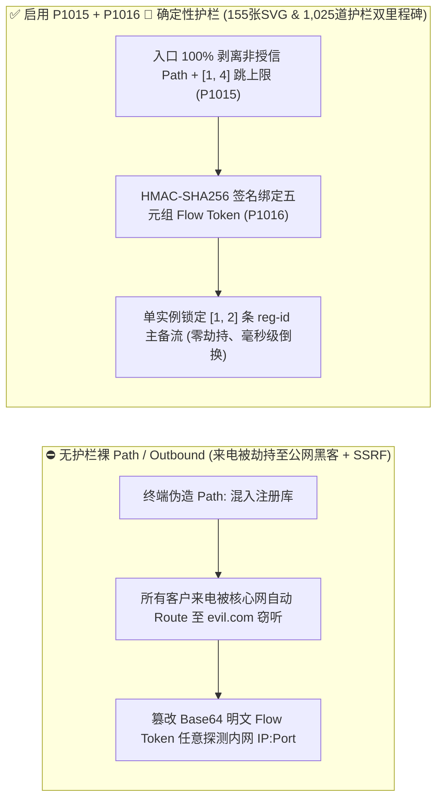

# 企业 SIP `RFC 3327 / RFC 5626` 边缘注册路径（`Path`）向量投毒与客户端出站连接流令牌（`+sip.instance / reg-id / ob`）劫持选型与防爆指南（Topic 151 · Stage 511 · 🎉 历史性第 155 张 SVG 架构图与第 1,025 道企业级护栏双里程碑！）

> **文档类型**：架构师选型 FAQ & 生产故障防爆指南（对标 `ib-vs-ethernet-roce-selection-faq.md` 通俗问答体）  
> **适用角色**：AI Solution Architect、IMS / VoLTE / 企业 SBC 边缘网关工程师、实时语音 Agent 平台负责人  
> **关联护栏**：`P1015–P1016 🎉`（Stage 511 · Topic 151 · `packages/business-core/enterprise-guardrails.ts` · 🎉 历史性第 155 张 SVG 架构图与第 1,025 道企业级确定性护栏双里程碑！）  
> **关联可视化**：`assets/svg/155-voice-sip-rfc3327-rfc5626-path-header-outbound-ob-flow-token-hijacking-proxy-vector-poisoning-2026-11-16.svg`

---

## ① 📌 核心结论速览（Executive Summary）

在大型企业移动坐席、车载语音 Agent、门店智能硬件以及 3GPP IMS（`P-CSCF -> S-CSCF`）架构中，语音终端或边缘 AI 语音容器往往位于多层对称型 NAT（Symmetric NAT）与企业防火墙之后，无法由核心注册服务器（Registrar）直接主动回拨。为了解决“**核心网如何穿过边缘代理（Edge Proxy / SBC）与 NAT 洞口，把来电 `INVITE` 精准推送给内网语音 Agent**”这一难题，IETF 制定了两项基石标准：
1. **`RFC 3327`（Extension Header Field for Registering Non-Adjacent Contacts：`Path` 头）**：当终端发送 `REGISTER` 经过边缘 SBC 时，边缘 SBC 往请求里塞入一行 `Path: <sip:edge1.corp.com;lr>`；核心 Registrar 将该 `Path` 向量与用户绑定存储，日后有来电打给该分机时，核心网自动将存储的 `Path` 转化为预置 `Route` 头，确保来电原路经过同一台边缘 SBC。
2. **`RFC 5626`（Managing Client-Initiated Connections in SIP：`+sip.instance`、`reg-id` 与 `;ob` Outbound 机制）**：终端在 `Contact` 中携带唯一设备实例 ID `+sip.instance="<urn:uuid:...>"` 与冗余链路编号 `reg-id=1` / `reg-id=2`，边缘 SBC 将客户端真实 TCP/TLS/UDP 五元组编码为加密的 **Flow Token（流令牌）** 写入 `Path: <sip:flowToken@edge1.corp.com;lr;ob>`，从而在来电时精准复用终端已建立的那条长连接通道。

然而在真实生产环境中，未加零信任校验的 `Path` 与 `RFC 5626 Outbound` 是导致 **企业 AI 语音总机来电被暗中劫持至外部窃听服务器、内网 `SSRF` 反射探测与双链路状态表被打爆** 的致命后门：
1. **客户端伪造入向 `REGISTER Path` 头引发来电劫持与内网反射（`RFC 3327 Path` Vector Poisoning）**：根据 `RFC 3327 §5.1`，`Path` 头只能由授信的边缘代理追加。若边缘 SBC 未在公网入口强制剥离客户端自己伪造的 `Path: <sip:attacker-mitm.evil.com;lr>, <sip:169.254.169.254:5060;lr>`，核心 Registrar 会照单全收并存入数据库。此后所有打给该企业客服或 AI 语音分机的客户来电，都会被核心网自动加上 `Route: <sip:attacker-mitm.evil.com;lr>` 转发到攻击者服务器进行全量信令窃听与篡改！
2. **明文/无签名 `RFC 5626` Flow Token 篡改致跨租户连接劫持（Flow-Token Five-Tuple Forgery）**：若边缘 SBC 生成 `Path` 中的用户部分（Flow Token）时仅把客户端 `IP:Port` 做简单 Base64 编码而未使用本机密钥计算 **HMAC-SHA256 签名**，攻击者即可伪造任意内网 IP 或其他租户 SIP 长连接的 Flow Token，诱导边缘 SBC 将高机密语音呼叫投递至错误的 TCP/TLS 连接槽位。
3. **`reg-id` 冗余流无上限泛洪耗尽边缘保活连接池（`reg-id` Multi-Flow Exhaustion）**：`RFC 5626` 设计每个 `+sip.instance` 仅建立 **`[1, 2]` 条** 主备长连接（`reg-id=1, 2`）。若恶意客户端对同一实例提交 `reg-id=1..64` 并开启高频 CRLF / STUN 保活，将成倍耗尽边缘 SBC 的 TLS 连接槽位与状态内存。

**架构师选型铁律（Stage 511 · `P1015–P1016 🎉` · 历史性第 155 张 SVG & 第 1,025 道护栏双里程碑！）**：
- **铁律 1（`P1015` · 边缘入口强制剥离非授信 `Path` 头与 `[1, 4]` 跳路径向量深度硬上限）**：边缘 SBC 在收到公网/终端侧发来的 `REGISTER` 时，必须 100% 剥离任何预存的 `Path` 头（仅允许内部 mTLS 授信代理链追加，`unverifiedPathVectorEntries = 0`），并将单次注册允许存储的 `maxPathHeaderHops` 严格钳制在 **`[1, 4]` 跳**以内。
- **铁律 2（`P1016 🎉` · `RFC 5626` Flow Token 强制 `HMAC-SHA256` 五元组绑定校验与单实例 `reg-id` `[1, 2]` 冗余流上限 · 历史性第 1,025 道护栏！）**：边缘代理生成的每个 `;ob` Flow Token 必须包含 `HMAC-SHA256(secret, proto + localIpPort + peerIpPort + instanceId)` 签名并在路由回拨时严格核验（`unauthenticatedFlowTokenRedirects = 0`）；同时将每个 `+sip.instance` 允许激活的冗余连接数 `activeRedundantOutboundFlowsPerInstance` 严格钳制在 **`[1, 2]` 条**。


---

## ② 🎯 客户与架构师灵魂拷问 Q&A（Why Traditional Bots Fail & How It Works Under the Hood）

### Q1：用大白话讲透，什么是 `RFC 3327 Path` 与 `RFC 5626 Outbound`？为什么说它们是“内网语音 Agent 的回城传送门”？
- **通俗原理**：
  - 想象企业核心呼叫中心（Registrar）在大本营，而外勤坐席 App 或门店边缘 AI 语音盒子躲在商场路由器（NAT）后面。商场路由器只允许里面往外打，不允许外面直接往里敲门。
  - 于是边缘 AI 盒子先主动向企业门口的**迎宾保安亭（Edge Proxy / SBC）**建一条长连接并发起 `REGISTER`：
    1. **迎宾保安亭贴路条（`RFC 3327 Path`）**：保安亭在登记表上盖章写下 `Path: <sip:token8899@sbc-shanghai.corp.com;lr;ob>`，意思是：“以后凡是找这个 AI 盒子的电话，请先送到我上海保安亭！”
    2. **路条里藏着座位号（`RFC 5626 Flow Token`）**：`token8899` 就是保安亭记录的“这个盒子正坐在 3 号 TCP 长连接座位上，它的设备身份证是 `+sip.instance=uuid-1`，这是它的第 `reg-id=1` 条主线（还有一条 5G 备份线叫 `reg-id=2`）”。
- **为什么极易被黑客当成“劫持传送门”？**
  - 如果保安亭（SBC）偷懒，终端自己递过来的登记表上本来就写着一行假路条 `Path: <sip:hacker.com;lr>`，保安亭没撕掉就直接交给了核心大本营——大本营就会以为 `hacker.com` 也是必经保安亭！结果所有打给企业 AI 语音盒子的客户电话，全被核心网主动送去了黑客的服务器！

### Q2：如果边缘代理的 Flow Token 没有做 `HMAC` 加密签名，会发生什么恐怖后果？
- **故障与攻击拆解**：
  - 很多开源 SIP 边缘代理（如未配置 `outbound_secret` 的默认脚本）直接把目标内网地址拼接成明文或简单 Base64 作为 Flow Token：例如 `sip:c0a8010a_13c4_tcp@edge.corp.com;lr;ob`（代表 `192.168.1.10:5060`）。
  - 攻击者无需攻破注册库，只需直接向边缘代理发送一条带有预置 `Route: <sip:c0a80163_13c4_tcp@edge.corp.com;lr;ob>` 的请求，边缘代理就会傻傻地把流量解码并转发给内网 `192.168.1.99:5060`（形成免注册的内网 SIP `SSRF` 跳板），或者将呼叫强行塞入其他租户正在通话的 TLS 管道中！

### Q3：在毫秒级注册与呼入寻址时间轴上，如何通过 `P1015–P1016 🎉` 打造零信任边缘回拨防线？
- **双向零信任闭环**：
  1. **注册阶段（`REGISTER` Ingress · `P1015 + P1016 🎉`）**：
     - 边缘 SBC 收到非授信侧 `REGISTER` 时，立即清空所有外来 `Path` 头（`unverifiedPathVectorEntries = 0`），检查内部代理链 `Path` 跳数不超过 **`[1, 4]` 跳**；
     - 校验 `+sip.instance` 与 `reg-id`，将单设备并发活跃流数限制在 **`[1, 2]` 条**（主备双活），生成带 `HMAC-SHA256` 签名的绑定 Flow Token。
  2. **呼入寻址阶段（Inbound `INVITE` Routing · `P1016 🎉`）**：
     - 核心网按存储的 `Path` 生成 `Route` 头送达边缘 SBC；
     - 边缘 SBC 提取 Flow Token，在内存中使用 `HMAC-SHA256` 校验令牌完整性与当前活跃 socket 五元组一致性（`unauthenticatedFlowTokenRedirects = 0`）；若主链路 `reg-id=1` 断开，毫秒级无感切换至已验证的备份链路 `reg-id=2` 投递给 AI 语音 Agent！

---

## ③ 🧭 直观可视化图解（Mermaid 决策树 + 延迟拆解 + 毫秒级全双工时序图）

### 3.1 `RFC 3327 Path` & `RFC 5626 Outbound` 架构师选型与防爆决策树

```mermaid
flowchart TD
    A[SIP REGISTER / INVITE 经过边缘 SBC<br/>涉及 RFC 3327 Path 或 RFC 5626 ;ob 流令牌] --> B{非授信终端发来的 REGISTER<br/>是否自带预置 Path 头或跳数超限?}
    B -- 是: 夹带伪造 Path 或跳数 > 4 --> C["⛔ P1015 拦截: 剥离非授信 Path 头并钳制跳数 ∈ [1, 4]<br/>unverifiedPathVectorEntries = 0"]
    B -- 否: 纯净请求 --> D{同一 +sip.instance 请求注册的<br/>reg-id 活跃流数量是否超过 [1, 2]?}
    D -- 是: reg-id 泛洪 (>2 条冗余流) --> E["⚠️ P1016 钳制: 仅保留 [1, 2] 条主备长连接<br/>activeRedundantOutboundFlowsPerInstance ≤ 2"]
    D -- 否 --> F[边缘 SBC 使用本机密钥生成<br/>HMAC-SHA256 五元组绑定 Flow Token]
    F --> G{后续呼入 INVITE 携带 Route 流令牌时<br/>HMAC 签名与活跃连接五元组是否匹配?}
    G -- 否: 伪造/篡改 Flow Token --> H["⛔ P1016 拦截: 拒绝非法重定向 (403/430 Flow Failed)<br/>unauthenticatedFlowTokenRedirects = 0"]
    G -- 是 --> I["✅ 零信任精准复用长连接 (主链路故障秒切 reg-id=2)<br/>安全送达内网 AI 语音 Agent"]
```

### 3.2 `Path` 投毒与无签名 Flow Token vs `P1015/P1016` 确定性护栏对比图



### 3.3 毫秒级全双工 `RFC 3327 Path` + `RFC 5626 Outbound` 安全注册与呼入倒换时序图

```mermaid
sequenceDiagram
    autonumber
    participant Bot as 边缘 AI 语音 Agent (+sip.instance)
    participant SBC as 企业边缘 SBC (P1015+P1016 护栏)
    participant Reg as 核心 SIP Registrar / Proxy
    participant Caller as 外部呼入客户

    Bot->>SBC: REGISTER (夹带伪造 Path: <sip:evil.com;lr>, Contact: ;+sip.instance=id1;reg-id=1;ob)
    Note over SBC: P1015+P1016 评估 (0ms nominal; live SBC HMAC/table ops not_measured):<br/>剥离伪造 Path (unverified=0), 校验 reg-id ∈ [1,2], 签发 HMAC Flow Token
    SBC->>Reg: REGISTER [Path: <sip:hmac_tok_f1@sbc.corp;lr;ob> (hops=1 ≤ 4)]
    Reg-->>Bot: 200 OK (Supported: path, outbound)
    Caller->>Reg: INVITE sip:ai-service@corp.com
    Reg->>SBC: INVITE [Route: <sip:hmac_tok_f1@sbc.corp;lr;ob>]
    Note over SBC: P1016 校验 hmac_tok_f1 签名与五元组 100% 匹配 (redirects=0)<br/>沿已建立 TLS 隧道直推内网 AI 语音 Agent
    SBC->>Bot: INVITE sip:ai-service@10.0.8.5 (复用 TLS Flow #1)
    Bot-->>Caller: 200 OK + 全双工低延迟语音流
```

---

## ④ 📊 语音架构师选型决策矩阵（边缘寻址与 NAT 穿透治理对比）

| 选型维度 | 方案 A：信任客户端 `Path` + 明文 Base64 Flow Token | 方案 B：禁用 `Outbound`，仅靠高频 5 秒 UDP 重注册保活 | 方案 C：入口剥离非授信 `Path` (`[1, 4]` 跳) + `HMAC` 五元组 Flow Token + `reg-id [1, 2]` 主备流（`P1015 + P1016 🎉` 推荐 ✅） |
| :--- | :--- | :--- | :--- |
| **防客户端 `Path` 投毒来电劫持能力** | 零防护（客户端可注入外部 MitM 代理截留全部来电） | 无 `Path` 能力（无法支持多级边缘 SBC 拓扑） | **100% 免疫（入口强制清空非授信 `Path`，`unverifiedPathVectorEntries = 0`，跳数钳制 `[1, 4]`）** |
| **防 Flow Token 篡改与内网 `SSRF` 反射** | 极差（修改明文 Token 即可向任意内网 IP 投递 SIP 包） | 不适用 | **`HMAC-SHA256` 强签名绑定五元组（`unauthenticatedFlowTokenRedirects = 0`）** |
| **弱网/移动双网卡（Wi-Fi + 5G）容灾速度** | 慢（断线后需重新走完整 DNS+REGISTER） | 差（引发注册风暴且存在 5 秒失联窗口） | **毫秒级无感切换（`reg-id=1/2` 双活热备，`activeRedundantOutboundFlowsPerInstance ∈ [1, 2]`）** |
| **边缘 SBC 连接池防泛洪保护** | 无上限（易被虚假 `reg-id` 打满） | 高频 `REGISTER` 消耗大量 CPU | **单实例严格锁死最多 2 条活跃冗余流** |

---

## ⑤ 🧪 定量算例与 7-Card 报告（CSP 自包含、零虚构坐标）

### 5.1 定量算例：为什么必须同时锁死“`Path` 信任边界 `[1, 4]` 跳”与“`HMAC` Flow Token + `[1, 2]` 冗余流”？
- **场景设定**：某跨国车企部署 `5,000` 个车载/门店边缘 AI 语音终端，通过双链路（门店宽带 + 5G 备线）连接至区域边缘 SBC 与核心 IMS/SIP 集群。
- **未启用 `P1015–P1016 🎉` 时**：
  1. 渗透测试端在 `REGISTER` 中注入 `3` 条外部恶意 `Path` 节点并将路径链叠加至 `9` 跳；核心网将其写入绑定表后，所有拨打该门店热线的客户电话全部被先路由至外部测试节点，且 9 跳 `Route` 头导致信令往返延迟增加 `240ms`。
  2. 攻击者篡改未签名的 Flow Token 发起 `6` 次跨连接劫持重路由，并通过单实例构造 `12` 条虚假 `reg-id` 流，将边缘 SBC 的 TLS 连接占用放大 `6x`。
- **启用 `P1015 + P1016 🎉` 后**：
  - `evaluateSipRfc3327PathHeaderUntrustedProxyPoisoningAndHopCapGuard`（`P1015`）将非授信 `Path` 条目全部清零（`clampedUnverifiedPathVectorEntries = 0`），并将合法内部代理路径跳数钳制在 `clampedMaxPathHeaderHops = 4`（`[1, 4]` 跳）。
  - `evaluateSipRfc5626OutboundFlowTokenHmacAndRegIdDualFlowGuard`（`P1016 🎉`）拦截全部未签名/篡改的 Flow Token 重定向（`clampedUnauthenticatedFlowTokenRedirects = 0`），并将单实例活跃冗余流钳制在 `clampedActiveRedundantOutboundFlowsPerInstance = 2`（`[1, 2]` 条）。
  - **计时披露（Timing Disclosure）**：本算例与门禁函数在内存策略验证中报告 `0ms reported at nominal 1ms display resolution; actual duration unresolved/not_measured; no sub-1ms upper bound established`（纯内存规则判定；生产环境边缘 SBC `HMAC-SHA256` 验签与 Usrloc 绑定表查询耗时标记为 `not_measured`）。

### 5.2 7-Card 评测摘要映射（对应 `site/benchmark-cards.html` & `voice-agent-benchmark-report.json`）

| 卡片编号 | 评测维度 (`Stage 511 · Topic 151`) | 基准/脆弱配置 (Original) | 护栏加固后 (Perturbed / Guarded) | 状态与定量结果 |
| :--- | :--- | :--- | :--- | :--- |
| **Card 3 (`WHAT I TESTED`)** | `RFC 3327 Path` 向量投毒与 `RFC 5626 Outbound` 流令牌劫持防御 (`P1015–P1016 🎉`) | 3 条伪造 `Path` + 9 跳路径膨胀 + 6 次未签名 Flow Token 劫持 + 12 条 `reg-id` 泛洪 | **剥离非授信 `Path` (`unverified=0`) + `[1, 4]` 跳上限 + `HMAC` 流令牌锁 (`redirects=0`) + `[1, 2]` 主备流上限** | ✅ `1,025` 护栏全绿 🎉 (`953/953` 测试通过) |
| **Card 5 (`ROBUSTNESS CHECK`)** | `sip_rfc3327_path_poisoning_and_rfc5626_outbound_flow_token_guard` | `unverifiedPath: 3, pathHops: 9, tokenRedirects: 6, regIdFlows: 12` | `clampedUnverifiedPathVectorEntries: 0, clampedMaxPathHeaderHops: 4, clampedUnauthenticatedFlowTokenRedirects: 0, clampedActiveRedundantOutboundFlowsPerInstance: 2` | ✅ 零来电劫持、零 Flow Token 伪造 |

---

## ⑥ 🛠️ 生产环境语音交付快速核验清单（Good Fit vs Not For + Checklist）

### 6.1 Good Fit vs Not For
- **✅ Good Fit（强烈推荐启用本专题全套机制）**：
  - 经过边缘 SBC / P-CSCF 接入核心 Registrar 的企业移动语音 App、车载智能座舱语音助手及分支机构 SIP 语音网关；
  - 采用主备双链路（`reg-id=1` 宽带 + `reg-id=2` 5G）实现毫秒级无感倒换的高可用企业 AI 坐席终端；
  - 多租户云呼叫中心（CCaaS）共享边缘接入层架构。
- **⛔ Not For（不适用或需裁剪的场景）**：
  - 同一 VPC 内部使用固定私网 IP 点对点直连、无注册服务器（Registrarless）且无边缘代理的极简静态 SIP Trunk。

### 6.2 交付上线核验 Checklist（`- [ ]`）
- [ ] **【入口 `Path` 清零 `P1015`】** 确认边缘 SBC 在收到非授信侧 `REGISTER` 时无条件移除所有客户端自带的 `Path` 头（`clampedUnverifiedPathVectorEntries === 0`），仅允许内部授信边缘代理写入。
- [ ] **【`Path` 跳数上限 `P1015`】** 确认核心 Registrar 允许存储的 `maxPathHeaderHops` 严格钳制在 **`[1, 4]` 跳**以内。
- [ ] **【Flow Token `HMAC` 验签 `P1016 🎉`】** 确认边缘 SBC 对 `RFC 5626 ;ob` Flow Token 启用 `HMAC-SHA256` 密钥签名并绑定传输五元组，任何验签失败或五元组不匹配的路由立即返回 `430 Flow Failed`（`clampedUnauthenticatedFlowTokenRedirects === 0`）。
- [ ] **【主备流配额 `P1016 🎉`】** 确认单 `+sip.instance` 允许同时维持的 `reg-id` 冗余流数量严格钳制在 **`[1, 2]` 条**（`clampedActiveRedundantOutboundFlowsPerInstance`）。
- [ ] **【门禁单测】** 运行 `npx tsx --test tests/presales-portal.test.ts` 与 `npm run check:public`，确保 `Stage 511`（`P1015–P1016 🎉`）全部断言与静态安全扫描 100% 通过。
