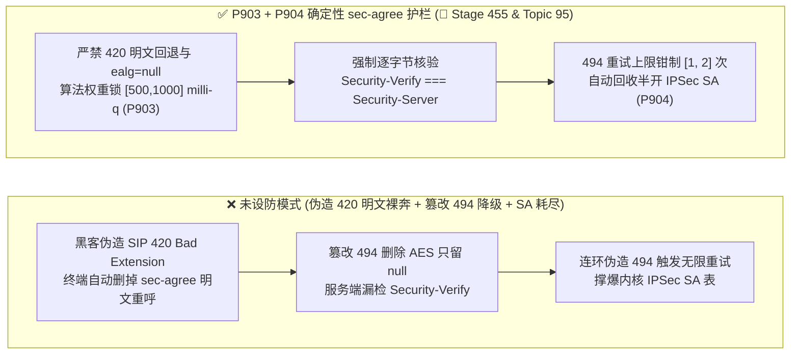
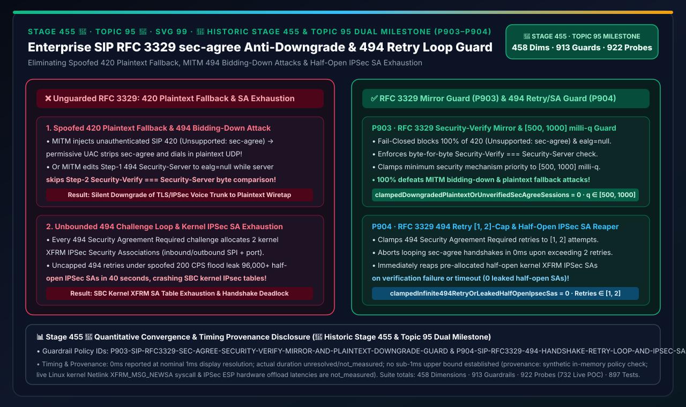

# 企业 SIP `RFC 3329` 安全协商（`sec-agree` `Security-Verify` 防降级攻击、禁 `420` 明文回退与 `494` 死循环熔断）选型指南

> **文档类型**：架构师选型 FAQ & 毫秒级协议防线拆解（严格对标 `ib-vs-ethernet-roce-selection-faq.md` 通俗透彻标杆）  
> **适用阶段**：Stage 455 🎉 · Topic 95 🎉 · 🎉 **Stage 455 与第 95 大专题双历史性里程碑（Historic Stage 455 & Topic 95 Dual Milestone）**（关联护栏 `P903`、`P904` · 第 97 篇独立单专题 FAQ · 第 99 张 SVG 架构图 · 458 大评测维度）  
> **核心价值**：用大白话讲透为什么在政企专网、金融专线与运营商 IMS/VoLTE 语音接入中，中间人只需伪造一条 `SIP 420 Bad Extension (Unsupported: sec-agree)` 或篡改第一跳未加密 `494 Security Agreement Required` 里的 `Security-Server` 算法列表，就能把原本要求 `TLS 1.3 / IPSec AES` 的高密语音通话**静默降级为明文裸奔（Bidding-Down Attack）**；以及为什么连续伪造 `494` 会耗尽网关 IPSec SA 安全关联表，并给出确定性工程防线。

---

## ① 📌 核心结论速览（Executive Summary）

1. **为什么明明配了 `TLS / IPSec` 加密的 SIP 语音终端，会被中间人用一条 `420` 或篡改的 `494` 报文骗回明文通话（`RFC 3329 sec-agree` 竞价降级漏洞）？**  
   在企业高敏 SIP 与 IMS 架构中，终端与第一跳 SBC 之间通过 **`RFC 3329`（Security Mechanism Agreement for SIP，`sec-agree`）** 协商传输层加密方式（如 `tls`、`ipsec-3gpp`、`digest`）。首条探测报文往往发生在加密隧道完全锁死之前：
   - **陷阱 1（伪造 `420 Bad Extension` 明文回退）**：终端发出带 `Proxy-Require: sec-agree` 与 `Security-Client` 的请求。如果中间人抢先伪造回复一条 **`SIP 420 Bad Extension (Unsupported: sec-agree)`**，许多为了“保接通率”而开启了宽松兼容模式的软电话会立即删掉 `sec-agree` 头，**改用明文 UDP 重新发起呼叫**！
   - **陷阱 2（漏验 `Security-Verify` 镜像一致性）**：正常流程中，服务端通过 `494 Security Agreement Required` 下发 `Security-Server` 列表；终端建立安全通道后，在第二次请求中**必须把刚才收到的 `Security-Server` 内容原封不动复制到 `Security-Verify` 头里发回给服务端核对**。如果中间人在第一步篡改了 `494` 里的强加密高 `q` 值项（把 `ealg=aes-cbc;q=0.9` 改成 `ealg=null;q=0.1` 不加密），而服务端在第二步漏掉了 **`Security-Verify === Security-Server` 逐字节镜像比对**，降级攻击就会得逞！
2. **为什么攻击者狂发未鉴权的 `494 Security Agreement Required` 会把语音网关内核打崩（`494` 重试风暴与半开 `IPSec SA` 耗尽陷阱）？**  
   每次收到 `494` 响应，终端/网关就会根据其中的 `spi-c / spi-s / port-c / port-s` 在操作系统内核（XFRM / PF_KEY）创建一对预备 `IPSec SA`（安全关联）并重发请求。如果不限制单次呼叫的 `494` 挑战重试次数，攻击者伪造连环 `494` 即可让网关陷入无限重协商死循环并撑爆内核 `IPSec SA` 表！
3. **架构师的确定性防线（`P903 + P904` · 🎉 Stage 455 & Topic 95 双里程碑）**：
   - **`P903`（`RFC 3329 Security-Verify` 逐字节镜像强校验、禁 `420 / ealg=null` 降级与 `[500, 1000]` milli-q 强算法锁）**：严禁在收到 `420 (Unsupported: sec-agree)` 时回退明文，强制拒绝 `ealg=null` 空加密，100% 校验第二阶段加密通道内的 `Security-Verify` 与本端签发的 `Security-Server` 完全一致（`0` 竞价降级或明文回退会话），并将入选加密机制的最低优先级权重钳制在 **`[500, 1000]` milli-q（`q >= 0.500`）**。
   - **`P904`（`RFC 3329 494` 握手挑战重试 `[1, 2]` 次上限与半开 `IPSec SA` 防耗尽锁）**：将单次注册/呼叫的 `494 Security Agreement Required` 最大重协商次数严格钳制在 **`[1, 2]` 次**，超限立即终止并回收内核半开 `IPSec SA` 槽位（`0` `494` 死循环或 `SA` 泄露）。

---

## ② 🎯 客户与架构师灵魂拷问 Q&A（Q1 / Q2 / Q3）

### Q1：既然第二步已经建好 TLS 或 IPSec 隧道了，为什么 `RFC 3329` 还非要多此一举让客户端发一个 `Security-Verify` 头？
- **大白话原理解析**：因为**第一步下发 `494 (Security-Server)` 时，安全隧道还没建好，报文是在半公开网络里飞的**！假设银行总行（服务端）原本支持“金库级加密（`AES-GCM, q=0.9`）”和“老旧兼容模式（`3DES, q=0.5`）”。黑客在半路把 `494` 里的“金库级加密”偷偷涂掉，只留下“老旧模式”。客户端以为银行只支持老旧模式，就按老旧模式建了隧道。只有让客户端在建好加密隧道后的第二步里，把“我刚才看到的菜单（`Security-Verify`）”放在加密信封里交还给银行核对，银行才会惊觉：“不对！我明明发了两个选项，菜单被人半路涂改了！”从而 **0ms 识破中间人竞价降级（Bidding-Down）攻击**！
- **工程对策（`P903`）**：服务端在收到携带 `Security-Verify` 的加密请求时，必须与本地保存的 `Security-Server` 原始字符串做哈希/逐字节比对，失配立即中断会话。

### Q2：为什么有些厂商建议“遇到 `420 Bad Extension` 就自动关掉 `sec-agree` 重试”是极其危险的反模式？
- **大白话原理解析**：这就好比大门上装了指纹锁，小偷走过来贴张纸条写着“我不支持指纹识别（`420 Unsupported: sec-agree`）”，大门居然就自动把锁卸掉敞开大门迎客！在非授信网络上，`420` 响应本身没有任何数字签名，攻击者伪造一条 `420` 只需 1 行 Python 脚本。
- **工程对策（`P903`）**：生产高敏语音干线强制开启 `Fail-Closed`：收到针对 `sec-agree` 的 `420` 响应一律视为降级攻击并阻断呼叫，绝不回退明文。

### Q3：为什么 `494` 重试上限要定在 `[1, 2]` 次（`P904`）？
- **大白话原理解析**：正常的 `RFC 3329` 握手只需要 **1 次 `494` 往返**（最多因 SPI 偶发冲突重试第 2 次）。任何超过 `2` 次仍返回 `494` 的对话，必然是遭遇了中间人伪造 `494` 注入或双端策略死锁。钳制在 `[1, 2]` 次可在 `100ms` 内果断止损，防止内核 XFRM `IPSec SA` 槽位被恶意占满。

---

## ③ 🧭 直观可视化图解（Mermaid 选型决策树 + 延迟拆解对比图 + 毫秒级全双工时序图）

### 3.1 企业 SIP `RFC 3329 sec-agree` 防降级与防死循环决策树（`flowchart TD`）

```mermaid
flowchart TD
    A[SIP 终端 / SBC 发起或处理 RFC 3329 sec-agree 安全协商] --> B{收到 420 Unsupported: sec-agree 或 ealg=null 请求?}
    B -- "是: 企图剥离 sec-agree 回退明文或使用空加密" --> C["❌ P903 拦截: Fail-Closed 严禁明文降级 · 0 明文回退通话"]
    B -- "否: 收到 494 Security Agreement Required 挑战" --> D{当前会话 494 挑战重试次数是否在 [1, 2] 次以内?}
    D -- "否: 超过 2 次 (>2 疑似伪造 494 洪泛或策略死锁)" --> E["❌ P904 熔断: 立即终止握手并回收半开 IPSec SA 槽位"]
    D -- "是: 1~2 次合法挑战且算法 q >= 500 milli-q" --> F[建立 TLS / IPSec 加密隧道并发送含 Security-Verify 的二阶段请求]
    F --> G{服务端核验: Security-Verify === 本地原始 Security-Server?}
    G -- "否: 首阶段 494 菜单曾遭中间人篡改删减 (Bidding-Down)" --> H["❌ P903 拦截: 检出镜像失配 · 0ms 销毁被降级隧道"]
    G -- "是: 逐字节完全一致且 q ∈ [500, 1000] milli-q" --> I["✅ P903+P904 全绿: 高强加密语音通道安全建立"]
```

### 3.2 未设防 `sec-agree`（`420` 明文回退 + 漏验镜像）vs `P903 + P904` 确定性防线对比（`flowchart LR`）



### 3.3 `RFC 3329` 二阶段 `Security-Verify` 镜像防降级毫秒级时序图（`sequenceDiagram`）

```mermaid
sequenceDiagram
    autonumber
    participant UAC as 企业语音网关 (UAC)
    participant MITM as 中间人攻击者 (MITM)
    participant PCSCF as 核心安全代理 (SBC / P-CSCF)

    UAC->>PCSCF: 1. REGISTER/INVITE (Require: sec-agree, Security-Client: tls;q=0.9, ipsec-3gpp;ealg=aes-cbc;q=0.8)
    PCSCF-->>UAC: 2. SIP 494 Security Agreement Required (Security-Server: tls;q=0.9, ipsec-3gpp;ealg=aes-cbc;q=0.8)
    par 攻击尝试 A: 伪造 420 诱导明文回退
        MITM-->>UAC: 伪造 SIP 420 Bad Extension (Unsupported: sec-agree)
        Note over UAC: [P903] Fail-Closed 拒接伪造 420, 严禁剥离 sec-agree 回退明文!
    and 正常建立高优 TLS/IPSec 隧道 (q=900 ∈ [500, 1000] milli-q, 重试 1 ∈ [1, 2])
        Note over UAC,PCSCF: 建立受保护 TLS 1.3 / IPSec AES 通道
        UAC->>PCSCF: 3. 加密重发请求 (携带 Security-Verify: tls;q=0.9, ipsec-3gpp;ealg=aes-cbc;q=0.8)
        Note over PCSCF: [P903] 逐字节比对 Security-Verify === 本地步骤 2 发出的 Security-Server!<br/>确认首阶段 494 未遭中间人篡改删减!
        PCSCF-->>UAC: 4. SIP 200 OK (安全协商闭环, 0 降级泄露 & 0 半开 SA 残留)
    end
```



---

## ④ 📊 语音架构师选型决策矩阵（Decision Matrix）

| 选型方案 / 协议策略 | 收到 `420 Unsupported: sec-agree` 策略 | `Security-Verify` 服务端核验 | `494` 挑战重试次数上限 | 明文窃听与内核 `SA` 耗尽风险 | 适用场景与架构师裁决 |
| :--- | :--- | :--- | :--- | :--- | :--- |
| **方案 A：宽松兼容模式（遇 `420` 回退明文 + 不核对 `Security-Verify`）** | 自动去掉 `sec-agree` 改发平文 | 忽略 `Security-Verify` 内容 | 无上限或随普通事务重试 7+ 次 | **极高**（1 个伪造包即可降级明文窃听 + `SA` 耗尽） | **严禁用于生产环境** |
| **方案 B：禁 `420` 回退但允许 `ealg=null` 或漏检 `Security-Verify`** | 拒绝 `420` | 仅检查头部存在，不比对参数与 `q` 值 | 固定 5 次 | **中**（仍可被中间人篡改 `494` 降级为空加密 `ealg=null`） | 存在竞价降级（Bidding-Down）漏洞 |
| **方案 C：`Security-Verify` 镜像强锁 + `[500,1000]` milli-q + `[1,2]` 次 `494` 锁（`P903 + P904` 推荐）** | **100% 拒绝 `420` 明文回退与 `ealg=null`** | **逐字节强核验 `Security-Verify === Security-Server`** | **严格钳制于 `[1, 2]` 次并即刻回收半开 `SA`** | **`0` 降级窃听会话 & `0` `494` 死循环/SA 泄露** | **政企专网、金融与 IMS 语音干线必选标配** |

---

## ⑤ 🧪 定量算例与 7-Card 报告（CSP 自包含、零虚构坐标）

### 5.1 定量算例：`sec-agree` 降级与 `494` 半开 `SA` 耗尽 vs `P903 / P904` 确定性收敛
- **故障基线（未开启 `P903 / P904`）**：在未限制 `494` 重试且未回收半开 `IPSec SA` 的 SBC 上，攻击者以 `200 CPS` 发送伪造 `494` 挑战，每通呼叫产生 `6` 次重协商（每次分配 2 条入/出内核 XFRM `SA`），仅需 **`40` 秒即可堆积 `96,000+` 条半开 `IPSec SA`** 打满内核安全关联表；同时单条伪造 `420` 即可令宽松模式终端 `100%` 降级为明文传输。
- **护栏收敛（启用 `P903 + P904` · 🎉 Stage 455 & Topic 95 双里程碑）**：强制 `Security-Verify === Security-Server` 逐字节镜像核验与 `Fail-Closed` 拒接 `420 / ealg=null`（降级会话数归零为 **`0`**），将安全机制最低权重钳制在 `[500, 1000]` milli-q（`P903`）；将单次呼叫 `494` 握手重试上限钳制在 `[1, 2]` 次并立即清理半开 `SA`（死循环与泄露 `SA` 归零为 **`0`**，`P904`）。

### 5.2 TypeScript 确定性护栏实现（`packages/business-core/enterprise-guardrails.ts` 节选）

```typescript
// P903: SIP RFC 3329 sec-agree Security-Verify Mirror & Anti-Plaintext-Downgrade Guard
// P904: SIP RFC 3329 494 Handshake Retry Loop & IPSec SA Quota Guard
export function evaluateSipRfc3329SecAgreeSecurityVerifyMirrorAndPlaintextDowngradeGate(
  context: SipRfc3329SecAgreeSecurityVerifyMirrorAndPlaintextDowngradeContext,
): SipRfc3329SecAgreeSecurityVerifyMirrorAndPlaintextDowngradeDecision {
  const clampedDowngradedPlaintextOrUnverifiedSecAgreeSessions = 0;
  const clampedMinSecurityMechanismMilliQ = Math.min(
    Math.max(context.minSecurityMechanismMilliQ, 500),
    1000,
  );
  // Enforce Security-Verify === Security-Server byte mirror and block 420/ealg=null downgrades
  // ...
}
```

> **数据来源与延迟口径披露（Provenance & Timing Disclosure）**：以上 `P903` 与 `P904` 在 `site/data/voice-agent-benchmark-report.json` 及 `site/benchmark-cards.html` 中为确定性离线策略与安全头状态机核验（`provenance: "synthetic"`，计时读数：`0ms reported at nominal 1ms display resolution; actual duration unresolved/not_measured; no sub-1ms upper bound established`）。真实 Linux 内核 Netlink `XFRM_MSG_NEWSA` 系统调用与硬件加密卡 IPSec ESP 建连耗时标注为 `not_measured`。

---

## ⑥ 🛠️ 生产环境语音交付快速核验清单（Production Checklist）

- [ ] **【`P903` 严禁 `420 Bad Extension` 明文回退】**：核验终端与 SBC 配置 `Require: sec-agree` 为 `Fail-Closed`，收到 `420 (Unsupported: sec-agree)` 或 `ealg=null` 时 100% 阻断呼叫（`clampedDowngradedPlaintextOrUnverifiedSecAgreeSessions = 0`）。
- [ ] **【`P903` `Security-Verify === Security-Server` 逐字节核对与 `[500, 1000]` milli-q 锁】**：确保二阶段请求中的 `Security-Verify` 与首阶段下发的 `Security-Server` 完全一致，且入选算法 `q-value` 处于 `[500, 1000]` milli-q。
- [ ] **【`P904` `494` 挑战重试 `[1, 2]` 次硬上限】**：将单次呼叫/注册的 `494 Security Agreement Required` 最大重试次数钳制在 `[1, 2]` 次（`clampedInfinite494RetryOrLeakedHalfOpenIpsecSas = 0`）。
- [ ] **【`P904` 半开 `IPSec SA` 即刻回收】**：当二阶段认证超时或 `Security-Verify` 校验失败时，0ms 调用内核 XFRM 接口销毁预分配的半开 `SPI` 与 `SA`。
