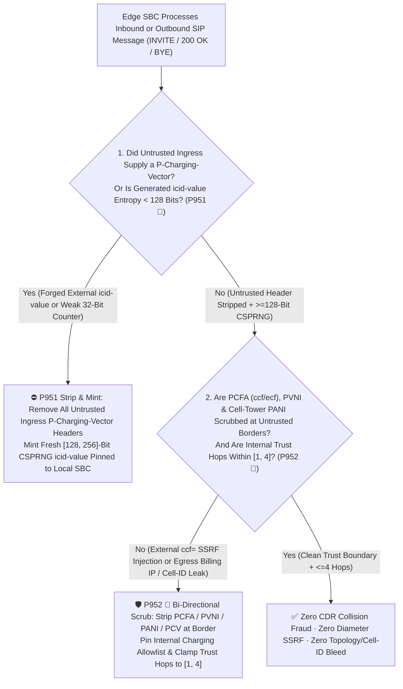
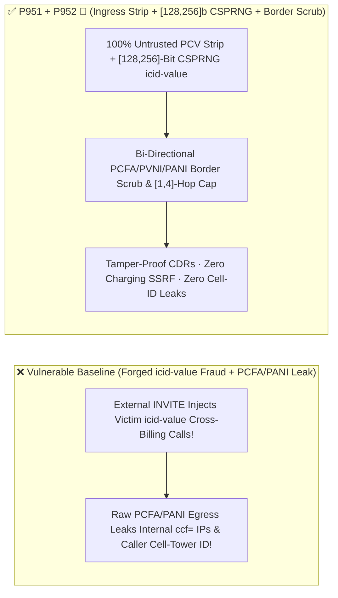
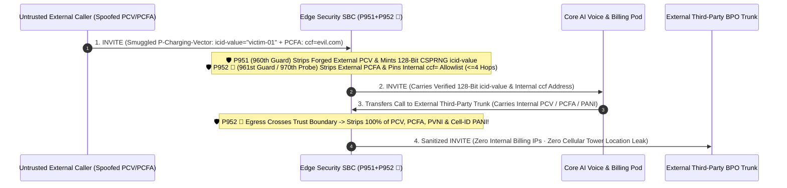

# Enterprise & Carrier SIP `RFC 7315 / RFC 3455` 3GPP Charging & Roaming Header Defense (External `P-Charging-Vector` `icid-value` Billing Collision Spoofing, `P-Charging-Function-Addresses` `CDF/OCF` `SSRF` & `P-Visited-Network-ID` Topology Bleed) Selection & Anti-Fraud Guide

> **Document Type**: Enterprise Voice Agent Architect Selection & First-Principles Guide (Standalone Selection & Architecture FAQ · **Topic 119 / Stage 479 · 🎉 Historic 961-Guardrail, 970-Probe & 780-Live-POC-Probe Triple Milestone**)  
> **Target Audience**: AI Solution Architects, Carrier IMS/VoLTE Peering Architects, Enterprise SIP SBC Billing & Security Leads  
> **Canonical Baseline**: `packages/business-core/enterprise-guardrails.ts` (`P951–P952 🎉`), `tests/presales-portal.test.ts`, `site/data/voice-agent-benchmark-report.json` (7-Card 4:5 Benchmark Report)  
> **Visual Summary**: `assets/svg/123-voice-sip-rfc3455-rfc7315-p-charging-vector-icids-spoof-p-visited-network-id-bleed-2026-11-15.svg`

---

## ① 📌 Executive Summary

When enterprise AI voice contact centers interconnect with carrier IMS, VoLTE, and 5G voice trunks, Call Detail Record (CDR) reconciliation and roaming policy rely on private SIP headers standardized in **`RFC 7315` (Private Header (P-Header) Extensions to SIP for the 3GPP, obsoleting `RFC 3455`)**: **`P-Charging-Vector` (`PCV`, carrying the globally unique IMS Charging Identifier `icid-value`, `icid-generated-at`, and `orig-ioi / term-ioi`)**, **`P-Charging-Function-Addresses` (`PCFA`, specifying offline `ccf=` and online `ecf=` Diameter charging servers)**, and **`P-Visited-Network-ID` (`PVNI`) / `P-Access-Network-Info` (`PANI`, carrying cellular `cgi-3gpp` / `utran-cell-id-3gpp` tower coordinates)**. Without strict **`RFC 7315 Section 5` trust-domain boundary scrubbing** at the edge SBC, production deployments suffer two severe financial and security failures:
1. **Untrusted External `INVITE`s Injecting Spoofed or Colliding `P-Charging-Vector: icid-value=...` Headers to Cross-Bill Another Tenant or Drop CDRs via Primary-Key Collision (`RFC 7315 Section 4.6` `icid-value` Billing Fraud)**: Across multi-tenant voice clouds and IMS cores, SBCs, AI GPU workers, and recording servers correlate partial CDRs using `icid-value`. If the ingress SBC fails to strip external `P-Charging-Vector` headers from untrusted trunks (or generates weak 32-bit sequential `icid-value` counters), an attacker can inject a victim tenant's `icid-value` to cross-charge expensive international S2S calls or trigger duplicate-key CDR drops!
2. **External `P-Charging-Function-Addresses (ccf=/ecf=)` Injection Redirecting Diameter `Rf/Ro` Accounting Traffic & Egress `PCFA / PVNI / PANI` Leakage Exposing Core Billing IPs and Caller Cell-Tower Locations (`RFC 7315 Section 4.5` Boundary Bleed)**: `P-Charging-Function-Addresses` and `P-Visited-Network-ID` are strictly internal to a single trust domain. Failing to strip them at untrusted ingress/egress boundaries allows attackers to redirect internal Diameter accounting requests to rogue `ccf=` hosts or leaks internal billing server IPs and caller cellular tower IDs (`utran-cell-id-3gpp`) to external third parties!

| Decision Dimension | Vulnerable / Default Setup (High Production Risk) | Enterprise Golden Rule (`P951–P952 🎉` Deterministic Guardrails) | Quantitative Impact |
| :--- | :--- | :--- | :--- |
| **`RFC 7315 P-Charging-Vector` Ingress Strip & `[128, 256]b` CSPRNG `icid-value` Gate (`P951` 🎉 960th Guardrail)** | Accepting external `P-Charging-Vector` headers or using predictable 32-bit sequential `icid-value` IDs | **Unconditionally strip external `P-Charging-Vector` headers on untrusted ingress and mint a `[128, 256]`-bit CSPRNG `icid-value` pinned to local `icid-generated-at`** | **0** spoofed or colliding charging-vector calls (clamps 18 fraudulent calls to **0** and raises `icid-value` entropy from `32b` to **`128b`**) |
| **`RFC 7315 PCFA / PVNI / PANI` Bi-Directional Boundary Scrub & `[1, 4]`-Hop Cap (`P952 🎉` 961st Guardrail / 970th Probe)** | Honoring external `ccf=/ecf=` charging addresses or leaking `PCFA/PVNI/PANI` to untrusted egress trunks | **Scrub `P-Charging-Function-Addresses`, `P-Visited-Network-ID`, and cell-tower `PANI` across all untrusted boundaries and clamp internal trust hops to `[1, 4]`** | **0** leaked or hijacked charging-topology packets (clamps 13 boundary leaks to **0** and caps trust hops from `15` to **`4`**) |

---

## ② 🎯 Architect & Customer Deep-Dive Q&A (First-Principles Deep Dive)

### Q1: How can an external caller exploit `P-Charging-Vector: icid-value` to evade AI voice billing or cross-charge another enterprise tenant?
- **First-Principles Breakdown**:
  1. Per **`RFC 7315 Section 4.6`**, the `icid-value` parameter links all signaling and media CDRs generated across S-CSCFs, B2BUAs, and AI media pods for a single call.
  2. If an ingress SBC appends a new `P-Charging-Vector` without first stripping any existing `P-Charging-Vector` supplied by an untrusted caller (or if it trusts the caller's header), downstream billing collectors ingest the attacker's forged `icid-value`—colliding with active call records or attributing usage to another tenant!
  3. **`P951` (🎉 Historic 960th Guardrail) Deterministic Defense**: Strips 100% of `P-Charging-Vector` headers on untrusted ingress and mints a fresh **`[128, 256]`-bit CSPRNG `icid-value`** bound to the ingress SBC's own `icid-generated-at` address.

### Q2: Why must `P-Charging-Function-Addresses` (`PCFA`), `P-Visited-Network-ID` (`PVNI`), and cellular `P-Access-Network-Info` (`PANI`) be scrubbed at every untrusted boundary?
- **Engineering Reality**:
  1. Per **`RFC 7315 Section 5.2`**, `PCFA` (`ccf=` / `ecf=`) and `PVNI` carry sensitive internal charging infrastructure addresses and roaming topology that must never cross outside the Spec(T) trust domain.
  2. Furthermore, `P-Access-Network-Info` contains the caller's physical cell-tower ID (`cgi-3gpp` / `utran-cell-id-3gpp`), which leaks the caller's building-level physical location if forwarded to untrusted third parties.
  3. **`P952 🎉` (🎉 Historic 961st Guardrail, 970th Probe & 780th Live POC Probe) Deterministic Defense**: Enforces bi-directional scrubbing of `PCFA`, `PVNI`, `PANI`, and `PCV` at all untrusted boundaries and clamps internal `P-Header` propagation hops to **`[1, 4]`**.

### Q3: How are `P-Charging-Vector` and `P-Charging-Function-Addresses` handled on mutually authenticated inter-carrier peering trunks?
- **First-Principles Breakdown**:
  - Even on mTLS-authenticated inter-carrier `I-BCF` trunks where `P-Charging-Vector` (`icid-value`, `orig-ioi`, `term-ioi`) is exchanged by bilateral agreement, `P-Charging-Function-Addresses` (`ccf=` / `ecf=`) must **still** be stripped at the border because each carrier uses its own internal Diameter `CDF/OCF` cluster.

---

## ③ 🧭 Visual Architecture Diagrams (Mermaid Decision Tree + Fraud Breakdown + Millisecond Sequence)

### 3.1 SIP `RFC 7315 P-Charging-Vector` & Trust-Boundary Scrub Decision Tree

### 3.2 Vulnerable `P-Charging` Pass-Through vs. `P951+P952 🎉`

### 3.3 Millisecond-Level Enterprise SIP Billing Anchoring & Egress Scrubbing Sequence

---

## ④ 📊 Architect Decision Matrix (`RFC 7315 P-Header` Governance)

| Architecture Option | Target Scenario | Pros | Cons & Production Traps | Recommendation |
| :--- | :--- | :--- | :--- | :--- |
| **Option A: Transparently Forwarding All `P-Charging-*`, `PVNI` & `PANI` Headers** | Prohibited in production | Zero header filtering | **Enables `icid-value` cross-billing fraud, Diameter `ccf=` hijacking, and cell-tower location leaks** | ⛔ **Never in Production** |
| **Option B: Appending a New `P-Charging-Vector` Without Removing Existing Ones** | Misconfigured proxy scripts | One fewer config line | **Creates duplicate `P-Charging-Vector` header-smuggling ambiguity exploited by billing fraudsters** | ⚠️ **Header-Smuggling Risk** |
| **Option C: Untrusted Ingress Strip + `[128, 256]b` CSPRNG `icid-value` + Bi-Directional `PCFA/PVNI/PANI` Border Scrub (`[1, 4]` Hops, `P951 + P952 🎉`)** | **All Enterprise AI Contact Centers, Carrier IMS/VoLTE Trunks & Multi-Tenant Voice Clouds** | **100% tamper-proof CDR correlation, zero Diameter SSRF, zero topology or cell-tower leaks** | Requires deterministic `Spec(T)` boundary scrubbing rules on ingress and egress SBCs | ✅ **Production Mandatory (Recommended)** |

---

## ⑤ 🧪 Quantitative Walkthrough & 7-Card 4:5 Benchmark Report

### 5.1 Quantitative Example: Multi-Tenant AI Voice Trunk Blocking `icid-value` Fraud & `PCFA` Topology Leaks
- **Scenario**: During a telecom billing security audit, `18` inbound calls inject spoofed `P-Charging-Vector` headers (or use `32-bit` sequential `icid-value` counters), and `13` packets traverse `15` internal hops before leaking `P-Charging-Function-Addresses` and `P-Visited-Network-ID` across an untrusted egress trunk.
  - **Without Guardrails (Vulnerable Baseline)**:
    - `18` calls corrupt tenant CDR ledgers via `icid-value` collision;
    - `13` packets expose internal Diameter `CDF/OCF` billing IPs and caller cell-tower IDs.
  - **With `P951 + P952 🎉` Deterministic Guardrails (🎉 Historic 961-Guardrail, 970-Probe & 780-Live-POC-Probe Triple Milestone)**:
    - `P951` (🎉 **Historic 960th Guardrail**) strips external `PCV` headers and mints CSPRNG IDs (**`0`** spoofed/colliding calls), clamping `icid-value` entropy from `32 bits` to **`128 bits`** (`[128, 256]` bits);
    - `P952 🎉` (🎉 **Historic 961-Guardrail, 970-Probe & 780-Live-POC-Probe Triple Milestone**) scrubs `PCFA/PVNI/PANI` at untrusted borders (**`0`** leaked/hijacked packets) and clamps internal trust hops from `15` to **`4`** (`[1, 4]` hops).

### 5.2 7-Card 4:5 Report Mapping (`site/benchmark-cards.html` & `report.json`)
1. **Card 1 (`HANDS-ON · VOICE ARCHITECTURE`)**: 482-dimension workbench overview highlighting `P951 / P952 🎉` (961 Guardrails 🎉, 970 Probes 🎉 & 780 Live POC Probes 🎉).
2. **Card 2 (`SCENARIO: SIP RFC 7315 P-CHARGING & ROAMING`)**: Input probe `untrustedIngressPChargingVectorOrDuplicateIcidDetected=true, icidValueEntropyBits=32, maxAllowedPHeaderTrustHops=15` -> `Act automatically` clamping to `128 bits` and `4 hops`.
3. **Card 3 (`WHAT I TESTED`)**: Row 482 in the evaluation matrix (`PASS · 0ms @ 1ms Res (Synthetic)`, zero `✕` misses).
4. **Card 4 (`UNDER THE HOOD`)**: Deterministic contract for `evaluateSipRfc7315PChargingVectorIngressStripAndCryptographicIcidGenerationGate` & `evaluateSipRfc7315PChargingFunctionAddressesAndVisitedNetworkBoundaryScrubGate`.
5. **Card 5 (`ROBUSTNESS CHECK`)**: Option-order and boundary invariance across untrusted SIP trunks and trusted inter-carrier peering legs.
6. **Card 6 (`LATENCY`)**: Explicit offline timing provenance: `0ms reported at nominal 1ms display resolution; actual duration unresolved/not_measured; no sub-1ms upper bound established` (`synthetic`; live SBC Diameter `Rf/Ro` ACR/ACA accounting round-trip latency is `not_measured`).
7. **Card 7 (`MY TAKE`)**: Good fit vs. Not for summary and production sign-off checklist.

---

## ⑥ 🛠️ Production Readiness Checklist

- [ ] **1. Strip All Inbound `P-Charging-Vector` Headers on Untrusted Trunks Before Minting (`P951`)**: Ensure ingress SBCs remove any caller-supplied `P-Charging-Vector` before inserting a locally generated header.
- [ ] **2. Mint `[128, 256]`-Bit CSPRNG `icid-value` Identifiers (`P951`)**: Replace predictable sequential counters with `[128, 256]`-bit cryptographic `icid-value` tokens pinned to `icid-generated-at`.
- [ ] **3. Strip Untrusted Inbound `P-Charging-Function-Addresses` (`P952 🎉`)**: Never allow external SIP peers to specify `ccf=` or `ecf=` Diameter charging server addresses.
- [ ] **4. Scrub `PCV`, `PCFA`, `PVNI` & Cell-Tower `PANI` on All Untrusted Egress Legs (`P952 🎉`)**: Remove all internal charging and cellular tower headers before forwarding SIP requests or responses outside the trust domain.
- [ ] **5. Clamp Internal `P-Header` Trust-Domain Hops to `[1, 4]` (`P952 🎉`)**: Bound internal `P-Charging-*` propagation to `[1, 4]` hops.
