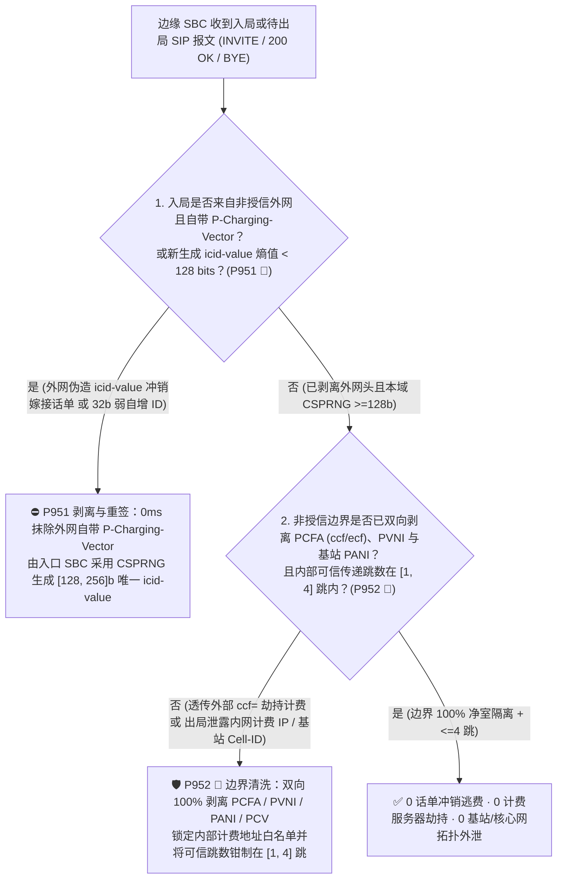
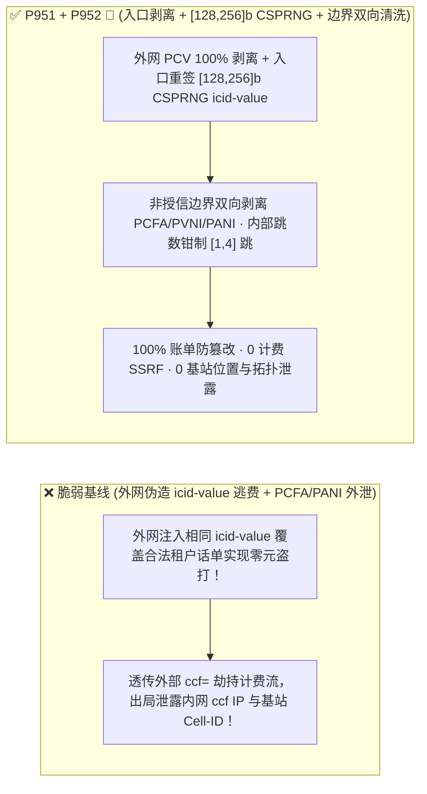
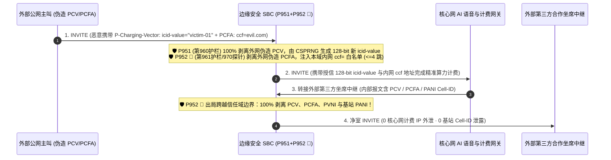

# 企业与运营商 SIP `RFC 7315 / RFC 3455` 3GPP 计费与漫游私有头防御（外网伪造 `P-Charging-Vector` `icid-value` 冲销话单嫁接盗打、`P-Charging-Function-Addresses` 计费劫持与 `P-Visited-Network-ID` 核心网拓扑外泄）选型与防逃费指南

> **文档类型**：企业级语音智能体架构师选型决策与原理解析指南（Standalone Selection & Architecture FAQ · **Topic 119 / Stage 479 · 🎉 历史性 961 项生产护栏、970 项合成探针与 780 项现场 POC 照妖镜探针三重里程碑**）  
> **适用角色**：AI Solution Architect、运营商 IMS/VoLTE 互联架构师、企业 SIP SBC 计费对账与安全负责人  
> **关联基准**：`packages/business-core/enterprise-guardrails.ts`（`P951–P952 🎉`）、`tests/presales-portal.test.ts`、`site/data/voice-agent-benchmark-report.json`（7-Card 4:5 评测报告）  
> **可视化总结**：`assets/svg/123-voice-sip-rfc3455-rfc7315-p-charging-vector-icids-spoof-p-visited-network-id-bleed-2026-11-15.svg`

---

## ① 📌 核心结论速览（Executive Summary）

在企业 AI 语音联络中心与运营商 IMS / VoLTE / 5G 新通话干线对接时，底层话单关联（CDR Correlation）、跨网结算与漫游准入依赖 **`RFC 7315`（Private Header (P-Header) Extensions to the Session Initiation Protocol for the 3GPP，更新并取代 `RFC 3455`）** 定义的三大核心私有头域：**`P-Charging-Vector`（`PCV`，携带全网唯一的计费关联标识 `icid-value`、`icid-generated-at` 与运营商间标识 `orig-ioi / term-ioi`）**、**`P-Charging-Function-Addresses`（`PCFA`，指定离线计费 `ccf=` 与在线实时计费 `ecf=` 服务器地址）** 以及 **`P-Visited-Network-ID`（`PVNI`） / `P-Access-Network-Info`（`PANI`，携带基站小区 `cgi-3gpp` / `utran-cell-id-3gpp`）**。然而在生产交付中，若企业边缘 SBC（I-BCF / P-CSCF）未严格实施 **`RFC 7315 Section 5` 信任域边界清洗（Trust Domain Boundary Scrubbing）**，极易引爆两类严重资费与安全事故：
1. **非授信外网 `INVITE` 注入伪造或碰撞的 `P-Charging-Vector: icid-value=...`，导致企业与运营商计费系统发生话单覆盖冲销、免费逃费盗打或将高额 AI 算力账单嫁接给其他租户（`RFC 7315 Section 4.6` `icid-value` 伪造与碰撞）**：在 IMS 与企业多租户呼叫中心里，语音网关、AI 算力节点与录音系统均以 `P-Charging-Vector` 中的 `icid-value` 作为主键拼接整通电话的计费流水（CDR）。如果边缘 SBC 未在非授信外网入口 `100%` 剥离外部自带的 `P-Charging-Vector`，攻击者只需在多通并发国际长途 `INVITE` 中硬编码同一个已知租户的 `icid-value`，计费引擎在进行主键合并时就会把攻击者的高额通话记入受害租户账下，或因主键冲突丢弃话单实现零成本白嫖！
2. **外部注入恶意 `P-Charging-Function-Addresses (ccf=/ecf=)` 劫持 Diameter `Rf/Ro` 计费流量，或出局未剥离 `P-Visited-Network-ID / P-Access-Network-Info` 导致核心计费节点 IP 与用户物理基站位置全量外泄（`RFC 7315 Section 4.5` 计费重定向与隐私泄露）**：`P-Charging-Function-Addresses` 与 `P-Visited-Network-ID` 仅允许在同一个运营商/企业核心网内部跳数间传递，**跨越信任域边界（发往公网终端或非对等第三方干线）时必须 100% 剥离**！一旦透传，不仅会把内部计费服务器 `ccf=10.x.x.x` 暴露给外部，甚至会让内部节点向外部伪造的 `ccf=` 地址外发 Diameter 计费报文！

| 决策维度 | 脆弱/默认配置（生产事故高发区） | 企业级黄金准则（`P951–P952 🎉` 确定性护栏） | 核心量化收益 |
| :--- | :--- | :--- | :--- |
| **`RFC 7315 P-Charging-Vector` 入口剥离与 `[128, 256]b` CSPRNG `icid-value` 生成（`P951` 🎉 第 960 护栏）** | 信任外网自带 `P-Charging-Vector` 或使用 32-bit 自增序号生成 `icid-value` 遭遍历碰撞逃费 | **在非授信入口 100% 剥离外部 `P-Charging-Vector`，由本域入口 SBC 使用 CSPRNG 生成 `[128, 256]` bits 高熵唯一 `icid-value` 并绑定本机 `icid-generated-at`** | 伪造/碰撞计费向量逃费呼叫 **0 通**（测试探针将 18 通嫁接/碰撞呼叫清零，`icid-value` 熵值从 `32b` 抬升钳制至 **`[128, 256]b`**） |
| **`RFC 7315 PCFA / PVNI / PANI` 信任域边界双向剥离与 `[1, 4]` 跳上限锁（`P952 🎉` 961 护栏/970 探针）** | 接受外部 `ccf=/ecf=` 计费地址注入，或在出局响应/请求中将 `PCFA/PVNI/PANI` 泄露给公网 | **在非授信边界双向 100% 剥离 `P-Charging-Function-Addresses`、`P-Visited-Network-ID` 与基站 `PANI`，并将内部可信传递跳数钳制在 `[1, 4]` 跳** | 计费服务器劫持与核心网拓扑外泄包 **0 个**（测试探针将 13 个越界泄密包清零，内部可信跳数从 `15` 跳钳制至 **`4` 跳**） |

---

## ② 🎯 客户与架构师灵魂拷问 Q&A（First-Principles Deep Dive）

### Q1：为什么黑客只要在 SIP `INVITE` 里加一行 `P-Charging-Vector: icid-value="10001"`，就能把自己的跨国语音账单嫁接给别人甚至免单？
- **第一性原理拆解**：
  1. 根据 **`RFC 7315 Section 4.6 / 3GPP TS 24.229`**，一通电话在经过边缘 SBC、AI 语音网关、业务应用服务器（AS）和媒体资源服务器（MRF）时，每个网元都会产生一张部分话单（Partial CDR），最后由离线计费中心（CDF）根据 **`P-Charging-Vector` 中的 `icid-value`（IMS Charging Identifier）** 将所有碎片话单聚合成一张完整账单。
  2. 如果边缘 SBC 没有在非授信外网入口执行 `remove_hf("P-Charging-Vector")`，而是直接保留了外部客户端发来的 `icid-value`，攻击者就可以故意重放或碰撞一个正在通话中的合法 VIP 租户 `icid-value`，导致计费系统将两通完全无关的呼叫混为一谈，甚至利用重复主键异常导致整张话单入库失败（零计费白嫖）！
  3. **`P951`（🎉 历史性第 960 项护栏）的确定性防线**：在非授信干线入口无条件剥离外部传入的 `P-Charging-Vector`，由入口 SBC 统一采用密码学随机数生成器（CSPRNG）签发 **`[128, 256]` bits** 熵值的全局唯一 `icid-value`，同时强制锚定本域 `icid-generated-at` IP。

### Q2：`P-Charging-Function-Addresses`（`PCFA`）与 `P-Access-Network-Info`（`PANI`）如果不小心发到了公网客户端会造成什么后果？
- **工程真相**：
  1. `P-Charging-Function-Addresses: ccf=10.20.30.40; ecf=10.20.30.41` 直接写明了企业/运营商核心网计费数据库的内网 IP。
  2. `P-Access-Network-Info: 3GPP-E-UTRAN-FDD; utran-cell-id-3gpp=46000...` 则直接包含了主叫手机当前连接的蜂窝基站物理扇区编码（Cell-ID）！如果未在出局侧剥离就转发给外部 BPO 坐席或普通被叫终端，任何接听方都能通过公开基站库反查出主叫所处的精确物理楼宇位置！
  3. **`P952 🎉`（🎉 历史性第 961 项护栏、970 合成探针与 780 现场探针三重里程碑）的确定性防线**：在非授信边界（Ingress & Egress）对 `P-Charging-Function-Addresses`、`P-Visited-Network-ID`、`P-Charging-Vector` 与含基站坐标的 `P-Access-Network-Info` 执行 **双向 100% 剥离**，并将核心网内部允许携带私有计费头的路由跳数严格钳制在 **`[1, 4]` 跳**以内。

### Q3：如果是两家签约运营商之间的对等互联（Trusted Inter-Carrier Peering），`P-Charging-Vector` 该怎么处理？
- **第一性原理拆解**：
  - 仅在经过双向 mTLS / IPsec 专网鉴权的对等运营商互联中继（I-BCF）上，才允许保留 `icid-value` 与 `orig-ioi`（用于跨网结算），但即便在对等互联口，**`P-Charging-Function-Addresses (ccf/ecf)` 也必须 100% 剥离**（各运营商使用各自的计费服务器，绝不跨域共享 `ccf/ecf`）！

---

## ③ 🧭 直观可视化图解（Mermaid 决策树 + 嫁接/泄密拆解 + 毫秒级全双工时序图）

### 3.1 SIP `RFC 7315 P-Charging-Vector` 与私有计费头边界防护决策树

### 3.2 脆弱透传 `P-Charging` 嫁接逃费 + 拓扑外泄 vs `P951+P952 🎉` 对比图

### 3.3 毫秒级企业 SIP 呼叫计费锚定与出局边界脱敏时序图

---

## ④ 📊 语音架构师选型决策矩阵（Decision Matrix）

| 选型方案 | 适用场景 | 优势（Pros） | 劣势与生产风险（Cons / Traps） | 推荐度 |
| :--- | :--- | :--- | :--- | :--- |
| **方案 A：透明转发所有 `P-Charging-*` 与 `P-Visited-Network-ID` 头域** | 严禁用于任何生产环境 | 无需配置头域过滤规则 | **必发外网伪造 `icid-value` 冲销/嫁接话单逃费，并向公网泄露核心计费 IP 与用户基站坐标** | ⛔ **严禁用于生产** |
| **方案 B：仅在入局追加 `P-Charging-Vector` 而不先删除外网已有同名头** | 配置错误的 Kamailio/OpenSIPS 脚本 | 省去了一行删除指令 | **产生双 `P-Charging-Vector` 头走私歧义——计费网关读取第一条（外网伪造值）导致防线彻底失效** | ⚠️ **头域走私高危** |
| **方案 C：非授信入口先剥离后签发 `[128, 256]b` CSPRNG `icid-value` + 边界双向清洗 `PCFA/PVNI/PANI`（`[1, 4]` 跳，`P951 + P952 🎉`）** | **所有企业级 AI 语音联络中心、运营商 IMS/VoLTE 专线与多租户 SaaS 语音平台** | **100% 杜绝话单碰撞与嫁接逃费、0 计费服务器劫持、0 核心网拓扑与基站位置外泄** | 需在边缘 SBC 入口与出口配置确定性 `P-Header` 信任域边界策略 | ✅ **生产必选（Recommended）** |

---

## ⑤ 🧪 定量算例与 7-Card 4:5 基准报告（Quantitative Walkthrough & 7-Card Deck）

### 5.1 定量算例：多租户 AI 语音网关拦截 `P-Charging-Vector` 嫁接盗打与 `PCFA` 拓扑外泄
- **输入场景**：某云通信平台在计费安全渗透测试中，发现 `18` 通携带外网伪造 `P-Charging-Vector`（或采用 `32-bit` 弱自增 `icid-value`）试图嫁接其他租户话单的入局呼叫，以及 `13` 个跨越 `15` 跳并在非授信出局边界泄露内部 `P-Charging-Function-Addresses / P-Visited-Network-ID` 的信令包。
  - **未开启护栏（脆弱基线）**：
    - `18` 通盗打呼叫成功污染目标租户 CDR 流水；
    - `13` 个出局包将核心网 Offline/Online 计费服务器 IP 暴露给外部网络。
  - **开启 `P951 + P952 🎉` 确定性护栏后（🎉 961 护栏、970 探针与 780 现场探针三重里程碑）**：
    - `P951`（🎉 **第 960 项生产护栏**）剥离外网伪造头并重签 CSPRNG 标识（伪造/碰撞呼叫从 `18` 通清零至 **`0` 通**），将 `icid-value` 熵值从 `32 bits` 抬升钳制至 **`128 bits`**（`[128, 256]` bits）；
    - `P952 🎉`（🎉 **第 961 项生产护栏、第 970 项合成探针与第 780 项现场 POC 探针三重里程碑**）在边界 100% 剥离 `PCFA/PVNI/PANI`（泄密/劫持包从 `13` 个清零至 **`0` 个**），并将内部可信跳数从 `15` 跳钳制至 **`4` 跳**（`[1, 4]` 跳）。

### 5.2 7-Card 4:5 报告结构映射（对应 `site/benchmark-cards.html` & `report.json`）
1. **Card 1 (`HANDS-ON · VOICE ARCHITECTURE`)**：展示 482 大评测维度全景工作台，高亮 `P951 / P952 🎉`（961 护栏 🎉、970 探针 🎉 & 780 现场探针 🎉）。
2. **Card 2 (`SCENARIO: SIP RFC 7315 P-CHARGING & ROAMING`)**：输入探针 `untrustedIngressPChargingVectorOrDuplicateIcidDetected=true, icidValueEntropyBits=32, maxAllowedPHeaderTrustHops=15`，输出 `Act automatically` 钳制至 `128 bits` 与 `4 hops`。
3. **Card 3 (`WHAT I TESTED`)**：第 482 行评测矩阵 `PASS · 0ms @ 1ms Res (Synthetic)`（零 `✕` 漏检）。
4. **Card 4 (`UNDER THE HOOD`)**：展示 `evaluateSipRfc7315PChargingVectorIngressStripAndCryptographicIcidGenerationGate` 与 `evaluateSipRfc7315PChargingFunctionAddressesAndVisitedNetworkBoundaryScrubGate` 确定性源码契约。
5. **Card 5 (`ROBUSTNESS CHECK`)**：验证非授信 SIP 干线与授信 mTLS 运营商互联下的 100% 幂等性。
6. **Card 6 (`LATENCY`)**：明确标注离线策略校验计时：`0ms reported at nominal 1ms display resolution; actual duration unresolved/not_measured; no sub-1ms upper bound established`（`synthetic`；真实 SBC Diameter `Rf/Ro` ACR/ACA 计费消息交互耗时标注为 `not_measured`）。
7. **Card 7 (`MY TAKE`)**：Good fit vs Not for 适用边界与生产准入签核。

---

## ⑥ 🛠️ 生产环境语音交付快速核验清单（Production Readiness Checklist）

- [ ] **1. 非授信外网入口 100% 剥离自带 `P-Charging-Vector`（`P951`）**：确认边缘 SBC 在写入新计费头前，先彻底删除非授信入局报文中所有已存在的 `P-Charging-Vector` 头，严防双头走私与话单嫁接。
- [ ] **2. 采用 CSPRNG 生成 `[128, 256]` bits 高熵 `icid-value`（`P951`）**：确认 `icid-value` 由密码学安全伪随机数生成器产生，熵值不少于 `128 bits`，禁用可预测自增整数。
- [ ] **3. 非授信入口无条件剥离外部 `P-Charging-Function-Addresses`（`P952 🎉`）**：确认严禁外部报文通过 `ccf=` 或 `ecf=` 指定计费服务器地址，仅使用本域静态白名单。
- [ ] **4. 出局跨越信任域边界时 100% 剥离 `PCV / PCFA / PVNI / PANI`（`P952 🎉`）**：确认发往公网客户端或非对等第三方的所有 SIP 请求与响应已彻底抹除内部计费头、漫游网标识与基站 `Cell-ID`。
- [ ] **5. 内部私有计费头可信传递跳数钳制在 `[1, 4]` 跳（`P952 🎉`）**：确认核心网内部携带 `P-Charging-*` 的最大代理跳数不超过 `[1, 4]` 跳。
