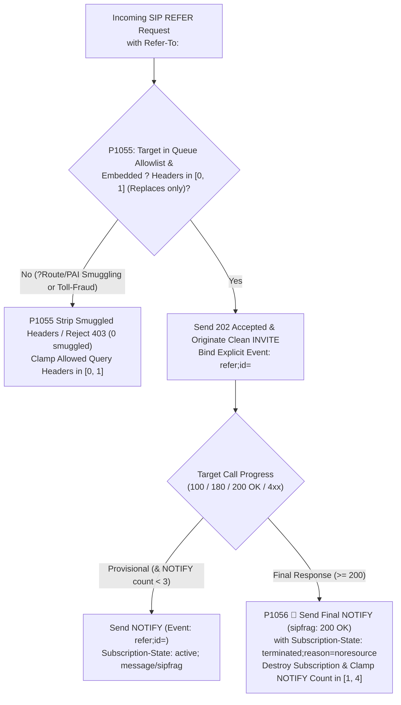
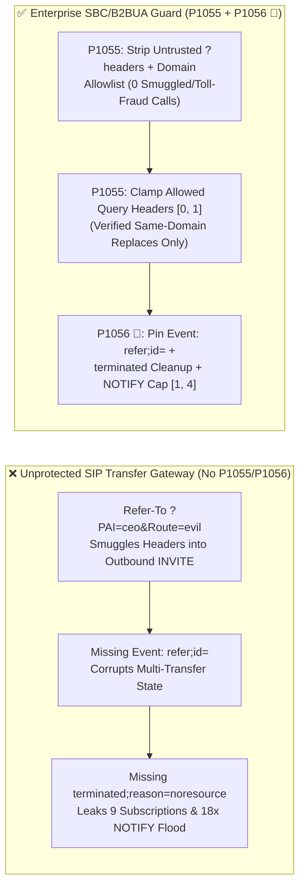

# Enterprise SIP `RFC 3515` Call Transfer (`REFER` Method) `Refer-To` URI Embedded Header Smuggling (`?Route=&PAI=`), Toll-Fraud Dial-Out & `Event: refer;id=` `message/sipfrag` Subscription Leak Selection & Engineering Guide (Stage 531 · Topic 171 · 🎉 Historic 175th Architecture SVG & 1,065th Enterprise Guardrail Dual Milestone!)

> **Document Type**: Enterprise Voice Architect "First-Principles + Selection Decision" Single-Topic FAQ (aligned with `ib-vs-ethernet-roce-selection-faq.md`)
> **Baseline**: `Stage 531` · `Topic 171` · Deterministic Guardrails `P1055–P1056 🎉` · 1,065 Guardrails 🎉 · 1,074 Sandbox Probes · 884 Live POC Trap Probes · 534 Evaluation Dimensions · **🎉 Historic 175th Architecture SVG & 1,065th Enterprise Guardrail Dual Milestone!**
> **Bilingual Edition**: [中文版 (`voice-sip-rfc3515-refer-to-uri-header-injection-smuggling-event-refer-id-notify-sipfrag-leak.md`)](./voice-sip-rfc3515-refer-to-uri-header-injection-smuggling-event-refer-id-notify-sipfrag-leak-faq.md)


---

## ① 📌 Executive Summary

In enterprise AI contact centers transferring callers from an AI Voice Agent to human agent queues via **`RFC 3515` (`REFER`)**, the transferee acts on a `Refer-To` URI to originate a new `INVITE` and reports progress via `NOTIFY (Event: refer, Content-Type: message/sipfrag)`. Two critical vulnerabilities threaten production `RFC 3515` deployments:
1. **`Refer-To` URI Embedded `?header=value` Smuggling & Toll-Fraud SSRF (`RFC 3515 §2.1 / §5.1`)**: Because SIP URIs allow embedded headers after `?` (`Refer-To: <sip:+882999@pstn?P-Asserted-Identity=ceo&Route=evil>`), an unguarded B2BUA that blindly expands `Refer-To` into an outbound `INVITE` allows attackers to smuggle arbitrary `Route`, `P-Asserted-Identity`, or `Authorization` headers and dial international toll-fraud numbers using the enterprise's trunk credentials!
2. **Missing `Event: refer;id=<CSeq>` Correlation on Multiple `REFER`s & Unterminated `message/sipfrag` Subscription Leaks (`RFC 3515 §2.4.6 / §2.4.7`)**: Issuing a second `REFER` in a dialog without `Event: refer;id=<CSeq>` desynchronizes transfer state, while omitting `Subscription-State: terminated;reason=noresource` on the final `>= 200` `message/sipfrag` leaks implicit subscriptions indefinitely.

**Architect Selection Rules**:
- **Guardrail `P1055` (`RFC 3515` `Refer-To` Embedded Header Stripping, Target Allowlist & `[0, 1]` Query Header Cap)**: Strips all untrusted `?header=value` parameters from `Refer-To` URIs, enforces target domain/prefix allowlists (`0` smuggled header or toll-fraud `REFER` requests), and clamps allowed embedded `Refer-To` query headers to **`[0, 1]`** (permitting only a verified same-domain `Replaces`).
- **Guardrail `P1056 🎉` (🎉 Historic 1,065th Enterprise Guardrail & 175th SVG Dual Milestone · `Event: refer;id=<CSeq>` Pinning, Terminal `terminated;reason=noresource` Cleanup & `[1, 4]` `NOTIFY` Cap)**: Enforces `Event: refer;id=<CSeq>` correlation, terminates the implicit subscription immediately upon final `>= 200` `message/sipfrag` (`0` leaked `refer` subscriptions), and clamps `message/sipfrag` `NOTIFY` messages per `REFER` in **`[1, 4]`**.

---

## ② 🎯 Architect & Customer Deep-Dive Q&A (Q1 / Q2 / Q3)

### Q1: How can an external caller use a `REFER` request to forge `P-Asserted-Identity` or hijack routing on our internal outbound `INVITE`?
- **Plain-Language Principle**: Under `RFC 3261 §19.1.5` and `RFC 3515 §2.1`, query parameters after `?` in a `Refer-To` URI are copied as **top-level SIP headers** into the newly generated `INVITE`!
- **Security Fix (`P1055`)**: Never blindly expand `?` headers from `Refer-To`. Strip `Route`, `Record-Route`, `P-Asserted-Identity`, `Authorization`, and `Privacy`, allowing at most **`[0, 1]`** validated `Replaces` header for attended transfers within the enterprise domain allowlist.

### Q2: Why does `RFC 3515 §2.4.6` require `Event: refer;id=<CSeq>` when a second transfer is attempted?
- **Protocol Reality**: If a transfer to Queue A fails (`486 Busy`) and the AI Agent or caller issues a second `REFER (CSeq: 206 REFER)` to Queue B, both implicit subscriptions coexist briefly. Pinning `Event: refer;id=206` (`P1056 🎉`) prevents `NOTIFY` responses from Queue A from cancelling Queue B.

### Q3: How do we prevent `REFER` implicit subscriptions from leaking memory?
- **Architectural Rule (`P1056 🎉`)**: The `NOTIFY` carrying the final `message/sipfrag` (`>= 200`) MUST include `Subscription-State: terminated;reason=noresource` (`RFC 3515 §2.4.7`), and total `NOTIFY` updates per transfer are capped in **`[1, 4]`**.

---

## ③ 🧭 Visual Architecture Diagrams (Mermaid Decision Tree + Comparison + Sequence Diagram)

### 3.1 `RFC 3515` `REFER` Sanitization & Subscription Lifecycle Decision Tree (`flowchart TD`)



### 3.2 Unprotected `REFER` Handling vs. `P1055 + P1056 🎉` Guardrails (`flowchart LR`)



### 3.3 Full-Duplex `REFER` Sanitization & `terminated` `sipfrag` Sequence (`sequenceDiagram`)

```mermaid
sequenceDiagram
    autonumber
    participant Caller as Remote Endpoint / Peer Trunk
    participant Edge as AI Voice B2BUA Guard (P1055 / P1056 🎉)
    participant Queue as Enterprise Human Agent Queue

    Caller->>Edge: 1. REFER (CSeq: 205 REFER, Refer-To: <sip:skillA@cc.corp?Route=%3Csip:evil%3E&PAI=admin> ❌)
    Note over Edge: P1055 Sanitize: Strip smuggled ?Route & ?PAI headers (clamp query headers <= 1)<br/>Verify skillA@cc.corp matches internal queue allowlist
    Edge-->>Caller: 2. 202 Accepted
    Edge->>Queue: 3. Clean INVITE sip:skillA@cc.corp (0 Smuggled Headers)
    Edge->>Caller: 4. NOTIFY (Event: refer;id=205, Subscription-State: active, sipfrag: "SIP/2.0 100 Trying")
    Caller-->>Edge: 5. 200 OK (NOTIFY)
    Queue-->>Edge: 6. 200 OK (INVITE) -> Human Agent Connected!
    Note over Edge: P1056 🎉 Terminal Cleanup: Emit final sipfrag ("SIP/2.0 200 OK")<br/>with Subscription-State: terminated;reason=noresource (NOTIFY=2 in [1, 4])
    Edge->>Caller: 7. NOTIFY (Event: refer;id=205, Subscription-State: terminated;reason=noresource, "SIP/2.0 200 OK")
    Caller-->>Edge: 8. 200 OK (NOTIFY) -> 0 Leaked Subscriptions
```

---

## ④ 📊 Architect Decision Matrix

| Dimension | Option A: Disable `REFER` | Option B: Permissive `RFC 3515` (No `P1055/P1056`) | Option C: `RFC 3515` + `P1055/P1056 🎉` Guardrails (Recommended ✅) |
| :--- | :--- | :--- | :--- |
| **`Refer-To ?header=` Smuggling & Toll-Fraud** | Hairpinned media | ❌ Vulnerable to `?Route/&PAI` injection & toll fraud | ✅ **`P1055` strips smuggled headers & clamps query headers in `[0, 1]` (`0` smuggled)** |
| **Multi-`REFER` Correlation (`;id=`)** | N/A | ❌ Missing `;id=` corrupts retry transfers | ✅ **`P1056 🎉` enforces `Event: refer;id=<CSeq>`** |
| **Subscription Cleanup & `NOTIFY` Pacing** | N/A | ❌ Leaked subscriptions & `18x` `NOTIFY` floods | ✅ **`P1056 🎉` enforces `terminated;reason=noresource` & `[1, 4]` `NOTIFY` cap** |
| **Policy Check Latency (Offline `synthetic`)** | N/A | N/A | **`0ms` (`nominal 1ms` resolution; see disclosure below)** |

---

## ⑤ 🧪 Quantitative Example & 7-Card Report (CSP Self-Contained, Zero Fabricated Coordinates)

### 5.1 Deterministic Guardrail Walkthrough (`P1055` & `P1056 🎉`)

1. **`P1055` (`evaluateSipRfc3515ReferToUriEmbeddedHeaderSanitizationAndDomainAllowlistGuard` · 1,064th Guardrail)**:
   - **Violating Input (Sandbox Probe `p1055_sip_rfc3515_refer_to_uri_embedded_header_sanitization_and_domain_allowlist`)**:
     - `smuggledReferToEmbeddedHeaderOrUntrustedTargetDetected = true`
     - `smuggledHeaderOrTollFraudReferRequests = 13`
     - `allowedEmbeddedReferToQueryHeadersCount = 6`
   - **Deterministic Output**:
     - `violated = true`
     - `action = "sanitize_refer_to_embedded_headers_and_enforce_target_allowlist"`
     - `clampedSmuggledHeaderOrTollFraudReferRequests = 0`
     - `clampedAllowedEmbeddedReferToQueryHeadersCount = 1` (clamped to **`[0, 1]`**)
     - **Timing Disclosure**: `0ms reported at nominal 1ms display resolution; actual duration unresolved/not_measured; no sub-1ms upper bound established` (offline in-memory `synthetic` policy check; live SBC URI parser and route-table lookup latency is `not_measured`).

2. **`P1056 🎉` (`evaluateSipRfc3515EventReferIdCorrelationAndTerminalSipfragCleanupGuard` · 🎉 Historic 1,065th Enterprise Guardrail & 175th SVG Dual Milestone · 1,074th Sandbox Probe / 884th Live POC Probe)**:
   - **Violating Input (Sandbox Probe `p1056_sip_rfc3515_event_refer_id_correlation_and_terminal_sipfrag_cleanup`)**:
     - `missingEventReferIdOrUnterminatedSipfragSubscriptionDetected = true`
     - `leakedReferSubscriptionsOrMismatchedIdCount = 9`
     - `sipfragNotifyMessagesPerReferCount = 18`
   - **Deterministic Output**:
     - `violated = true`
     - `action = "bind_event_refer_id_and_terminate_final_sipfrag_subscription"`
     - `clampedLeakedReferSubscriptionsOrMismatchedIdCount = 0`
     - `clampedSipfragNotifyMessagesPerReferCount = 4` (clamped to **`[1, 4]`**)
     - **Timing Disclosure**: `0ms reported at nominal 1ms display resolution; actual duration unresolved/not_measured; no sub-1ms upper bound established`.

---

## ⑥ 🛠️ Production Voice Delivery Verification Checklist

- [ ] **1. `Refer-To` `?header=` Smuggling Sanitization (`P1055`)**: Verify any `?Route=`, `?P-Asserted-Identity=`, or `?Authorization=` query headers in `Refer-To` are stripped (`[0, 1]` verified `Replaces` only).
- [ ] **2. Transfer Target Domain Allowlist (`P1055`)**: Confirm external `REFER` requests targeting off-net or premium PSTN prefixes are rejected with `403 Forbidden`.
- [ ] **3. `Event: refer;id=<CSeq>` Correlation (`P1056 🎉`)**: Confirm `NOTIFY` messages include `;id=<CSeq>` whenever multiple `REFER` transactions occur in a dialog.
- [ ] **4. Terminal `terminated;reason=noresource` & `[1, 4]` `NOTIFY` Cap (`P1056 🎉`)**: Verify the final `>= 200` `message/sipfrag` `NOTIFY` sets `Subscription-State: terminated;reason=noresource` and caps `NOTIFY` count in `[1, 4]`.
