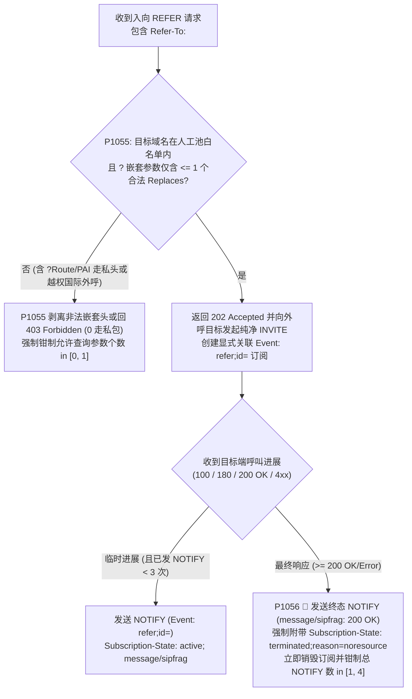
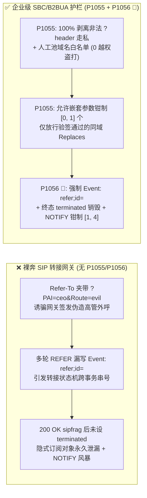

# 企业 SIP `RFC 3515` 呼叫转接（`REFER` 方法）`Refer-To` URI 嵌套头走私（`?Route=&PAI=`）、越权国际盗打与 `Event: refer;id=` `message/sipfrag` 订阅泄漏选型与工程指南（Stage 531 · Topic 171 · 🎉 历史性第 175 张架构 SVG 图谱与第 1,065 道企业级护栏双重里程碑！）

> **文档类型**：企业语音架构师“第一性原理 + 选型决策”单专题 FAQ（对标 `ib-vs-ethernet-roce-selection-faq.md` 通俗透彻规范）
> **关联基准**：`Stage 531` · `Topic 171` · 确定性护栏 `P1055–P1056 🎉` · 1,065 道企业护栏 🎉 · 1,074 个沙盒探针 · 884 个现场 POC 探针 · 534 大评测维度 · **🎉 历史性第 175 张架构 SVG 图谱与第 1,065 道企业级护栏双重里程碑！**
> **双语版本**：[English Version (`voice-sip-rfc3515-refer-to-uri-header-injection-smuggling-event-refer-id-notify-sipfrag-leak-faq.en.md`)](./voice-sip-rfc3515-refer-to-uri-header-injection-smuggling-event-refer-id-notify-sipfrag-leak-faq.en.md)


---

## ① 📌 核心结论速览（Executive Summary）

在企业级 AI 语音客服（AI 接待后执行盲转 Blind Transfer 或咨询转接 Attended Transfer 至人工技能组）中，**`RFC 3515`（The SIP Refer Method，`REFER`）** 是最核心的呼叫转接原语：一方发送 `REFER (Refer-To: <sip:target>)` 指示被转接方主动向 `target` 发起新的 `INVITE`，并通过 `NOTIFY (Event: refer, Content-Type: message/sipfrag)` 实时汇报转接进度。然而在生产落地中，`RFC 3515` 存在两个极易被攻击者利用或引发内存泄漏的高危漏洞：
1. **`Refer-To` URI 问号参数嵌套 SIP 头走私（`?Route=...&P-Asserted-Identity=...`）与越权盗打 SSRF（`RFC 3515 §2.1 / §5.1`）**：根据 `RFC 3261 §19.1.5` 与 `RFC 3515 §2.1`，`Refer-To` 的 SIP URI 支持在 `?` 后附带任意头部（如 `Refer-To: <sip:+882999@carrier?P-Asserted-Identity=%3Csip:admin@bank%3E&Route=%3Csip:attacker.com%3E>`）！如果 AI 语音 B2BUA 收到外部发来的 `REFER` 后不加清洗地将 `?` 后的参数解包塞进外呼 `INVITE`，攻击者不仅能伪造高管主叫身份（PAI 走私）、劫持信令路由（Route 注入），还能利用企业 AI 网关的公网中继权限盗打高额国际卫星电话！
2. **多轮转接缺失 `Event: refer;id=<CSeq>` 串号与 `message/sipfrag` 终态未回 `terminated` 导致订阅泄漏（`RFC 3515 §2.4.6`）**：同一对话内发生第 2 次转接时，若 `NOTIFY` 漏写 `;id=<CSeq>` 参数会导致状态机串号；且当汇报完 `SIP/2.0 200 OK`（或 `>= 300` 失败）终态 `sipfrag` 后未同时携带 `Subscription-State: terminated;reason=noresource`，隐式订阅将永久驻留内存。

**架构师选型铁律**：
- **护栏 `P1055`（`RFC 3515` `Refer-To` URI 嵌套头白名单清洗、禁止跨网盗打与 `[0, 1]` 个允许查询参数上限锁）**：严格执行 `RFC 3515 §5.1 / §5.2`，强制剥离 `Refer-To` URI 中除合法同域 `Replaces` 以外的一切 `?header=value` 嵌套走私头（如 `Route`, `P-Asserted-Identity`, `Authorization` 等，`0` 头走私或越权外呼），并将允许保留的 `Refer-To` 查询参数个数钳制在 **`[0, 1]` 个**（仅限咨询转接的 `Replaces`）。
- **护栏 `P1056 🎉`（🎉 历史性第 1,065 道企业级护栏与第 175 张架构 SVG 双重里程碑 · `Event: refer;id=<CSeq>` 强关联、终态 `terminated;reason=noresource` 自动销毁与 `[1, 4]` 次 `NOTIFY` 上限锁）**：严格执行 `RFC 3515 §2.4.6 / §2.4.7`，强制绑定 `;id=<CSeq>`、在终态 `message/sipfrag` 时 100% 销毁隐式订阅（`0` 残留订阅泄漏），并将单次 `REFER` 触发的 `NOTIFY` 通知包数钳制在 **`[1, 4]` 次**。

---

## ② 🎯 客户与架构师灵魂拷问 Q&A（Q1 / Q2 / Q3）

### Q1：为什么外部一个普通的 SIP 终端发一条 `REFER` 报文，竟然能让我们的 AI 语音网关以“银行行长内线”的身份往境外高费率号码拨打电话？
- **通俗原理**：`REFER` 的本质是**“借刀杀人 / 代客拨号（Call-by-Reference）”**——发 `REFER` 的人自己不拨号，而是命令收到 `REFER` 的 AI 语音 B2BUA 用自己的中继权限去发起一通全新的 `INVITE`！
- **毫秒级走私真相**：在 SIP URI 标准（`RFC 3261 §19.1.1`）中，`<sip:target@domain?Header1=Val1&Header2=Val2>` 的 `?` 部分叫做 **URI Header 参数**，协议规定：当根据该 URI 构造 `INVITE` 请求时，解析器会把 `?` 后面的键值对直接展开成 `INVITE` 报文的顶层 SIP Header！
  - 如果攻击者构造：`Refer-To: <sip:00882123456@pstn.gw?P-Asserted-Identity=%3Csip:8888@bank.internal%3E&Route=%3Csip:tap.evil.org;lr%3E>`
  - 无防备的 B2BUA 直接调用 `createInviteFromUri(referTo)`，生成出的 `INVITE` 就会自带伪造的 `P-Asserted-Identity` 和恶意 `Route` 头！
  - 因此 `RFC 3515 §5.1` 专门警告了这一旁路滥用风险。**`P1055` 护栏**在解析 `Refer-To` 时执行两步硬核手术：① 校验目标域名/号码前缀必须属于受控人工坐席池白名单；② 剥离一切非 `Replaces` 的 `?` 嵌套头（将允许查询参数严格限制在 **`[0, 1]` 个**）。

### Q2：为什么 AI 客服把客户先转给技能组 A（未接通），紧接着又发第二次 `REFER` 转给技能组 B 时，网关直接报错 `500` 或把状态通知全搞混了？
- **底层原因**：违反了 **`RFC 3515 §2.4.6`（Multiple REFER Requests in a Dialog）**！
  - 当对话里只有第 1 个 `REFER` 时，`NOTIFY` 里的事件头可以简写为 `Event: refer`；
  - 但只要同一对话里出现了第 2 个或更多 `REFER`，**每一个 `NOTIFY` 都必须带上对应 `REFER` 请求的 `CSeq` 序列号作为区分：`Event: refer;id=102`**！
  - `P1056 🎉` 强制为所有 `REFER` 隐式订阅显式注入并校验 `Event: refer;id=<CSeq>`。

### Q3：为什么每次执行完 `REFER` 盲转后，网关内存里都会多出一个永远关不掉的订阅对象？
- **架构解法**：`REFER` 会自动创建一个隐式事件订阅（除非协商了 `RFC 4488` `Refer-Sub: false`）。根据 `RFC 3515 §2.4.7`，当被转接方收到目标人工坐席的最终响应（如 `SIP/2.0 200 OK` 或 `SIP/2.0 486 Busy Here`）并发出最后一条 `NOTIFY (Content-Type: message/sipfrag)` 时，**必须在同一条 `NOTIFY` 中携带 `Subscription-State: terminated;reason=noresource`**！若漏写 `terminated`，该订阅将一直挂到超时。此外，为防止每个 `180/183` 临时响应触发海量 `NOTIFY`，`P1056 🎉` 将单次转接的 `NOTIFY` 次数钳制在 **`[1, 4]` 次**（仅汇报关键状态跃迁与终态）。

---

## ③ 🧭 直观可视化图解（Mermaid 选型决策树 + 延迟/安全拆解对比图 + 毫秒级全双工时序图）

### 3.1 `RFC 3515` `REFER` 安全清洗与订阅生命周期决策树（`flowchart TD`）



### 3.2 裸奔 `REFER` 处理 vs `P1055 + P1056 🎉` 确定性转接护栏对比图（`flowchart LR`）



### 3.3 毫秒级全双工 `REFER` 安全转接、头走私剥离与 `terminated` 回收时序图（`sequenceDiagram`）

```mermaid
sequenceDiagram
    autonumber
    participant Caller as 远端呼叫方 / 外部网关
    participant Edge as AI 语音 B2BUA 护栏 (P1055 / P1056 🎉)
    participant Queue as 企业人工坐席队列 (Target)

    Caller->>Edge: 1. REFER (CSeq: 205 REFER, Refer-To: <sip:skillA@cc.corp?Route=%3Csip:evil%3E&PAI=admin> ❌)
    Note over Edge: P1055 拦截清洗: 剥离非法的 ?Route 与 ?PAI 走私头 (钳制查询参数至 <=1)<br/>校验 skillA@cc.corp 属于受控坐席域名白名单
    Edge-->>Caller: 2. 202 Accepted
    Edge->>Queue: 3. 发送纯净 INVITE sip:skillA@cc.corp (0 走私头污染)
    Edge->>Caller: 4. NOTIFY (Event: refer;id=205, Subscription-State: active, sipfrag: "SIP/2.0 100 Trying")
    Caller-->>Edge: 5. 200 OK (NOTIFY)
    Queue-->>Edge: 6. 200 OK (INVITE) -> 人工坐席接通!
    Note over Edge: P1056 🎉 终态收割: 构造最终 message/sipfrag ("SIP/2.0 200 OK")<br/>强制写入 Subscription-State: terminated;reason=noresource (总 NOTIFY=2 in [1, 4])
    Edge->>Caller: 7. NOTIFY (Event: refer;id=205, Subscription-State: terminated;reason=noresource, "SIP/2.0 200 OK")
    Caller-->>Edge: 8. 200 OK (NOTIFY) -> 0 订阅残留，完成平滑转接拆线
```

---

## ④ 📊 语音架构师选型决策矩阵（Architect Decision Matrix）

| 选型维度 | 方案 A：彻底禁用 `REFER`（仅支持媒体桥接） | 方案 B：启用默认 `RFC 3515 REFER`（无 `P1055/P1056`） | 方案 C：`RFC 3515` + `P1055/P1056 🎉` 确定性护栏（推荐 ✅） |
| :--- | :--- | :--- | :--- |
| **`Refer-To ?header=` 走私与盗打防护** | 无 `REFER` 风险，但媒体绕路成本高 | ❌ 易遭 `?PAI=&Route=` 走私与国际盗打 | ✅ **`P1055` 强制剥离走私头、钳制 `[0, 1]` 参数并校验白名单（`0` 走私）** |
| **同对话多轮 `REFER` 并发无串号** | N/A | ❌ 漏写 `;id=` 导致多轮转接状态错乱 | ✅ **`P1056 🎉` 强制绑定 `Event: refer;id=<CSeq>`** |
| **终态订阅内存回收与 `NOTIFY` 节流** | N/A | ❌ 漏写 `terminated` 导致订阅泄漏与风暴 | ✅ **`P1056 🎉` 终态强制 `terminated;reason=noresource` 且限流 `[1, 4]` 次** |
| **策略判定耗时（离线 `synthetic`）** | N/A | N/A | **`0ms`（`nominal 1ms` 分辨率；见下方披露）** |

---

## ⑤ 🧪 定量算例与 7-Card 报告（CSP 自包含、零虚构坐标）

### 5.1 确定性护栏定量算例（`P1055` & `P1056 🎉`）

1. **`P1055`（`evaluateSipRfc3515ReferToUriEmbeddedHeaderSanitizationAndDomainAllowlistGuard` · 第 1,064 道护栏）**：
   - **异常输入（沙盒探针 `p1055_sip_rfc3515_refer_to_uri_embedded_header_sanitization_and_domain_allowlist`）**：
     - `smuggledReferToEmbeddedHeaderOrUntrustedTargetDetected = true`
     - `smuggledHeaderOrTollFraudReferRequests = 13`（检测到 `13` 次携带 `?Route=/PAI=` 走私头或指向非白名单高费率号码的 `REFER` 请求）
     - `allowedEmbeddedReferToQueryHeadersCount = 6`（配置允许 `6` 个嵌套查询头，超出安全上限 `1`）
   - **确定性输出**：
     - `violated = true`
     - `action = "sanitize_refer_to_embedded_headers_and_enforce_target_allowlist"`
     - `clampedSmuggledHeaderOrTollFraudReferRequests = 0`（100% 剥离走私头并阻断越权外呼）
     - `clampedAllowedEmbeddedReferToQueryHeadersCount = 1`（自动钳制回 **`[0, 1]` 个**，仅允许验证通过的 `Replaces`）
     - **计时语义披露**：`0ms reported at nominal 1ms display resolution; actual duration unresolved/not_measured; no sub-1ms upper bound established`（离线内存 `synthetic` 策略检查；真实 SBC URI 词法解析与路由表查找耗时为 `not_measured`）。

2. **`P1056 🎉`（`evaluateSipRfc3515EventReferIdCorrelationAndTerminalSipfragCleanupGuard` · 🎉 历史性第 1,065 道企业级护栏与第 175 张架构 SVG 双重里程碑 · 第 1,074 沙盒探针 / 第 884 现场探针）**：
   - **异常输入（沙盒探针 `p1056_sip_rfc3515_event_refer_id_correlation_and_terminal_sipfrag_cleanup`）**：
     - `missingEventReferIdOrUnterminatedSipfragSubscriptionDetected = true`
     - `leakedReferSubscriptionsOrMismatchedIdCount = 9`（检测到 `9` 个缺失 `Event: refer;id=` 或终态未销毁的泄漏订阅）
     - `sipfragNotifyMessagesPerReferCount = 18`（单次 `REFER` 发送了 `18` 条 `NOTIFY`，超出 `[1, 4]` 节流上限）
   - **确定性输出**：
     - `violated = true`
     - `action = "bind_event_refer_id_and_terminate_final_sipfrag_subscription"`
     - `clampedLeakedReferSubscriptionsOrMismatchedIdCount = 0`（`0` 订阅泄漏与 `0` 跨事务串号）
     - `clampedSipfragNotifyMessagesPerReferCount = 4`（强制钳制在 **`[1, 4]` 条** `message/sipfrag` 通知内）
     - **计时语义披露**：`0ms reported at nominal 1ms display resolution; actual duration unresolved/not_measured; no sub-1ms upper bound established`。

---

## ⑥ 🛠️ 生产环境语音交付快速核验清单（Checklist）

- [ ] **1. `Refer-To` `?header=value` 嵌套走私头剥离核验（`P1055`）**：向网关发送 `Refer-To: <sip:agent@corp?Route=%3Csip:evil%3E&P-Asserted-Identity=admin>`，验证生成的 `INVITE` 100% 剥离了 `Route` 与 `P-Asserted-Identity`，仅保留至多 `[0, 1]` 个经校验的 `Replaces` 参数。
- [ ] **2. `Refer-To` 域名与号码前缀白名单核验（`P1055`）**：确认 외부入向 `REFER` 仅能转接至企业内部坐席池域名/分机段，任何指向外部 PSTN 高费率字头的 `REFER` 一律回 `403 Forbidden`。
- [ ] **3. `Event: refer;id=<CSeq>` 显式关联核验（`P1056 🎉`）**：在同一对话内连续触发两次转接，验证所有 `NOTIFY` 均携带匹配的 `Event: refer;id=<REFER-CSeq>`。
- [ ] **4. 终态 `Subscription-State: terminated;reason=noresource` 与 `[1, 4]` 条节流核验（`P1056 🎉`）**：验证携带 `>= 200` `message/sipfrag` 的最后一条 `NOTIFY` 必带 `terminated;reason=noresource`，且单次转接总 `NOTIFY` 数不超过 `4` 条。
