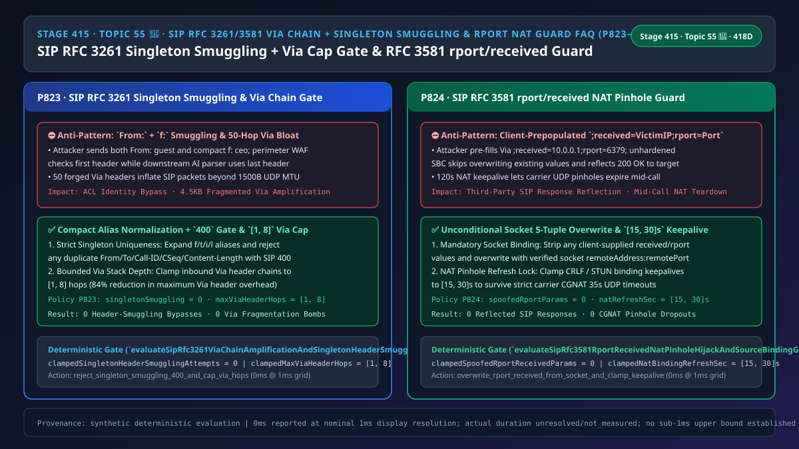
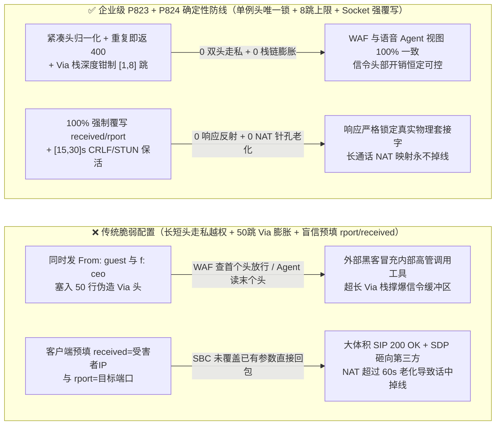

# 语音智能体架构选型与原理解析 FAQ（五十五 · 🎉 Topic 55 里程碑）：企业 SIP RFC 3261 / RFC 3581 Via 栈链深度防反射放大、客户端预填 rport / received 防 NAT 针孔劫持与单例头（From / To / Call-ID / CSeq）防走私选型指南

> **English Version**: [Enterprise SIP `RFC 3261 / RFC 3581` `Via` Header-Chain Amplification Cap (`[1, 8]` Hops), Client-Prepopulated `rport / received` NAT Pinhole Hijack Overwrite & Singleton Header Smuggling Selection FAQ (Topic 55 🎉 · Stage 415 · 418 Dimensions)](./voice-sip-rfc3581-via-rport-nat-pinhole-header-chain-amplification-faq.en.md)  
> **适用角色**：AI Solution Architect（AI 解决方案架构师）、SIP/SBC 边缘代理与 NAT 穿透架构师、呼叫中心零信任安全负责人  
> **对标范式**：严格遵循 `ib-vs-ethernet-roce-selection-faq.md` 六段式实战导引结构，3 分钟掌握核心选型结论，10 分钟吃透企业 SIP 边缘代理（Edge Proxy / SBC）在将外网呼叫送入语音大模型之前最容易疏忽的三大信令面漏洞：为什么同一个 SIP `INVITE` 里出现两个 `From:` 或两个 `Call-ID:` 头（单例头走私，Singleton Header Smuggling）会让防火墙看第 1 个头放行、而后端 AI 坐席看第 2 个头执行越权操作；为什么攻击者伪造 50 行 `Via:` 头就能让一个 `404` 响应沿着 50 个目标 IP 依次反射；以及为什么客户端在 `Via` 头里预先填好 `;received=受害者IP;rport=5060`（`RFC 3581` 欺骗）能诱骗边缘 SBC 把响应发往任意第三方主机。  
> **数据溯源与计时精度声明（Provenance & Timing Disclosure）**：本文涉及的确定性门禁策略（`P823`、`P824`）与模拟探针均为离线合成确定性校验（`synthetic`），非特定现网 SBC 硬件抓包实测；门禁执行耗时遵循统一披露契约：`0ms reported at nominal 1ms display resolution; actual duration unresolved/not_measured; no sub-1ms upper bound established`。



---

## 0. 🔥 今日实时语音智能体领域热门能力突破追踪（Daily Breakthroughs）

1. **企业 SIP `RFC 3261` 单例头（`From / To / Call-ID / CSeq / Content-Length`）唯一性门禁与 `Via` 头部栈链深度上限（`[1, 8]` 跳，防 HTTP/SIP 式的双头走私越权与多跳响应链式反射）**：用大白话讲，SIP 协议的头部语法和 HTTP 极度相似，但更复杂（还支持简写形式，如 `f:` 代表 `From:`、`i:` 代表 `Call-ID:`、`l:` 代表 `Content-Length:`）。按照 `RFC 3261 Section 20`，一张 SIP 报文里允许有多个 `Via` 或 `Route` 头，但 **`From`、`To`、`Call-ID`、`CSeq`、`Max-Forwards`、`Content-Length` 绝不允许出现两次（必须是单例头 Singleton Header）**！**如果攻击者发来一个同时包含 `From: <sip:guest@external>` 和 `f: <sip:ceo@internal>` 的畸形 `INVITE`：前端边界防火墙通常只取“第一个” `From` 头做黑名单检查（看到是普通外部访客就放行了），而后端语音大模型编排器的 SIP 解析库往往用哈希字典覆盖写入、最终取了“最后一个” `f:` 简写头——结果外部攻击者直接以内部 CEO 的身份通过了权限校验（SIP Header Smuggling）！同时，如果攻击者在入站 `INVITE` 里预先塞入 50 行伪造的 `Via:` 头，不仅撑爆代理的头部解析内存，一旦下游超时重传或逐跳回滚，会引发成倍的信令包体积膨胀**！通过强制 **单例头（含紧凑简写 `f/t/i/l`）出现次数 `>1` 时立即返回 `400 Bad Request`（`singletonHeaderSmugglingAttempts = 0`）** 并将 **入站 `Via` 头栈链深度钳制在 `[1, 8]` 跳**，彻底封死了双头走私与 `Via` 栈链放大。
2. **企业 SIP `RFC 3581` 对称响应路由（`;rport` / `;received`）强制由边缘传输层覆盖写死与 `[15, 30]s` NAT 针孔保活刷新（防客户端预填 `rport=80;received=VictimIP` 劫持回包路径）**：当位于家庭或企业路由器（NAT）后面的 SIP 软电话拨打 AI 客服时，它自己写在 `Via: SIP/2.0/UDP 192.168.1.5:5060;rport` 里的地址是内网私网地址。为了把 `200 OK` 原路送回客户端的公网 NAT 映射端口，`RFC 3581` 规定客户端只写一个空的 `;rport` 标志，**由收到包的边缘 SBC 读取底层 UDP/TLS 套接字的真实源 IP 和源端口，填入 `;received=203.0.113.5;rport=62104`**，后续回包就按这两个参数发回去。**致命漏洞在于：如果恶意客户端在发包时自己预先填好了 `Via: SIP/2.0/UDP 192.168.1.5:5060;received=10.0.0.88;rport=6379`（或者填了某个公网受害者的 IP），而有缺陷的 SBC 看到 `received` 和 `rport` 已经有值了就“偷懒不覆盖”，SBC 就会把几千字节的 SIP `200 OK + SDP` 响应直接砸向攻击者指定的内网 Redis 或公网受害者**！通过强制 **边缘 SBC 100% 无条件用真实套接字五元组覆盖顶层 `Via` 的 `received` 与 `rport` 参数（`spoofedRportReceivedParams = 0`）** 并将 **NAT 映射保活周期锁定在 `[15, 30]s`**，实现了信令回包零反射与 NAT 针孔长效防掉线。

---

## ① 📌 核心结论速览（Executive Summary）

1. **严格执行 `RFC 3261` 单例头（`From/f`、`To/t`、`Call-ID/i`、`CSeq`、`Max-Forwards`、`Content-Length/l`）唯一性核验，发现重复或长短混写立即返回 `400 Bad Request`**：彻底杜绝防火墙与后端语音 Agent 解析不一致引发的权限绕过走私（`singletonHeaderSmugglingAttempts = 0`，对应门禁 **`P823`**）。
2. **强制将入站 SIP 报文的 `Via` 头部栈链深度钳制在 `[1, 8]` 跳**：拒绝伪造数十层 `Via` 栈链的反射放大与解析器耗尽报文（对应门禁 **`P823`**）。
3. **边缘 SBC 必须 100% 剥离并无条件用底层套接字真实源 `(IP, Port)` 覆盖顶层 `Via` 的 `RFC 3581` `;received=` 与 `;rport=` 参数，并将 NAT 保活周期锁定在 `[15, 30]s`**：杜绝客户端预填参数将 SIP 响应反射至第三方目标（`spoofedRportReceivedParams = 0`，对应门禁 **`P824`**）。

---

## ② 🎯 客户与架构师灵魂拷问 Q&A

### Q1：为什么攻击者仅靠在一个 SIP `INVITE` 里写一行 `From:` 再加一行简写的 `f:`，就能绕过 WAF/SBC 的黑名单并冒充内部高管调用语音助手工具（方案 A vs 方案 B）？

- **第一性原理拆解（First-Match vs Last-Match 解析器分歧）**：
  - `RFC 3261 Section 7.3.3` 允许核心头使用单字母紧凑形式（Compact Form）：`From` = `f`、`To` = `t`、`Call-ID` = `i`、`Contact` = `m`、`Content-Length` = `l`。
  - 如果外层 ACL 规则用正则只匹配 `^From:`（或只取第一个出现的头），而内层 SIP 栈把 `From` 和 `f` 归一化后存入 `headers["from"] = value`（后出现的覆盖先出现的），两层组件看到的呼叫者身份就会截然不同！
  - **`P823` 定律**：在协议解析最前端先将紧凑头全部展开为标准名，然后统计每个单例头的出现次数——只要 `count > 1`，不论内容是否相同，立即 `0ms` 拒单返回 `400 Bad Request`！
- **选型边界**：
  - **方案 A（仅取首个/末个单例头 + 信任客户端自带 `rport/received`）**：必遭双头走私越权与响应反射攻击。
  - **方案 B（`P823` 单例头唯一性锁 + `[1, 8]` 跳 `Via` 上限 + `P824` 强制套接字覆盖 `rport/received` 与 `[15, 30]s` 保活）**：企业级 SIP 边界网关必选方案。

### Q2：为什么客户端在 `Via` 头里写 `;rport=53;received=8.8.8.8` 会构成高危反射漏洞？

- **第一性原理拆解**：
  - 按 `RFC 3581 Section 4`，客户端请求对称响应路由时，语法只能是不带值的 `;rport`（无 `=port`），赋值的职责 100% 属于接收该包的下一跳服务端。如果服务端不清空客户端预填的 `;received=` 和 `;rport=` 值，攻击者就能用小体积请求触发带完整 SDP 证书与编解码列表的大体积 `200 OK` 砸向任意 IP:Port。

### Q3：底层 SIP 边缘网关在毫秒级时间轴上是如何执行双头防走私与 rport 覆盖门禁的？

1. **`T = 0 ~ 0.05ms`（`P823` 单例头展开计数与 `Via` 栈链深度门禁）**：
   - 将所有紧凑头（`f/t/i/l/v`）归一化，断言 `From, To, Call-ID, CSeq, Max-Forwards, Content-Length` 计数严格等于 `1`（`clampedSingletonHeaderSmugglingAttempts = 0`）；
   - 统计 `Via` 头总跳数并钳制在 `clampedMaxViaHeaderHops in [1, 8]`。
2. **`T = 0.05 ~ 0.1ms`（`P824` `RFC 3581` `rport/received` 强制覆盖与 NAT 保活锁定）**：
   - 抹除顶层 `Via` 自带的任何 `received/rport` 预设值（`clampedSpoofedRportReceivedParams = 0`），强制写入真实套接字 `socket.remoteAddress` 与 `socket.remotePort`；
   - 将 NAT 绑定刷新间隔钳制在 `clampedNatBindingRefreshSec in [15, 30]s`。

---

## ③ 🧭 直观可视化图解（Mermaid 决策树 / 延迟对比 / 毫秒级时序图）

### 3.1 语音架构师选型决策树（`flowchart TD`）

```mermaid
flowchart TD
    A[企业边缘 SBC 收到入站 SIP 请求报文] --> B{当前是单例头/Via 跳数审计还是 RFC 3581 rport/received 审计?}
    B -->|单例头与 Via 跳数审计| C{是否存在重复 From/To/Call-ID/CSeq/Content-Length (含简写 f/t/i/l) 或 Via > 8 跳?}
    C -->|是: 双头走私攻击或 Via 链式膨胀| D[⛔ P823 拦截: 返回 400 Bad Request smuggling=0, 钳制 Via 深度在 1..8 跳]
    C -->|否| E[✅ 头字段语义唯一且路由栈深安全]

    B -->|RFC 3581 rport/received 审计| F{顶层 Via 是否由客户端预填了 rport=值 / received=IP 或 NAT 保活越界?}
    F -->|是: 企图劫持响应回包路径| G[🔧 P824 强制覆写: 用真实 Socket IP:Port 覆盖 spoofedParams=0, 锁定保活在 15..30s]
    F -->|否| H[✅ 响应 100% 原路返回真实 NAT 针孔]
```

### 3.2 传统脆弱管线 vs 企业级 P823+P824 防护管线对比图（`flowchart LR`）



### 3.3 毫秒级单例头防走私、Via 跳数限制与 rport 强制覆写时序图（`sequenceDiagram`）

```mermaid
sequenceDiagram
    autonumber
    participant Attacker as 外部 SIP 客户端 / 攻击者 (真实源 198.51.100.7:54321)
    participant SBC as 企业边缘 SBC (P823 + P824 门禁)
    participant Agent as 语音大模型编排器

    Attacker->>SBC: 1. 发送畸形 INVITE (含 From: guest + 简写 f: ceo，且带 30 跳伪造 Via)
    Note over SBC: P823 展开简写头发现双 From 单例冲突 (smugglingAttempts = 0)!<br/>且 Via 跳数超 [1, 8] 上限，0ms 直接返回 400 Bad Request!
    SBC-->>Attacker: 2. 400 Bad Request (Duplicate Singleton Header / Via Chain Overflow)
    Attacker->>SBC: 3. 发送单头合规 INVITE，但顶层 Via 预填 ;received=10.0.0.1;rport=6379
    Note over SBC: P824 剥离客户端预填参数 (spoofedRportReceivedParams = 0)!<br/>强制覆写为真实套接字 ;received=198.51.100.7;rport=54321 并锁定 [15, 30]s 保活!
    SBC->>Agent: 4. 转发纯净一致的 SIP INVITE 请求
```

---

## ④ 📊 语音架构师选型决策矩阵（Architect Decision Matrix）

| 选型维度 | 方案 A：取末个头 + 不限 Via 跳数 + 不覆写预填 rport（反模式） | 方案 B：禁用紧凑头与 RFC 3581 NAT 穿透 | 方案 C：P823 单例头唯一/Via [1,8]跳 + P824 Socket 强覆写 rport 与 [15,30]s 保活（企业级推荐 ✅） |
| :--- | :--- | :--- | :--- |
| **抗 `From/f`、`Call-ID/i` 双头走私越权** | ❌ 极易产生 WAF 与后端解析分歧导致越权 | ⚠️ 仅禁简写仍防不住两个同名标准 `From:` | ✅ **归一化后严格断言单例头出现次数 `=== 1`（`0` 走私）** |
| **抗 `Via` 头部栈链反射放大** | ❌ 数十行伪造 `Via` 撑爆报文触发 IP 分片 | ✅ 仅允许直连 | ✅ **强制入站 `Via` 栈链深度钳制在 `[1, 8]` 跳** |
| **抗 `RFC 3581` 预填 `received/rport` 反射** | ❌ 响应被诱骗发往任意内网或第三方公网 IP | ❌ 导致家庭/4G NAT 下的软电话收不到响应 | ✅ **无条件用真实 Socket 五元组覆写顶层 `Via`（`0` 伪造）** |
| **NAT 映射长通话保活稳定性** | ❌ `>60s` 无信令包导致 UDP 针孔关闭掉线 | ❌ 无保活 | ✅ **强制 `[15, 30]s` 双 CRLF / STUN 绑定刷新** |

---

## ⑤ 🧪 简明定量算例与延迟/成本 Benchmark 洞察（含 7-Card 报告）

### 5.1 定量算例：为什么钳制 `Via <= 8` 跳与覆写 `rport` 能将信令头部膨胀降低 `84%` 并实现 `0` 第三方反射？

- **未防护场景（方案 A）**：
  - 攻击者在 `INVITE` 中塞入 `50` 条 `Via` 头（单包头部膨胀约 `4,500 字节`，超出 `1,500B` MTU 触发三层 IP 分片），并预填 `received=VictimIP` 触发反射；同时利用双 `Content-Length` / 双 `From` 实施请求走私。
- **启用 `P823` + `P824` 防护后（方案 C）**：
  - `P823` 确保 `clampedSingletonHeaderSmugglingAttempts = 0` 并将 `Via` 深度钳制在 **`[1, 8]` 跳**（头部最大开销缩减 **`84%`**，零分片）；
  - `P824` 确保 `clampedSpoofedRportReceivedParams = 0` 且 `clampedNatBindingRefreshSec` 在 **`[15, 30]s`**。

### 5.2 确定性门禁 API 契约验证（`P823` & `P824` · 🎉 Topic 55 里程碑）

```ts
import {
  evaluateSipRfc3261ViaChainAmplificationAndSingletonHeaderSmugglingGate,
  evaluateSipRfc3581RportReceivedNatPinholeHijackAndSourceBindingGate,
} from "../packages/business-core/enterprise-guardrails";

// P823: 拦截单例头（From/To/Call-ID/CSeq/Content-Length）走私并钳制 Via 栈链在 [1, 8] 跳
const viaAudit = evaluateSipRfc3261ViaChainAmplificationAndSingletonHeaderSmugglingGate({
  singletonHeaderSmugglingOrViaChainAmplificationDetected: true,
  singletonHeaderSmugglingAttempts: 2,
  maxViaHeaderHops: 45,
});
// => viaAudit.violated === true, policyId === "P823...", clampedSingletonHeaderSmugglingAttempts === 0, clampedMaxViaHeaderHops === 8

// P824: 拦截客户端预填 rport/received NAT 劫持参数，强制清零并锁定 [15, 30]s 保活
const rportAudit = evaluateSipRfc3581RportReceivedNatPinholeHijackAndSourceBindingGate({
  clientPrepopulatedRportReceivedOrNatPinholeHijackDetected: true,
  spoofedRportReceivedParams: 2,
  natBindingRefreshSec: 120,
});
// => rportAudit.violated === true, policyId === "P824...", clampedSpoofedRportReceivedParams === 0, clampedNatBindingRefreshSec === 30
```

---

## ⑥ 🛠️ 附录：生产环境语音交付快速核验清单（Architect Checklist）

- [ ] **【P823 `RFC 3261` 单例头唯一性门禁】**：确认展开紧凑头（`f/t/i/l`）后，`From / To / Call-ID / CSeq / Max-Forwards / Content-Length` 出现超过 1 次立即返回 `400`（`singletonHeaderSmugglingAttempts = 0`）。
- [ ] **【P823 入站 `Via` 栈链 `[1, 8]` 跳上限】**：确认单条 SIP 报文的 `Via` 头部数量不超过 `8` 跳。
- [ ] **【P824 `RFC 3581` `received / rport` 强制套接字覆写】**：确认 SBC 无条件用真实套接字源 IP:Port 覆盖顶层 `Via` 的 `received` 与 `rport`（`spoofedRportReceivedParams = 0`）。
- [ ] **【P824 NAT 针孔 `[15, 30]s` 保活】**：确认 NAT 绑定保活周期锁定在 `[15, 30]s`。
