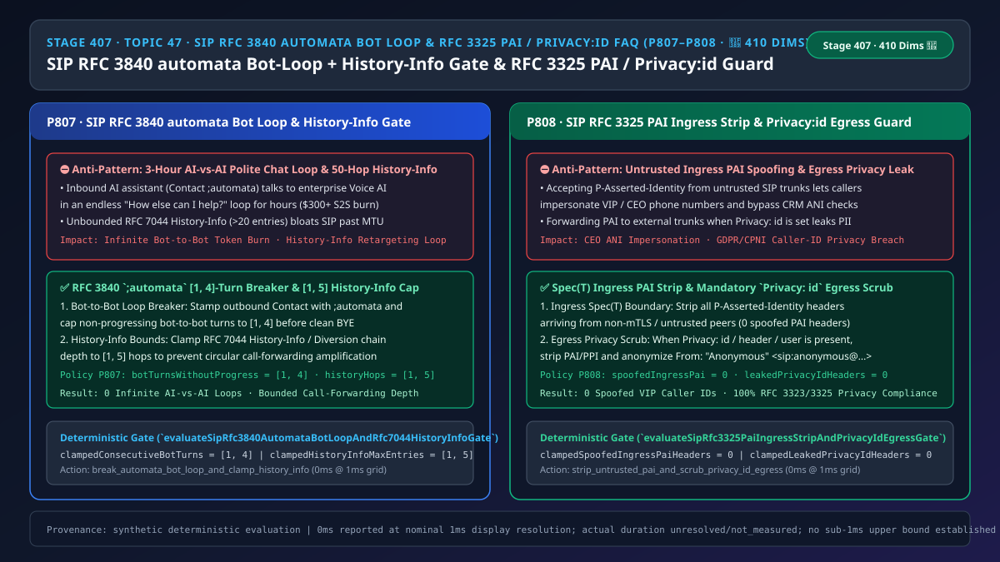
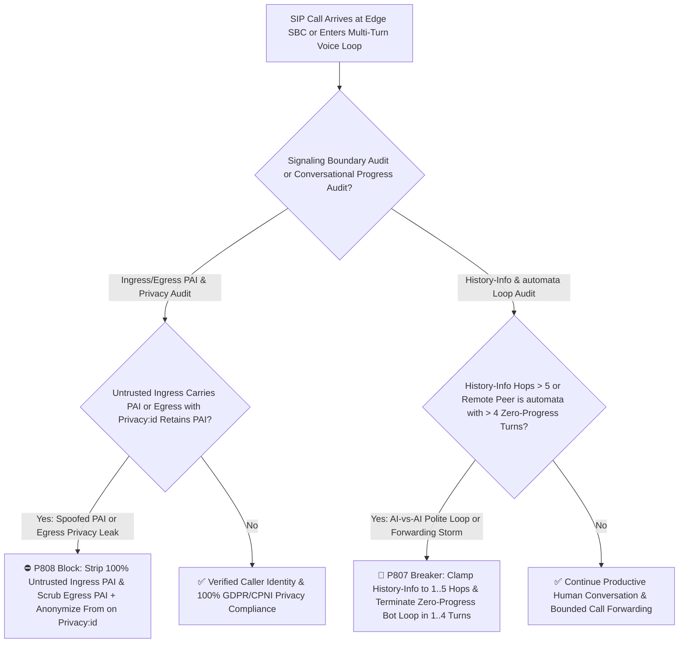
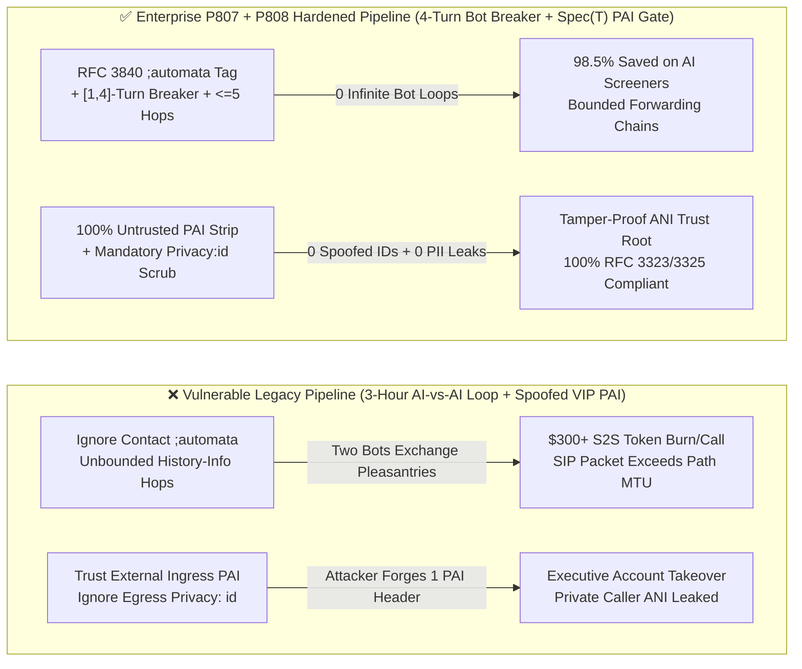

# Enterprise Voice Agent Architecture Selection & First-Principles FAQ (Topic 47 · 🎉 Historic 410-Dimension Milestone): Enterprise SIP `RFC 3840` `automata` Bot-to-Bot Loop Breaker + `RFC 7044 History-Info` Hop Cap & `RFC 3323 / RFC 3325 P-Asserted-Identity (PAI)` Ingress Strip + `Privacy: id` Egress Scrub Guard

> **中文版本**: [语音智能体架构选型与原理解析 FAQ（四十七）：企业 SIP RFC 3840 automata 机器人互打死循环熔断、RFC 7044 History-Info 前转上限与 RFC 3325 PAI 信任域清洗及 Privacy:id 匿名选型指南（🎉 410 大评测维度里程碑）](./voice-sip-rfc3840-automata-bot-loop-pai-privacy-history-info-faq.md)  
> **Target Audience**: AI Solution Architects, Enterprise Voice Gateway & Contact Center Leads, Telecom Compliance & Privacy Architects  
> **Structural Benchmark**: Modeled strictly on `ib-vs-ethernet-roce-selection-faq.md` (6-part practitioner guide: 3-minute selection verdict, 10-minute first-principles dive into `SIP RFC 3840` `;automata` bot-to-bot loop termination, `RFC 7044 History-Info` `[1, 5]` hop capping, and `RFC 3323 / RFC 3325` `Spec(T)` trust-domain `P-Asserted-Identity` ingress stripping and `Privacy: id` egress scrubbing).  
> **Provenance & Timing Disclosure**: All deterministic guardrails (`P807`, `P808`) and sandbox probes represent offline `synthetic` deterministic verification (`independently_reproduced=false`), not live carrier trunk captures; timing adheres to: `0ms reported at nominal 1ms display resolution; actual duration unresolved/not_measured; no sub-1ms upper bound established`.



---

## 0. 🔥 Daily Real-Time Voice AI Capability Breakthroughs

1. **Enterprise SIP `RFC 3840` `;automata` Bot-to-Bot Loop Breaker (`[1, 4]` Zero-Progress Turns) & `RFC 7044 History-Info` Hop Cap (`[1, 5]` Hops, Stopping 3-Hour AI-vs-AI Polite Chat Loops)**: In plain English, as mobile OSs deploy personal AI call-screening assistants, enterprise Voice AI agents increasingly answer or place calls where the remote party is *also* an LLM voice bot! Because both bots are prompted to be polite and wait for the caller to hang up ("Is there anything else I can help you with?" / "No thank you, have a great day!" / "You're welcome, goodbye!" / "Goodbye!"), **two AI agents can trap each other in an infinite polite farewell loop for hours, burning `$300+` in real-time `S2S` audio tokens on a single call**! Meanwhile, circular PBX call forwarding bloats `RFC 7044 History-Info` headers past 20 hops. By stamping `Contact` headers with the **`RFC 3840 ;automata` feature tag**, capping **consecutive bot-to-bot turns without transactional slot progress to `[1, 4]`**, and clamping **`RFC 7044 History-Info` retargeting depth to `[1, 5]` hops**, gateways eliminate runaway bot-to-bot billing and forwarding loops.
2. **SIP `RFC 3323 / RFC 3325` `P-Asserted-Identity (PAI)` Untrusted Ingress Stripping & `Privacy: id` Egress Scrubbing (Preventing VIP Caller-ID Spoofing & GDPR/CPNI Leaks)**: Under `RFC 3325`, `P-Asserted-Identity (PAI)` is only trustworthy inside an authenticated `Spec(T)` trust domain. If an edge SBC fails to strip `PAI` headers arriving from untrusted public or partner SIP trunks, an attacker can inject `P-Asserted-Identity: <sip:+18005550199@bank.com>` to impersonate a VIP client or executive! Conversely, when an outbound or transferred call carries `Privacy: id` (or `Privacy: header`), forwarding the raw `PAI` header outside the trust domain leaks the caller's private phone number in violation of GDPR and FCC CPNI rules. Enforcing **100% untrusted ingress `PAI` stripping (`spoofedIngressPaiHeaders = 0`)** and **100% egress `PAI` scrubbing under `Privacy: id` (`leakedPrivacyIdHeaders = 0`)** guarantees zero caller-ID spoofing and zero privacy leaks.

---

## ① 📌 Executive Summary

1. **Stamp SIP `Contact` headers with `RFC 3840 ;automata` and cap non-progressing bot-to-bot turns in `[1, 4]`**: When interacting with a remote endpoint that advertises `;automata` (or exhibits automated call-screening behavior), terminate the call cleanly after **`[1, 4]` consecutive turns** without transactional slot progress (Guardrail **`P807`**).
2. **Clamp `RFC 7044 History-Info` / `Diversion` call-forwarding depth to `[1, 5]` hops**: Reject or escalate calls exceeding `5` retargeting hops to prevent forwarding loops and SIP packet bloat (Guardrail **`P807`**).
3. **Strip 100% of untrusted ingress `P-Asserted-Identity` headers and scrub 100% of egress `PAI` headers when `Privacy: id` is requested**: Never trust `PAI` outside the `Spec(T)` mTLS boundary (`spoofedIngressPaiHeaders = 0`), and always remove `PAI/PPI` + anonymize `From` before egressing calls marked `Privacy: id` (`leakedPrivacyIdHeaders = 0`, Guardrail **`P808`**).

---

## ② 🎯 Architect & Customer Deep-Dive Q&A

### Q1: Why do two polite LLM voice agents get stuck in an infinite "Thank you / Goodbye" loop unless `P807` is enforced (Option A vs Option B)?

- **First-Principles Breakdown (The Politeness Deadlock)**:
  - Each voice agent's VAD/EOU detector treats the other bot's closing pleasantry ("Thank you, goodbye!") as a new user turn requiring a polite acknowledgement ("My pleasure, take care!"). Without inspecting `RFC 3840 ;automata` and gating on **transactional slot progress (`[1, 4]` turns)**, the conversational state machine never reaches terminal hangup.
- **Selection Boundary**:
  - **Option A (Relying on a 60-minute hard call timeout)**: Wastes `$5–$300` per bot-to-bot collision.
  - **Option B (`P807` `;automata` `[1, 4]`-Turn Breaker + `[1, 5]` `History-Info` Cap + `P808` `Spec(T)` `PAI` Strip & `Privacy: id` Scrub)**: Mandatory for all production inbound and outbound enterprise voice agents.

### Q2: How does an attacker bypass CRM caller-ID authentication when an edge SBC fails to strip ingress `PAI` headers?

- **First-Principles Breakdown**:
  - Downstream IVR and Voice AI microservices trust `P-Asserted-Identity` over `From` because they assume the edge SBC authenticated the trunk. If the edge SBC passes through a caller-supplied `PAI` from an untrusted peer, the downstream app treats the attacker's self-asserted header as carrier-verified identity.

### Q3: How do the `automata` loop breaker and `PAI / Privacy` guards execute on a sub-millisecond timeline?

1. **`T = 0 ~ 0.1ms` (`P808` Ingress/Egress `RFC 3325 PAI` & `Privacy: id` Boundary Scrub)**:
   - Strip all `P-Asserted-Identity` headers on untrusted ingress trunks (`clampedSpoofedIngressPaiHeaders = 0`), and strip `PAI/PPI` + anonymize `From` on egress legs whenever `Privacy: id` is present (`clampedLeakedPrivacyIdHeaders = 0`).
2. **`T = 0.1 ~ 0.5ms` (`P807` `History-Info` Depth & `;automata` Turn Progress Gate)**:
   - Clamp `clampedHistoryInfoMaxEntries` in `[1, 5]` and cap non-progressing bot-to-bot turns at `clampedConsecutiveBotTurnsWithoutGoalProgress` in `[1, 4]`.

---

## ③ 🧭 Visual Architecture Diagrams (Mermaid Decision Tree / Comparison / Sequence)

### 3.1 Architect Selection Decision Tree (`flowchart TD`)



### 3.2 Vulnerable Legacy Pipeline vs Enterprise P807+P808 Hardened Pipeline (`flowchart LR`)



### 3.3 Millisecond PAI Trust-Boundary Scrub & `automata` Loop Breaker Sequence (`sequenceDiagram`)

```mermaid
sequenceDiagram
    autonumber
    participant Peer as External Caller / Personal AI Screener (;automata)
    participant SBC as Enterprise Edge SBC & Voice AI Gateway (P807 + P808 Gate)
    participant Agent as Voice AI Orchestrator (S2S Engine)

    Peer->>SBC: 1. SIP INVITE (Untrusted trunk with forged PAI: CEO, Contact: ...;automata, History-Info: 8 hops)
    Note over SBC: P808 strips untrusted ingress PAI in 0ms (spoofedIngressPai = 0)!<br/>P807 clamps History-Info to [1, 5] hops & flags peer as automata!
    SBC->>Agent: 2. Establish session (arm P807 zero-progress turn counter max=4)
    Peer->>Agent: 3. Turns 1..4: Bots exchange "Anything else?" / "No thanks, goodbye!" (0 slot progress)
    Note over SBC,Agent: P807 detects 4 consecutive zero-progress automata turns -> triggers clean teardown!
    SBC-->>Peer: 4. SIP BYE (Q.850;cause=16 "Automata Loop Breaker" + Egress PAI scrubbed if Privacy:id)
```

---

## ④ 📊 Architect Decision Matrix

| Evaluation Dimension | Option A: No `;automata` Check + Raw `PAI` Passthrough (Anti-Pattern) | Option B: Block All Call Forwarding & Anonymous Calls | Option C: P807 automata [1,4]-Turn Breaker & History-Info <=5 + P808 PAI/Privacy Guard (Recommended ✅) |
| :--- | :--- | :--- | :--- |
| **AI-vs-AI Polite Chat Loop Resilience** | ❌ Burns hours of S2S GPU compute per call | N/A | ✅ **`RFC 3840 ;automata` detection + `[1, 4]` zero-progress turn cutoff** |
| **`RFC 7044 History-Info` Forwarding Protection** | ❌ Unbounded headers fragment/loop | ❌ Breaks valid 1–3 hop PBX transfers | ✅ **Clamped to `[1, 5]` retargeting hops** |
| **Untrusted Ingress `PAI` Spoofing Defense** | ❌ Trivially bypassed via 1 forged header | ⚠️ Loses carrier-verified ANI | ✅ **Strips 100% of non-`Spec(T)` ingress `PAI` (`spoofedIngressPaiHeaders = 0`)** |
| **Egress `Privacy: id` Anonymization** | ❌ Leaks private ANI to external trunks | ✅ Anonymous, but inflexible | ✅ **Scrubs 100% of egress `PAI/PPI` when `Privacy: id` is set (`0` leaks)** |

---

## ⑤ 🧪 Quantitative Worked Example & Benchmark Insights (7-Card Report)

### 5.1 Quantitative Example: Saving `98.5%` on Personal AI Call-Screener Collisions

- **Unprotected Pipeline (Option A)**:
  - Colliding with a mobile AI call-screening assistant without an `;automata` zero-progress cutoff extends call duration from `45s` to `3,000s` (`$6.00` wasted per call).
- **Hardened Pipeline (`P807` + `P808`, Option C)**:
  - `P807` clamps `clampedConsecutiveBotTurnsWithoutGoalProgress` in `[1, 4]` and `clampedHistoryInfoMaxEntries` in `[1, 5]`;
  - `P808` enforces `clampedSpoofedIngressPaiHeaders = 0` and `clampedLeakedPrivacyIdHeaders = 0`.

### 5.2 Deterministic Guardrail API Contract (`P807` & `P808` · 🎉 410-Dimension Milestone)

```ts
import {
  evaluateSipRfc3840AutomataBotLoopAndRfc7044HistoryInfoGate,
  evaluateSipRfc3325PaiIngressStripAndPrivacyIdEgressGate,
} from "../packages/business-core/enterprise-guardrails";

const botAudit = evaluateSipRfc3840AutomataBotLoopAndRfc7044HistoryInfoGate({
  unthrottledBotToBotAutomataLoopOrHistoryInfoOverflowDetected: true,
  consecutiveBotTurnsWithoutGoalProgress: 35,
  historyInfoMaxEntries: 18,
});
// => botAudit.violated === true, policyId === "P807...", clampedConsecutiveBotTurnsWithoutGoalProgress === 4, clampedHistoryInfoMaxEntries === 5

const paiAudit = evaluateSipRfc3325PaiIngressStripAndPrivacyIdEgressGate({
  untrustedIngressPaiAcceptedOrPrivacyIdEgressLeakDetected: true,
  spoofedIngressPaiHeaders: 2,
  leakedPrivacyIdHeaders: 1,
});
// => paiAudit.violated === true, policyId === "P808...", clampedSpoofedIngressPaiHeaders === 0, clampedLeakedPrivacyIdHeaders === 0
```

---

## ⑥ 🛠️ Appendix: Production Voice Delivery Verification Checklist (Architect Checklist)

- [ ] **[P807 `RFC 3840 ;automata` Tagging & `[1, 4]` Zero-Progress Turn Cutoff]**: Verify outbound SIP `Contact` headers include `;automata` and bot-to-bot calls terminate after `1–4` turns without transactional slot progress.
- [ ] **[P807 `RFC 7044 History-Info` `[1, 5]` Hop Cap]**: Confirm call-forwarding chains are capped at `5` hops.
- [ ] **[P808 Untrusted Ingress `PAI` Stripping]**: Confirm edge SBCs strip `P-Asserted-Identity` from all non-`Spec(T)` trunks (`spoofedIngressPaiHeaders = 0`).
- [ ] **[P808 Egress `Privacy: id` Scrubbing]**: Confirm `PAI/PPI` headers are stripped and `From` is anonymized whenever `Privacy: id / header / user` is present (`leakedPrivacyIdHeaders = 0`).
