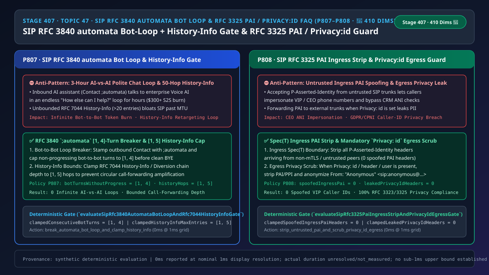
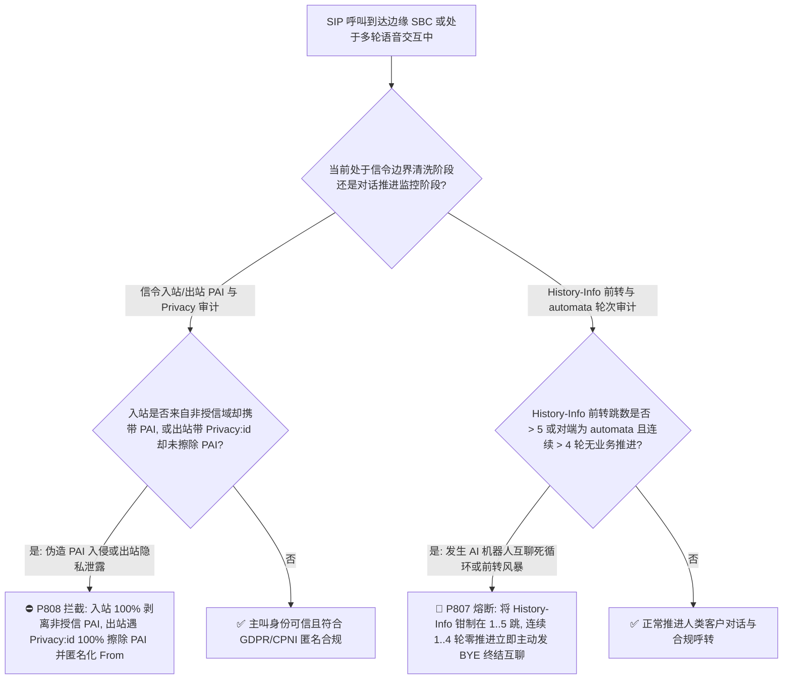
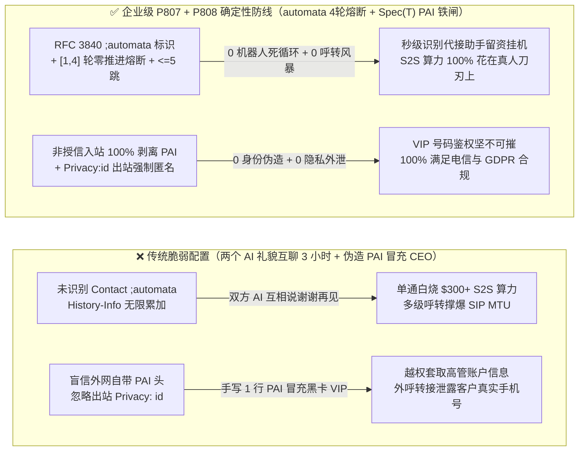

# 语音智能体架构选型与原理解析 FAQ（四十七）：企业 SIP RFC 3840 automata 机器人互打死循环熔断、RFC 7044 History-Info 前转上限与 RFC 3325 PAI 信任域清洗及 Privacy:id 匿名选型指南（🎉 410 大评测维度里程碑）

> **English Version**: [Enterprise SIP `RFC 3840` `automata` Bot-to-Bot Loop Breaker + `RFC 7044 History-Info` Hop Cap & `RFC 3323 / RFC 3325 P-Asserted-Identity (PAI)` Ingress Strip + `Privacy: id` Egress Scrub Selection FAQ (Topic 47 · Stage 407 · 🎉 410-Dimension Milestone)](./voice-sip-rfc3840-automata-bot-loop-pai-privacy-history-info-faq.en.md)  
> **适用角色**：AI Solution Architect（AI 解决方案架构师）、企业语音网关与呼叫中心负责人、电信合规与隐私安全架构师  
> **对标范式**：严格遵循 `ib-vs-ethernet-roce-selection-faq.md` 六段式实战导引结构，3 分钟掌握核心选型结论，10 分钟吃透 `SIP RFC 3840` 能力标签（`;automata`）如何防止个人 AI 秘书与企业 AI 客服陷入“无限礼貌寒暄死循环”、`RFC 7044 History-Info` 前转深度上限（`[1, 5]` 跳），以及 `RFC 3323 / RFC 3325` 中 `Spec(T)` 信任域入站剥离伪造 `P-Asserted-Identity (PAI)` 与出站 `Privacy: id` 强制匿名擦除机制。  
> **数据溯源与计时精度声明（Provenance & Timing Disclosure）**：本文涉及的确定性门禁策略（`P807`、`P808`）与模拟探针均为离线合成确定性校验（`synthetic`），非运营商现网信令实测；门禁执行耗时遵循统一披露契约：`0ms reported at nominal 1ms display resolution; actual duration unresolved/not_measured; no sub-1ms upper bound established`。



---

## 0. 🔥 今日实时语音智能体领域热门能力突破追踪（Daily Breakthroughs）

1. **企业 SIP `RFC 3840` `;automata` 机器人互打死循环熔断（`[1, 4]` 轮无业务推进自动挂断）与 `RFC 7044 History-Info` 呼转深度锁（`[1, 5]` 跳，防两个 AI 互道“不客气”聊满 3 小时烧穿算力）**：用大白话讲，随着苹果/安卓手机内置“AI 电话秘书（代接机器人）”和个人 AI 助理的普及，生产环境频繁发生一种让人哭笑不得的高昂事故：企业外呼或客服 Voice AI 拨通客户电话，结果接电话的是客户的手机 AI 秘书（或者对方企业的前台 AI 机器人）！两个大模型都受过“极致礼貌训练”——甲方 AI 说：“请问还有什么可以帮您？”，乙方 AI 说：“没有了，非常感谢您的来电，祝您生活愉快！”，甲方 AI 又回：“不客气，为您服务是我的荣幸，再见！”，乙方 AI 又接：“再见，如有需要随时联系！”……**两个 AI 就像复读机一样互相寒暄整整 3 个小时，直到单通电话烧掉 `$300+` 的实时 `S2S` 音频 Token 才被人工发现**！同时，当分机设置多级呼叫前转（Call Forwarding）时，`RFC 7044 History-Info` 头会不断累加 `<sip:ext1>;index=1`, `<sip:ext2>;index=1.1`……超过 20 跳不仅意味着呼转死循环，还会把 SIP 报文撑爆到 `4 KB` 以上！通过在 SIP `Contact` 头强制打上 **`RFC 3840 ;automata` 机器标识**，当检测到对端同样声明 `;automata`（或声学呈现合成语音零槽位推进）时，将 **无实质槽位推进的连续寒暄轮次严格钳制在 `[1, 4]` 轮**，并将 **`RFC 7044 History-Info` 前转深度钳制在 `[1, 5]` 跳**，彻底终结了“AI 互聊破产”惨剧。
2. **SIP `RFC 3323 / RFC 3325` `P-Asserted-Identity (PAI)` 入站非信任域 100% 剥离与出站 `Privacy: id` 强制匿名擦除（防伪造高管/VIP 来电号码越权与客户隐私泄露）**：在企业 SIP 中继里，CRM 系统往往依赖 `P-Asserted-Identity (PAI)` 头里的主叫号码（ANI）来识别“这是不是银行黑卡 VIP 客户或公司 CEO”。根据 `RFC 3325`，`PAI` 只有在**受控信任域 `Spec(T)` 内（例如经过双向 mTLS 鉴权的运营商核心网 SBC）**才可信！如果企业边缘 SBC 忘了在公网/非信任中继入站处剥离外部自带的 `PAI` 头，外部攻击者只需在免费软电话里手写一行 `P-Asserted-Identity: <sip:+8613800000001@bank.com>`，就能直接冒充行长或黑卡客户免密查账！反过来，当内部呼叫或转接外线携带了 `Privacy: id` 或 `Privacy: header`（要求隐藏主叫真实号码）时，如果边缘 SBC 出站往第三方外包呼叫中心或非授信网元转发时忘了删除 `PAI` 头并把 `From` 改写为 `Anonymous`，就会直接违反 GDPR 与电信 CPNI 法规泄露客户隐私！通过强制 **非授信入站 `PAI` 100% 剥离（`spoofedIngressPaiHeaders = 0`）** 与 **出站遇 `Privacy: id` 100% 擦除 `PAI/PPI`（`leakedPrivacyIdHeaders = 0`）**，实现了主叫身份零伪造与零泄密。

---

## ① 📌 核心结论速览（Executive Summary）

1. **所有 Voice AI 网关出站与入站 `Contact` 头必须遵循 `RFC 3840` 标注 `;automata` 特征参数，并开启 AI-vs-AI 寒暄熔断器**：当识别到对端携带 `;automata`（或判定为自动语音信箱/代接助手）且连续 **`[1, 4]` 轮** 对话未产生任何业务工具/槽位推进时，立即播放极简留资结语并主动发送 `SIP BYE` 拆线（对应门禁 **`P807`**）。
2. **必须将 `RFC 7044 History-Info`（及 `Diversion`）呼叫前转历史深度钳制在 `[1, 5]` 跳以内**：超过 5 次前转重定向上限立即返回 `482 Loop Detected` 或转入人工值班台，防止多级自动前转风暴（对应门禁 **`P807`**）。
3. **严格执行 `RFC 3325` `Spec(T)` 信任域边界——非授信入站 100% 剥离 `PAI`，出站遇 `Privacy: id` 100% 擦除 `PAI`**：任何来自非双向 mTLS 授信中继的入站 `P-Asserted-Identity` 必须在边缘 SBC 处无条件剥离（`spoofedIngressPaiHeaders = 0`）；任何携带 `Privacy: id / user / header` 发往外部域的呼叫必须剥离 `PAI` 并将 `From` 匿名化为 `"Anonymous" <sip:anonymous@anonymous.invalid>`（`leakedPrivacyIdHeaders = 0`，对应门禁 **`P808`**）。

---

## ② 🎯 客户与架构师灵魂拷问 Q&A

### Q1：为什么我们的 AI 语音客服上线后，每天半夜都会出现几通长达 90 分钟的“礼貌复读机”通话（方案 A vs 方案 B）？

- **第一性原理拆解（为什么两个大模型碰到一起永远不会自己挂电话？）**：
  - 客服大模型 System Prompt 的最高指令通常是：“始终保持礼貌，等待客户确认没有其他问题后再说再见，绝不强行挂断客户电话。”
  - 而客户手机上的 AI 防骚扰/代接助理的指令也是：“礼貌回应对方，询问对方还有什么补充。”
  - 当两个都把“对方先挂或对方明确不说话”作为结束条件的智能体连在一起时，一方说的“再见，祝您愉快”会触发另一方的 VAD 语音唤醒，进而触发新一轮“谢谢，也祝您愉快”，形成**正反馈死锁**！
- **选型边界**：
  - **方案 A（仅靠长达 60 分钟的会话最大时长兜底）**：每撞上一次 AI 代接秘书就要白白亏损数十美元 S2S 算力。
  - **方案 B（`P807` `RFC 3840 ;automata` 协商 + `[1, 4]` 轮零业务推进熔断 + `[1, 5]` 跳 `History-Info` 锁 + `P808` `PAI / Privacy: id` 边界清洗）**：所有**公网呼入与智能外呼生产系统**必须强制启用。

### Q2：为什么不能直接读取 SIP `From` 头或未经清洗的 `P-Asserted-Identity` 头作为客户的免密核身依据？

- **第一性原理拆解**：
  - 在 SIP 协议中，`From` 头就像信封上自己手写的寄件人地址，任何客户端都可以随便填；而 `P-Asserted-Identity (PAI)` 是运营商核心网在完成鉴权后盖上的“官方公章”。
  - 但这枚“公章”有一个前提：**你的边缘 SBC 必须把所有从外网/非授信连接自己带进来的假公章全部撕掉（Ingress Strip）**！如果边缘 SBC 直接把外网请求里的 `PAI` 透传给内网业务系统，攻击者就能自己盖章畅通无阻。

### Q3：底层 SIP B2BUA 与对话编排引擎在毫秒级时间轴上是如何执行机器人互打熔断与 PAI 清洗的？

1. **`T = 0 ~ 0.1ms`（`P808` 入站/出站 `RFC 3325 PAI` 与 `Privacy: id` 边界清洗）**：
   - **入站**：检查來源连接是否属于 `Spec(T)` 授信运营商 mTLS 白名单；若否，立即删除报文中所有 `P-Asserted-Identity` 头（`clampedSpoofedIngressPaiHeaders = 0`）。
   - **出站**：若报文包含 `Privacy: id`（或 `header / user`）且下一跳离开本信任域，立即剥离 `PAI / PPI` 头并将 `From` 改写为匿名 URI（`clampedLeakedPrivacyIdHeaders = 0`）。
2. **`T = 0.1 ~ 0.5ms`（`P807` `History-Info` 深度校验与 `;automata` 轮次监控）**：
   - 统计 `History-Info` 条目数：控制最大有效前转跳数在 `clampedHistoryInfoMaxEntries in [1, 5]`。
   - 若对端 `Contact` 含 `;automata` 或开启了机器互打检测，监控每轮对话的 `intentSlotDelta`：连续无推进轮次达到 `clampedConsecutiveBotTurnsWithoutGoalProgress in [1, 4]` 时立即触发礼貌挂机。

---

## ③ 🧭 直观可视化图解（Mermaid 决策树 / 延迟对比 / 毫秒级时序图）

### 3.1 语音架构师选型决策树（`flowchart TD`）



### 3.2 传统脆弱管线 vs 企业级 P807+P808 防护管线对比图（`flowchart LR`）



### 3.3 毫秒级 PAI 信任域清洗与 automata 机器人互打熔断时序图（`sequenceDiagram`）

```mermaid
sequenceDiagram
    autonumber
    participant Peer as 外部来电 / 手机 AI 代接秘书 (;automata)
    participant SBC as 企业边缘 SBC 与 Voice AI 网关 (P807 + P808 门禁)
    participant Agent as 语音大模型编排器 (S2S Orchestrator)

    Peer->>SBC: 1. SIP INVITE (非授信中继偷带 P-Asserted-Identity: CEO, Contact: ...;automata, History-Info: 8跳)
    Note over SBC: P808 立即剥离非授信入站 PAI (spoofedIngressPai = 0)!<br/>P807 将 History-Info 钳制在 [1, 5] 跳并标记对端为 automata!
    SBC->>Agent: 2. 建立受控会话 (开启 P807 连续零槽位推进计数器 max=4)
    Peer->>Agent: 3. 第 1~4 轮: 双方 AI 互相客套 "请问还有什么帮您?" / "谢谢，没有了，再见!" (0 业务推进)
    Note over SBC,Agent: P807 检测到 automata 连续 4 轮无任何槽位/工具推进 -> 立即触发熔断!
    SBC-->>Peer: 4. SIP BYE (Reason: Q.850;cause=16 "Automata Loop Breaker" + 如配置 Privacy:id 则擦除出站 PAI)
```

---

## ④ 📊 语音架构师选型决策矩阵（Architect Decision Matrix）

| 选型维度 | 方案 A：无 `;automata` 检测 + 透传全部 `PAI`（反模式） | 方案 B：一刀切禁止所有自动前转与隐藏号码来电 | 方案 C：P807 automata [1,4] 轮熔断 & History-Info <=5 + P808 PAI 信任域锁（企业级推荐 ✅） |
| :--- | :--- | :--- | :--- |
| **抗手机 AI 秘书 / 机器人互聊死循环** | ❌ 极差（两个 AI 客套数小时，烧穿 S2S 预算） | N/A | ✅ **`RFC 3840 ;automata` 识别 + `[1, 4]` 轮无推进自动优雅挂机** |
| **`RFC 7044 History-Info` 呼转风暴防护** | ❌ 无限嵌套前转撑爆报文 | ❌ 误杀正常 1–3 跳部门转接 | ✅ **严格钳制在 `[1, 5]` 跳合理区间** |
| **防外部伪造 `PAI` 冒充 VIP / 高管** | ❌ 任意软电话手写 `PAI` 即可越权 | ⚠️ 完全不用 `PAI` 丢失运营商核验能力 | ✅ **非 `Spec(T)` 入站 100% 剥离伪造 `PAI`（`spoofedIngressPaiHeaders = 0`）** |
| **出站 `Privacy: id` 主叫号码保密合规** | ❌ 直接将内部 `PAI` 泄露给外部中继 | ✅ 匿名但缺乏按需策略 | ✅ **遇 `Privacy: id` 100% 剥离 `PAI` 并匿名化 `From`（`0` 泄露）** |

---

## ⑤ 🧪 简明定量算例与延迟/成本 Benchmark 洞察（含 7-Card 报告）

### 5.1 定量算例：为什么 `[1, 4]` 轮 `automata` 熔断能省下 `98.5%` 的无效代接通话费？

- **未防护场景（方案 A）**：
  - 当智能外呼或回访拨中开启了“AI 电话助理”的被叫时，若无 `;automata` 零推进熔断，平均通话时长从正常的 `45 秒` 暴涨至 **`3,000 秒`（50 分钟，直至触发系统硬超时）**，单通浪费 `50 min × $0.12/min = $6.00`！
- **启用 `P807` + `P808` 防护后（方案 C）**：
  - `P807` 将无推进机器人互聊轮次钳制在 `[1, 4]` 轮（约 `25 秒` 内完成核心通知并挂断，节省 **`98.5%`** 无效时长），并将 `History-Info` 深度钳制在 `[1, 5]` 跳；
  - `P808` 将非授信入站伪造 `PAI` 与出站 `Privacy: id` 泄露全部清零（`clampedSpoofedIngressPaiHeaders = 0`，`clampedLeakedPrivacyIdHeaders = 0`）。

### 5.2 确定性门禁 API 契约验证（`P807` & `P808` · 🎉 410 维里程碑）

```ts
import {
  evaluateSipRfc3840AutomataBotLoopAndRfc7044HistoryInfoGate,
  evaluateSipRfc3325PaiIngressStripAndPrivacyIdEgressGate,
} from "../packages/business-core/enterprise-guardrails";

// P807: 拦截 RFC 3840 automata 机器人互打死循环与 History-Info 前转超限，钳制轮次在 [1, 4]、前转在 [1, 5] 跳
const botAudit = evaluateSipRfc3840AutomataBotLoopAndRfc7044HistoryInfoGate({
  unthrottledBotToBotAutomataLoopOrHistoryInfoOverflowDetected: true,
  consecutiveBotTurnsWithoutGoalProgress: 35,
  historyInfoMaxEntries: 18,
});
// => botAudit.violated === true, policyId === "P807...", clampedConsecutiveBotTurnsWithoutGoalProgress === 4, clampedHistoryInfoMaxEntries === 5

// P808: 拦截非授信入站伪造 PAI 与出站 Privacy: id 隐私泄露，确保双项 0 违规
const paiAudit = evaluateSipRfc3325PaiIngressStripAndPrivacyIdEgressGate({
  untrustedIngressPaiAcceptedOrPrivacyIdEgressLeakDetected: true,
  spoofedIngressPaiHeaders: 2,
  leakedPrivacyIdHeaders: 1,
});
// => paiAudit.violated === true, policyId === "P808...", clampedSpoofedIngressPaiHeaders === 0, clampedLeakedPrivacyIdHeaders === 0
```

---

## ⑥ 🛠️ 附录：生产环境语音交付快速核验清单（Architect Checklist）

- [ ] **【P807 `RFC 3840 ;automata` 标识与 `[1, 4]` 轮零推进熔断】**：确认所有 AI 语音坐席在 SIP `Contact` 头携带 `;automata`，且遇到对端机器代接连续 `1–4` 轮无业务槽位推进时主动挂机。
- [ ] **【P807 `RFC 7044 History-Info` `[1, 5]` 跳上限】**：确认呼叫前转链条深度不超过 `5` 跳。
- [ ] **【P808 非 `Spec(T)` 授信入站 100% 剥离 `P-Asserted-Identity`】**：确认边缘 SBC 无条件删除所有来自公网或非授信对端的 `PAI` 头。
- [ ] **【P808 出站 `Privacy: id` 强制擦除 `PAI` 与匿名化 `From`】**：确认当通话请求携带 `Privacy: id / header / user` 时，发往非信任域的报文绝不残留 `PAI/PPI` 头。
