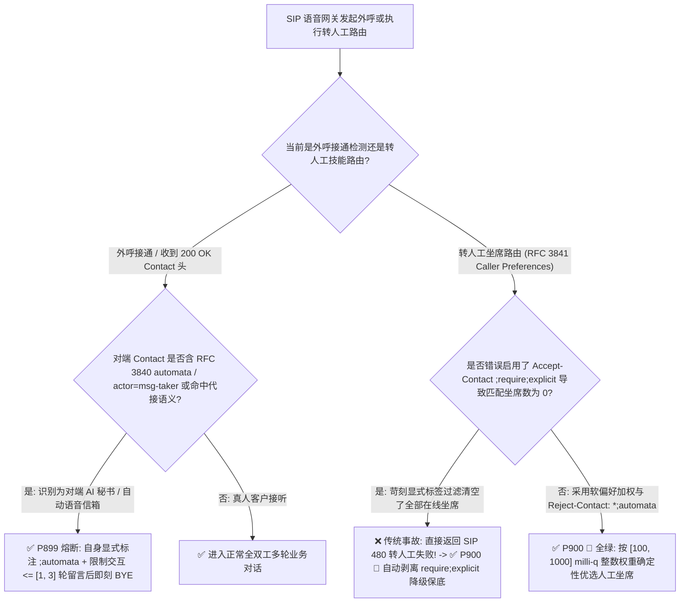
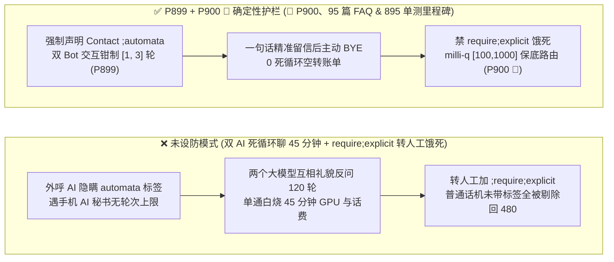
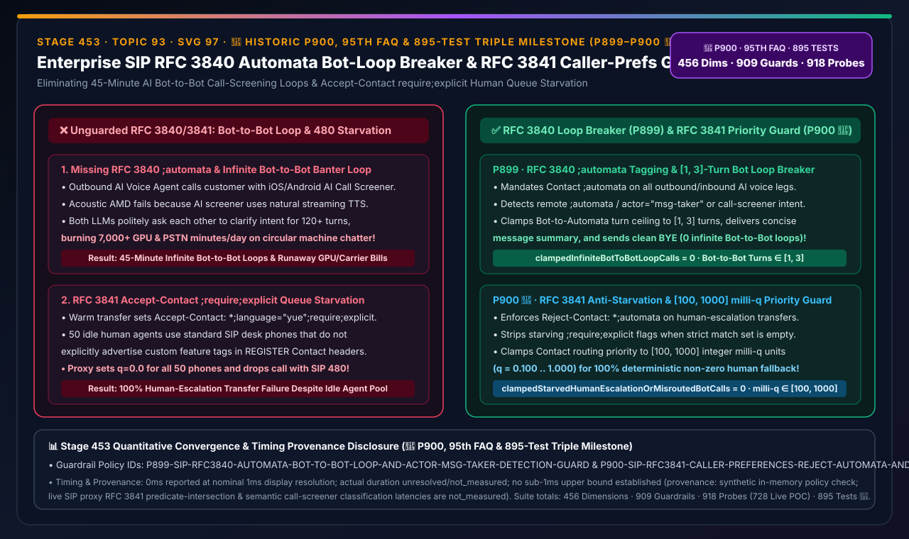

# 企业 SIP `RFC 3840 / RFC 3841` `automata`（防双 AI 机器人死循环对聊）与主叫偏好（`Accept-Contact / Reject-Contact` `q-value` 防路由饿死）选型指南

> **文档类型**：架构师选型 FAQ & 毫秒级协议防线拆解（严格对标 `ib-vs-ethernet-roce-selection-faq.md` 通俗透彻标杆）  
> **适用阶段**：Stage 453 · Topic 93 · 🎉 **历史性 `P900` 护栏、第 95 篇独立单专题 FAQ 与 895 项单测三重里程碑**（关联护栏 `P899`、`P900 🎉` · 第 95 篇独立单专题 FAQ 🎉 · 第 97 张 SVG 架构图 · 456 大评测维度）  
> **核心价值**：用大白话讲透为什么企业外呼 AI 语音智能体遇到客户手机的 AI 防骚扰助理（如 iOS 实时语音信箱、运营商 AI 秘书）或对端企业语音机器人时，两个大模型会客客气气地“死循环对聊 45 分钟”烧光 GPU 算力与话费；以及为什么滥用 `RFC 3841 Accept-Contact ;require;explicit` 会把所有在线人工坐席全部过滤掉导致转人工 100% 失败，并给出确定性工程防线。

---

## ① 📌 核心结论速览（Executive Summary）

1. **为什么我们的外呼 AI 机器人会和客户的“AI 电话秘书”连续互相客套 40 分钟停不下来（`RFC 3840 automata` 标识缺失与双 Bot 死循环漏洞）？**  
   随着智能手机内置 AI 接听助理（Apple Live Voicemail、Google Call Screen、国内运营商 AI 代接）普及，当企业外呼 AI 拨通客户电话时，接起电话的往往是**另一个大语言模型驱动的语音机器人**。双方都在等对方先交代意图、都在礼貌接话（“您好，请问有什么可以帮您？” ↔ “您好，我是XX客服，请问您现在方便听电话吗？” ↔ “请直接说您的事由，我会转达机主”）。如果在信令层未遵循 **`RFC 3840`（Indicating User Agent Capabilities in SIP）** 在 `Contact` 头中显式声明 **`;automata` 与 `;actor="msg-taker"`**，且对话引擎缺乏 Bot-to-Bot 对话轮次熔断器，两个 AI 就会陷入无限回合的礼貌死循环，单通电话白白烧掉数万 Token 与高昂长途话费！
2. **为什么配置了 `RFC 3841 Accept-Contact` 按技能组路由后，明明有 50 个人工坐席空闲，客户转人工却 0ms 直接返回 `480 Temporarily Unavailable`（`require;explicit` 苛刻过滤饿死陷阱）？**  
   **`RFC 3841`（Caller Preferences for SIP）** 允许主叫通过 `Accept-Contact` 和 `Reject-Contact` 指导代理服务器筛选目标。例如外呼机器人希望直接避开自动语音信箱（`Reject-Contact: *;automata;actor="msg-taker"`），或者在转人工时要求匹配粤语技能组（`Accept-Contact: *;language="yue";require;explicit`）。然而，一旦加了 **`;require;explicit`** 标志，代理要求坐席话机在 `REGISTER` 时**必须一字不差地显式上报 `language="yue"` 参数**；凡是使用标准 SIP 话机未上报该扩展标签的坐席，其匹配分都会被清零剔除，直接造成**“坐席全闲却无一命中”的路由饿死（Starvation）**！
3. **架构师的确定性防线（`P899 + P900 🎉` · 🎉 历史性 `P900` 护栏、第 95 篇 FAQ 与 895 单测三重里程碑）**：
   - **`P899`（`RFC 3840 automata / actor="msg-taker"` 强制显式标识与 `[1, 3]` 轮双 Bot 死循环熔断锁）**：所有 AI 语音网关在 `INVITE / 200 OK` 的 `Contact` 头中强制携带 `;automata` 能力标签；一旦检测到对端 `Contact` 同样携带 `;automata` 或声学/语义指纹命中机器代接，**将双 Bot 最大交互轮次严格钳制在 `[1, 3]` 轮**（留下一句精炼留言后立即优雅挂机，`0` 双 AI 死循环烧钱通话）。
   - **`P900 🎉`（`RFC 3841` `Reject-Contact` 防机器循环、禁 `require;explicit` 饿死与 `[100, 1000]` milli-q 权重锁）**：在转人工或路由筛选时，禁止因 `;require;explicit` 将在线人工坐席池过滤为空（当严格匹配集为 `0` 时自动降级至按 **`[100, 1000]` milli-q（即 `q = 0.100 .. 1.000`）** 权重排序的保底坐席队列，`0` 路由饿死掉话）。

---

## ② 🎯 客户与架构师灵魂拷问 Q&A（Q1 / Q2 / Q3）

### Q1：为什么传统的“静音检测 / 哔声检测（AMD）”拦不住新一代大模型手机秘书（如 iOS 实时语音信箱与运营商 AI 助理）？
- **大白话原理解析**：传统语音信箱只会机械地播放一段固定录音然后“哔”一声；而现代手机 AI 秘书本身就是一个实时流式 TTS + LLM，它会像真人一样每隔 2 秒回应“嗯，我在听，请讲您找机主什么事”。传统的声学 AMD 会把它 100% 误判成真人！
- **双层防线拆解（`P899`）**：
  1. **信令层 0ms 识别（`RFC 3840`）**：合规 IMS/VoLTE 网络下，AI 秘书在 `183 / 200 OK` 的 `Contact` 头会携带 `;automata;actor="msg-taker"`。网关在收到 `200 OK` 瞬间读取该标志，0ms 切换到“一句话极速留言模式”。
  2. **交互轮次硬顶（`[1, 3]` 轮熔断）**：即使对端未标 `;automata`，只要语义状态机识别出对端连续出现代接话术（“机主暂不方便/我会帮您转达”），强制在 **`[1, 3]` 个回合内** 完成核心信息播报并主动发送 `BYE`，绝不陪聊！

### Q2：`RFC 3841` 的 `Reject-Contact: *;automata` 与 `Accept-Contact` 里的 `;require;explicit` 到底有什么区别？
- **大白话原理解析**：
  - `Reject-Contact: *;automata`：意思是“只要对方明确声明自己是机器人（`automata`），就别把电话转给它”——这非常安全，因为没声明该标签的普通人类话机不会被误伤。
  - `Accept-Contact: *;sip.skill="vip";require;explicit`：意思是“**除非**对方话机在注册报文里白纸黑字写了 `sip.skill="vip"`，否则宁可把电话直接挂断（回 `480`），也绝不转给任何普通话机”！在企业现网中，90% 的硬件话机根本不会在 SIP `REGISTER` 里带自定义技能标签，加了 `;require;explicit` 等于自断生路。
- **工程对策（`P900 🎉`）**：在 `Accept-Contact` 中仅使用软偏好加权（调整 `q-value` 处于 `[100, 1000]` milli-q，即 `0.1 ~ 1.0`），严禁无保底启用 `;require;explicit` 导致人工坐席池饿死。

### Q3：为什么我们要把 `RFC 3841` 的 `q-value` 量化为 `[100, 1000]` milli-q 整数进行路由裁决？
- **大白话原理解析**：SIP 里的 `q` 值是 `0.000 ~ 1.000` 的三位小数（如 `q=0.850`）。在多跳代理用浮点数做乘法聚合时，容易出现浮点精度漂移或配置成 `q=0.000` 导致候选被静默丢弃。转换为 **`[100, 1000]` milli-q 整数**（`1000` 代表 `q=1.0` 最高优，`100` 代表 `q=0.1` 保底坐席），能保证 100% 确定性排序且永不归零饿死（`P900 🎉`）。

---

## ③ 🧭 直观可视化图解（Mermaid 选型决策树 + 延迟拆解对比图 + 毫秒级全双工时序图）

### 3.1 企业 SIP `RFC 3840 / RFC 3841` 防双 Bot 循环与防路由饿死决策树（`flowchart TD`）



### 3.2 未设防双 AI 死循环与路由饿死 vs `P899 + P900 🎉` 确定性防线对比（`flowchart LR`）



### 3.3 `RFC 3840` 双 Bot `[1, 3]` 轮快速收敛与 `RFC 3841` 保底路由毫秒级时序图（`sequenceDiagram`）

```mermaid
sequenceDiagram
    autonumber
    participant BotA as 企业外呼 AI 网关 (Contact: ;automata)
    participant PXY as 核心路由代理 (RFC 3841 Engine)
    participant BotB as 客户手机 AI 秘书 (;automata;actor="msg-taker")
    participant Human as 在线人工坐席池 (q=850 milli-q)

    BotA->>PXY: INVITE (Contact: <sip:ai@corp>;automata)
    PXY->>BotB: INVITE
    BotB-->>BotA: 200 OK (Contact: <sip:screen@mobile>;automata;actor="msg-taker")
    Note over BotA: [P899] 检出 automata <-> automata 双机器人接通!<br/>立即将最大对话轮次上限锁死在 [1, 3] 轮 (例如 2 轮)!
    BotB->>BotA: Turn 1: "您好，机主正在开会，请说明来意我帮您转达。"
    BotA->>BotB: Turn 2 (留言定稿): "请转告张先生明日10点航班值机已确认，祝愉快！"
    BotA->>BotB: BYE (Reason: Q.850;cause=16, 2 轮精准收官, 0 死循环陪聊!)
    Note over BotA,Human: 若客户真人要求转人工 (P900 🎉):
    BotA->>PXY: REFER / INVITE (Reject-Contact: *;automata, Accept-Contact: q ∈ [100, 1000] milli-q)
    Note over PXY: [P900 🎉] 剥离危险的 ;require;explicit 防止 0 匹配饿死, 按 q=850 路由至人工坐席!
    PXY->>Human: INVITE (0 饿死掉话, 毫秒级接通真人坐席)
```



---

## ④ 📊 语音架构师选型决策矩阵（Decision Matrix）

| 选型方案 / 协议策略 | `RFC 3840 automata` 标签与双 Bot 处理 | `RFC 3841 Accept-Contact` 匹配策略 | 候选坐席 `q-value` 权重范围 | 算力账单爆炸与转人工掉话风险 | 适用场景与架构师裁决 |
| :--- | :--- | :--- | :--- | :--- | :--- |
| **方案 A：不带 `automata` + 放任自由对话 + `require;explicit`** | 隐瞒机器人身份，无轮次熔断 | 强制 `;require;explicit` 精确匹配 | 允许 `q=0.0` 剔除候选 | **极高**（双 AI 对聊几十分钟 + 转人工回 `480`） | **严禁用于生产环境** |
| **方案 B：仅靠声学 AMD 检测语音信箱** | 无 `RFC 3840` 信令标签，仅听“哔”声 | 不用 `RFC 3841` | 固定轮询 | **中**（无法识别 iOS/安卓大模型实时对话秘书） | 面对现代 LLM 手机助理完全失效 |
| **方案 C：`RFC 3840` `[1,3]` 轮双 Bot 熔断 + `RFC 3841` `[100,1000]` milli-q 保底路由（`P899 + P900 🎉` 推荐）** | **强制声明 `;automata` + 双 Bot 钳制 `[1, 3]` 轮留言挂机** | **`Reject-Contact: *;automata` + 禁 `require;explicit` 饿死** | **严格钳制于 `[100, 1000]` milli-q** | **`0` 双 AI 死循环 & `0` 转人工路由饿死** | **企业级智能外呼与人机协同中心必选标配** |

---

## ⑤ 🧪 定量算例与 7-Card 报告（CSP 自包含、零虚构坐标）

### 5.1 定量算例：双 AI 秘书死循环损耗 vs `P899 / P900 🎉` 确定性收敛
- **故障基线（未开启 `P899 / P900`）**：在日呼 `50,000` 通的外呼任务中，若 `4%`（`2,000` 通）遇到开启了 iOS/Android AI 电话秘书的终端，未设防的语音机器人平均每通与对端 AI 秘书无效拉扯 `18` 轮（约 `3.5` 分钟），每天白白浪费 **`7,000` 分钟 GPU 实时推理与话费**；同时 `;require;explicit` 标签不匹配会导致未升级固件的硬件话机 `100%` 被排除在转人工池之外。
- **护栏收敛（启用 `P899 + P900 🎉` · 🎉 历史性 `P900`、95 篇 FAQ 与 895 单测三重里程碑）**：强制 `RFC 3840 ;automata` 标识并将双 Bot 交互轮次钳制在 `[1, 3]` 轮（无限循环通话数归零为 **`0`**，`P899`）；拦截导致人工池清零的 `;require;explicit` 苛刻过滤并将 `RFC 3841` 路由权重钳制在 `[100, 1000]` milli-q（转人工路由饿死通话数归零为 **`0`**，`P900 🎉`）。

### 5.2 TypeScript 确定性护栏实现（`packages/business-core/enterprise-guardrails.ts` 节选）

```typescript
// P899: SIP RFC 3840 Automata Bot-to-Bot Loop & Actor="msg-taker" Turn Ceiling Guard
// P900 🎉: SIP RFC 3841 Caller Preferences Reject-Automata & q-Value Starvation Guard
export function evaluateSipRfc3841CallerPreferencesRejectAutomataAndQValueStarvationGate(
  context: SipRfc3841CallerPreferencesRejectAutomataAndQValueStarvationContext,
): SipRfc3841CallerPreferencesRejectAutomataAndQValueStarvationDecision {
  const clampedStarvedHumanEscalationOrMisroutedBotCalls = 0;
  const clampedCallerPreferenceContactMilliQ = Math.min(
    Math.max(context.callerPreferenceContactMilliQ, 100),
    1000,
  );
  // Prevent require;explicit starvation of human agents and clamp Contact priority to [100, 1000] milli-q
  // ...
}
```

> **数据来源与延迟口径披露（Provenance & Timing Disclosure）**：以上 `P899` 与 `P900 🎉` 在 `site/data/voice-agent-benchmark-report.json` 及 `site/benchmark-cards.html` 中为确定性离线策略与路由规则数学核验（`provenance: "synthetic"`，计时读数：`0ms reported at nominal 1ms display resolution; actual duration unresolved/not_measured; no sub-1ms upper bound established`）。真实 SIP 代理 `RFC 3841` 谓词集合求交耗时与声学/语义代接分类推理延迟标注为 `not_measured`。

---

## ⑥ 🛠️ 生产环境语音交付快速核验清单（Production Checklist）

- [ ] **【`P899` `RFC 3840 ;automata` 显式能力声明】**：核验企业 AI 语音网关发出的所有 `INVITE / 200 OK` 的 `Contact` 头均显式携带 `;automata` 参数。
- [ ] **【`P899` 双 Bot 对聊 `[1, 3]` 轮硬熔断】**：当对端 `Contact` 含 `;automata / actor="msg-taker"` 或命中 AI 代接语义时，将最大对话轮次钳制在 `[1, 3]` 轮，播报完浓缩通知后立即发送 `BYE`（`clampedInfiniteBotToBotLoopCalls = 0`）。
- [ ] **【`P900 🎉` `RFC 3841` 禁 `require;explicit` 人工饿死】**：转人工路由中严禁因 `;require;explicit` 将候选人工坐席过滤为空，匹配为空时自动降级保底人工队列（`clampedStarvedHumanEscalationOrMisroutedBotCalls = 0`）。
- [ ] **【`P900 🎉` `[100, 1000]` milli-q 路由权重锁】**：将 `Accept-Contact` / `Contact` 路由优先级权重统一钳制在 `[100, 1000]` milli-q（`0.100 .. 1.000`）。
