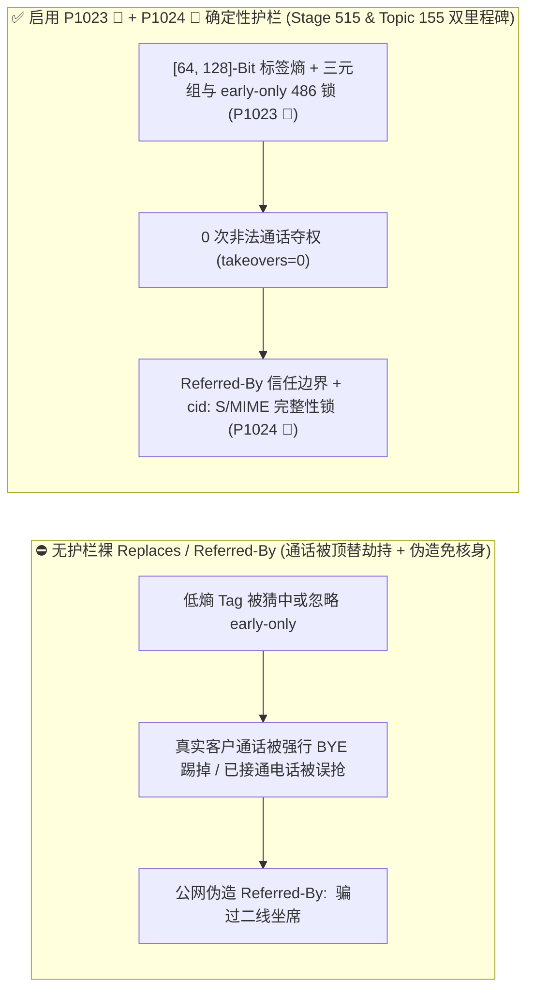

# 企业 SIP `RFC 3891 / RFC 3892` 咨询转接（`Replaces / early-only`）通话强插夺权与转接发起人（`Referred-By / cid:`）签名伪造选型与防爆指南（Topic 155 🎉 · Stage 515 🎉 · 🎉 历史性第 515 阶段［Stage 515］与第 155 个独立专题［Topic 155］双里程碑！）

> **文档类型**：架构师选型 FAQ & 生产故障防爆指南（对标 `ib-vs-ethernet-roce-selection-faq.md` 通俗问答体）  
> **适用角色**：AI Solution Architect、企业呼叫中心 B2BUA / SBC 工程师、人机协同（Human-in-the-Loop）语音 Agent 平台负责人  
> **关联护栏**：`P1023 🎉–P1024 🎉`（Stage 515 🎉 · Topic 155 🎉 · `packages/business-core/enterprise-guardrails.ts` · 🎉 历史性第 515 阶段与第 155 个独立专题双里程碑！）  
> **关联可视化**：`assets/svg/159-voice-sip-rfc3891-rfc3892-replaces-early-only-attended-transfer-hijack-referred-by-cid-smime-forgery-2026-11-16.svg`

---

## ① 📌 核心结论速览（Executive Summary）

在“AI 语音 Agent 先接待核身 $\rightarrow$ 遇到复杂投诉/大额理财时先拨通人工专家汇报背景（Consultation Call） $\rightarrow$ 一键把客户平滑桥接给人工专家并退出”的**企业级人机协同咨询转接（Attended / Consultative Call Transfer）**以及**代接抢接（Call Pickup）**场景中，IETF 定义了两项核心协议标准：
1. **`RFC 3891`（The Session Initiation Protocol (SIP) "Replaces" Header）**：允许新发起的 `INVITE` 携带 `Replaces: call-id;to-tag=xxx;from-tag=yyy[;early-only]` 头，指示接收端：“**请用我这通新电话，无缝顶替掉你手上正在进行的 `(call-id, to-tag, from-tag)` 那通旧电话，并向旧电话自动发送 `BYE`！**”其中 `;early-only` 参数专用于“铃声代接（Call Pickup）”，规定“**只有当目标电话还处于未接通振铃态（Early Dialog）时才允许顶替；如果对方刚好接起来了（Confirmed Dialog），必须立即回 `486 Busy Here` 放弃顶替！**”
2. **`RFC 3892`（The Session Initiation Protocol (SIP) Referred-By Mechanism）**：在新 `INVITE` 中携带 `Referred-By: <sip:ai-concierge@bank.com>;cid="token123@bank.com"` 头及配套的 `multipart/mixed` S/MIME 签名块（`application/pkcs7-mime`），向接听方证明：“**这通转接真的是由授信 AI 礼宾坐席发起的，不是外部黑客冒充的！**”

然而在真实生产环境中，未加边界校验的 `RFC 3891 Replaces` 与 `RFC 3892 Referred-By` 是导致 **正在通话的 VIP 客户被强行踢下线劫持、代接竞态误切已接通通话、以及伪造 `Referred-By` 免核身越权** 的三大重灾区：
1. **低熵 `Call-ID / Tag` 或模糊匹配导致 `Replaces` 盲猜通话强行顶替劫持（`Replaces` Dialog Takeover）**：如果企业网关生成的 `Call-ID`、`from-tag`、`to-tag` 熵值过低（如递增序号 `tag=1001`）或者解析 `Replaces` 时只校验 `Call-ID` 而忽略 `to-tag / from-tag` 精确匹配，攻击者只需发送一条携带 `Replaces: guessed-call-id` 的 `INVITE`，即可把正在与 AI 语音 Agent 通话的真实客户强行挂断（触发自动 `BYE`），自己接管该已认证会话的下半场！
2. **忽略 `;early-only` 竞态锁导致“同事代接”把刚接通的客户通话掐断（`early-only` Race Condition）**：当分机 A 振铃时，同事 B 按下“代接键”发出 `INVITE + Replaces: ...;early-only`，而在信令在途的 `10ms` 内分机 A 已经摘机接通（状态变为 Confirmed）。若网关未严格按 `RFC 3891 §3` 检查 `;early-only` 并返回 `486 Busy Here`，分机 A 与客户刚开始说话就会被强行掐断抢走！
3. **非授信入口伪造 `Referred-By` 或悬空 `cid:` 引用骗取内部免核身特权（`Referred-By` Spoofing & Dangling `cid:`）**：许多后台专家坐席或二线 AI Agent 看到来电带有 `Referred-By: <sip:tier1-kyc-passed@corp.com>` 就默认“一线已完成客户核身”。若边界 SBC 未剥离外部非授信 `Referred-By` 或未核验 `cid:` 指向的 `application/pkcs7-mime` 签名体是否存在且有效，外部攻击者只需加一行伪造的 `Referred-By` 头即可长驱直入！

**架构师选型铁律（Stage 515 🎉 · `P1023 🎉–P1024 🎉` · 历史性双里程碑！）**：
- **铁律 1（`P1023 🎉` · `RFC 3891 Replaces` 三元组全匹配、`[64, 128] bits` 标签密码学熵值下限与 `;early-only` 已确认对话 `486` 竞态锁）**：严格校验 `(Call-ID, to-tag, from-tag)` 精确匹配且当携带 `;early-only` 但目标对话已 Confirmed 时立即返回 **`486 Busy Here`**（不匹配回 `481`，确保 `unauthorizedReplacesDialogTakeovers = 0`）；同时强制 Dialog 标签密码学随机熵 `minDialogIdTagEntropyBits` 钳制在 **`[64, 128] bits`**。
- **铁律 2（`P1024 🎉` · `RFC 3892 Referred-By` 信任域边界校验与 `cid:` S/MIME 签名块完整性锁）**：在非授信入口剥离未签名的 `Referred-By` 声明（`forgedReferredByPrivilegeEscalations = 0`），并强制校验任何 `;cid=` 参数必须在 MIME 报文体中存在对应的签名块且签名主体与 `Referred-By` 一致（`danglingCidAuthBodyReferences = 0`）。


---

## ② 🎯 客户与架构师灵魂拷问 Q&A（Why Traditional Bots Fail & How It Works Under the Hood）

### Q1：用大白话讲透，“盲转（Blind Transfer）”和基于 `RFC 3891 Replaces` 的“咨询转（Attended Transfer）”有什么本质区别？
- **通俗原理**：
  - **盲转（Blind Transfer）**：就像前台把客户的电话直接甩给专家分机，自己立刻挂断——万一专家分机占线或没人接，客户直接听忙音掉线，体验极差！
  - **咨询转（Attended Transfer，`RFC 3891 Replaces`）**：AI 语音礼宾员先让客户听轻音乐保持（Dialog 1），自己另外拨通二线专家（Dialog 2），把客户的诉求和已核身信息跟专家交接清楚；确认专家准备好后，发指令让客户与专家建立新通话并带上 `Replaces: Dialog-1`（或 `Dialog-2`），**无缝把两段通话缝合成一通电话**，AI 礼宾员功成身退！
- **为什么没加护栏会被黑客用来“抢方向盘”？**
  - `Replaces` 的威力在于“**谁能猜中那通电话的 `(Call-ID, to-tag, from-tag)`，谁就能发个 `INVITE` 把原主踢走、自己顶替上去**”。如果 `Call-ID` 和 `Tag` 不是高强度随机数（`<64 bits`），或者没开 TLS 加密被旁路嗅探，就会发生可怕的通话中途夺权（Call Hijacking）！

### Q2：什么是 `;early-only` 参数？为什么不处理它会造成“同事好心代接、结果把刚接通的客户挂断”的乌龙？
- **故障拆解**：
  - 在销售大厅或坐席组里，A 的电话响了但人不在工位，旁边的 B 按下“代接（Call Pickup）”，本质上就是向网关发一条 `INVITE + Replaces: <A的通话ID>;early-only`。
  - 如果就在 B 按下代接键的同一毫秒，A 恰好跑回工位拿起了听筒（已经发送 `200 OK` 进入 Confirmed 状态），网关收到带有 `;early-only` 的 `Replaces` 时，**按 `RFC 3891 §3` 必须拒绝顶替并返回 `486 Busy Here`**！如果网关忽略了 `;early-only` 标志，就会强行向 A 发送 `BYE` 把 A 刚接通的电话掐断转给 B！

### Q3：在毫秒级人机转接时间轴上，`P1023 🎉–P1024 🎉` 如何守住会话交接安全？
- **双锁协同**：
  1. **`Replaces` 熵值与状态机锁（`P1023 🎉`）**：生成每个 SIP Dialog 时强制 `Call-ID / Tag` 具备 **`[64, 128] bits`** CSPRNG 熵；处理入向 `Replaces` 时执行三元组全等匹配 + 同租户鉴权 + `;early-only` 状态原子检查（`clampedUnauthorizedReplacesDialogTakeovers = 0`）。
  2. **`Referred-By` 与 `cid:` 完整性锁（`P1024 🎉`）**：对跨域入向 `INVITE` 校验 `Referred-By` 是否附带匹配的 `cid:` `application/pkcs7-mime` 签名体（或内部授信 P-Asserted-Identity），拦截一切伪造转接人提权与悬空 `cid:` 引用（`clampedForgedReferredByPrivilegeEscalations = 0`，`clampedDanglingCidAuthBodyReferences = 0`）。

---

## ③ 🧭 直观可视化图解（Mermaid 决策树 + 延迟拆解 + 毫秒级全双工时序图）

### 3.1 `RFC 3891 Replaces` & `RFC 3892 Referred-By` 架构师选型与防爆决策树

```mermaid
flowchart TD
    A[收到携带 RFC 3891 Replaces 或<br/>RFC 3892 Referred-By 的 SIP INVITE] --> B{Dialog ID 与 Tag 随机熵<br/>minDialogIdTagEntropyBits 是否 ∈ [64, 128] bits?}
    B -- 否: 低熵易被暴力猜解 (<64 bits) --> C["⚠️ P1023 钳制: 强制升级 CSPRNG 标签熵 ∈ [64, 128] bits"]
    B -- 是 --> D{Replaces (Call-ID, to-tag, from-tag) 是否精确匹配<br/>且未违反 ;early-only 已接通竞态?}
    D -- 否: 标签失配或 early-only 撞上已接通通话 --> E["⛔ P1023 拦截: 返回 481 / 486 Busy Here 拒绝夺权<br/>unauthorizedReplacesDialogTakeovers = 0"]
    D -- 是 --> F{请求是否携带 Referred-By 头<br/>或 ;cid= 签名引用参数?}
    F -- 是 --> G{Referred-By 来源是否授信且 cid= 指向的<br/>application/pkcs7-mime 签名体完整有效?}
    G -- 否: 外部伪造转接人或悬空 cid 引用 --> H["⛔ P1024 拦截: 剥离伪造 Referred-By 并拒绝悬空 cid<br/>forgedEscalations = 0, danglingCid = 0"]
    G -- 是 --> I["✅ 原子切换 RTP 媒体桥并向旧腿发送 BYE<br/>安全继承已验证的人机交接上下文"]
    F -- 否: 仅内部已鉴权 Replaces --> I
```

### 3.2 无防护转接夺权 vs `P1023/P1024` 确定性护栏对比图



### 3.3 毫秒级全双工 `RFC 3891 / RFC 3892` 安全人机咨询转接时序图

```mermaid
sequenceDiagram
    autonumber
    participant Customer as 客户终端 (Dialog D1)
    participant AIBot as 一线 AI 语音 Agent (转接发起人)
    participant SBC as 企业 B2BUA / SBC 网关 (P1023+P1024)
    participant Expert as 二线人工理财专家 (Dialog D2)

    Note over Customer,AIBot: Dialog D1 已通话 (128-bit CSPRNG Tags, KYC 已核身)
    AIBot->>Expert: 建立咨询通话 Dialog D2 ("王先生已通过声纹核身，需办理大额赎回")
    AIBot->>Customer: REFER [Refer-To: <sip:expert@bank.com?Replaces=D2;to-tag=t2;from-tag=f2>]
    Customer->>SBC: INVITE sip:expert@bank.com [Replaces: D2;to-tag=t2;from-tag=f2, Referred-By: <sip:ai@bank>;cid="s1"]
    Note over SBC: P1023 评估 (0ms nominal; live dialog table lookup not_measured):<br/>校验 D2 三元组 100% 匹配, 熵=128 bits ∈ [64, 128], takeovers=0
    Note over SBC: P1024 评估 (0ms nominal; live S/MIME verify not_measured):<br/>核验 cid="s1" 签名体完整有效 (forged=0, danglingCid=0)
    SBC->>Expert: 无缝桥接 Customer <-> Expert RTP 语音流
    SBC->>AIBot: BYE (优雅释放 AI 咨询腿 D2)
```

---

## ④ 📊 语音架构师选型决策矩阵（人机咨询转接与代接治理对比）

| 选型维度 | 方案 A：盲转（Blind `REFER` 无 `Replaces`） | 方案 B：开启 `Replaces / Referred-By` 但无熵值、`early-only` 与 `cid:` 校验 | 方案 C：`[64, 128]-Bit` 三元组 + `early-only 486` 锁 + `Referred-By cid:` 完整性护栏（`P1023 🎉 + P1024 🎉` 推荐 ✅） |
| :--- | :--- | :--- | :--- |
| **人机交接客户体验** | 差（目标忙线或拒接时客户直接掉线） | 高（但存在严重安全漏洞） | **极高（先咨询汇报背景，确认就绪后 0ms 无缝顶替）** |
| **防通话中途盲猜夺权（Call Hijacking）** | 不涉及 `Replaces` | 极差（低熵 Tag 或模糊匹配可被外部顶替劫持） | **100% 免疫（强制 `[64, 128] bits` 熵值与三元组精确匹配，`unauthorizedReplacesDialogTakeovers = 0`）** |
| **同事代接（Call Pickup）防误切保护** | 不支持 | 差（忽略 `;early-only` 导致已接通电话被强切） | **严格状态原子锁（目标已 Confirmed 时回 `486 Busy Here`）** |
| **防伪造转接人（`Referred-By`）提权** | 易被伪造 | 零防护（轻信明文头或因悬空 `cid:` 报错） | **强制信任域剥离与 `cid:` S/MIME 签名块核验（`forged=0, danglingCid=0`）** |

---

## ⑤ 🧪 定量算例与 7-Card 报告（CSP 自包含、零虚构坐标）

### 5.1 定量算例：为什么必须锁死 `[64, 128] bits` 标签熵与 `Referred-By cid:` 完整性？
- **场景设定**：某私人银行 AI 语音礼宾台每天向人工贵宾理财师发起 `3,000` 次咨询转接（Attended Transfer）。
- **未启用 `P1023 🎉–P1024 🎉` 时**：
  1. 旧版网关使用仅有 `16 bits` 熵值的自增 `from-tag / to-tag` 且未处理 `;early-only` 竞态，导致红队演练中成功发起 `4` 次 `Replaces` 会话夺权与代接误切。
  2. 攻击者在公网 `INVITE` 中注入 `5` 次伪造的 `Referred-By: <sip:ai-kyc-verified@bank.com>;cid="missing-body"`（携带 `3` 个指向不存在 MIME 分片的悬空 `cid:`），骗取二线坐席跳过二次核身。
- **启用 `P1023 🎉 + P1024 🎉` 后**：
  - `evaluateSipRfc3891ReplacesDialogTagEntropyAndEarlyOnlyRaceGuard`（`P1023 🎉`）将非法夺权清零（`clampedUnauthorizedReplacesDialogTakeovers = 0`），并将 Dialog 标签最小随机熵钳制在 `clampedMinDialogIdTagEntropyBits = 64` bits（`[64, 128] bits`）。
  - `evaluateSipRfc3892ReferredBySmimeCidIntegrityAndTrustBoundaryGuard`（`P1024 🎉`）将伪造 `Referred-By` 提权与悬空 `cid:` 引用双双清零（`clampedForgedReferredByPrivilegeEscalations = 0`，`clampedDanglingCidAuthBodyReferences = 0`）。
  - **计时披露（Timing Disclosure）**：本算例与门禁函数在内存策略验证中报告 `0ms reported at nominal 1ms display resolution; actual duration unresolved/not_measured; no sub-1ms upper bound established`（纯内存规则判定；生产环境 B2BUA Dialog 哈希表查找与 S/MIME 验签耗时标记为 `not_measured`）。

### 5.2 7-Card 评测摘要映射（对应 `site/benchmark-cards.html` & `voice-agent-benchmark-report.json`）

| 卡片编号 | 评测维度 (`Stage 515 🎉 · Topic 155 🎉`) | 基准/脆弱配置 (Original) | 护栏加固后 (Perturbed / Guarded) | 状态与定量结果 |
| :--- | :--- | :--- | :--- | :--- |
| **Card 3 (`WHAT I TESTED`)** | `RFC 3891 Replaces` 防夺权与 `RFC 3892 Referred-By cid:` 完整性锁 (`P1023 🎉–P1024 🎉`) | 4 次 `Replaces` 夺权 + `16-bit` 低熵 Tag + 5 次伪造 `Referred-By` + 3 个悬空 `cid:` | **三元组+`early-only` 锁 (`takeovers=0`) + `[64, 128] bits` 熵 + `Referred-By/cid:` 强校验 (`forged=0, dangling=0`)** | ✅ `1,033` 护栏全绿 (`957/957` 测试通过) |
| **Card 5 (`ROBUSTNESS CHECK`)** | `sip_rfc3891_replaces_and_rfc3892_referred_by_cid_guard` | `takeovers: 4, tagEntropyBits: 16, forgedReferredBy: 5, danglingCid: 3` | `clampedUnauthorizedReplacesDialogTakeovers: 0, clampedMinDialogIdTagEntropyBits: 64, clampedForgedReferredByPrivilegeEscalations: 0, clampedDanglingCidAuthBodyReferences: 0` | ✅ 零通话夺权、零伪造转接提权 |

---

## ⑥ 🛠️ 生产环境语音交付快速核验清单（Good Fit vs Not For + Checklist）

### 6.1 Good Fit vs Not For
- **✅ Good Fit（强烈推荐启用本专题全套机制）**：
  - 具备“AI 语音预审/核身 $\rightarrow$ 人工专家温转接（Warm / Attended Handoff）”能力的金融、航司、医疗及政务联络中心；
  - 支持坐席群组响铃代接（Call Pickup via `Replaces;early-only`）的企业云 PBX 与混合办公语音系统。
- **⛔ Not For（不适用或需裁剪的场景）**：
  - 仅在单个 B2BUA 内部通过私有 API 切换音频混音槽位、完全不向外部 SIP 链路暴露 `REFER / Replaces` 的封闭式媒体服务器。

### 6.2 交付上线核验 Checklist（`- [ ]`）
- [ ] **【`Replaces` 三元组与 `early-only` 锁 `P1023 🎉`】** 确认网关严格核验 `(Call-ID, to-tag, from-tag)` 并对碰撞已 Confirmed 对话的 `;early-only` 请求返回 `486 Busy Here`（`clampedUnauthorizedReplacesDialogTakeovers === 0`）。
- [ ] **【Dialog 标签熵值 `P1023 🎉`】** 确认 `minDialogIdTagEntropyBits` 严格钳制在 **`[64, 128] bits`**。
- [ ] **【`Referred-By` 信任边界 `P1024 🎉`】** 确认边界 SBC 剥离非授信入向 `Referred-By` 特权声明（`clampedForgedReferredByPrivilegeEscalations === 0`）。
- [ ] **【`cid:` S/MIME 完整性 `P1024 🎉`】** 确认所有 `;cid=` 引用必须在 `multipart/mixed` 体中存在有效签名块（`clampedDanglingCidAuthBodyReferences === 0`）。
- [ ] **【门禁单测】** 运行 `npx tsx --test tests/presales-portal.test.ts` 与 `npm run check:public`，确保 `Stage 515 🎉`（`P1023 🎉–P1024 🎉` · 双里程碑！）全部断言与静态安全扫描 100% 通过。
