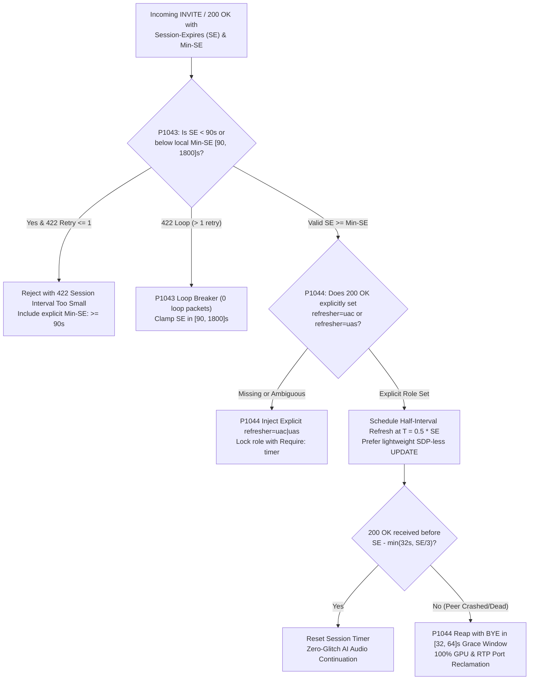
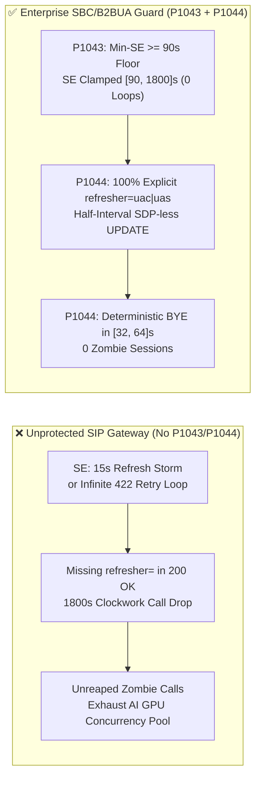

# Enterprise SIP `RFC 4028` Session Timers (`Session-Expires` & `Min-SE`) `422` Negotiation Loop, `refresher` Role Deadlock & Zombie Call Reaper Selection & Engineering Guide (Stage 525 🎉 · Topic 165 🎉 · 🎉 Historic Stage 525 & 165th Architecture Topic Dual Milestone!)

> **Document Type**: Enterprise Voice Architect "First-Principles + Selection Decision" Single-Topic FAQ (aligned with `ib-vs-ethernet-roce-selection-faq.md`)
> **Baseline**: `Stage 525 🎉` · `Topic 165 🎉` · Deterministic Guardrails `P1043–P1044` · 1,053 Guardrails · 1,062 Sandbox Probes · 872 Live POC Trap Probes · 528 Evaluation Dimensions · **🎉 Historic Stage 525 & 165th Voice Architecture Topic Dual Milestone!**
> **Bilingual Edition**: [中文版 (`voice-sip-rfc4028-session-expires-min-se-422-interval-too-small-loop-refresher-role-deadlock-zombie-reaper-faq.md`)](./voice-sip-rfc4028-session-expires-min-se-422-interval-too-small-loop-refresher-role-deadlock-zombie-reaper-faq.md)


---

## ① 📌 Executive Summary

In enterprise AI contact centers and SIP trunks, client crashes, mobile tunnel drops, or silent NAT expirations frequently prevent `BYE` requests from ever arriving. Without **`RFC 4028` Session Timers (`Session-Expires` / `SE` and `Min-SE`)**, LLM streaming contexts, GPU memory slots, and RTP media ports remain stranded for hours as **"Zombie Calls"**. However, naive `RFC 4028` deployments suffer from three severe production failures:
1. **Sub-90s Refresh Storms & `422 Session Interval Too Small` Loops**: Endpoints requesting `Session-Expires: 15` force `re-INVITE/UPDATE` transactions every `7.5s`, exhausting SBC signaling CPU; or proxies returning `422` without a valid `Min-SE` (or UACs retrying without raising `Session-Expires`) trigger infinite `INVITE -> 422 -> INVITE` loops.
2. **Missing `refresher=uac/uas` Role Deadlocks (Clockwork 15/30-Minute Drops)**: When `200 OK` includes `Session-Expires: 1800` but omits `;refresher=uac` or `;refresher=uas`, both UAC and UAS assume the peer will refresh—causing the call to be terminated at `1800s`.
3. **Unbounded Zombie Reaper Grace Windows**: When a peer dies and half-interval (`0.5 * SE`) refresh fails, failing to send a deterministic `BYE` within `[32, 64]s` leaves zombie AI sessions holding GPU ASR/TTS concurrency slots.

**Architect Selection Rules**:
- **Guardrail `P1043` (`RFC 4028` `Min-SE >= 90s` Floor, `[90, 1800]s` Bounds & `422` Loop Breaker)**: Enforces `RFC 4028 §4 / §7.1` `Min-SE >= 90s` floor, clamps negotiated `Session-Expires` to **`[90, 1800]` seconds**, and caps `422` retry loops (`0` unbounded `422` retries or sub-90s timer requests).
- **Guardrail `P1044` (Explicit `refresher=uac|uas` Role Pinning, Half-Interval `UPDATE` Refresh & `[32, 64]s` Zombie Reaper)**: Requires explicit `refresher=uac` or `refresher=uas` in `200 OK` (`0` ambiguous refresher roles), refreshes at `50%` of `SE` via SDP-less `UPDATE` where supported, and reaps unresponsive sessions with `BYE` within **`[32, 64]` seconds** (`0` zombie sessions).

---

## ② 🎯 Architect & Customer Deep-Dive Q&A (Q1 / Q2 / Q3)

### Q1: Why do some enterprise AI voice deployments drop active calls like clockwork at exactly 15 or 30 minutes?
- **Plain-Language Principle**: Both sides agreed on a 30-minute lease (`Session-Expires: 1800`), but neither side wrote down **who is responsible for sending the renewal at the 15-minute halfway mark (`;refresher=uac` vs `;refresher=uas`)**.
- **Protocol Reality**: Under `RFC 4028 §9` Table 2, if `200 OK` omits `refresher=` or mismatches `Require: timer` with `Supported: timer`, UAC and UAS both wait for the other to send `UPDATE / re-INVITE`. At `1800s - 32s = 1768s`, the SBC's session timer expires and fires `BYE` to both endpoints.

### Q2: Why does `RFC 4028` mandate an absolute `Min-SE >= 90` seconds floor instead of allowing `20` seconds for fast disconnect detection?
- **Engineering Rule**: **SIP Session Timers are a control-plane garbage collector for leaked billing/GPU state, NOT a sub-second media liveness detector (which belongs to `RFC 8445` ICE Consent or `RFC 8083` RTCP Circuit Breakers)!**
- **Quantitative Reality**: A SIP `UPDATE` or `re-INVITE` transaction can take up to **`32` seconds** (`64*T1` Timer B/F) to complete under packet loss. Setting `Session-Expires < 90s` causes the session timer to expire while the half-interval refresh transaction is still retransmitting. `P1043` strictly enforces **`[90, 1800]s`**.

### Q3: Does refreshing a session via `re-INVITE` cause an audible glitch in the AI Voice Agent's speech?
- **Architectural Fix**: Naive B2BUAs rebind RTP sockets or reset NetEQ/Opus state on every `re-INVITE`, causing a `60–150ms` audio click. **`P1044` Best Practice**: Prefer SDP-less `UPDATE` requests when `Allow: UPDATE` is present; when using `re-INVITE`, inspect the SDP `o=` `<sess-version>`—if unchanged, keep RTP sockets, SRTP ROC, and NetEQ buffers completely untouched.

---

## ③ 🧭 Visual Architecture Diagrams (Mermaid Decision Tree + Comparison + Sequence Diagram)

### 3.1 `RFC 4028` Session Timer & Zombie Reaper Decision Tree (`flowchart TD`)



### 3.2 Unprotected SIP Timers vs. `P1043 + P1044` Deterministic Guardrails (`flowchart LR`)



### 3.3 Full-Duplex Session Refresh & Zombie Call Reaper Sequence (`sequenceDiagram`)

```mermaid
sequenceDiagram
    autonumber
    participant UAC as Enterprise Endpoint / Remote SBC (UAC)
    participant Edge as AI Voice SBC Guard (P1043 / P1044)
    participant Agent as AI Voice Agent Engine (UAS)

    UAC->>Edge: 1. INVITE (Session-Expires: 30, Supported: timer)
    Note over Edge: P1043 Check: SE=30s < Min-SE(90s)!<br/>Block sub-90s signaling storm
    Edge-->>UAC: 2. 422 Session Interval Too Small (Min-SE: 90)
    UAC->>Edge: 3. INVITE (Session-Expires: 1800; Min-SE: 90)
    Edge->>Agent: 4. Forward Valid INVITE (SE: 1800)
    Agent-->>Edge: 5. 200 OK (Session-Expires: 1800;refresher=uac, Require: timer)
    Note over Edge: P1044 Check: refresher=uac explicitly pinned<br/>Arm T_half=900s monitor & T_reap=1768s reaper
    Edge-->>UAC: 6. 200 OK (Session-Expires: 1800;refresher=uac)
    Note over UAC,Agent: t = 900s (Half-Interval): UAC sends SDP-less UPDATE -> 200 OK
    Note over UAC,Edge: t = 2400s: UAC loses power; t = 2700s refresh never arrives!
    Note over Edge: t = 3568s (32s before expiry):<br/>P1044 triggers deterministic zombie reaper!
    Edge->>Agent: 7. BYE (Reason: SIP;cause=408;text="RFC 4028 Session Timer Expired")
    Note over Agent: Reclaim LLM Context & RTP Port (0 Zombie Leaks)
```

---

## ④ 📊 Architect Decision Matrix

| Dimension | Option A: Disable `RFC 4028` Timers | Option B: Default `RFC 4028` (No `P1043/P1044`) | Option C: `RFC 4028` + `P1043/P1044` Guardrails (Recommended ✅) |
| :--- | :--- | :--- | :--- |
| **Sub-90s Storm & `422` Loop Protection** | No timer traffic | ❌ Vulnerable to `SE < 90s` storms & `422` loops | ✅ **`P1043` clamps `SE` in `[90, 1800]s` & breaks `422` loops (`0` loops)** |
| **`refresher` Role Deadlock Prevention** | N/A | ❌ Missing `refresher=` drops calls at 15/30 min | ✅ **`P1044` enforces explicit `refresher=uac\|uas` (`0` ambiguity)** |
| **Mid-Call AI Audio Continuity** | No refresh | ⚠️ Naive `re-INVITE` resets RTP/NetEQ buffers | ✅ **SDP-less `UPDATE` + zero RTP reset on unchanged SDP `o=`** |
| **Zombie Call GPU/Port Reclamation** | ❌ Leaked for hours on silent crash | ⚠️ Unbounded or inconsistent expiry teardown | ✅ **`P1044` sends `BYE` within `[32, 64]s` grace window (`0` zombies)** |
| **Policy Check Latency (Offline `synthetic`)** | N/A | N/A | **`0ms` (`nominal 1ms` resolution; see disclosure below)** |

---

## ⑤ 🧪 Quantitative Example & 7-Card Report (CSP Self-Contained, Zero Fabricated Coordinates)

### 5.1 Deterministic Guardrail Walkthrough (`P1043` & `P1044`)

1. **`P1043` (`evaluateSipRfc4028SessionExpiresMinSe422FloorAndLoopBreakerGuard` · 1,052nd Guardrail)**:
   - **Violating Input (Sandbox Probe `p1043_sip_rfc4028_session_expires_min_se_422_floor_and_loop_breaker`)**:
     - `sub90sSessionExpiresOrInfinite422RetryLoopDetected = true`
     - `unbounded422RetryOrSub90sTimerRequests = 14`
     - `negotiatedSessionExpiresSeconds = 25`
   - **Deterministic Output**:
     - `violated = true`
     - `action = "enforce_min_se_90s_and_break_422_retry_loop"`
     - `clampedUnbounded422RetryOrSub90sTimerRequests = 0`
     - `clampedNegotiatedSessionExpiresSeconds = 90` (clamped to **`[90, 1800]` seconds**)
     - **Timing Disclosure**: `0ms reported at nominal 1ms display resolution; actual duration unresolved/not_measured; no sub-1ms upper bound established` (offline in-memory `synthetic` policy check; live SBC timer wheel and `422` transaction latency are `not_measured`).

2. **`P1044` (`evaluateSipRfc4028RefresherRoleAssignmentAndHalfIntervalReaperGuard` · 1,053rd Guardrail / 1,062nd Sandbox Probe / 872nd Live POC Probe)**:
   - **Violating Input (Sandbox Probe `p1044_sip_rfc4028_refresher_role_assignment_and_half_interval_reaper`)**:
     - `missingRefresherParameterOrUnreapedZombieSessionDetected = true`
     - `ambiguousRefresherOrZombieCallsCount = 8`
     - `zombieReaperGraceWindowSeconds = 180`
   - **Deterministic Output**:
     - `violated = true`
     - `action = "assign_explicit_refresher_and_reap_zombie_session_with_bye"`
     - `clampedAmbiguousRefresherOrZombieCallsCount = 0`
     - `clampedZombieReaperGraceWindowSeconds = 64` (clamped to **`[32, 64]` seconds**)
     - **Timing Disclosure**: `0ms reported at nominal 1ms display resolution; actual duration unresolved/not_measured; no sub-1ms upper bound established`.

---

## ⑥ 🛠️ Production Voice Delivery Verification Checklist

- [ ] **1. `Min-SE >= 90s` & `[90, 1800]s` Bounds (`P1043`)**: Verify the SBC rejects `Session-Expires < 90` with `422 Session Interval Too Small` + `Min-SE: 90` and breaks repeated `422` retry loops (`0` infinite loops).
- [ ] **2. Explicit `refresher=uac|uas` Pinning (`P1044`)**: Verify every `200 OK` negotiating `RFC 4028` timers explicitly contains `;refresher=uac` or `;refresher=uas` and sets `Require: timer` when `refresher=uac`.
- [ ] **3. Glitch-Free Half-Interval `UPDATE` Refresh**: Confirm half-interval (`0.5 * SE`) refreshes use SDP-less `UPDATE` when supported, or preserve RTP/SRTP/NetEQ state when `re-INVITE` SDP `o=` version is unchanged.
- [ ] **4. `[32, 64]s` Deterministic Zombie Call Reaper (`P1044`)**: Simulate silent peer disconnect and verify the SBC sends `BYE` within `[32, 64]s` of expiry, freeing 100% of AI GPU and RTP resources.
