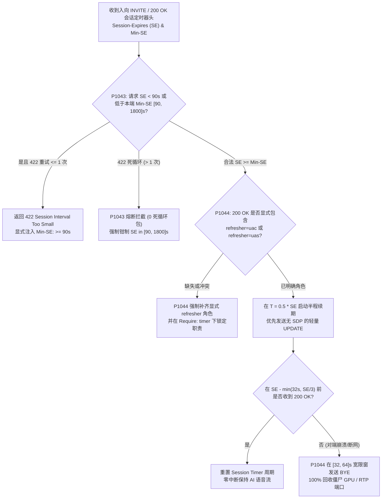
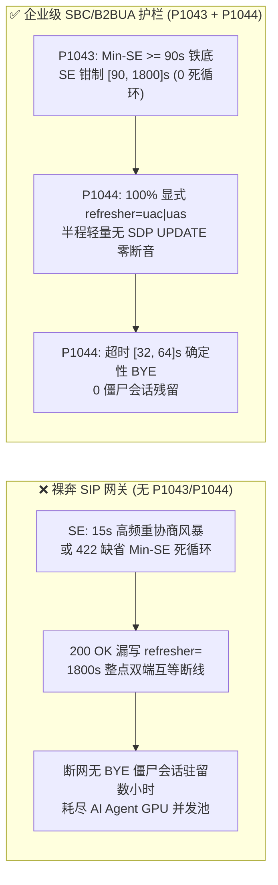

# 企业 SIP `RFC 4028` 会话定时器（`Session-Expires` 与 `Min-SE`）`422` 协商死循环、`refresher` 角色死锁与僵尸长连接收割选型与工程指南（Stage 525 🎉 · Topic 165 🎉 · 🎉 历史性 Stage 525 与第 165 个架构专题双重里程碑！）

> **文档类型**：企业语音架构师“第一性原理 + 选型决策”单专题 FAQ（对标 `ib-vs-ethernet-roce-selection-faq.md` 通俗透彻规范）
> **关联基准**：`Stage 525 🎉` · `Topic 165 🎉` · 确定性护栏 `P1043–P1044` · 1,053 道企业护栏 · 1,062 个沙盒探针 · 872 个现场 POC 探针 · 528 大评测维度 · **🎉 历史性 Stage 525 与第 165 个核心语音架构专题双重里程碑！**
> **双语版本**：[English Version (`voice-sip-rfc4028-session-expires-min-se-422-interval-too-small-loop-refresher-role-deadlock-zombie-reaper-faq.en.md`)](./voice-sip-rfc4028-session-expires-min-se-422-interval-too-small-loop-refresher-role-deadlock-zombie-reaper-faq.en.md)


---

## ① 📌 核心结论速览（Executive Summary）

在企业级 AI 语音客服、金融外呼与跨国 SIP 中继场景中，客户端断电、移动电梯断网或 NAT 表项静默过期，往往导致 `BYE` 信令永远无法送达。如果缺少 **`RFC 4028` 会话定时器（Session Timers：`Session-Expires` / `SE` 与 `Min-SE`）**，AI 语音 Agent 的 LLM 流式会话、GPU 显存上下文和 RTP 媒体端口将沦为长达数小时的**“僵尸长连接（Zombie Calls）”**。然而在生产落地中，`RFC 4028` 极易触发三大致命故障：
1. **亚 90 秒高频重协商风暴与 `422 Session Interval Too Small` 死循环**：恶意或配置错误的终端发送 `Session-Expires: 15`（每 7.5 秒发一次 `re-INVITE/UPDATE`），瞬间打爆 SBC 信令 CPU；或者中间代理返回 `422 Session Interval Too Small` 但未携带合法 `Min-SE`（或 UAC 忽略 `Min-SE` 原样重发），导致两端陷入无限 `INVITE -> 422 -> INVITE` 死循环。
2. **`refresher=uac/uas` 角色缺失导致“双端互等半程掉话”**：`200 OK` 返回 `Session-Expires: 1800` 却漏写 `;refresher=uac` 或 `;refresher=uas` 参数，导致 UAC 以为 UAS 负责续期、UAS 以为 UAC 负责续期，通话精确在 `1800s`（或 `900s`）时被防火墙/SBC 强行掐断！
3. **到期宽限窗口失控导致幽灵计费**：当对端崩溃且半程（`T = SE / 2`）续期失败后，若未在到期前 `min(32s, SE/3)` 发送 `BYE` 强制收割，僵尸会话将继续占用 GPU ASR/TTS 并发槽位。

**架构师选型铁律**：
- **护栏 `P1043`（`RFC 4028` `Min-SE >= 90s` 铁底、生命周期 `[90, 1800]s` 钳制与 `422` 重试熔断锁）**：严格执行 `RFC 4028 §4 / §7.1`，强制 `Min-SE >= 90s` 协议铁底，将协商的 `Session-Expires` 钳制在 **`[90, 1800]` 秒**，并限制单次建连最多允许 `1` 次 `422` 抬升重试（将超限重试循环与非法短周期请求清零为 `0`）。
- **护栏 `P1044`（`refresher=uac|uas` 显式角色绑定、半程 `UPDATE` 优先续期与 `[32, 64]s` 僵尸收割门禁）**：强制 `200 OK` 的 `Session-Expires` 必须显式指定 `refresher=uac` 或 `refresher=uas`（`0` 角色死锁），在 `50%` 周期点优先以轻量 `UPDATE`（无 SDP 变更）续期，并在超时宽限窗口 **`[32, 64]` 秒**内强制发送 `BYE` 回收 GPU 与 RTP 端口（`0` 僵尸通话残留）。

---

## ② 🎯 客户与架构师灵魂拷问 Q&A（Q1 / Q2 / Q3）

### Q1：为什么很多企业上线 AI 语音网关后，每通电话都像定了闹钟一样在整 15 分钟或 30 分钟时莫名断线？
- **通俗原理**：就像租房续约，房东（UAS）和租客（UAC）签了 30 分钟（`Session-Expires: 1800`）合同，但合同上没写清楚**到底谁负责在满 15 分钟（半程 `T = 900s`）时主动发消息续约（`;refresher=uac` 还是 `;refresher=uas`）**。
- **毫秒级底层真相**：按 `RFC 4028 §9` Table 2，如果 `200 OK` 中漏掉了 `refresher` 参数，或者一方声称 `Supported: timer` 而另一方未正确解析 `Require: timer`，UAC 和 UAS 就会同时进入“等待对方发 `re-INVITE/UPDATE`”的死锁状态。当计时器走到 `1800s - 32s = 1768s` 时，SBC 判定会话续期超时，立即向双端发射 `BYE Reason: SIP;cause=408;text="Session Timer Expired"`，正在激辩的客户与 AI 坐席被瞬间掐断。

### Q2：为什么 `RFC 4028` 硬性规定 `Min-SE` 绝对不能低于 `90` 秒？如果设成 `20` 秒靠它做毫秒级断网检测行不行？
- **工程铁律**：**绝对不行！SIP 会话定时器是用来回收“僵尸计费/GPU 槽位”的控制面保底机制，绝不是媒体面毫秒级断网检测器（那是 `RFC 8445` ICE Consent 或 `RFC 8083` RTCP 断路器的职责）！**
- **定量灾难**：每次 SIP 会话续期都是一次完整的 `re-INVITE`（3 次握手）或 `UPDATE`（2 次握手）信令事务，每次事务一旦遇上丢包重传，Timer B/F 最长要跑 **`32` 秒**（`64*T1`）。如果把 `Session-Expires` 设为 `20` 秒，在半程 `10` 秒触发的 `UPDATE` 事务还没跑完 `32` 秒重传周期，外层会话定时器就已经在 `20` 秒引爆拆线了！因此 `P1043` 强制锁定 `Min-SE >= 90s` 且会话周期落在 **`[90, 1800]s`**。

### Q3：遇到客户终端不支持 `UPDATE` 方法，续期时用 `re-INVITE` 会不会导致 AI 语音短暂停顿（Audio Glitch）？
- **架构解法**：无防备的 B2BUA 在收到续期 `re-INVITE` 时，往往会无脑重建 RTP 套接字或重置 Opus 解码器/NetEQ 缓冲，引发 `60–150ms` 的“咔哒”断音。**最佳实践（`P1044`）**：若对端 `Allow` 头包含 `UPDATE`，一律在 `50%` 周期点发送**不带 SDP 包体的轻量 `UPDATE`**（零媒体面触碰）；若只能发 `re-INVITE`，必须对比 SDP `o=` 行的 `<sess-version>`——只要版本号未递增，媒体面严禁重绑定端口或清空抖动缓冲！

---

## ③ 🧭 直观可视化图解（Mermaid 选型决策树 + 延迟/资源拆解对比图 + 毫秒级全双工时序图）

### 3.1 `RFC 4028` 会话定时器协商与僵尸收割选型决策树（`flowchart TD`）



### 3.2 无保护僵尸长连接/高频风暴 vs `P1043 + P1044` 确定性定时器对比图（`flowchart LR`）



### 3.3 毫秒/秒级全双工会话续期与僵尸收割时序图（`sequenceDiagram`）

```mermaid
sequenceDiagram
    autonumber
    participant UAC as 企业终端 / 远端 SBC (UAC)
    participant Edge as AI 语音 SBC 护栏 (P1043 / P1044)
    participant Agent as AI 语音 Agent 引擎 (UAS)

    UAC->>Edge: 1. INVITE (Session-Expires: 30, Supported: timer)
    Note over Edge: P1043 判定: SE=30s < Min-SE(90s)!<br/>拒绝亚 90 秒高频风暴
    Edge-->>UAC: 2. 422 Session Interval Too Small (Min-SE: 90)
    UAC->>Edge: 3. INVITE (Session-Expires: 1800; Min-SE: 90)
    Edge->>Agent: 4. 转发合规 INVITE (SE: 1800)
    Agent-->>Edge: 5. 200 OK (Session-Expires: 1800;refresher=uac, Require: timer)
    Note over Edge: P1044 校验: refresher=uac 显式锁定<br/>启动 T_half=900s 监控与 T_reap=1768s 收割器
    Edge-->>UAC: 6. 200 OK (Session-Expires: 1800;refresher=uac)
    Note over UAC,Agent: t = 900s (半程续期点): UAC 发送无 SDP 变更的轻量 UPDATE 续期成功
    Note over UAC,Edge: t = 2400s: UAC 断电崩溃，t = 2700s 半程续期未到达!
    Note over Edge: t = 3568s (到期前 32s 宽限窗):<br/>P1044 触发确定性僵尸收割!
    Edge->>Agent: 7. BYE (Reason: SIP;cause=408;text="RFC 4028 Session Timer Expired")
    Note over Agent: 立即释放 LLM 上下文与 RTP 端口 (0 僵尸残留)
```

---

## ④ 📊 语音架构师选型决策矩阵（Architect Decision Matrix）

| 选型维度 | 方案 A：禁用 `RFC 4028` Session Timers | 方案 B：启用默认 `RFC 4028`（无 `P1043/P1044` 护栏） | 方案 C：`RFC 4028` + `P1043/P1044` 确定性护栏（推荐 ✅） |
| :--- | :--- | :--- | :--- |
| **最小周期与 `422` 死循环防护** | 无定时器开销 | ❌ 易遭 `SE < 90s` 风暴或 `422` 死循环 | ✅ **`P1043` 强制 `[90, 1800]s` 并阻断 `>1` 次 `422` 循环（`0` 死循环）** |
| **`refresher` 角色死锁（整点断线）** | 不会因续期断线 | ❌ 漏写 `refresher=` 导致 15/30 分钟整点掉话 | ✅ **`P1044` 强制 `200 OK` 显式绑定 `refresher=uac\|uas`（`0` 歧义）** |
| **续期期间 AI 语音连续性** | 无续期抖动 | ⚠️ 盲目用带 SDP `re-INVITE` 重置 RTP 端口断音 | ✅ **优先无 SDP 轻量 `UPDATE` + SDP `o=` 版本未变零重绑** |
| **断网僵尸会话 GPU/端口回收** | ❌ 永不释放或等数小时保底超时 | ⚠️ 宽限窗口混乱导致误杀或延迟释放 | ✅ **`P1044` 在到期前 `[32, 64]s` 宽限窗确定性发 `BYE`（`0` 僵尸会话）** |
| **策略判定耗时（离线 `synthetic`）** | N/A | N/A | **`0ms`（`nominal 1ms` 分辨率；见下方披露）** |

---

## ⑤ 🧪 定量算例与 7-Card 报告（CSP 自包含、零虚构坐标）

### 5.1 确定性护栏定量算例（`P1043` & `P1044`）

1. **`P1043`（`evaluateSipRfc4028SessionExpiresMinSe422FloorAndLoopBreakerGuard` · 第 1,052 道护栏）**：
   - **异常输入（沙盒探针 `p1043_sip_rfc4028_session_expires_min_se_422_floor_and_loop_breaker`）**：
     - `sub90sSessionExpiresOrInfinite422RetryLoopDetected = true`
     - `unbounded422RetryOrSub90sTimerRequests = 14`（检测到 `14` 次 `422` 死循环或低于 `90s` 的高频请求）
     - `negotiatedSessionExpiresSeconds = 25`（违规请求 `25s` 超短周期，低于 `RFC 4028` `90s` 铁底）
   - **确定性输出**：
     - `violated = true`
     - `action = "enforce_min_se_90s_and_break_422_retry_loop"`
     - `clampedUnbounded422RetryOrSub90sTimerRequests = 0`（100% 阻断死循环与短周期风暴）
     - `clampedNegotiatedSessionExpiresSeconds = 90`（自动钳制回 **`[90, 1800]` 秒**合规区间下限 `90s`）
     - **计时语义披露**：`0ms reported at nominal 1ms display resolution; actual duration unresolved/not_measured; no sub-1ms upper bound established`（离线内存 `synthetic` 策略检查；真实 SBC 定时器轮询与 `422` 事务状态机耗时为 `not_measured`）。

2. **`P1044`（`evaluateSipRfc4028RefresherRoleAssignmentAndHalfIntervalReaperGuard` · 第 1,053 道护栏 / 第 1,062 沙盒探针 / 第 872 现场探针）**：
   - **异常输入（沙盒探针 `p1044_sip_rfc4028_refresher_role_assignment_and_half_interval_reaper`）**：
     - `missingRefresherParameterOrUnreapedZombieSessionDetected = true`
     - `ambiguousRefresherOrZombieCallsCount = 8`（`8` 通缺失 `refresher` 参数或超时未收割的僵尸通话）
     - `zombieReaperGraceWindowSeconds = 180`（收割宽限窗口高达 `180s`，远超安全上限 `64s`）
   - **确定性输出**：
     - `violated = true`
     - `action = "assign_explicit_refresher_and_reap_zombie_session_with_bye"`
     - `clampedAmbiguousRefresherOrZombieCallsCount = 0`（`0` 角色歧义与 `0` 僵尸通话残留）
     - `clampedZombieReaperGraceWindowSeconds = 64`（强制钳制在 **`[32, 64]` 秒**收割窗口内）
     - **计时语义披露**：`0ms reported at nominal 1ms display resolution; actual duration unresolved/not_measured; no sub-1ms upper bound established`。

---

## ⑥ 🛠️ 生产环境语音交付快速核验清单（Checklist）

- [ ] **1. `Min-SE >= 90s` 与 `[90, 1800]s` 边界核验（`P1043`）**：验证 SBC 对任何 `Session-Expires < 90` 的 `INVITE/UPDATE` 均返回携带 `Min-SE: 90`（或更高策略值）的 `422 Session Interval Too Small`，且对同一事务超过 `1` 次的连续 `422` 循环执行确定性收敛或拦截。
- [ ] **2. `200 OK` 显式 `refresher=uac|uas` 角色注入核验（`P1044`）**：抓取 `200 OK` 报文，确认当协商启用 Session Timer 时，`Session-Expires` 头 100% 包含 `;refresher=uac` 或 `;refresher=uas`，且当 `refresher=uac` 时必须附带 `Require: timer`。
- [ ] **3. 半程无 SDP `UPDATE` 零断音续期核验**：确认在 `T = 0.5 * SE` 触发续期时，优先发送无 SDP 的 `UPDATE`；若回退至 `re-INVITE`，验证 SDP `o=` 版本号不变时 NetEQ 抖动缓冲与 SRTP 上下文保持零重置。
- [ ] **4. `[32, 64]s` 僵尸长连接 `BYE` 收割核验（`P1044`）**：拔掉客户端网线模拟静默崩溃，验证 SBC 在 `SE - min(32s, SE/3)` 宽限窗口内准时向 AI Agent 发送 `BYE`，GPU 并发槽位与 RTP 端口 100% 释放。
