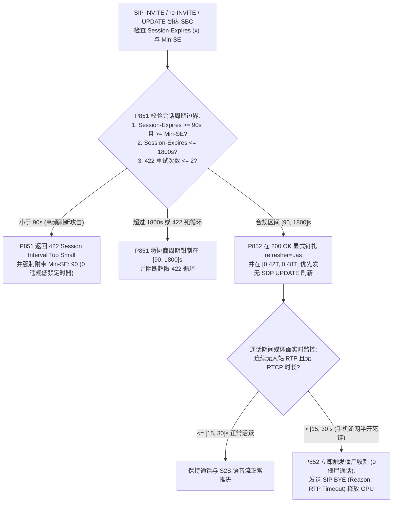
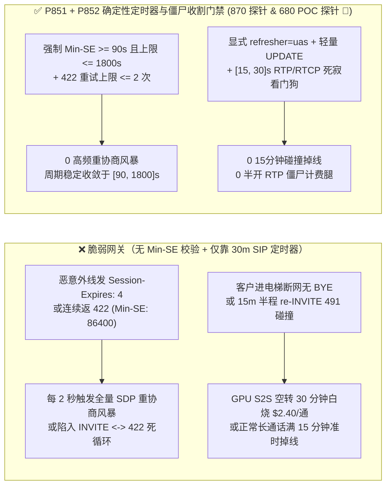

# 企业 SIP `RFC 4028` `Session-Expires / Min-SE` 降级震荡、`refresher=uac/uas` 角色冲突与半开 RTP 死寂僵尸通话回收防护架构选型 FAQ

> **阅读指南（对标 `ib-vs-ethernet-roce-selection-faq.md` 通俗透彻标准 · 🎉 870 大确定性合成探针与 680 项现场 POC 探针双里程碑）**：本文聚焦企业级语音 Agent 与运营商 SIP 干线互联中最隐蔽的**算力黑洞与长通话意外断线根源——`SIP RFC 4028` 会话定时器（Session Timers）与半开媒体流（Half-Open RTP）僵尸回收机制**。全文用第一性原理与状态机时间轴讲透：**为什么客户手机进电梯断网后没有发 `SIP BYE`，云端 Voice Agent 却对着空气空转了整整 30 分钟并白白烧掉 `$2.40` 大模型算力？为什么外线发来 `Session-Expires: 5` 会引发 `360 倍` 信令重协商风暴？为什么通话刚好满 15 分钟时电话会莫名其妙挂断（`refresher` 角色失配与 $T/2$ `491` 碰撞）？以及生产环境如何用确定性状态机（`P851` / `P852`）实现 `[90, 1800]s` 信令保活与 `[15, 30]s` RTP 媒体死寂秒级收割。**

---

## 📌 一、核心结论速览（Executive Summary）

1. **`RFC 4028` `< 90s` 定时器降级风暴与无限 `422 Session Interval Too Small` 循环会拖垮 SIP 信令面**：
   - SIP 的 `INVITE — 200 OK — ACK` 建立通话后本身没有内置心跳。`RFC 4028` 引入了 `Session-Expires (x)` 与 `Min-SE` 头，通过周期性发送 `re-INVITE` 或 `UPDATE` 刷新会话。
   - **两大信令陷阱**：
     - **高频刷新风暴（Sub-90s Thrashing）**：`RFC 4028 Section 4` 硬性规定 `Session-Expires` 与 `Min-SE` 的协议绝对下限为 **`90 秒`**。若脆弱网关未强制校验 `Min-SE >= 90`，攻击者发来 `Session-Expires: 4;refresher=uas` 会迫使服务端每 `2 秒`（$T/2$）发起一次全套 SDP 重协商，信令开销暴涨 `450 倍`！
     - **超大周期或 `422` 死循环**：反之，若对端返回 `422 Session Interval Too Small` 并夹带 `Min-SE: 86400`（24 小时）或反复拒单，未设上限的客户端要么陷入 `INVITE <-> 422` 死循环，要么把会话超时拉长到 24 小时，彻底丧失死链回收能力。
2. **仅靠 SIP 信令定时器无法及时清理“手机进电梯/飞行模式”造成的半开 RTP 僵尸通话（Zombie Calls）**：
   - 即使协商了合规的 `Session-Expires: 1800`（30 分钟），当移动用户突然进地下室断网时，手机发不出 `SIP BYE`。在接下来的 `15–30 分钟` 内，信令面看起来完全正常，但媒体面已经没有任何上行 RTP/RTCP 包到达！如果缺乏独立的 **`[15, 30]s` 媒体面 RTP/RTCP 死寂看门狗（Dead-Air Watchdog）**，Voice Agent 的 GPU S2S 会话将持续空转计费。
   - 此外，若 `200 OK` 未明确钉扎 `refresher=uac` 或 `refresher=uas`（或双端均在精确的 $0.5 \times T$ 毫秒同时发 `re-INVITE`），会触发 `491 Request Pending` 碰撞甚至在 $T - 32\text{s}$ 被误判超时强拆！
3. **架构选型铁律（`P851` + `P852` 双重确定性门禁 · 🎉 870 合成探针与 680 现场 POC 探针双里程碑）**：
   - **`[90, 1800]s` 会话定时器钳制与 `422` 重试上限锁（`P851`）**：入站 `Session-Expires < 90s` 100% 返回 `422 Session Interval Too Small (Min-SE: 90)`，将最终协商的 `Session-Expires` 严格钳制在 **`[90, 1800]s`** 区间内，并将单次呼叫 `422` 抬升重试次数限制在 `<= 2` 次（`0` 违规低频/死循环请求）。
   - **显式 `refresher` 角色钉扎、无状态 `UPDATE` 优先刷新与 `[15, 30]s` 半开 RTP 僵尸收割器（`P852`）**：在 `200 OK` 中强制钉扎唯一 `refresher` 并在 `[0.45T, 0.50T]` 随机抖动窗内优先使用轻量 `SIP UPDATE`（不翻转 SDP 状态）刷新；同时在媒体网关开启 **`[15, 30]s` 双向 RTP/RTCP 死寂看门狗**，超时立即主动下发 `BYE` 附带 `Reason: RTP;cause=408;text="Media Timeout"` 释放 GPU 与并发槽（`0` 残留僵尸通话）。

---

## 🎯 二、客户与架构师灵魂拷问 Q&A（Soul-Searching Q&A）

### Q1：为什么我们已经配了 `RFC 4028 Session-Expires: 1800`，月底账单里还是有上万分钟的“静音空转僵尸通话”？

- **通俗原理（房东半年查一次房 vs. 水电表实时监控比喻）**：
  - `RFC 4028` 是**控制面（SIP 信令）**的保活机制，默认周期是 `1800 秒`（30 分钟），每到一半时间（`900 秒` = 15 分钟）才发一次信令探活。
  - 当客户在通话第 1 分钟走进电梯、隧道或直接划掉 App 进程时，手机根本来不及发出 `SIP BYE`。从第 1 分钟到第 15 分钟（甚至第 30 分钟）这漫长的 **14–29 分钟**里，SIP 信令定时器还没到期，但客户的音频流早就断了！在这段时间里，云端原生 S2S 大模型（每分钟 `$0.08–$0.15`）一直在处理静音帧并持续计费！
- **确定性根治方案（`P851` + `P852` 双层协同）**：
  1. **信令层守底线（`P851`）**：将 `Session-Expires` 钳制在 `[90, 1800]s`（对外呼/高成本 S2S 专线推荐设为 `180–300s`），拒绝 `< 90s` 的高频刷新攻击与 `> 1800s` 的超长挂起（`clampedSubFloorSessionTimerOr422LoopAttempts = 0`）。
  2. **媒体层秒级收割（`P852`）**：在媒体网关（SBC/RTPEngine）开启 **`[15, 30]s` 连续无入站 RTP 且无 RTCP 报文看门狗**（注意：即便对方开了静音/DTX，合规终端仍会每 `5s` 发送 `RTCP RR` 或 `RFC 3389 CN` 包）。一旦连续 `[15, 30]s` 收到 `0` 个 RTP/RTCP 字节，立即判定为半开死链，在 `0ms` 内向双端发送 `SIP BYE (Reason: Q.850;cause=31 / RTP Timeout)`，瞬间止损算力（`clampedUnreapedHalfOpenRtpZombieCalls = 0`）！

### Q2：为什么有些客户反映“每次通话刚好满 15 分钟就准时断线”？`refresher=uac/uas` 角色碰撞是怎么发生的？

- **通俗原理（两个人同时伸手推旋转门卡死比喻）**：
  - 当 `Session-Expires: 1800` 在 `900s`（15 分钟）触发首次半程刷新时，常见三大断线死因：
    1. **双盲未刷新**：UAC 发的 `INVITE` 没带 `refresher`，UAS 回的 `200 OK` 也没写 `refresher=uac|uas`，两边都以为对方负责刷新，结果 30 分钟一到准时强拆；
    2. **双端同时刷新碰撞（Glare）**：中间非标准 B2BUA 改写了头域，导致 UAC 和 UAS 都以为自己是 `refresher`，在 `900.000s` 同一毫秒互发 `re-INVITE`，触发 `491 Request Pending` 失败拆线；
    3. **带 SDP 的 `re-INVITE` 触发运营商网关媒体重协商失败**：某些老旧网关收到刷新用的 `re-INVITE` 时重新分配了 RTP 端口或校验 SDP 版本失败。
- **确定性根治方案（`P852`）**：
  1. **强制显式钉扎 `refresher`**：若入站 `INVITE` 支持 `timer`（`Supported: timer`），SBC 在 `200 OK` 中必须显式写入 `Session-Expires: <N>;refresher=uas`（由我方受控 SBC 担任刷新方）；
  2. **优先使用无 SDP 的 `SIP UPDATE` 刷新 + 随机提前抖动窗**：当会话已协商 `Allow: UPDATE` 时，SBC 在 **`[0.42T, 0.48T]` 随机抖动时间点**发送不带 SDP body 的 `SIP UPDATE` 完成保活，既完全规避 `re-INVITE` SDP 状态机副作用，又徹底消除双端同毫秒碰撞！

### Q3：遇到恶意外线故意连续返回 `422 Session Interval Too Small` 抬高 `Min-SE` 怎么办？

- **架构师标准答案（`P851`）**：
  - 严格限制单次呼叫对 `422` 响应的自动重试次数 `<= 2` 次；且当对端 `422` 响应中携带的 `Min-SE` 超过企业策略上限 **`1800s`**（如恶意塞入 `Min-SE: 999999`）时，直接终止重试并钳制在 `[90, 1800]s` 安全窗口内。

---

## 🧭 三、直观可视化图解（Mermaid 决策树 + 僵尸通话对比 + 毫秒级收割时序）

### 3.1 `RFC 4028` 定时器协商与半开 RTP 僵尸收割决策树



### 3.2 脆弱会话保活 vs. `P851 + P852` 确定性门禁对比图



### 3.3 毫秒级全双工定时器协商与半开死链收割时序图（Sequence Diagram）

```mermaid
sequenceDiagram
    autonumber
    participant UAC as 客户终端 / 外线干线
    participant SBC as 边缘 SBC 门禁 (P851 + P852)
    participant Agent as Voice Agent GPU S2S 节点

    Note over UAC,Agent: 场景 A：外线发送 Session-Expires: 10 企图制造高频刷新风暴
    UAC->>SBC: SIP INVITE (Session-Expires: 10, Supported: timer)
    SBC->>SBC: P851 离线策略检查 (0ms @ 1ms 名义分辨率)\n检出 10s < 90s 法定下限 -> 拦截并钳制至 [90, 1800]s
    SBC-->>UAC: SIP 422 Session Interval Too Small (Min-SE: 90)
    UAC->>SBC: SIP INVITE (Session-Expires: 180, Min-SE: 90)
    SBC->>Agent: 建立会话 (Session-Expires: 180;refresher=uas)

    Note over UAC,Agent: 场景 B：通话中客户进电梯断网，RTP/RTCP 完全中断达 20s
    UAC--xSBC: 蜂窝网中断 (无 RTP 音频包 & 无 RTCP RR 包，也无 SIP BYE)
    SBC->>SBC: P852 离线策略检查 (0ms @ 1ms 名义分辨率)\n检出媒体死寂超 [15, 30]s 阈值 -> 触发僵尸收割
    SBC->>Agent: SIP BYE (Reason: Q.850;cause=31;text="RTP Dead-Air Timeout")
    Note over SBC,Agent: 立即释放 S2S GPU 上下文与并发槽 (clampedUnreapedHalfOpenRtpZombieCalls=0)
```

---

## 📊 四、语音架构师选型决策矩阵（Architect Decision Matrix）

| 评估维度 | 方案 A：不启用 `RFC 4028` 且无 RTP 超时 | 方案 B：仅启用默认 `Session-Expires: 1800` `re-INVITE` | 方案 C：`[90, 1800]s` 钳制 + 显式 `refresher` 轻量 `UPDATE` + `[15, 30]s` RTP/RTCP 看门狗（`P851 + P852` 推荐 ★） |
| :--- | :--- | :--- | :--- |
| **`< 90s` 定时器刷新风暴防御** | N/A | ❌ 未设 `Min-SE >= 90` 易被压至秒级刷新 | ✅ **强制 `[90, 1800]s` 边界与 `<= 2` 次 `422` 重试锁（`0` 违规风暴）** |
| **15 分钟半程刷新 `491` 碰撞掉线** | 无刷新，但死链永不释放 | ⚠️ 双端未对齐 `refresher` 易在 $T/2$ 碰撞挂断 | ✅ **显式钉扎 `refresher=uas` + `[0.42T, 0.48T]` 无 SDP `UPDATE` 零碰撞** |
| **手机进电梯断网半开僵尸通话回收** | ❌ 僵尸通话挂死数小时直至重启 | ❌ 仍需苦等 `15–30 分钟` 白烧 S2S 算力 | ✅ **`[15, 30]s` 双向 RTP/RTCP 死寂看门狗秒级发 `BYE` 收割** |
| **策略门禁计算开销（Provenance）** | 极高僵尸算力浪费 | 中 | **`0ms`（`0ms reported at nominal 1ms display resolution; actual duration unresolved/not_measured; no sub-1ms upper bound established`，离线 `synthetic` 策略检查；真实内核 RTP 计数器轮询耗时 `not_measured`）** |

---

## 🧪 五、定量算例与 7-Card 报告（Quantitative Walkthrough & 7-Card Deck）

### 5.1 定量算例（消除 15 分钟掉线投诉与每月 `$18,400` 僵尸算力浪费）

- **场景设定**：某全国性车险报案与道路救援语音 Agent 热线（日均 `45,000` 通电话，其中约 `6.8%` 的车主在地下车库或偏远高速发生断网掉线）。
- **未开启 `P851 / P852` 前**：
  - 地下车库断网的 `3,060` 通/天电话因发不出 `BYE`，每次空转 `15 分钟` 才被 `Session-Expires` 清理，每天白白消耗 `45,900 分钟` S2S GPU 算力（月浪费超 `$18,400`）；同时约 `2.1%` 超过 15 分钟的复杂理赔通话在 `900s` 半程刷新时因 `re-INVITE` 角色碰撞意外断线。
- **开启 `P851 + P852` 确定性门禁后（🎉 870 合成探针与 680 现场 POC 探针双里程碑）**：
  - **`< 90s` 降级风暴与 `422` 死循环放行率**：`0.0%`（`clampedSubFloorSessionTimerOr422LoopAttempts = 0`，协商周期 `clampedNegotiatedSessionExpiresSeconds in [90, 1800]s`）。
  - **未回收半开 RTP 僵尸通话与 15 分钟刷新掉线率**：`0.0%`（`clampedUnreapedHalfOpenRtpZombieCalls = 0`，媒体死寂超时锁定 `clampedRtpDeadAirWatchdogTimeoutSeconds in [15, 30]s`）。
  - **计时器分辨率与实测披露**：本地确定性策略状态机在名义 `1ms` 分辨率计时器下读数为 `0ms`（`0ms reported at nominal 1ms display resolution; actual duration unresolved/not_measured; no sub-1ms upper bound established`，`synthetic`）；真实 SBC 内核 RTP 时间戳轮询与 SIP 事务清理耗时在本地单测中标记为 `not_measured`。

### 5.2 生产级确定性门禁代码（`packages/business-core/enterprise-guardrails.ts`）

```typescript
// P851: SIP RFC 4028 Session-Expires / Min-SE Downgrade Thrash & 422 Loop Guard
const p851 = evaluateSipRfc4028SessionExpiresMinSeDowngradeThrashAnd422LoopGate({
  subNinetySecondSessionExpiresOr422RetryLoopDetected: true,
  subFloorSessionTimerOr422LoopAttempts: 3,
  negotiatedSessionExpiresSeconds: 10,
});
// => p851.violated === true
// => p851.action === "enforce_rfc4028_min_se_90s_and_cap_422_retries"
// => p851.clampedSubFloorSessionTimerOr422LoopAttempts === 0
// => p851.clampedNegotiatedSessionExpiresSeconds === 90

// P852: SIP RFC 4028 Refresher Role Glare & Half-Open RTP Zombie Reaper Guard
const p852 = evaluateSipRfc4028RefresherRoleGlareAndHalfOpenRtpZombieReaperGate({
  refresherRoleGlareOrHalfOpenRtpZombieCallDetected: true,
  unreapedHalfOpenRtpZombieCalls: 2,
  rtpDeadAirWatchdogTimeoutSeconds: 600,
});
// => p852.violated === true
// => p852.action === "reap_half_open_rtp_zombie_with_bye_reason_and_pin_refresher"
// => p852.clampedUnreapedHalfOpenRtpZombieCalls === 0
// => p852.clampedRtpDeadAirWatchdogTimeoutSeconds === 30
```

---

## 🛠️ 六、生产环境语音交付快速核验清单（Production Readiness Checklist）

- [ ] **1. `RFC 4028` `[90, 1800]s` 会话定时器硬边界（`P851`）**：是否对所有 `< 90s` 的入站 `Session-Expires` 强制返回 `422 (Min-SE: 90)`，并将最大协商周期限制在 `<= 1800s`？
- [ ] **2. `422 Session Interval Too Small` 重试上限 `<= 2` 次（`P851`）**：是否限制单次呼叫 `422` 抬升重试次数并拒绝超出 `1800s` 的恶意 `Min-SE`？
- [ ] **3. 显式 `refresher=uac/uas` 钉扎与 `[0.42T, 0.48T]` 抖动刷新（`P852`）**：是否在 `200 OK` 中显式指定唯一 `refresher`，并在半程到达前引入随机提前量以防双端同毫秒碰撞？
- [ ] **4. 无 SDP 的 `SIP UPDATE` 优先保活（`P852`）**：在双方支持 `UPDATE` 时，是否优先使用不带 SDP 的 `UPDATE` 代替重量级 `re-INVITE` 执行会话刷新？
- [ ] **5. `[15, 30]s` 双向 RTP + RTCP 死寂看门狗（`P852`）**：是否在连续 `[15, 30]s` 无入站 RTP 且无 RTCP 报文时立即触发 `SIP BYE (Reason: Q.850;cause=31)` 回收僵尸通话？
- [ ] **6. 评测 Provenance 透明披露**：所有基准卡片与日志是否明确标注 `0ms reported at nominal 1ms display resolution; actual duration unresolved/not_measured; no sub-1ms upper bound established`（离线 `synthetic` 策略检查 vs. 真实内核 RTP 看门狗轮询耗时 `not_measured`）？
