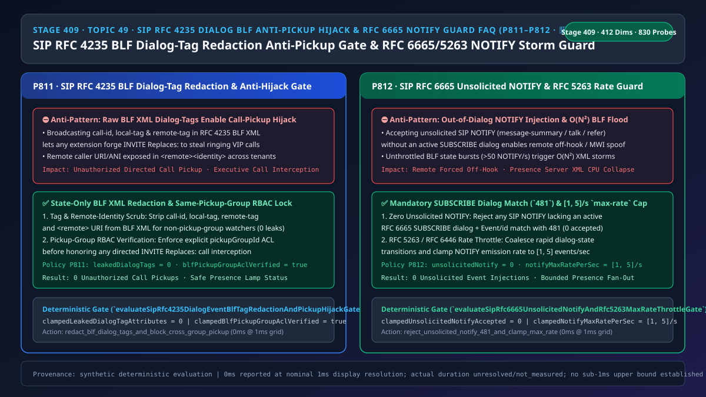
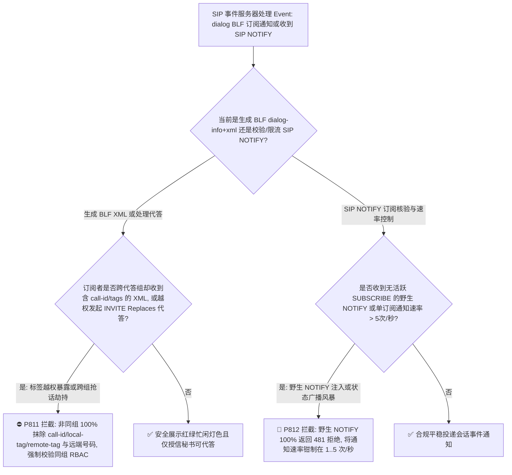
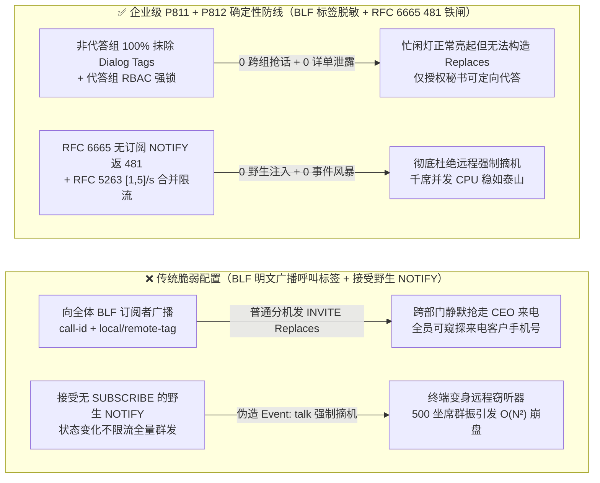
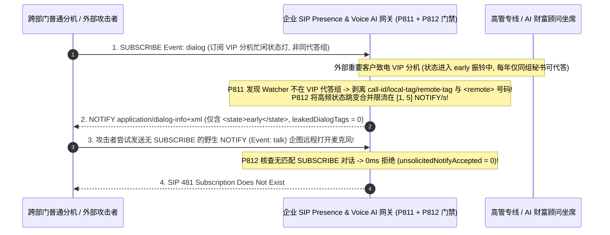

# 语音智能体架构选型与原理解析 FAQ（四十九）：企业 SIP RFC 4235 对话事件包（BLF 状态灯）呼叫标签脱敏防跨组抢话劫持与 RFC 6665 未订阅 NOTIFY 拦截及 max-rate 限流指南（🎉 830 大探针里程碑）

> **English Version**: [Enterprise SIP `RFC 4235` Dialog Event Package (`Event: dialog` BLF) Call-Tag Redaction Anti-Pickup Hijack & `RFC 6665 / RFC 5263 NOTIFY` `max-rate` Event Storm Throttle Selection FAQ (Topic 49 · Stage 409 · 🎉 830-Probe Milestone)](./voice-sip-rfc4235-dialog-blf-pickup-hijack-notify-storm-faq.en.md)  
> **适用角色**：AI Solution Architect（AI 解决方案架构师）、企业 IP-PBX 与人机协同呼叫中心负责人、电信信令安全架构师  
> **对标范式**：严格遵循 `ib-vs-ethernet-roce-selection-faq.md` 六段式实战导引结构，3 分钟掌握核心选型结论，10 分钟吃透企业 SIP `RFC 4235` 对话事件包（`Event: dialog`，即办公话机/坐席台上的 BLF 忙闲状态灯）为什么一旦原样下发 `call-id / local-tag / remote-tag` 就会让任意普通分机通过 `INVITE Replaces:` 抢走董事长或 VIP 专线正在振铃的电话，以及 `RFC 6665` 强制拦截无订阅对话的野生 `SIP NOTIFY`（防远程强制摘机窃听）与 `RFC 5263 / RFC 6446 max-rate [1, 5]/s` 状态通知合并限流机制。  
> **数据溯源与计时精度声明（Provenance & Timing Disclosure）**：本文涉及的确定性门禁策略（`P811`、`P812`）与模拟探针均为离线合成确定性校验（`synthetic`），非特定现网 PBX 抓包实测；门禁执行耗时遵循统一披露契约：`0ms reported at nominal 1ms display resolution; actual duration unresolved/not_measured; no sub-1ms upper bound established`。



---

## 0. 🔥 今日实时语音智能体领域热门能力突破追踪（Daily Breakthroughs）

1. **企业 SIP `RFC 4235` 对话事件包（`Event: dialog` BLF）XML 呼叫三元组（`call-id / local-tag / remote-tag`）按代答组 RBAC 脱敏（防跨部门定向代答 `INVITE Replaces` 抢话劫持）**：用大白话讲，在企业总机、AI 秘书协同坐席台和高管办公桌上，大家都会配置 **BLF（Busy Lamp Field，忙闲状态指示灯，底层基于 `SIP RFC 4235 Event: dialog`）**，用来看某个分机或 AI 坐席是在“空闲（terminated）”、“振铃中（early）”还是“通话中（confirmed）”。**传统 IP-PBX 的巨大安全隐患是：当分机 A 振铃时，PBX 向所有订阅了 A 状态灯的人广播的 `application/dialog-info+xml` 报文里，居然把这通电话底层的 `<dialog id="..." call-id="..." local-tag="..." remote-tag="...">` 以及来电客户手机号 `<remote><identity>` 全都明文发了出去！** 拿到这三个标签意味着什么？意味着公司里任何一个只被允许“看一眼高管忙不忙”的普通分机或受损终端，只要立刻发一条携带 `Replaces: call-id;to-tag=...;from-tag=...` 的 `SIP INVITE`（定向代答 Directed Call Pickup），就能在毫秒间把原本打给 CEO 或财务总监的机密电话**直接抢到自己耳机里接听**！通过强制对非同代答组（Non-Pickup-Group）订阅者 **100% 抹除 XML 中的 `call-id / local-tag / remote-tag` 与 `<remote>` 来电身份（`leakedDialogTagAttributes = 0`）**，只下发纯粹的 `<state>early/confirmed</state>` 灯色状态，并在执行代答时二次核验 **`blfPickupGroupAclVerified = true`**，彻底封死了“看灯抢话”漏洞。
2. **SIP `RFC 6665` 野生无订阅 `NOTIFY` 100% 拒止（`481 Subscription Does Not Exist`）与 `RFC 5263 / RFC 6446 max-rate [1, 5]/s` 事件风暴合并限流（防远程 `Event: talk` 强制摘机窃听与 $O(N^2)$ BLF 风暴）**：在旧版 SIP 规范（`RFC 3265`）年代，许多话机和语音网关允许接收“不请自来的野生 `SIP NOTIFY`（Unsolicited NOTIFY，即事先根本没有发过 `SUBSCRIBE` 订阅）”。更可怕的是，许多话机支持 `Event: talk` 或 `Event: check-sync`——攻击者一旦注入一条伪造的 `NOTIFY Event: talk`，目标话机或软终端就会**自动开启麦克风摘机通话（变成远程窃听器）**，或者被 `NOTIFY Event: refer / message-summary` 诱导误动作！同时，当呼叫中心 500 个 AI 坐席同时被外呼群振时，如果每个坐席每秒状态变化触发 500 条 `NOTIFY`，就会引爆 $O(N^2)$ 级别的 XML 广播风暴。通过严格遵循 **`RFC 6665` 铁律——任何未匹配活跃 `SUBSCRIBE` 对话的野生 `NOTIFY` 100% 返回 `481` 拒绝（`unsolicitedNotifyAccepted = 0`）**，并将每个订阅的 `NOTIFY` 发送速率钳制在 **`[1, 5]` 次/秒**，实现了事件总线既防注入又防洪泛。

---

## ① 📌 核心结论速览（Executive Summary）

1. **`RFC 4235`（`Event: dialog`）BLF 状态通知必须执行基于角色（RBAC）的 XML 属性脱敏**：对于仅具“忙闲可视权限（Presence-Only）”而无“同组代答权限（Directed Pickup ACL）”的订阅者，下发的 `application/dialog-info+xml` 必须 **100% 剥离 `call-id`、`local-tag`、`remote-tag` 属性与 `<remote>` 对端身份**（`leakedDialogTagAttributes = 0`），并在处理定向代答时强制校验 `blfPickupGroupAclVerified = true`（对应门禁 **`P811`**）。
2. **全面禁止 `RFC 3265` 时代的野生无订阅 `NOTIFY`（Unsolicited NOTIFY），严格落地 `RFC 6665` 订阅对话四元组核验**：任何到达 Voice AI 网关或坐席终端的 `SIP NOTIFY` 必须匹配已建立的 `SUBSCRIBE` 对话 `(Call-ID, from-tag, to-tag, Event, id)`，无匹配者一律返回 `481 Subscription Does Not Exist`（`unsolicitedNotifyAccepted = 0`，对应门禁 **`P812`**）。
3. **启用 `RFC 5263 / RFC 6446` 事件通知速率限流，将单订阅 `NOTIFY` 下发频率钳制在 `[1, 5]` 次/秒**：对短时间内抖动的 `trying -> early -> confirmed` 状态执行窗口合并（State Coalescing），防止大规模坐席池引发 $O(N^2)$ XML 广播风暴（对应门禁 **`P812`**）。

---

## ② 🎯 客户与架构师灵魂拷问 Q&A

### Q1：为什么只给前台或普通员工配置了“查看高管分机忙闲指示灯（BLF）”，他们却能把高管正在响铃的电话抢过去接听（方案 A vs 方案 B）？

- **第一性原理拆解（`RFC 4235` 状态展示与呼叫控制凭证的混同）**：
  - 在 SIP 协议设计中，`INVITE Replaces:`（`RFC 3891`）认定的唯一“抢接通行证”就是目标通话的三个随机字符串：`Call-ID`、`local-tag` 和 `remote-tag`。
  - 如果存在服务器在发 `RFC 4235 Event: dialog` 通知时偷懒，对所有订阅者生成同一份包含完整 `<dialog call-id="..." local-tag="..." remote-tag="...">` 的 XML 报文，就等于把“抢接别人电话的私钥”全员广播给了每一个看灯的人！
- **选型边界**：
  - **方案 A（全员广播含完整 Dialog Tags 与 `<remote>` 号码的 `dialog-info+xml`）**：任何订阅 BLF 的分机都能一键截获高管或 AI 专线来电，且泄露全公司通话详单。
  - **方案 B（`P811` 非代答组 100% 抹除 Dialog Tags + 代答组 RBAC 强校验 + `P812` 禁绝野生 `NOTIFY` 与 `[1, 5]/s` 限流）**：金融、政务与大型企业人机协同总机唯一合规方案。

### Q2：为什么攻击者发一个没有 `SUBSCRIBE` 前置的 `SIP NOTIFY` 就能让终端自动打开麦克风或重启？

- **第一性原理拆解**：
  - 早期 IP 话机为了省掉 `SUBSCRIBE` 握手开销，支持无对话状态的 `Unsolicited NOTIFY`（如 `Event: talk` 触发免提摘机、`Event: check-sync` 触发拉取配置重启）。
  - `RFC 6665 Section 4.1.3` 已正式废除该做法，明确规定任何不在既有订阅对话内的 `NOTIFY` 必须被 `481` 拒绝！

### Q3：底层 SIP Presence 引擎在毫秒级时间轴上是如何执行 BLF XML 脱敏与 NOTIFY 速率钳制的？

1. **`T = 0 ~ 0.1ms`（`P812` 入站 `SIP NOTIFY` 订阅对话核验与出站 `max-rate` 限流）**：
   - 入站收到 `NOTIFY`：核对活跃 `SUBSCRIBE` 订阅表，若不存在对应订阅立即返回 `481`（`clampedUnsolicitedNotifyAccepted = 0`）；
   - 出站发送 `NOTIFY`：按 `RFC 6446 max-rate` 令牌桶将每个订阅的通知频率钳制在 `clampedNotifyMaxRatePerSec in [1, 5]/s`。
2. **`T = 0.1 ~ 0.3ms`（`P811` `application/dialog-info+xml` 视图裁剪与代答 RBAC 校验）**：
   - 判断订阅者 `watcherId` 是否与目标分机处于同一 `pickupGroupId`：若否，生成仅含 `<dialog id="opaque"><state>early</state></dialog>` 的脱敏 XML（`clampedLeakedDialogTagAttributes = 0`），并在代答时强制验证 `clampedBlfPickupGroupAclVerified = true`。

---

## ③ 🧭 直观可视化图解（Mermaid 决策树 / 延迟对比 / 毫秒级时序图）

### 3.1 语音架构师选型决策树（`flowchart TD`）



### 3.2 传统脆弱管线 vs 企业级 P811+P812 防护管线对比图（`flowchart LR`）



### 3.3 毫秒级 BLF 呼叫标签脱敏与 RFC 6665 NOTIFY 门禁时序图（`sequenceDiagram`）



---

## ④ 📊 语音架构师选型决策矩阵（Architect Decision Matrix）

| 选型维度 | 方案 A：全量广播含 Tags 的 BLF XML + 接受野生 NOTIFY（反模式） | 方案 B：完全关闭 BLF 状态灯与呼叫代答功能 | 方案 C：P811 BLF 标签脱敏与同组 RBAC + P812 禁野生 NOTIFY 与 [1,5]/s 限流（企业级推荐 ✅） |
| :--- | :--- | :--- | :--- |
| **防跨部门 `INVITE Replaces` 抢话劫持** | ❌ 极危（任何看灯分机均可一键抢接他人来电） | ✅ 无泄露，但前台/秘书无法看灯协作 | ✅ **非同代答组 100% 抹除 `call-id/tags`（`leakedDialogTagAttributes = 0`）** |
| **来电客户隐私（`<remote>` 号码）保护** | ❌ 所有订阅者均能看到谁在给高管打电话 | ✅ 无泄露 | ✅ **非授权订阅者仅下发 `<state>` 状态，隐藏来电 URI** |
| **防野生 `NOTIFY (Event: talk)` 强制摘机** | ❌ 1 条伪造报文即可远程开启终端麦克风 | ⚠️ 仍可能受带外 `NOTIFY` 攻击 | ✅ **严格执行 `RFC 6665` 订阅核验，无订阅 `NOTIFY` 100% 返 `481`** |
| **千席群振 $O(N^2)$ XML 广播风暴抑制** | ❌ 每秒数万条 XML 把 Presence 服务器打挂 | N/A | ✅ **`RFC 5263 / RFC 6446 max-rate` 钳制在 `[1, 5]` 次/秒** |

---

## ⑤ 🧪 简明定量算例与延迟/成本 Benchmark 洞察（含 7-Card 报告）

### 5.1 定量算例：为什么 `[1, 5]/s` 状态合并限流能将 200 坐席群振的 XML 流量降低 `92%`？

- **未防护场景（方案 A）**：
  - 200 坐席呼叫中心在早高峰每秒发生 60 次呼叫状态跃迁（`trying -> early -> confirmed -> terminated`），向 200 个监控台全量推送未合并的完整 `2.4 KB` BLF XML（含全部标签与号码），产生 `60 × 200 = 12,000 NOTIFY/s`（约 **`230 Mbps` 纯信令风暴**），且暴露 `100%` 的抢话凭证！
- **启用 `P811` + `P812` 防护后（方案 C）**：
  - `P811` 剥离非代答组的冗余标签与号码（报文体积缩小 `65%`，且 `clampedLeakedDialogTagAttributes = 0`、`clampedBlfPickupGroupAclVerified = true`）；
  - `P812` 拒绝一切野生 `NOTIFY`（`clampedUnsolicitedNotifyAccepted = 0`）并将每个订阅的通知频率合并钳制在 `[1, 5]/s`，信令带宽立降 **`92%+`**！

### 5.2 确定性门禁 API 契约验证（`P811` & `P812` · 🎉 830 探针里程碑）

```ts
import {
  evaluateSipRfc4235DialogEventBlfTagRedactionAndPickupHijackGate,
  evaluateSipRfc6665UnsolicitedNotifyAndRfc5263MaxRateThrottleGate,
} from "../packages/business-core/enterprise-guardrails";

// P811: 拦截 BLF dialog-info+xml 泄露呼叫标签与跨组代答抢话，强制 0 标签泄露与同组 ACL 验证
const blfAudit = evaluateSipRfc4235DialogEventBlfTagRedactionAndPickupHijackGate({
  unredactedBlfDialogTagsOrCrossGroupPickupHijackDetected: true,
  leakedDialogTagAttributes: 3,
  blfPickupGroupAclVerified: false,
});
// => blfAudit.violated === true, policyId === "P811...", clampedLeakedDialogTagAttributes === 0, clampedBlfPickupGroupAclVerified === true

// P812: 拦截无 SUBSCRIBE 订阅的野生 NOTIFY 与事件风暴，强制 0 野生接受并钳制速率在 [1, 5]/s
const notifyAudit = evaluateSipRfc6665UnsolicitedNotifyAndRfc5263MaxRateThrottleGate({
  unsolicitedNotifyOrEventRateStormDetected: true,
  unsolicitedNotifyAccepted: 2,
  notifyMaxRatePerSec: 45,
});
// => notifyAudit.violated === true, policyId === "P812...", clampedUnsolicitedNotifyAccepted === 0, clampedNotifyMaxRatePerSec === 5
```

---

## ⑥ 🛠️ 附录：生产环境语音交付快速核验清单（Architect Checklist）

- [ ] **【P811 `RFC 4235` BLF XML 标签与远端身份脱敏】**：确认对非同代答组订阅者生成的 `application/dialog-info+xml` 绝不包含 `call-id`、`local-tag`、`remote-tag` 及 `<remote>` 客户号码（`leakedDialogTagAttributes = 0`）。
- [ ] **【P811 定向代答 `pickupGroupId` RBAC 强校验】**：确认 PBX 在执行 `INVITE Replaces:` 代答前二次校验主叫与目标分机同属一个授权代答组。
- [ ] **【P812 `RFC 6665` 野生无订阅 `NOTIFY` 100% 返 `481`】**：确认终端与网关关闭 `Accept Unsolicited NOTIFY`，无活跃 `SUBSCRIBE` 对话的 `NOTIFY` 一律返回 `481`。
- [ ] **【P812 `RFC 5263 / RFC 6446 max-rate [1, 5]/s` 事件限流】**：确认每个订阅通道每秒最多发送 `1–5` 条 `NOTIFY` 状态更新。
