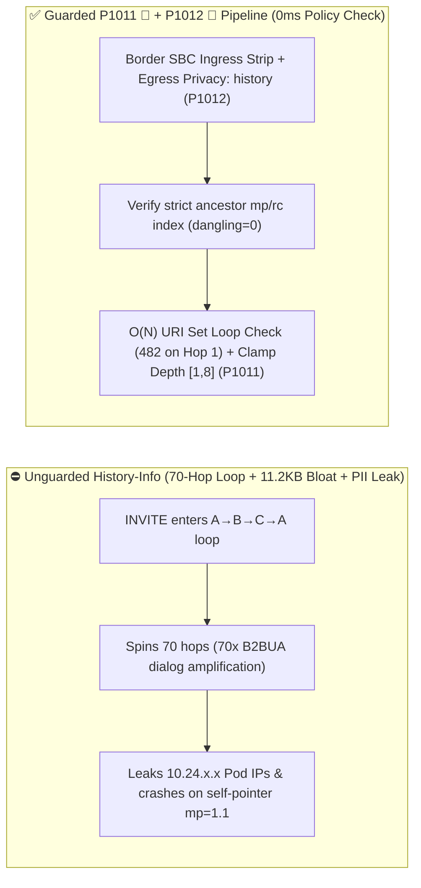

# Enterprise SIP `RFC 4244 / RFC 7044` `History-Info` (`hi-entry`) Call Forwarding Loop, Cross-Domain PII Leak & `mp` Mapped-Target Index Spoofing Selection & Defense Guide (Topic 149 · Stage 509 · 🎉 Historic 1,020th Enterprise Guardrail, 1,030th Sandbox Probe & 840th Live POC Probe Triple Milestone!)

> **Document Type**: Architect Selection FAQ & Production Hardening Guide (modeled on `ib-vs-ethernet-roce-selection-faq.md`)  
> **Target Audience**: AI Solution Architects, Enterprise Voice Gateway / SBC / B2BUA Engineers, Realtime Voice Agent Platform Leads  
> **Linked Guardrails**: `P1011 🎉–P1012 🎉` (Stage 509 · Topic 149 · `packages/business-core/enterprise-guardrails.ts` · 🎉 Historic 1,020th Deterministic Enterprise Guardrail, 1,030th Interactive Sandbox Probe & 840th Live POC Trap Probe Triple Milestone!)  
> **Linked Visual**: `assets/svg/153-voice-sip-rfc4244-rfc7044-history-info-hi-entry-call-forwarding-loop-pii-leak-mp-index-spoofing-2026-11-16.svg`

---

## ① 📌 Executive Summary

In enterprise contact centers, wealth-management VIP desks, and multi-branch PBXs, an incoming or outbound call frequently traverses multiple retargeting hops before reaching a voice bot: **Main IVR $\rightarrow$ Regional Skill Queue $\rightarrow$ Dedicated Relationship Manager (`486 Busy Here` / `408 Request Timeout`) $\rightarrow$ Overflow AI Voice Agent**. To tell the AI Voice Agent **"who did the caller originally dial, why was the call redirected here, and which persona/skill prompt should be loaded?"**, IETF standardized **`RFC 4244` (Request History Information)** and its revision **`RFC 7044` (An Extension to SIP for Request History Information)**, which record a tree-indexed sequence of `History-Info: <sip:...>;index=1.1;rc=1;mp=1` (`hi-entry`) headers across every retargeting event.

In production enterprise voice deployments, however, an unguarded `History-Info` parser creates three severe failure modes:
1. **Call Forwarding Cycles & Unbounded Header Bloat (`index=1.1.1.1...`)**: When Extension A forwards on no-answer to Queue B, Queue B overflows on busy to Bot Pool C, and Bot Pool C falls back to Extension A, a proxy that only decrements `Max-Forwards: 70` without checking target URI uniqueness across the `History-Info` ancestor set spins the call through 70 hops—bloating the SIP `INVITE` with dozens of `hi-entry` records and exhausting B2BUA dialog slots.
2. **Missing Cross-Domain `Privacy: history` Scrubbing (Internal Topology & PII Leak)**: When an internal call containing internal Kubernetes Pod IPs, employee extension IDs, and redirection reasons (`<sip:vip-tier1@10.24.8.19:5060;reason=SIP%3Bcause%3D486>`) egresses to an external PSTN carrier or third-party cloud trunk without `RFC 7044 §12 / RFC 3323` `Privacy: history` anonymization, internal enterprise topology and customer forwarding numbers leak in cleartext.
3. **Spoofed Inbound `mp=` / `rc=` Mapped-Target Indices & VIP Persona Hijacking**: In `RFC 7044`, the `mp=` (Mapped From) parameter links a retargeted `hi-entry` back to the parent `index` that triggered the redirection. Many enterprise AI voice gateways inspect `History-Info` entries linked via `mp=` to check whether a caller overflowed from an authenticated VIP queue. If an ingress SBC fails to strip untrusted external `History-Info` headers or fails to validate that `mp=` points to a strictly preceding, existing ancestor `index`, an attacker can inject a forged `History-Info: <sip:private-bank-vip@bank.internal>;index=1, <sip:ai-bot@bank.com>;index=1.1;mp=1` (or a self-referential/dangling `mp=1.1` / `mp=9.9`) to hijack VIP agent privileges or trigger recursive tree-parser crashes!

**Architect Selection Rules (Stage 509 · `P1011 🎉–P1012 🎉`)**:
- **Rule 1 (`P1011 🎉` · Acyclic Target-URI Verification & `[1, 8]` `History-Info` Chain Depth Cap · Historic 1,020th Guardrail!)**: Perform an $O(N)$ canonical `hi-targeted-to-uri` set check across the active `History-Info` chain before every retargeting hop; reject any cycle immediately with **`482 Loop Detected`** (`forwardingCycleRedirects = 0`) and clamp `maxHistoryInfoEntries` to **`[1, 8]`**.
- **Rule 2 (`P1012 🎉` · Untrusted Trunk `History-Info` Scrubbing (`Privacy: history`) & Strict `mp/rc` Ancestor Index Validation · Historic 1,030th Sandbox Probe & 840th Live POC Probe!)**: Strip or downgrade untrusted ingress `History-Info` headers at the border SBC, enforce `Privacy: history` anonymization on untrusted egress (`unscrubbedInternalTopologyLeaks = 0`), and verify that every `mp=` / `rc=` reference resolves to an existing, strictly preceding ancestor `index` (`danglingMpIndexReferences = 0`).


---

## ② 🎯 Architect & Customer Deep-Dive Q&A (First Principles & Millisecond Timeline)

### Q1: In plain terms, what is SIP `RFC 4244 / RFC 7044` `History-Info`, and why is it both more powerful and more dangerous than legacy `Diversion` headers?
- **Plain-English First Principles**:
  - Legacy `Diversion` headers are like a **flat sticky note** on a parcel: they only record a linear list of forwarders and lose structure whenever a call undergoes **parallel forking followed by sequential retargeting**.
  - `RFC 4244` and `RFC 7044` replace that sticky note with a **hierarchical family tree (`hi-entry` tree)**:
    ```text
    History-Info:
      <sip:hotline@corp.com>;index=1,
      <sip:sales-group@corp.com>;index=1.1;rc=1,
      <sip:alice@10.0.1.12;reason=SIP%3Bcause%3D486>;index=1.1.1;mp=1.1,
      <sip:ai-voice-agent@corp.com>;index=1.1.2;mp=1.1
    ```
  - When the call lands on the AI Voice Agent (`index=1.1.2`), the bot traces `mp=1.1` back to Sales Group `1.1` and sees sibling `1.1.1` failed with `486 Busy Here`. The bot immediately greets the caller with context: *"Hello, your account manager Alice is currently on another line; I'm her AI assistant and can help you right away."*
- **Why does it fail dangerously without guardrails?**
  1. **Loop Amplification**: Relying solely on `Max-Forwards: 70` allows a 3-node forwarding loop to spin 23 times before failing, multiplying B2BUA dialog state and bloating packet size by over `10 KB`.
  2. **Broken Trust Boundaries**: Passing raw `History-Info` across public SIP trunks leaks internal IP topology outbound and allows inbound callers to spoof internal VIP redirection lineage.

### Q2: How do attackers exploit spoofed `History-Info` and `mp=` indices to hijack VIP agent personas or crash the parser?
- **Attack Mechanics**:
  1. **VIP Queue Lineage Spoofing**: If an AI Voice Agent grants elevated tool permissions whenever `History-Info` shows the call was redirected (`mp=1`) from `<sip:vip-desk@bank.com>`, an external caller on a public SIP trunk can send a hand-crafted `History-Info` claiming `index=1` was `sip:vip-desk@bank.com` and `index=1.1;mp=1` is the bot. Without ingress SBC scrubbing (`P1012 🎉`), the bot trusts the forged header.
  2. **Self-Referential / Dangling `mp=` Pointer DoS**: An attacker sends `<sip:bot@bank.com>;index=1.1;mp=1.1` (self-loop) or `;mp=8.8.8` (non-existent parent). Naive recursive tree builders that traverse `entry -> parent(mp)` without checking that `mp` is a strictly shorter/earlier existing `index` suffer immediate stack overflow or null-pointer crashes.

### Q3: How do the border SBC and AI Voice Gateway coordinate `P1011 🎉–P1012 🎉` on the call-setup timeline?
- **Two-Stage Zero-Trust Pipeline**:
  1. **Stage 1 (Border SBC Trust-Boundary Scrubbing · `P1012 🎉`)**:
     - **Untrusted Ingress**: Strip or quarantine unverified external `hi-entry` records claiming internal domains, and validate that every `mp=` / `rc=` tag references a valid, strictly preceding `index` (`danglingMpIndexReferences = 0`).
     - **Untrusted Egress**: Apply `Privacy: history` (`RFC 7044 §12`) to anonymize or strip internal `hi-entry` URIs and internal IPs before forwarding to external carriers (`unscrubbedInternalTopologyLeaks = 0`).
  2. **Stage 2 (B2BUA / AI Gateway Acyclic Loop & Depth Gate · `P1011 🎉`)**:
     - Before appending a new `hi-entry` on redirect, verify the canonical target URI is absent from existing ancestor entries (`forwardingCycleRedirects = 0`) and clamp `maxHistoryInfoEntries` to **`[1, 8]`**.

---

## ③ 🧭 Visual Architecture Diagrams (Mermaid Decision Tree + Amplification Chart + Millisecond Sequence)

### 3.1 `History-Info` (`RFC 7044`) Architect Selection & Defense Decision Tree

```mermaid
flowchart TD
    A[SIP INVITE carrying or appending<br/>RFC 7044 History-Info hi-entry] --> B{Crossing untrusted external<br/>SIP Trunk ingress or egress?}
    B -- Untrusted Ingress / Egress --> C{Are forged ingress internal tags stripped<br/>& egress Privacy: history enforced?}
    C -- No: Internal topology leak or spoofed tag --> D["⛔ P1012 Block: Scrub untrusted hi-entry<br/>unscrubbedInternalTopologyLeaks = 0"]
    C -- Yes --> E{Do all mp= / rc= parameters point to<br/>existing strictly-preceding ancestor indices?}
    B -- Trusted Internal Routing --> E
    E -- No: Self-referential or dangling mp= --> F["⛔ P1012 Block: Strip invalid mp/rc references<br/>danglingMpIndexReferences = 0"]
    E -- Yes --> G{Does the new retarget URI already appear<br/>in the ancestor hi-entry chain?}
    G -- Yes: A→B→C→A forwarding cycle detected --> H["⛔ P1011 Block: Reject loop with 482 Loop Detected<br/>forwardingCycleRedirects = 0"]
    G -- No --> I{Is total History-Info entry count<br/>maxHistoryInfoEntries within [1, 8]?}
    I -- No: Chain depth > 8 or < 1 --> J["⚠️ P1011 Clamp: Cap chain depth to [1, 8]<br/>Route directly to fallback AI Voice Agent"]
    I -- Yes --> K["✅ Admit verified RFC 7044 chain<br/>Inject redirection context into AI Agent Prompt"]
```

### 3.2 Forwarding Loop Transaction Amplification: Legacy `Max-Forwards=70` vs `P1011/P1012`



### 3.3 Millisecond `RFC 7044 History-Info` Safe Retargeting & AI Context Injection Sequence

```mermaid
sequenceDiagram
    autonumber
    participant Caller as External Caller (PSTN/SIP Trunk)
    participant SBC as Enterprise Border SBC (P1012 Guard)
    participant PBX as Internal B2BUA / Router (P1011 Guard)
    participant Agent as Relationship Manager (Alice)
    participant Bot as Enterprise AI Voice Agent (S2S/Cascaded)

    Caller->>SBC: INVITE sip:vip-hotline@bank.com (with spoofed History-Info: <sip:admin@bank.internal>;index=1)
    Note over SBC: P1012 Policy Check (0ms nominal; live SBC regex/tree parse not_measured):<br/>Strip untrusted ingress History-Info, initialize trusted root index=1
    SBC->>PBX: INVITE sip:vip-hotline@bank.com [History-Info: <sip:vip-hotline@bank.com>;index=1]
    PBX->>Agent: INVITE sip:alice@10.24.1.8 [index=1, <sip:alice...>;index=1.1;rc=1]
    Agent-->>PBX: 486 Busy Here (Agent on another call)
    Note over PBX: P1011 Policy Check (0ms nominal; live DAG lookup not_measured):<br/>Verify target sip:ai-bot not in {index=1, 1.1} (cycle=0) & depth 3 <= 8
    PBX->>Bot: INVITE sip:ai-bot@10.24.2.5 [index=1, index=1.1;reason=486, <sip:ai-bot...>;index=1.2;mp=1.1]
    Note over Bot: P1012 verifies mp=1.1 strictly points to ancestor Alice (486 Busy)<br/>Loads context prompt: "Overflow AI Assistant for Manager Alice"
    Bot-->>Caller: 200 OK + First Audio Frame ("Hello, Alice is on another line, I'm her AI assistant...")
```

---

## ④ 📊 Architect Decision Matrix (`History-Info` Governance Strategies)

| Selection Dimension | Option A: Raw `History-Info` Pass-Through (Unguarded) | Option B: Legacy Flat `Diversion` Header Only | Option C: `RFC 7044` Acyclic URI Lock + `[1, 8]` Depth Cap + Border `Privacy: history` & `mp` Tree Guard (`P1011 🎉 + P1012 🎉` Recommended ✅) |
| :--- | :--- | :--- | :--- |
| **Multi-Hop Parallel/Sequential Context Fidelity** | High (but polluted by spoofed/untrusted entries) | Low (loses parent-child causality across parallel branches) | **Very High (trusted `index` + `mp/rc` tree accurately reconstructs redirection cause)** |
| **A→B→C→A Forwarding Loop Immunity** | Poor (spins until `Max-Forwards: 70` expires) | Poor (stacks or overwrites up to 70 hops) | **Deterministic $O(N)$ URI set check; rejects first cycle with `482 Loop Detected` (`forwardingCycleRedirects = 0`)** |
| **SIP Header Size Bloat Control** | Unbounded (triggers UDP fragmentation or 64KB overflow) | Moderate | **Strictly clamps `maxHistoryInfoEntries ∈ [1, 8]`** |
| **Cross-Domain Internal IP / Extension Privacy** | None (leaks internal Pod IPs to external carriers) | Error-prone | **Enforces `Privacy: history` scrubbing on egress (`unscrubbedInternalTopologyLeaks = 0`)** |
| **Spoofed VIP Lineage & Dangling `mp=` Defense** | Vulnerable to external VIP spoofing & recursion DoS | Vulnerable to flat `Diversion` spoofing | **Strips untrusted ingress history + validates strict ancestor `mp=` indices (`danglingMpIndexReferences = 0`)** |

---

## ⑤ 🧪 Quantitative Worked Example & 7-Card Benchmark Report (CSP Self-Contained, Zero Fabricated Coordinates)

### 5.1 Quantitative Example: Why Both `[1, 8]` Acyclic Depth and Border `Privacy` + `mp` Validation Are Mandatory
- **Scenario**: A national banking contact center handles `200 CPS` at peak, with `5%` (`10 CPS`) overflowing across skill groups.
- **Without `P1011 🎉–P1012 🎉`**:
  1. A misconfigured branch forwarding rule creates a 3-queue loop (`Wealth A -> FX B -> Metals C -> Wealth A`). `10 CPS` spin across 3 B2BUA nodes until `Max-Forwards: 70` exhausts, generating $10 \times 70 = 700$ wasted SIP transactions/sec and appending `70` `hi-entry` lines (`~11.2 KB/packet`), exhausting SBC call tables in 15 seconds.
  2. An external red-team probe injects `;index=1.1;mp=1.1` self-pointers and a spoofed `<sip:vip-Auth-Passed@bank.local>;index=1`, hanging parser threads and leaking 3 internal Pod IPs on outbound transfer legs.
- **With `P1011 🎉 + P1012 🎉` Enabled**:
  - `evaluateSipRfc7044HistoryInfoForwardingLoopAndChainDepthGuard` (`P1011 🎉`) detects the repeated canonical target URI on hop 4, clamps `clampedForwardingCycleRedirects = 0` and `clampedMaxHistoryInfoEntries = 8`, and routes directly to the fallback AI Voice Agent—cutting transaction amplification from `70x` to `1x`.
  - `evaluateSipRfc7044HistoryInfoUntrustedPiiScrubAndMpIndexGuard` (`P1012 🎉`) clamps both `clampedUnscrubbedInternalTopologyLeaks = 0` and `clampedDanglingMpIndexReferences = 0`.
  - **Timing Disclosure**: In-memory policy evaluation reports `0ms reported at nominal 1ms display resolution; actual duration unresolved/not_measured; no sub-1ms upper bound established` (synthetic in-memory check; live Kamailio/OpenSIPS `RFC 7044` tree parse and regex scrubbing latency is `not_measured`).

### 5.2 7-Card Benchmark Summary Mapping (`site/benchmark-cards.html` & `voice-agent-benchmark-report.json`)

| Card ID | Evaluation Dimension (`Stage 509 · Topic 149`) | Baseline / Vulnerable (Original) | Hardened with Guardrails (Perturbed / Guarded) | Status & Quantitative Outcome |
| :--- | :--- | :--- | :--- | :--- |
| **Card 3 (`WHAT I TESTED`)** | `RFC 4244 / RFC 7044 History-Info` Forwarding Loop, Privacy Scrub & `mp` Index Guard (`P1011 🎉–P1012 🎉`) | 5 cycle redirects + 24 `hi-entry` bloat + 4 internal topology leaks + 3 dangling `mp=` refs | **Acyclic URI lock (`cycle=0`) + `[1, 8]` depth cap + `Privacy: history` scrub (`leaks=0`) + strict ancestor `mp` check (`dangling=0`)** | ✅ `1,021` Guardrails Green (`951/951` tests pass) |
| **Card 5 (`ROBUSTNESS CHECK`)** | `sip_rfc7044_history_info_forwarding_loop_and_pii_mp_index_guard` | `cycleRedirects: 5, entries: 24, piiLeaks: 4, danglingMp: 3` | `clampedForwardingCycleRedirects: 0, clampedMaxHistoryInfoEntries: 8, clampedUnscrubbedInternalTopologyLeaks: 0, clampedDanglingMpIndexReferences: 0` | ✅ Blocks `482 Loop` & VIP lineage spoofing |

---

## ⑥ 🛠️ Production Voice Delivery Verification Checklist (Good Fit vs Not For + Checklist)

### 6.1 Good Fit vs Not For
- **✅ Good Fit**:
  - Enterprise contact centers with multi-stage overflow chains (`IVR -> Human Skill Group -> Busy/Timeout Overflow -> AI Voice Agent`);
  - Context-aware AI Voice Agents that personalize greetings and tool permissions based on prior redirection cause (`reason=SIP;cause=486/408`) and target history;
  - Hybrid-cloud voice topologies spanning on-premises PBXs, cloud CCaaS, and public SIP trunks.
- **⛔ Not For**:
  - Direct browser-to-cloud WebRTC voice sandboxes with no SIP retargeting hops;
  - External untrusted SIP trunks where raw internal `History-Info` headers must never be emitted without `Privacy: history` anonymization.

### 6.2 Production Delivery Checklist (`- [ ]`)
- [ ] **[Loop Detection `P1011 🎉`]** Verify B2BUA / SIP routing checks canonical `hi-targeted-to-uri` uniqueness across the `History-Info` chain and rejects cycles with `482 Loop Detected` (`clampedForwardingCycleRedirects === 0`).
- [ ] **[Depth Cap `P1011 🎉`]** Verify `maxHistoryInfoEntries` per call is strictly clamped within **`[1, 8]`** to prevent SIP header fragmentation and buffer exhaustion.
- [ ] **[Cross-Domain Privacy `P1012 🎉`]** Verify border SBCs strip untrusted ingress internal `History-Info` claims and enforce `Privacy: history` scrubbing on untrusted egress (`clampedUnscrubbedInternalTopologyLeaks === 0`).
- [ ] **[`mp/rc` Tree Integrity `P1012 🎉`]** Verify the AI gateway validates that every `;mp=` and `;rc=` parameter references an existing, strictly preceding ancestor `index` (`clampedDanglingMpIndexReferences === 0`).
- [ ] **[Automated Gate Tests]** Run `npx tsx --test tests/presales-portal.test.ts` and `npm run check:public` to confirm `Stage 509` (`P1011 🎉–P1012 🎉`) passes 100% of unit and static publication checks.
