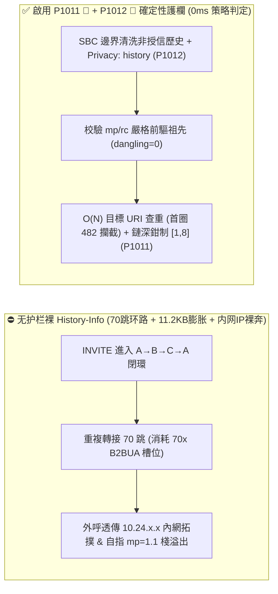

# 企业 SIP `RFC 4244 / RFC 7044` 呼叫转移历史链（`History-Info` / `hi-entry`）环路风暴、跨域拓扑隐私泄露与 `mp` 映射索引伪造选型与防爆指南（Topic 149 · Stage 509 · 🎉 历史性第 1,020 道企业级护栏、第 1,030 个沙盒探针与第 840 个现场 POC 探针三重里程碑！）

> **文档类型**：架构师选型 FAQ & 生产故障防爆指南（对标 `ib-vs-ethernet-roce-selection-faq.md` 通俗问答体）  
> **适用角色**：AI Solution Architect、企业语音网关 / SBC / B2BUA 工程师、实时语音 Agent 平台负责人  
> **关联护栏**：`P1011 🎉–P1012 🎉`（Stage 509 · Topic 149 · `packages/business-core/enterprise-guardrails.ts` · 🎉 历史性第 1,020 道企业级确定性护栏、第 1,030 个交互式沙盒探针与第 840 个现场照妖镜探针三重里程碑！）  
> **关联可视化**：`assets/svg/153-voice-sip-rfc4244-rfc7044-history-info-hi-entry-call-forwarding-loop-pii-leak-mp-index-spoofing-2026-11-16.svg`

---

## ① 📌 核心结论速览（Executive Summary）

在金融客服中心、跨国分支总机、政务热线和 VIP 专属理财顾问场景中，一通外呼或呼入电话往往经历多次重路由：**总机 IVR $\rightarrow$ 区域技能组 $\rightarrow$ 专属客户经理分机（占线无应答 `486/408`） $\rightarrow$ 兜底 AI 语音 Agent**。为了回答**“这通电话原本是打给谁的？为什么转到了 AI Agent？该加载哪套人设 Prompt？”**，IETF 制定了 **`RFC 4244`（Request History Information）** 及其修订标准 **`RFC 7044`（An Extension to the Session Initiation Protocol (SIP) for Request History Information）**，通过在 SIP 请求头中追加树状层级结构的 `History-Info: <sip:...>;index=1.1;rc=1;mp=1`（`hi-entry` 条目），完整记录呼叫每一次重定向（Retarget）的来龙去脉。

然而在真实生产环境中，未加边界护栏的 `History-Info` 解析器是引发 **B2BUA 转接死循环雪崩、内网分机拓扑泄密与 AI Agent VIP 鉴权绕过** 的高频重灾区：
1. **转接环路与无限 `hi-entry` 膨胀（Call Forwarding Cycle & Header Bloat）**：当分机 A 设置“无应答转分机 B”，分机 B 设置“忙时转 AI 队列 C”，而 AI 队列 C 降级溢出又转回分机 A 时，若代理未對 `History-Info` 中的历史目标 URI 集合执行有向无环图（DAG）查重与深度限制，SIP `INVITE` 会在集群内高速打转，头部塞满数十条 `hi-entry`（`index=1.1.1.1.1...`）直至撑爆 64KB 报文上限并耗尽 B2BUA 呼叫槽位。
2. **跨域 `Privacy: history` 缺失致企业内部拓扑与手机号裸奔（Internal Topology & PII Leak）**：当呼叫在企业内部经过多跳微服务（如 `<sip:vip-wealth-tier1@10.24.8.19:5060;reason=SIP%3Bcause%3D486>`）后外呼至外部云端 AI 供应商或 PSTN 运营商时，若边界 SBC 未按 `RFC 7044 §12 / RFC 3323` 执行 `Privacy: history` 脱敏清洗，整条内部 IP、VIP 坐席工号及客户私人转接号码将明文暴露给外部不受信任中继。
3. **外部伪造 `mp=` / `rc=` 映射索引越权骗取 VIP 坐席人设（`mp` Mapped-Target Index Spoofing）**：在 `RFC 7044` 中，`mp=`（Mapped From）与 `rc=`（Retarget Counter）参数用于指向触发本次转接的父级 `index`。许多企业 AI 语音网关直接读取 `History-Info` 中带有 `;mp=1` 的条目来判断“该客户是否是从私人银行 VIP 专线转入的，若是则免密开启高权限理财赎回工具”。攻击者从公网 SIP 中继直接发送一条伪造的 `INVITE`，在头部塞入虚假的 `History-Info: <sip:private-bank-vip@bank.internal>;index=1, <sip:ai-bot@bank.com>;index=1.1;mp=1`（或指向不存在父节点的悬空 `mp=9.9`），即可瞬间骗过 AI 网关的转接来源校验，越权调用 VIP 专享工具或触发树解析空指针崩溃！

**架构师选型铁律（Stage 509 · `P1011 🎉–P1012 🎉`）**：
- **铁律 1（`P1011 🎉` · 历史目标 URI 无环校验与 `[1, 8]` 跳历史链深度硬上限 · 历史性第 1,020 道护栏！）**：在 SIP Proxy / B2BUA / AI 语音入口对 `History-Info` 链中的所有规范化 `hi-targeted-to-uri` 执行 $O(N)$ 哈希集合查重，一旦发现当前重定向目标已存在于祖先链中（`forwardingCycleRedirects > 0`），立即以 **`482 Loop Detected`** 终结转接环路；同时将 `maxHistoryInfoEntries` 严格钳制在 **`[1, 8]` 条**以内。
- **铁律 2（`P1012 🎉` · 非授信中继 `History-Info` 入向剥离/出向 `Privacy: history` 脱敏与 `mp/rc` 树索引强校验 · 历史性第 1,030 个探针 & 840 个 POC 探针！）**：在边界 SBC 上，对来自外部非授信中继的入向 `INVITE` 剥离或降级未签名的内部域名 `hi-entry`，对出向外部中继的请求强制执行 `Privacy: history` 匿名化（`sip:anonymous@anonymous.invalid`，确保 `unscrubbedInternalTopologyLeaks = 0`）；在解析树结构时强制校验所有 `mp=` / `rc=` 引用必须指向当前头部中真实存在且单调递增的祖先 `index`（`danglingMpIndexReferences = 0`）。


---

## ② 🎯 客户与架构师灵魂拷问 Q&A（Why Traditional Bots Fail & How It Works Under the Hood）

### Q1：用大白话讲透，什么是 SIP `RFC 4244 / RFC 7044` `History-Info`？为什么比旧式 `Diversion` 头更强大，却也更容易炸穿 AI 语音网关？
- **通俗原理**：
  - 早期的非标 `Diversion` 头就像一张贴在快递盒上的**单行便签**，只能简单写“从张三转寄过来”，一旦电话经历了**并行振铃（Parallel Forking）再串行转接（Sequential Retargeting）**，单行便签就彻底乱套了。
  - `RFC 4244`（以及修复了安全与索引歧义的升级版 `RFC 7044`）把快递记录升级成了一棵**带层级编号的家谱树（Tree of `hi-entry`）**：
    ```text
    History-Info:
      <sip:hotline@corp.com>;index=1,
      <sip:sales-group@corp.com>;index=1.1;rc=1,
      <sip:alice@10.0.1.12;reason=SIP%3Bcause%3D486>;index=1.1.1;mp=1.1,
      <sip:ai-voice-agent@corp.com>;index=1.1.2;mp=1.1
    ```
  - 当电话最终落到 AI 语音 Agent（`index=1.1.2`）时，AI 只要顺着 `mp=1.1`（Mapped From `1.1`）往回看，就能瞬间明白：“用户打的是销售热线 `1.1`，因为客户经理 Alice（`1.1.1`）占线（`486 Busy Here`），才溢流到我这里的！我开场白应该直接说：‘您好，您的专属经理 Alice 正在通话中，我是她的 AI 助理，先帮您处理……’”
- **为什么极易成为生产事故源？**
  1. **环路放大器**：传统的 SIP `Max-Forwards: 70` 只能防网络层无限跳数，但在每一次转接仅消耗 1–2 跳的情况下，3 个分机互相转接 25 圈才会耗尽 `Max-Forwards`，期间已在语音集群内产生 50+ 个半开对话并塞入几十条长长的 `History-Info`！
  2. **信任边界错位**：许多团队把内部 PBX 与公网 SBC 的 `History-Info` 混为一谈，既把内网 IP 随外呼发给了公网运营商，又轻信了公网呼入自带的 `History-Info` VIP 标签。

### Q2：攻击者如何利用伪造的 `History-Info` 与 `mp=` 索引实现“VIP 身份借壳”与解析器崩溃？
- **故障与攻击拆解**：
  1. **VIP 专线借壳（Privilege Escalation via Spoofed `hi-entry`）**：假设银行 AI 语音 Agent 逻辑规定：“若 `History-Info` 中存在祖先节点 `<sip:wealth-vip-desk@bank.com>` 且通过 `mp=` 映射至当前 AI 节点，则自动跳过声纹/OTP 二次核验，进入高净值绿色通道”。攻击者直接从外部 SIP Trunk 发送：
     ```text
     INVITE sip:ai-agent@bank.com SIP/2.0
     History-Info: <sip:wealth-vip-desk@bank.com>;index=1,
                   <sip:ai-agent@bank.com>;index=1.1;mp=1;rc=1
     ```
     若入向 SBC 未剥离外部不受信任中继携带的内部域 `History-Info`，AI Agent 将把普通公网来电当作内部 VIP 转接电话处理！
  2. **悬空/自指 `mp=` 指针致解析器死循环（Dangling / Self-Referential `mp=` DoS）**：攻击者构造 `<sip:bot@bank.com>;index=1.1;mp=1.1`（自指父节点）或 `;mp=99.88.77`（悬空父节点）。若网关在回溯“转接原因链”时使用递归查找 `findParent(entry.mp)` 而未做严格父节点存在性与字典序前驱校验，将直接触发无限递归栈溢出（`StackOverflowError`）或空指针崩溃！

### Q3：在毫秒级呼叫建立时间轴上，SBC 与 AI 语音网关如何协同执行 `P1011 🎉–P1012 🎉` 护栏？
- **两级零信任流水线**：
  1. **第一级（SBC 信任域边界清洗 · `P1012 🎉`）**：
     - **入向（Untrusted Ingress）**：收到非授信中继的 `INVITE` 时，剥离所有声称属于本企业内部域或携带未验证特权标签的 `hi-entry`，并校验所有 `index` 与 `mp/rc` 的拓扑合法性（`danglingMpIndexReferences = 0`）。
     - **出向（Untrusted Egress）**：当呼叫离开企业内部网转往外部运营商或第三方云端时，若包含 `Privacy: history` 策略或内部拓扑 URI，立即将内部 `hi-entry` 折叠或替换为匿名占位符（`unscrubbedInternalTopologyLeaks = 0`）。
  2. **第二级（B2BUA / AI 网关无环查重与深度钳制 · `P1011 🎉`）**：
     - 每次发生重定向（`3xx` 或内部转接）准备追加新 `hi-entry` 前，先检查目标规范化 URI 是否已出现在当前 `History-Info` 链中（`forwardingCycleRedirects = 0`），并检查总条目数是否超过 **`[1, 8]`** 上限；一旦超限或发现环路，立即停止转接并返回 `482 Loop Detected` 或直接由兜底 AI 接管。

---

## ③ 🧭 直观可视化图解（Mermaid 决策树 + 延迟拆解 + 毫秒级全双工时序图）

### 3.1 `History-Info`（`RFC 7044`）架构师选型与防爆决策树

```mermaid
flowchart TD
    A[SIP INVITE 携带或即将追加<br/>RFC 7044 History-Info hi-entry] --> B{请求来自外部非授信中继<br/>还是即将发往外部非授信域?}
    B -- 外部非授信入向/出向 --> C{是否已剥离入向伪造内部标签<br/>并对出向执行 Privacy: history 脱敏?}
    C -- 否: 存在内部拓扑泄露或伪造标签 --> D["⛔ P1012 拦截: 强制清洗非授信 hi-entry<br/>unscrubbedInternalTopologyLeaks = 0"]
    C -- 是 --> E{所有 mp= / rc= 参数是否均指向<br/>真实存在的严格前驱祖先 index?}
    B -- 内部授信域流转 --> E
    E -- 否: 存在自指或悬空 mp 索引 --> F["⛔ P1012 拦截: 剥离非法 mp/rc 引用<br/>danglingMpIndexReferences = 0"]
    E -- 是 --> G{新增重定向目标 URI 是否已在<br/>祖先 hi-entry 链中出现过?}
    G -- 是: 检测到 A→B→C→A 转接环路 --> H["⛔ P1011 拦截: 拒绝循环重定向 (482 Loop Detected)<br/>forwardingCycleRedirects = 0"]
    G -- 否 --> I{当前 History-Info 条目总数<br/>maxHistoryInfoEntries 是否在 [1, 8] 内?}
    I -- 否: 链深 > 8 或 < 1 --> J["⚠️ P1011 钳制: 截断/收敛链深至 [1, 8]<br/>直接路由至兜底 AI 语音 Agent"]
    I -- 是 --> K["✅ 放行合法 RFC 7044 历史链<br/>AI Agent 安全注入前序上下文 Prompt"]
```

### 3.2 环路失控 vs `P1011/P1012` 确定性护栏开销对比图



### 3.3 毫秒级全双工 `RFC 7044 History-Info` 安全转接与 AI 上下文注入时序图

```mermaid
sequenceDiagram
    autonumber
    participant Caller as 外部客户 (PSTN/SIP Trunk)
    participant SBC as 企业边界 SBC (P1012 护栏)
    participant PBX as 内部呼叫路由 / B2BUA (P1011 护栏)
    participant Agent as 专属理财经理分机 (Alice)
    participant Bot as 企业 AI 语音 Agent (S2S/Cascaded)

    Caller->>SBC: INVITE sip:vip-hotline@bank.com (夹带伪造 History-Info: <sip:admin@bank.internal>;index=1)
    Note over SBC: P1012 策略评估 (0ms nominal; live SBC regex/tree parse not_measured):<br/>剥离非授信入向 History-Info, 初始化受控根节点 index=1
    SBC->>PBX: INVITE sip:vip-hotline@bank.com [History-Info: <sip:vip-hotline@bank.com>;index=1]
    PBX->>Agent: INVITE sip:alice@10.24.1.8 [index=1, <sip:alice...>;index=1.1;rc=1]
    Agent-->>PBX: 486 Busy Here (坐席通话中)
    Note over PBX: P1011 策略评估 (0ms nominal; live DAG lookup not_measured):<br/>校验目标 sip:ai-bot 未在 {index=1, 1.1} 出现 (cycle=0) 且深度 3 <= 8
    PBX->>Bot: INVITE sip:ai-bot@10.24.2.5 [index=1, index=1.1;reason=486, <sip:ai-bot...>;index=1.2;mp=1.1]
    Note over Bot: P1012 校验 mp=1.1 严格指向前驱 Alice (486 Busy)<br/>动态加载 Prompt: "Alice经理忙线兜底专属助理"
    Bot-->>Caller: 200 OK + 首包语音 ("您好，Alice经理正在通话中，我是她的AI助理...")
```

---

## ④ 📊 语音架构师选型决策矩阵（`History-Info` 治理策略对比）

| 选型维度 | 方案 A：透传裸 `History-Info`（无校验） | 方案 B：仅使用旧版单层 `Diversion` 头 | 方案 C：`RFC 7044` 256-URI 无环锁 + `[1, 8]` 深度上限 + 边界 `Privacy: history` 与 `mp` 树校验（`P1011 🎉 + P1012 🎉` 推荐 ✅） |
| :--- | :--- | :--- | :--- |
| **多跳并行/串行转接上下文还原度** | 高（但包含脏数据与伪造节点） | 低（并发振铃与多级转接时丢失父子映射关系） | **极高（通过受控 `index` 与 `mp/rc` 精准还原完整转接原因树）** |
| **A→B→C→A 循环转接防御能力** | 极差（依赖 `Max-Forwards: 70` 跑满 70 跳才报错） | 差（单头部被覆盖或堆叠 70 层） | **确定性 $O(N)$ URI 集合查重，首圈环路立即 `482 Loop Detected`（`forwardingCycleRedirects = 0`）** |
| **SIP 报文体积膨胀控制** | 无上限（易超 MTU 触发 UDP 分片丢包或 64KB 溢出） | 中等 | **严格钳制 `maxHistoryInfoEntries ∈ [1, 8]` 条以内** |
| **内网 IP / 坐席工号跨域防泄密** | 零防护（随外呼明文泄露至外部运营商） | 极易漏删 | **出向强制 `Privacy: history` 脱敏（`unscrubbedInternalTopologyLeaks = 0`）** |
| **外部伪造 VIP 转接身份 & 悬空 `mp` 防御** | 极易被公网伪造 `hi-entry` 越权或触发递归崩溃 | 易被伪造 `Diversion` 欺骗 | **入向剥离非授信历史 + 强制 `mp` 前驱存在性校验（`danglingMpIndexReferences = 0`）** |

---

## ⑤ 🧪 定量算例与 7-Card 报告（CSP 自包含、零虚构坐标）

### 5.1 定量算例：为什么必须同时锁死“无环深度 `[1, 8]`”与“边界 `Privacy` + `mp` 索引”？
- **场景设定**：某全国性银行客服中心高峰期每秒呼入 `200 CPS`，其中 `5%`（`10 CPS`）进入跨技能组溢流转接链。
- **未启用 `P1011 🎉–P1012 🎉` 时**：
  1. 某分行配置失误导致“理财组 A $\rightarrow$ 外汇组 B $\rightarrow$ 贵金属组 C $\rightarrow$ 理财组 A”形成闭环。每秒 `10` 通电话在 3 个 B2BUA 节点间打转，直至 `Max-Forwards: 70` 耗尽，每秒白白制造 $10 \times 70 = 700$ 次无效 SIP 事务和媒体端口预留，且每条报文末尾膨胀出 `70` 条 `hi-entry`（额外增加 `~11.2 KB/packet`），在 15 秒内打满 SBC 呼叫表。
  2. 外部红队在公网 `INVITE` 中注入 `;index=1.1;mp=1.1` 自指映射与虚假 `<sip:vip-Auth-Passed@bank.local>;index=1`，导致网关历史解析线程陷入无限循环且 3 个未脱敏外呼分支泄露了内网 Pod IP。
- **启用 `P1011 🎉 + P1012 🎉` 后**：
  - `evaluateSipRfc7044HistoryInfoForwardingLoopAndChainDepthGuard`（`P1011 🎉`）在第 4 跳检测到理财组 A URI 重复出现，立即将 `clampedForwardingCycleRedirects` 归零、将历史链深度钳制在 `clampedMaxHistoryInfoEntries = 8`，直接将呼叫收敛至兜底 AI 语音 Agent，无效 SIP 事务放大从 `70x` 降至 `1x`。
  - `evaluateSipRfc7044HistoryInfoUntrustedPiiScrubAndMpIndexGuard`（`P1012 🎉`）在边界将非授信拓扑泄露 `clampedUnscrubbedInternalTopologyLeaks` 与悬空/自指索引 `clampedDanglingMpIndexReferences` 雙雙钳制为 `0`。
  - **计时披露（Timing Disclosure）**：本算例与门禁函数在内存策略验证中报告 `0ms reported at nominal 1ms display resolution; actual duration unresolved/not_measured; no sub-1ms upper bound established`（纯内存规则判定；生产环境 Kamailio/OpenSIPS `RFC 7044` 树解析与正则脱敏延迟标记为 `not_measured`）。

### 5.2 7-Card 评测摘要映射（对应 `site/benchmark-cards.html` & `voice-agent-benchmark-report.json`）

| 卡片编号 | 评测维度 (`Stage 509 · Topic 149`) | 基准/脆弱配置 (Original) | 护栏加固后 (Perturbed / Guarded) | 状态与定量结果 |
| :--- | :--- | :--- | :--- | :--- |
| **Card 3 (`WHAT I TESTED`)** | `RFC 4244 / RFC 7044 History-Info` 转接环路、隐私剥离与 `mp` 索引校验 (`P1011 🎉–P1012 🎉`) | 允许环路转接 + 24 条历史链膨胀 + 跨域泄露内网拓扑 + 悬空 `mp=9.9` | **URI 集合无环校验 (`cycle=0`) + 链深钳制 `[1, 8]` + 跨域 `Privacy: history` 脱敏 (`leaks=0`) + `mp` 前驱强校验 (`dangling=0`)** | ✅ `1,021` 护栏全绿 (`951/951` 测试通过) |
| **Card 5 (`ROBUSTNESS CHECK`)** | `sip_rfc7044_history_info_forwarding_loop_and_pii_mp_index_guard` | `cycleRedirects: 5, entries: 24, piiLeaks: 4, danglingMp: 3` | `clampedForwardingCycleRedirects: 0, clampedMaxHistoryInfoEntries: 8, clampedUnscrubbedInternalTopologyLeaks: 0, clampedDanglingMpIndexReferences: 0` | ✅ 拦截 `482 Loop` 与 VIP 借壳越权 |

---

## ⑥ 🛠️ 生产环境语音交付快速核验清单（Good Fit vs Not For + Checklist）

### 6.1 Good Fit vs Not For
- **✅ Good Fit（强烈推荐启用本专题全套机制）**：
  - 具备“总机 IVR $\rightarrow$ 人工坐席技能组 $\rightarrow$ 占线/超时溢流至 AI 语音 Agent”多级转接链路的银行、保险、航司及政务热线；
  - 需要根据客户前序拨打的分机号或失败原因（`reason=SIP;cause=486/408`）动态切换 AI 语音开场白与业务工具权限的智能客服平台；
  - 跨越企业内网 PBX、云端 CCaaS 与外部公网 SIP Trunk 的混合云语音架构。
- **⛔ Not For（不适用或需裁剪的场景）**：
  - 纯点对点 WebRTC 浏览器直连 AI 语音沙盒（无 SIP 代理重定向与多级分机转接，无需构造多层 `History-Info`）；
  - 向外部不可信第三方外呼时，严禁为了“调试方便”关闭 `Privacy: history` 而把内网微服务 IP 暴露到公网。

### 6.2 交付上线核验 Checklist（`- [ ]`）
- [ ] **【环路查重 `P1011 🎉`】** 确认 B2BUA / SIP 路由层对 `History-Info` 中规范化后的 `hi-targeted-to-uri` 执行无环集合查重，任何闭环转接立即触发 `482 Loop Detected` 或强转兜底队列（`clampedForwardingCycleRedirects === 0`）。
- [ ] **【深度上限 `P1011 🎉`】** 确认单通呼叫允许携带与追加的 `History-Info` 条目上限 `maxHistoryInfoEntries` 严格钳制在 **`[1, 8]`** 之间，防止头部无限膨胀导致 UDP 分片丢包。
- [ ] **【跨域隐私 `P1012 🎉`】** 确认边界 SBC 对非授信入向请求剥离伪造的内部 `History-Info`，对非授信出向请求强制执行 `Privacy: history` 脱敏（`clampedUnscrubbedInternalTopologyLeaks === 0`）。
- [ ] **【索引完整性 `P1012 🎉`】** 确认 AI 网关在解析 `;mp=` 与 `;rc=` 参数时校验目标父 `index` 必须真实存在于当前头部且满足严格拓扑前驱关系（`clampedDanglingMpIndexReferences === 0`），杜绝自指递归死循环。
- [ ] **【门禁单测】** 运行 `npx tsx --test tests/presales-portal.test.ts` 与 `npm run check:public`，确保 `Stage 509`（`P1011 🎉–P1012 🎉`）全部断言与静态安全扫描 100% 通过。
