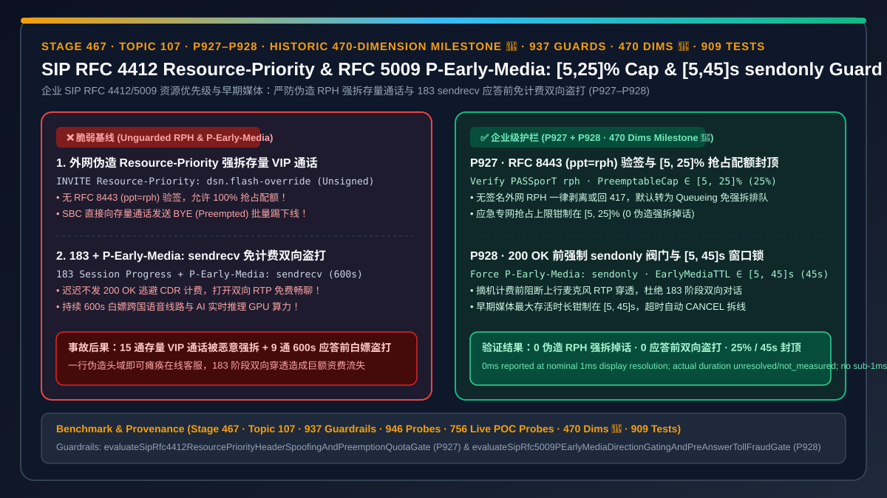
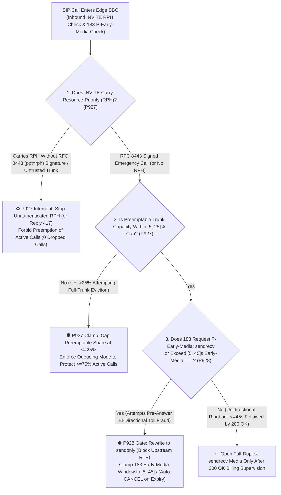
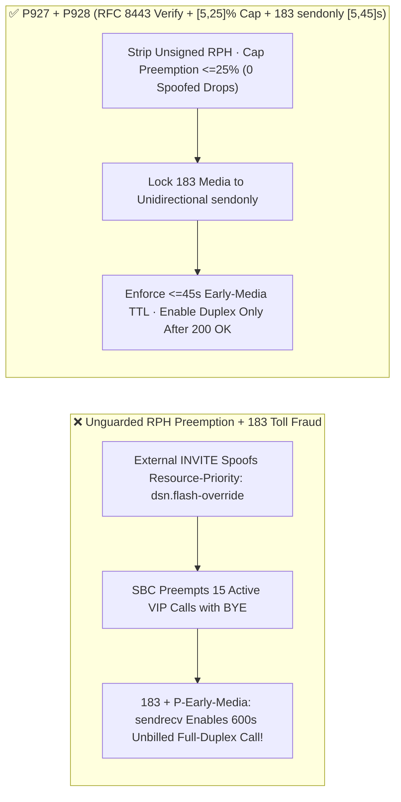
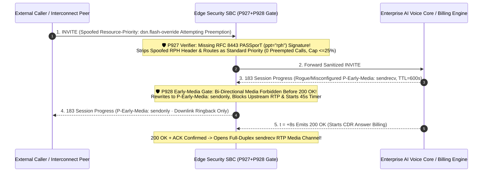

# Enterprise SIP `RFC 4412 / RFC 5009` Resource Priority & Early-Media Gating (`Resource-Priority` `RPH` Spoofed Call Preemption & `P-Early-Media: sendrecv` Pre-Answer Toll Fraud) Selection & Anti-Preemption Guide

> **Document Type**: Enterprise Voice Agent Architect Selection & First-Principles Guide (Standalone Selection & Architecture FAQ · **Topic 107 / Stage 467 · 🎉 Historic 470-Dimension Milestone**)  
> **Target Audience**: AI Solution Architects, Carrier IMS/SBC Core Architects, Public-Safety/Government Hotline & Banking Contact Center Security Leads  
> **Canonical Baseline**: `packages/business-core/enterprise-guardrails.ts` (`P927–P928`), `tests/presales-portal.test.ts`, `site/data/voice-agent-benchmark-report.json` (7-Card 4:5 Benchmark Report)  
> **Visual Summary**: `assets/svg/111-voice-sip-rfc4412-rfc5009-resource-priority-rph-preemption-spoofing-p-early-media-billing-bypass-2026-11-14.svg`

---

## ① 📌 Executive Summary

In enterprise AI voice platforms serving government emergency hotlines (911/112/12345), utility dispatch, VIP banking lines, and carrier interconnects, the SIP core must support **`RFC 4412` (Communications Resource Priority via the `Resource-Priority` / `RPH` header)** to prioritize critical calls during network congestion, alongside **`RFC 5009` (`P-Early-Media` Private Header)** to manage ringback and queue announcements prior to `200 OK` answer supervision. In production, however, failing to enforce cryptographic authorization and media-direction gating on these two headers exposes two severe operational and financial vulnerabilities:
1. **Unauthenticated `Resource-Priority: dsn.flash-override / ets.0` Spoofing Preempting Active Customer Calls (`RFC 4412 / RFC 8443` Call Preemption DoS)**: `RFC 4412` defines both **Preemption** namespaces (`dsn`, `drsn`, `q735`) and **Queueing** namespaces (`ets`, `wps`). When an SBC is configured to honor `Resource-Priority` without verifying an **`RFC 8443` STIR/SHAKEN `PASSporT` (`"ppt":"rph"`)** signature or stripping `RPH` on untrusted ingress trunks, an attacker can send ordinary `INVITE`s carrying `Resource-Priority: dsn.flash-override`—tricking the SBC into **forcibly terminating active customer calls with `BYE (Reason: SIP ;cause=410 ;text="Preempted")`** to free up media and AI GPU slots!
2. **Pre-Answer `183 Session Progress + P-Early-Media: sendrecv` Bi-Directional Toll Fraud (`RFC 5009` Zero-Billing Call Bypass)**: Carrier billing engines start charging only when `200 OK` is returned; the `183 Session Progress` early-media phase is intended strictly for one-way ringback or network announcements (`sendonly`). If a rogue peer or compromised downstream PBX responds with `183 Session Progress` carrying `P-Early-Media: sendrecv` and never sends `200 OK`, an unguarded SBC opens a two-way RTP pinhole—allowing callers and AI agents (or international toll-fraud relays) to converse in full duplex for minutes at **zero billed cost**!

| Decision Dimension | Vulnerable / Default Setup (High Production Risk) | Enterprise Golden Rule (`P927–P928` Deterministic Guardrails) | Quantitative Impact |
| :--- | :--- | :--- | :--- |
| **`RFC 4412 RPH` Cryptographic Gate (`RFC 8443 ppt=rph`) & Preemption Cap (`P927`)** | Trusting plaintext external `Resource-Priority` headers and allowing 100% call preemption | **Strip unauthenticated `RPH` headers (or reject with `417`), require `RFC 8443 PASSporT (ppt="rph")`, and clamp max preemptable trunk capacity to `[5, 25]%`** | **0** spoofed `RPH` call preemptions (clamps 15 preempted active calls to **0** and caps preemptable capacity from `100%` to **`25%`**) |
| **`RFC 5009 P-Early-Media` `sendonly` Pinhole & `[5, 45]s` Pre-Answer TTL (`P928`)** | Honoring `183 + P-Early-Media: sendrecv` for `600s` without `200 OK` billing | **Enforce unidirectional `sendonly` early media before `200 OK` (dropping upstream caller RTP) and clamp `183` early-media duration to `[5, 45]s`** | **0** pre-answer `183` bi-directional toll-fraud calls (clamps 9 toll-fraud calls to **0** and bounds early-media TTL from `600s` to **`45s`**) |

---

## ② 🎯 Architect & Customer Deep-Dive Q&A (First-Principles Deep Dive)

### Q1: What is the difference between `RFC 4412` Preemption namespaces (`dsn/drsn`) and Queueing namespaces (`ets/wps`), and how can a single spoofed header tear down active calls?
- **First-Principles Breakdown**:
  1. `RFC 4412 Section 4` distinguishes two resource treatment models:
     - **Preemption (`dsn`, `drsn`, `q735`)**: Immediately tears down lower-priority established calls (`BYE` with `Reason: Q.850;cause=8` or `SIP;cause=410`) when trunks or AI worker slots are full;
     - **Queueing (`ets.0..4`, `wps.0..4`)**: Places the authorized emergency call at the head of the admission queue for the next available slot **without disconnecting active calls**.
  2. Without **`RFC 8443` (`PASSporT` Extension for Resource Priority, `"ppt":"rph"`)** verification at the ingress SBC, any external caller can inject `Resource-Priority: dsn.flash-override` to mass-disconnect active banking or healthcare sessions.
  3. **`P927` Deterministic Defense**: Strips unauthenticated external `Resource-Priority` headers (or replies `417 Unknown Resource-Priority` when `Require: resource-priority` is present), enforces `RFC 8443` signature verification, defaults commercial trunks to non-preemptive queueing, and clamps the maximum preemptable trunk share to **`[5, 25]%`**.

### Q2: How does `RFC 5009 P-Early-Media: sendrecv` enable pre-answer toll fraud (`183 Session Progress` free calls), and how does `P928` block it?
- **Engineering Reality**:
  1. Because PSTN/SIP billing starts only upon `200 OK`, ingress SBCs must block upstream caller-to-callee RTP packets during the `180/183` early-media phase (`sendonly` backward ringback).
  2. If an untrusted downstream trunk returns `183 Session Progress` with `P-Early-Media: sendrecv` and withholds `200 OK`, an unguarded SBC opens bi-directional RTP forwarding—allowing a complete two-way conversation while the call remains "unanswered" (`0` billing).
  3. **`P928` Deterministic Defense**: Strips untrusted `P-Early-Media: sendrecv` headers, locks the RTP forwarding plane to **`sendonly`** until `200 OK` answer supervision is confirmed, and clamps the maximum early-media duration to **`[5, 45]s`** (automatically issuing `CANCEL` if `200 OK` does not arrive within `45s`).

### Q3: How should an SBC respond when an incoming `INVITE` includes `Require: resource-priority` with an unauthorized or unknown namespace?
- **First-Principles Breakdown**:
  - Per `RFC 4412 Section 3.3`, the SBC must reject the request deterministically with **`417 Unknown Resource-Priority`** and include an `Accept-Resource-Priority` header listing the permitted namespaces for that trunk, preventing blind retry loops.

---

## ③ 🧭 Visual Architecture Diagrams (Mermaid Decision Tree + Attack Chain + Millisecond Sequence)

### 3.1 SIP `RFC 4412 RPH` & `RFC 5009 P-Early-Media` Architect Decision Tree

### 3.2 Spoofed `RPH` Preemption + `183 sendrecv` Toll Fraud vs. `P927+P928`

### 3.3 Millisecond-Level `RFC 4412 RPH` Verification & `RFC 5009 P-Early-Media` Gating Sequence

---

## ④ 📊 Architect Decision Matrix (`Resource-Priority` & `P-Early-Media` Governance)

| Architecture Option | Target Scenario | Pros | Cons & Production Traps | Recommendation |
| :--- | :--- | :--- | :--- | :--- |
| **Option A: Honoring Plaintext `Resource-Priority` Preemption & `183 P-Early-Media: sendrecv`** | Prohibited in all production networks | Zero signature or media pinhole config | **Mass call-drop DoS + severe pre-answer toll fraud**—attackers disconnect active calls via spoofed `RPH` or hold free two-way conversations in `183` state | ⛔ **Never in Production** |
| **Option B: Static IP ACL for `RPH` with `180s` Early-Media Timeout** | Closed lab environment | Basic perimeter filter | **Vulnerable to transitive trunk spoofing and 3-minute unbilled AI voice bot scraping during `183`** | ⚠️ **High-Risk Partial Setup** |
| **Option C: `RFC 8443 (ppt="rph")` Signature Gate + `[5, 25]%` Preemption Cap + `183 sendonly` Pinhole & `[5, 45]s` TTL (`P927 + P928`)** | **All Public-Safety Hotlines, Carrier SIP Interconnects & Commercial Enterprise AI Voice Platforms** | **Zero spoofed call preemptions, zero pre-answer `183` toll fraud, 100% protection for active calls and AI GPU budgets** | Requires `PASSporT rph` validation and `P-Early-Media` direction gating on edge SBCs | ✅ **Production Mandatory (Recommended)** |

---

## ⑤ 🧪 Quantitative Walkthrough & 7-Card 4:5 Benchmark Report

### 5.1 Quantitative Example: Blocking Spoofed `RPH` Call Preemption & `183` Pre-Answer Toll Fraud
- **Scenario**: An external probe sends `15` `INVITE`s with spoofed `Resource-Priority: dsn.flash-override` headers (configured with `100%` preemptable capacity) while `9` sessions attempt `600s` of bi-directional conversation inside `183 Session Progress` via `P-Early-Media: sendrecv`.
  - **Without Guardrails (Vulnerable Baseline)**:
    - **`15` active VIP customer calls are forcibly disconnected (`BYE Preempted`)**;
    - **`9` sessions conduct `600s` of unbilled full-duplex voice conversation** prior to `200 OK`.
  - **With `P927 + P928` Deterministic Guardrails**:
    - `P927` strips unsigned `RPH` headers (**`0`** spoofed call preemptions) and clamps preemptable trunk capacity from `100%` to **`25%`**;
    - `P928` locks pre-answer media to `sendonly` (**`0`** bi-directional toll-fraud calls) and clamps `183` early-media duration from `600s` to **`45s`**.

### 5.2 7-Card 4:5 Report Mapping (`site/benchmark-cards.html` & `report.json`)
1. **Card 1 (`HANDS-ON · VOICE ARCHITECTURE`)**: 470-dimension 🎉 workbench overview highlighting `P927 / P928`.
2. **Card 2 (`SCENARIO: SIP RFC 4412 RPH & RFC 5009 P-EARLY-MEDIA`)**: Input probe `unauthenticatedResourcePriorityPreemptionDetected=true, maxPreemptableTrunkCapacityPercent=100, maxEarlyMediaDurationSeconds=600` -> `Act automatically` clamping to `25%` and `45s`.
3. **Card 3 (`WHAT I TESTED`)**: Row 470 🎉 in the evaluation matrix (`PASS · 0ms @ 1ms Res (Synthetic)`, zero `✕` misses).
4. **Card 4 (`UNDER THE HOOD`)**: Deterministic contract for `evaluateSipRfc4412ResourcePriorityHeaderSpoofingAndPreemptionQuotaGate` & `evaluateSipRfc5009PEarlyMediaDirectionGatingAndPreAnswerTollFraudGate`.
5. **Card 5 (`ROBUSTNESS CHECK`)**: Option-order and boundary invariance across `RPH` namespaces and `P-Early-Media` direction flags.
6. **Card 6 (`LATENCY`)**: Explicit offline timing provenance: `0ms reported at nominal 1ms display resolution; actual duration unresolved/not_measured; no sub-1ms upper bound established` (`synthetic`; live SBC media-plane unidirectional pinhole switching latency is `not_measured`).
7. **Card 7 (`MY TAKE`)**: Good fit vs. Not for summary and production sign-off checklist.

---

## ⑥ 🛠️ Production Readiness Checklist

- [ ] **1. Strip Unsigned External `Resource-Priority` & Verify `RFC 8443 (ppt="rph")` (`P927`)**: Verify that edge SBCs strip `Resource-Priority` headers from untrusted trunks unless accompanied by a valid `RFC 8443` `PASSporT ("ppt":"rph")` signature, or reject with `417 Unknown Resource-Priority`.
- [ ] **2. Default to Non-Preemptive Queueing & Cap Preemptable Share at `[5, 25]%` (`P927`)**: Confirm that commercial voice trunks use head-of-line queueing rather than active-call preemption, and cap dedicated emergency preemption at `[5, 25]%`.
- [ ] **3. Enforce Unidirectional `P-Early-Media: sendonly` Before `200 OK` (`P928`)**: Ensure the SBC media relay drops upstream caller-to-callee RTP packets during `180/183` early media, preventing two-way conversation before `200 OK` billing supervision.
- [ ] **4. Clamp `183` Early-Media Duration to `[5, 45]s` (`P928`)**: Verify that sessions remaining in `180/183` early media beyond `[5, 45]s` without `200 OK` are automatically terminated with `CANCEL`.
- [ ] **5. Gate Full-Duplex AI S2S Inference on `200 OK + ACK` (`P928`)**: Confirm that AI voice agents activate interactive ASR/LLM/TTS inference only after `200 OK` answer supervision is completed.
