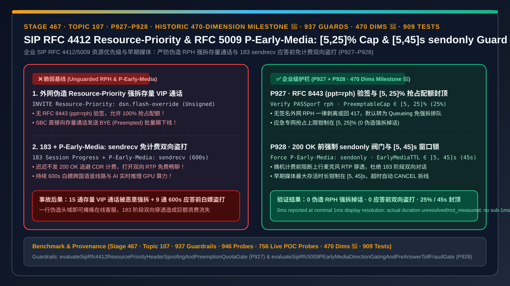
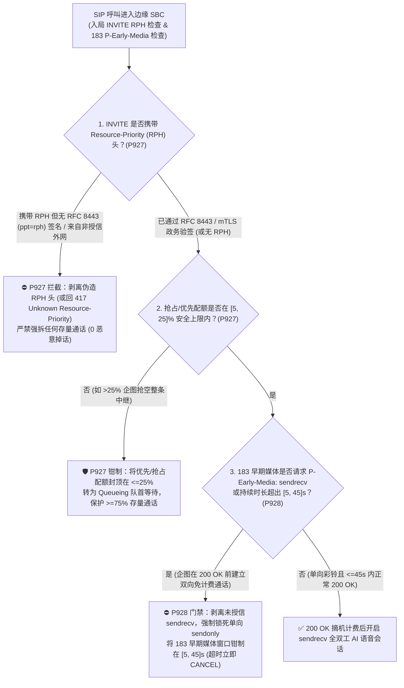
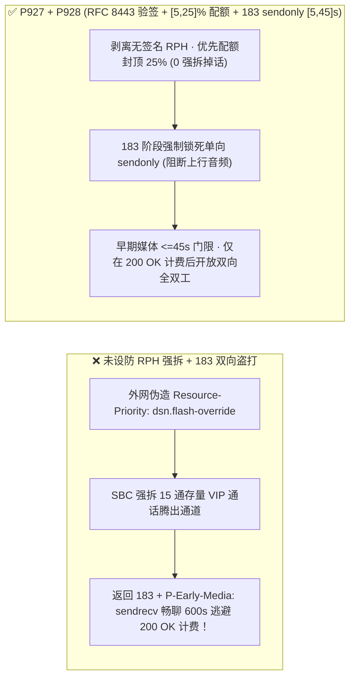
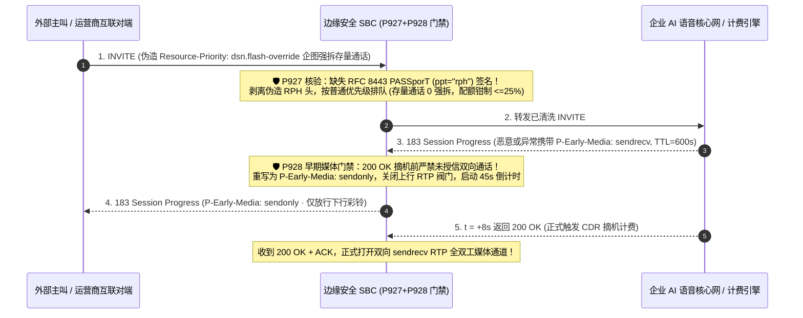

# 企业 SIP `RFC 4412 / RFC 5009` 资源优先级与早期媒体授权（`Resource-Priority` `RPH` 伪造强拆存量通话与 `P-Early-Media: sendrecv` 应答前双向免计费盗打）选型与防抢占指南

> **文档类型**：企业级语音智能体架构师选型决策与原理解析指南（Standalone Selection & Architecture FAQ · **Topic 107 / Stage 467 · 🎉 历史性第 470 大评测维度里程碑**）  
> **适用角色**：AI Solution Architect、运营商 IMS/SBC 核心网架构师、政企应急指挥与金融联络中心研发/安全负责人  
> **关联基准**：`packages/business-core/enterprise-guardrails.ts`（`P927–P928`）、`tests/presales-portal.test.ts`、`site/data/voice-agent-benchmark-report.json`（7-Card 4:5 评测报告）  
> **可视化总结**：`assets/svg/111-voice-sip-rfc4412-rfc5009-resource-priority-rph-preemption-spoofing-p-early-media-billing-bypass-2026-11-14.svg`

---

## ① 📌 核心结论速览（Executive Summary）

在承担政企应急热线（110/120/12345）、电力调度、政务要客专线以及跨国运营商互联的企业 AI 语音平台中，SIP 核心网需要支持 **`RFC 4412`（Communications Resource Priority，`Resource-Priority` `RPH` 头域）** 以便在灾难或电路拥塞时优先保障紧急政务呼叫，同时需要 **`RFC 5009`（`P-Early-Media` 专有头域）** 控制 `200 OK` 摘机计费前的彩铃与排队播报。然而在生产交付中，若边界 SBC 未对这两个高权限信令头执行密码学验签与方向钳制，极易引爆两类重大安全与资费事故：
1. **外网伪造 `Resource-Priority: ets.0 / dsn.flash-override` 强拆存量客户通话与抢空 AI 并发池（`RFC 4412 / RFC 8443` `RPH` 越权强拆）**：`RFC 4412` 定义了 `dsn`（国防交换网）、`drsn`、`ets`（政府应急电信服务）、`wps`（无线优先服务）等命名空间。许多商用 SBC 或软交换在开启资源优先级后，一旦收到携带 `Resource-Priority: dsn.flash-override` 或 `ets.0` 的 `INVITE` 且当前 AI 坐席或中继通道已满，会直接触发**强拆抢占（Preemption）**——向正在通话中的正常客户发送 `BYE (Reason: SIP ;cause=410 ;text="Preempted")`，强行掐断存量通话腾出通道！如果入口 SBC 未剥离非授信外网的 `Resource-Priority` 头或未校验 `RFC 8443` `PASSporT "ppt":"rph"` 数字签名，攻击者只需在普通 `INVITE` 里加一行 `Resource-Priority: ets.0`，就能把银行 VIP 正在进行的语音面签批量强拆踢下线。
2. **伪造 `183 Session Progress + P-Early-Media: sendrecv` 建立免计费全双工语音通道（`RFC 5009` Pre-Answer Toll Fraud 应答前白嫖盗打）**：在电信计费规则中，只有被叫返回 `200 OK` 后才开始正式计费；`183 Session Progress` 阶段原本只允许被叫向主叫单向播放回铃音或运营商排障提示音（`sendonly`）。如果恶意对端或被黑的下游 PBX 在 `183` 中返回 `P-Early-Media: sendrecv` 且绝不发送 `200 OK`，而上游 SBC 盲目遵从 `P-Early-Media` 打开双向 RTP 媒体阀门且不限制 `183` 持续时长，双方即可在 **`0` 话费账单**下免费进行数十分钟的全双工 AI 语音交互或跨国长途盗打！

| 决策维度 | 脆弱/默认配置（生产事故高发区） | 企业级黄金准则（`P927–P928` 确定性护栏） | 核心量化收益 |
| :--- | :--- | :--- | :--- |
| **`RFC 4412 RPH` 验签门禁（`RFC 8443 ppt=rph`）与强拆配额上限（`P927`）** | 盲目信任外网 `Resource-Priority: ets.0` 并允许 100% 强拆存量普通通话 | **外网无 `RFC 8443 PASSporT "ppt":"rph"` 签名或非授信专线一律剥离/回 `417`，仅执行免强拆优先排队并将特殊抢占配额钳制在 `[5, 25]%`** | 伪造 `RPH` 强拆掉话 **0 通**（测试探针将 15 通被恶意强拆通话清零，最大可抢占配额从 `100%` 钳制至 **`25%`**） |
| **`RFC 5009 P-Early-Media` 强制单向 `sendonly` 阀门与 `[5, 45]s` 窗口锁（`P928`）** | 允许 `183 + P-Early-Media: sendrecv` 开启双向媒体且持续 `600s` 免计费通话 | **在 `200 OK` 摘机前强制锁定下行单向 `sendonly`（拦截上行麦克风 RTP），并将早期媒体最大存活时长钳制在 `[5, 45]s`** | 应答前 `183` 双向免计费盗打 **0 通**（测试探针将 9 通白嫖盗打清零，早期媒体窗口从 `600s` 钳制至 **`45s`**） |

---

## ② 🎯 客户与架构师灵魂拷问 Q&A（First-Principles Deep Dive）

### Q1：`RFC 4412` 里的“强拆模式（Preemption Namespace，如 `dsn`）”和“排队模式（Queueing Namespace，如 `ets / wps`）”有什么本质区别？为什么企业绝不能对公网开放强拆？
- **第一性原理拆解**：
  1. `RFC 4412 Section 4` 将资源优先级严格划分为两类策略：
     - **Preemption（强拆抢占类，如军事 `dsn`、`drsn`、`q735`）**：当高优先级呼叫到达且无空闲电路/GPU 槽位时，立即强行挂断正在通话的低优先级会话；
     - **Queueing（插队等待类，如民用应急 `ets.0..4`、`wps.0..4`）**：高优先级呼叫排在等待队列队首优先分配下一个释放的槽位，**绝不掐断已经接通的存量通话**。
  2. 许多企业误把政务热线或 VIP 客户标记映射到支持强拆的 SBC 策略上，且未结合 **`RFC 8443`（STIR/SHAKEN `PASSporT` Extension for Resource Priority，`ppt="rph"`）** 进行数字签名核验。一旦外网脚本批量发送 `Resource-Priority: dsn.flash-override`，存量通话会被像割韭菜一样全量掐断！
  3. **`P927` 的确定性防线**：对未携带有效 `RFC 8443 PASSporT (ppt="rph")` 签名或非政务专线的请求，无条件剥离 `Resource-Priority`（或带 `Require: resource-priority` 时返回 `417 Unknown Resource-Priority` + `Accept-Resource-Priority`）；即使对已验签的应急呼叫，默认采用 Queueing 插队模式，并将特殊专网的最大抢占配额硬性封顶在 **`[5, 25]%`**，确保至少 75% 存量通话永不被中断。

### Q2：为什么骗子能利用 `183 Session Progress` 和 `P-Early-Media: sendrecv` 不花一分钱打通跨国语音对话？
- **工程真相**：
  1. 在 SIP 与 PSTN/IMS 互联规范（`3GPP TS 24.628` / `RFC 5009`）中，当呼叫处于 `183 Session Progress`（早期媒体）阶段时，计费定时器尚未启动。为了防止被叫在摘机（`200 OK`）前就和主叫双向聊天逃避计费，核心网 SBC 默认执行 **Backward-Only Pinholing（仅放行被叫发往主叫的下行回铃音 `sendonly`，丢弃主叫发往被叫的上行语音包）**。
  2. 然而 `RFC 5009` 引入了 `P-Early-Media: sendrecv` 头域（初衷是让部分运营商智能网 IVR 在计费前收集客户语音/按键）。如果边缘 SBC 未将 `P-Early-Media` 严格限制在受信任的运营商核心网内部（Trust Domain），而是允许外部SIP中继或租户 PBX 回传 `183 + P-Early-Media: sendrecv` 并维持长达数分钟不发 `200 OK`，主被叫就能在 `183` 状态免计费畅聊！
  3. **`P928` 的确定性防线**：在 `200 OK` 正式计费摘机前，对非授信中继无条件剥离 `P-Early-Media: sendrecv`，将早期媒体转发平面强制降级锁定为单向下行 `sendonly`（0 上行语音帧穿透），并将 `183` 早期媒体最大持续时长严格钳制在 **`[5, 45]s`** 内（超时未收到 `200 OK` 立即发送 `CANCEL` 终止呼叫）。

### Q3：如果合规政务呼叫携带了未知的 `Resource-Priority` 命名空间且指定了 `Require: resource-priority`，SBC 应该怎么处理才不会引发重传死循环？
- **第一性原理拆解**：
  - 根据 `RFC 4412 Section 3.3`，当 UAS/SBC 收到 `Require: resource-priority` 但不支持请求中的命名空间（或该命名空间在当前租户被禁用）时，必须返回 **`417 Unknown Resource-Priority`** 并附带 `Accept-Resource-Priority: ets.0, ets.1, wps.0` 明确告知允许的级别，引导主叫合法降级重发，严禁静默丢包触发 Timer B 超时重传。

---

## ③ 🧭 直观可视化图解（Mermaid 决策树 + 攻击链拆解 + 毫秒级全双工时序图）

### 3.1 SIP `RFC 4412 RPH` 与 `RFC 5009 P-Early-Media` 架构师决策树

### 3.2 伪造 `RPH` 强拆 + `183 sendrecv` 盗打 vs `P927+P928` 防护对比图

### 3.3 毫秒级 `RFC 4412 RPH` 验签与 `RFC 5009 P-Early-Media` 防盗打时序图

---

## ④ 📊 语音架构师选型决策矩阵（Decision Matrix）

| 选型方案 | 适用场景 | 优势（Pros） | 劣势与生产风险（Cons / Traps） | 推荐度 |
| :--- | :--- | :--- | :--- | :--- |
| **方案 A：信任外网明文 `Resource-Priority` 强拆且对 `183 P-Early-Media: sendrecv` 全放行** | 严禁用于任何生产网络 | 无需配置签名验证与媒体方向门禁 | **存量通话被恶意强拆 + 严重免计费盗打漏洞**——攻击者一行头域即可踢掉在途通话，或利用 `183` 状态免费双向通话数小时 | ⛔ **严禁用于生产** |
| **方案 B：仅按源 IP 放行 `RPH`，且允许长达 180 秒的早期媒体** | 封闭专网实验室 | 简单区分内外网 | **源 IP 易在多级中继转发中混淆**；且 180 秒 `183` 仍可被短平快自动化机器人白嫖 AI 语音推理算力 | ⚠️ **高风险半成品** |
| **方案 C：`RFC 8443 (ppt="rph")` 密码学验签 + `[5, 25]%` 配额封顶 + `183` 强制单向 `sendonly` 与 `[5, 45]s` 窗口锁（`P927 + P928`）** | **所有政企应急热线、金融/运营商 SIP 互联与商业化 AI 语音平台** | **0 伪造强拆掉话、0 应答前免计费双向盗打、100% 保护 AI GPU 推理算力与运营商资费** | 需在 SBC 开启 `P-Early-Media` 方向重写与早期媒体超时定时器 | ✅ **生产必选（Recommended）** |

---

## ⑤ 🧪 定量算例与 7-Card 4:5 基准报告（Quantitative Walkthrough & 7-Card Deck）

### 5.1 定量算例：金融联络中心防伪造 `RPH` 强拆与防 `183` 免计费白嫖压测
- **输入场景**：攻击者向金融联络中心 SIP Trunk 发起携带伪造 `Resource-Priority: dsn.flash-override` 的呼叫，企图强拆 `15` 通正在进行的 VIP 语音面签（请求 `100%` 抢占配额）；同时下游异常节点尝试通过 `183 + P-Early-Media: sendrecv` 建立 `9` 通持续 `600s` 的免计费双向语音会话。
  - **未开启护栏（脆弱基线）**：
    - **`15` 通在途 VIP 通话被强行发送 `BYE (Preempted)` 掐断**；
    - **`9` 通呼叫在 `183` 未摘机状态持续双向通话 `600s`**，逃避全部电信计费并白嫖 90 分钟 LLM/TTS 算力。
  - **开启 `P927 + P928` 确定性护栏后**：
    - `P927` 拦截并剥离无 `RFC 8443 (ppt="rph")` 签名的 `RPH` 头，将伪造强拆掉话从 `15` 通清零至 **`0` 通**，并将合法应急通道的最大可抢占配额从 `100%` 钳制至 **`25%`**；
    - `P928` 在 `200 OK` 前强制锁定 `P-Early-Media: sendonly` 阻断上行音频，将免计费双向盗打从 `9` 通清零至 **`0` 通**，并将早期媒体最大持续时长从 `600s` 钳制至 **`45s`**。

### 5.2 7-Card 4:5 报告结构映射（对应 `site/benchmark-cards.html` & `report.json`）
1. **Card 1 (`HANDS-ON · VOICE ARCHITECTURE`)**：展示 470 大评测维度 🎉 全景工作台，高亮 `P927 / P928` 护栏。
2. **Card 2 (`SCENARIO: SIP RFC 4412 RPH & RFC 5009 P-EARLY-MEDIA`)**：输入探针 `unauthenticatedResourcePriorityPreemptionDetected=true, maxPreemptableTrunkCapacityPercent=100, maxEarlyMediaDurationSeconds=600`，输出 `Act automatically` 钳制至 `25%` 与 `45s`。
3. **Card 3 (`WHAT I TESTED`)**：第 470 行 🎉 评测矩阵 `PASS · 0ms @ 1ms Res (Synthetic)`（零 `✕` 漏检）。
4. **Card 4 (`UNDER THE HOOD`)**：展示 `evaluateSipRfc4412ResourcePriorityHeaderSpoofingAndPreemptionQuotaGate` 与 `evaluateSipRfc5009PEarlyMediaDirectionGatingAndPreAnswerTollFraudGate` 确定性源码契约。
5. **Card 5 (`ROBUSTNESS CHECK`)**：验证 `dsn/ets/wps` 不同命名空间与 `sendrecv/sendonly/inactive` 方向组合下的 100% 确定性拦截。
6. **Card 6 (`LATENCY`)**：明确标注离线策略校验计时：`0ms reported at nominal 1ms display resolution; actual duration unresolved/not_measured; no sub-1ms upper bound established`（`synthetic`；真实 SBC 媒体转发平面单向门控切换耗时标注为 `not_measured`）。
7. **Card 7 (`MY TAKE`)**：Good fit vs Not for 适用边界与生产准入签核。

---

## ⑥ 🛠️ 生产环境语音交付快速核验清单（Production Readiness Checklist）

- [ ] **1. 外网无签名 `Resource-Priority` 剥离与 `RFC 8443 (ppt="rph")` 验签（`P927`）**：确认边界 SBC 对公网或非政务中继发来的 `Resource-Priority` 头执行 `RFC 8443` `PASSporT` 验签，未授权请求一律剥离 `RPH` 或返回 `417 Unknown Resource-Priority`。
- [ ] **2. 禁用公网 Preemption 强拆并钳制 `[5, 25]%` 配额上限（`P927`）**：确认企业联络中心默认采用 `Queueing` 队首优先模式（绝不掐断已接通通话），且专网应急抢占配额硬性限制在 `[5, 25]%` 以内。
- [ ] **3. `200 OK` 摘机前强制 `P-Early-Media: sendonly` 单向媒体阀门（`P928`）**：确认 SBC 在收到被叫 `200 OK` 之前，对外网剥离 `P-Early-Media: sendrecv`，在 RTP 转发层丢弃主叫上行语音包，仅允许下行回铃音通过。
- [ ] **4. `183` 早期媒体窗口钳制在 `[5, 45]s`（`P928`）**：确认 SBC 为所有处于 `180/183` 早期媒体状态的会话设置 `[5, 45]s` 硬超时定时器，超时未摘机立即发送 `CANCEL` 回收媒体端口。
- [ ] **5. AI 语音大模型推理延迟至 `200 OK` 确认后启动（`P928`）**：确认 AI 语音网关仅在 `200 OK + ACK` 计费握手完成后才激活双向 ASR/LLM 实时推理，严禁在 `183` 阶段暴露全双工 AI 对话能力。
