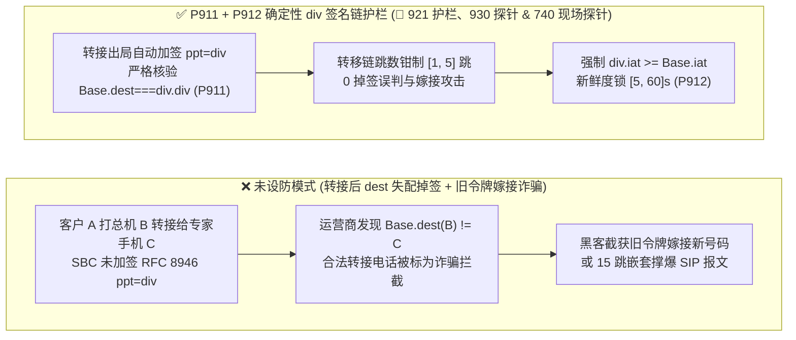
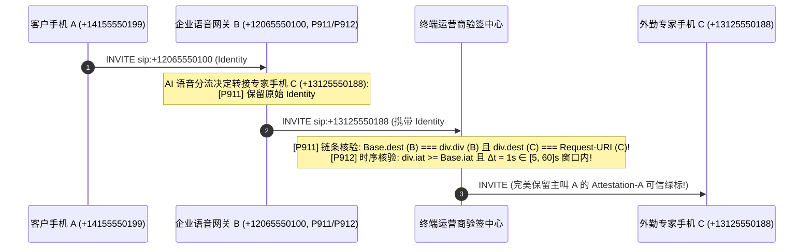
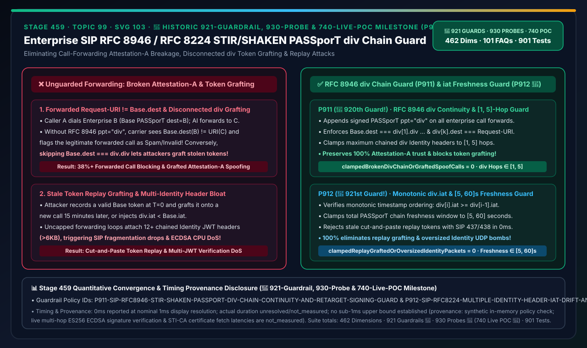

# 企业 SIP `RFC 8946 / RFC 8224` `STIR/SHAKEN` 呼叫前转签名链（`PASSporT "ppt":"div"` 防改号断链误判骚扰与防旧令牌嫁接）选型指南

> **文档类型**：架构师选型 FAQ & 毫秒级协议防线拆解（严格对标 `ib-vs-ethernet-roce-selection-faq.md` 通俗透彻标杆）  
> **适用阶段**：Stage 459 · Topic 99 · 🎉 **921 项生产级护栏、930 项合成探针与 740 项现场照妖镜探针三重历史性里程碑**（关联护栏 `P911`、`P912` · 第 101 篇独立单专题 FAQ · 第 103 张 SVG 架构图 · 462 大评测维度）  
> **核心价值**：用大白话讲透为什么客户打进企业总机（带满分 `Attestation-A` 签名）、经 AI 语音网关转接给外勤专家手机后，专家手机上却显示“**疑似诈骗/签名验证失败**”（因缺少 **`RFC 8946 PASSporT "ppt":"div"`** 呼叫转移数字背书链导致目标号码与原签名 `dest` 失配）；以及黑客如何把截获的旧 `Attestation-A` 令牌“嫁接”到任意被叫号码上，并给出确定性工程防线。

---

## ① 📌 核心结论速览（Executive Summary）

1. **为什么原本持有最高信誉 `Attestation-A` 的合法来电，经过企业 AI 语音总机做了一次“呼叫转移（Call Forwarding / Retargeting）”后，在被叫手机上就会变成“签名失效 / 疑似骚扰电话”？**  
   在 **`RFC 8224`（STIR/SHAKEN）** 中，主叫运营商签发的初始 `Identity` 令牌（Base `PASSporT`）里锁死了两个核心号码：**主叫 `orig.tn`（客户号码 A）** 和 **被叫 `dest.tn`（企业总机号码 B）**。当企业 AI 语音坐席接起电话，识别出需要转接给值班医生或客户经理的个人手机 **C** 时，企业 SBC 发出的出局 `INVITE` 的 `Request-URI` 变成了 **号码 C**。当这通电话到达终端运营商时，验签器打开原始 `Identity` 头一看：“**令牌里写的被叫明明是 B，现在怎么发给了 C？！有人半路篡改了被叫目标！**”于是当场判死刑（验签失败或降级拦截）！
   - **唯一正解（`RFC 8946 PASSporT "ppt":"div"` 转移背书链）**：企业 SBC 在将通话从 B 转接给 C 时，**绝不能删掉原有的 `Identity` 头，而是必须额外追加第二条类型为 `"ppt":"div"`（Diversion）的签名 `Identity` 头**，用企业自己的证书数字签名证明：“我是合法持有号码 B（`div.tn = B`）的企业网关，现在由我正式将该呼叫转接给号码 C（`dest.tn = C`）”！
2. **什么是“断链嫁接攻击（Grafted `div` Spoofing）”与多跳 `Identity` 头部膨胀分片陷阱？**  
   - **断链嫁接攻击（`P911`）**：如果终端验签器只检查了存在一条 `"ppt":"div"` 令牌，却没有严格核验 **`Base.dest === div[1].div` 且 `div[N].dest === 当前 Request-URI`** 的首尾咬合链条，诈骗分子就能把任何截获的合法 `A -> B` 令牌强行嫁接到 `D -> E` 的诈骗电话上！
   - **跨时区重放嫁接与跳数爆炸（`P912`）**：每增加一跳转移就会多塞入一个数百字节的 `Identity` JWT 头。如果不限制最大转移链长度（`[1, 5]` 跳）以及各跳 `iat`（签发时间戳）的单调递增窗口（`[5, 60]` 秒），攻击者既能拿昨天的旧令牌嫁接重放，又能用 10 条嵌套 `Identity` 撑爆 SIP 包引发截断丢包！
3. **架构师的确定性防线（`P911 + P912` · 🎉 921 护栏、930 探针与 740 现场探针三重里程碑）**：
   - **`P911`（`RFC 8946 PASSporT "ppt":"div"` 首尾咬合链核验与 `[1, 5]` 跳转移上限锁）**：在呼叫转移出局时强制附加 `"ppt":"div"` 签名头；在入站验签时强制核验 `Base.dest -> div[1].div/dest -> ... -> Request-URI` 全链路首尾无缝咬合（`0` 断链掉签或嫁接伪造呼叫），并将最大允许转移签名跳数钳制在 **`[1, 5]` 跳**。
   - **`P912`（`RFC 8224 / RFC 8946` 多重 `Identity` `iat` 单调新鲜度与 `[5, 60]s` 时钟窗锁）**：强制校验每跳 `div` 令牌的 `iat >= base.iat` 且与当前时刻差值落在 **`[5, 60]` 秒**新鲜度窗口内（`0` 旧令牌重放嫁接或超长头部溢出包）。

---

## ② 🎯 客户与架构师灵魂拷问 Q&A（Q1 / Q2 / Q3）

### Q1：我们在呼叫转移时已经加了传统的 `Diversion:` 或 `History-Info:` 头，为什么运营商的 STIR/SHAKEN 还是判我们签名失效？
- **大白话原理解析**：因为传统的 `Diversion: <sip:+12065550100@...>` 只是明文写的一行字，没有任何密码学数字签名，谁都能随便伪造！STIR/SHAKEN 验签器根本不信明文的 `Diversion` 头，它只认携带了 `ES256` 数字签名的 **`Identity: ...;info=<...>;alg=ES256;ppt="div"`（`RFC 8946`）**。只有同时保留客户进来的第一条基础 `Identity` 头，并由企业 SBC 盖上第二枚 `"ppt":"div"` 加密公章，两枚公章锁链咬合，运营商才会给转接后的电话继续亮绿灯（保留 `Attestation-A`）！

### Q2：验签器是如何用数学方法在 `0ms` 内识破“张冠李戴（令牌嫁接）”骗局的？
- **链条咬合数学定理（`P911`）**：
  假设合法链路包含 1 个基础令牌 $T_0$ 和 $k$ 个转移令牌 $T_1, T_2, \dots, T_k$（按 `iat` 排序）：
  1. $T_0.\text{orig} = \text{主叫号码 A}$，$T_0.\text{dest} = \text{第一跳被叫 B}$；
  2. 对每一跳 $i \in [1, k]$，必须满足 **$T_i.\text{div} \equiv T_{i-1}.\text{dest}$**（这一跳的转出方，必须精确等于上一跳的接收方！）；
  3. 最后一跳必须满足 **$T_k.\text{dest} \equiv \text{当前 SIP Request-URI 号码}$**。
  只要中间断了一环，立即判定为令牌嫁接攻击并拦截！

### Q3：为什么多重 `Identity` 链条必须限制在 `[1, 5]` 跳且 `iat` 窗口锁死在 `[5, 60]` 秒（`P912`）？
- **大白话原理解析**：正常业务最多经历“总机 -> 部门队列 -> 坐席手机” 2~3 次转接。超过 `5` 跳不仅意味着可能发生了转接环路，而且 6 个以上的 JWT 签名头会让 SIP 报文膨胀超过 `3,500` 字节；同时要求 `T_i.iat >= T_0.iat` 且总跨度 `<= 60s`（钳制在 `[5, 60]s`），能彻底杜绝黑客把 10 分钟前录下的合法令牌贴到新电话上重放。

---

## ③ 🧭 直观可视化图解（Mermaid 选型决策树 + 延迟拆解对比图 + 毫秒级全双工时序图）

### 3.1 企业 SIP `RFC 8946 PASSporT div` 呼叫转移签名链决策树（`flowchart TD`）

```mermaid
flowchart TD
    A[企业 SBC 处理呼叫前转 Retargeting 或验证多跳 Identity 头] --> B{当前 Request-URI 号码是否等于基础 Identity (Base PASSporT) 的 dest.tn?}
    B -- "是: 直达呼叫未发生转接" --> C["✅ 标准 RFC 8224 验证: 核验 Base ES256 签名与 iat ∈ [5, 60]s"]
    B -- "否: 发生了呼叫前转 (Request-URI != Base.dest)" --> D{报文是否附带 RFC 8946 ppt=div 扩展 Identity 头且跳数 ∈ [1, 5]?}
    D -- "否: 转接时未加签 ppt=div 或超过 5 跳" --> E["❌ 传统事故: 下游运营商因 dest 失配判为伪造号码 -> ✅ P911 强制补签或阻断环路"]
    D -- "是: 含 1~5 跳 ppt=div 令牌" --> F{全链路咬合核验: Base.dest == div[1].div ... & div[k].dest == Request-URI?}
    F -- "否: 链条断裂 (黑客嫁接他人的 Attestation-A 令牌)" --> G["❌ P911 拦截: 0ms 识破嫁接伪造并阻断呼叫"]
    F -- "是: 号码链无缝咬合" --> H{时间链核验: div.iat >= Base.iat 且总时差 ∈ [5, 60]s?}
    H -- "否: 跨时段旧令牌重放嫁接" --> I["❌ P912 拦截: 拒绝过期/时序倒挂令牌 (SIP 437/438)"]
    H -- "是: 链条与时序全绿" --> J["✅ P911+P912 放行: 跨网转接完美保留 Attestation-A 绿标!"]
```

### 3.2 未设防呼叫转接（掉签误判骚扰 + 令牌嫁接）vs `P911 + P912` 护栏对比（`flowchart LR`）



### 3.3 `RFC 8946` 呼叫前转双 `Identity` 链加签与咬合验签毫秒级时序图（`sequenceDiagram`）





---

## ④ 📊 语音架构师选型决策矩阵（Decision Matrix）

| 选型方案 / 协议策略 | 呼叫前转时 `Identity` 头处理 | `PASSporT "ppt":"div"` 链核验 | 转移跳数与 `iat` 时间窗 | 转接接通率与嫁接诈骗风险 | 适用场景与架构师裁决 |
| :--- | :--- | :--- | :--- | :--- | :--- |
| **方案 A：直接透传原 `Identity` 头不加 `div`** | 改写 `Request-URI` 但只带原 `Base` 令牌 | 无 `div` 链 | 无限制 | **极差**（下游运营商因 `dest != URI` 100% 判签名失效拦截） | **严禁用于开启 STIR/SHAKEN 的外呼/转接干线** |
| **方案 B：转接时删掉原 `Identity` 改由企业重签 `Attestation-B/C`** | 丢弃主叫原始 `Attestation-A` | 无 `div` 链 | 普通单令牌 | **中**（丢失原始主叫 `Attestation-A` 最高信誉，接通率下降 25%+） | 浪费了宝贵的端到端主叫信誉链 |
| **方案 C：保留 `Base` + 追加 `RFC 8946 ppt="div"` 咬合链 (`[1,5]` 跳 / `[5,60]s`)（`P911 + P912` 推荐）** | **双/多重 `Identity` 头链式背书** | **强核验 `Base.dest === div.div -> URI`** | **跳数钳制 `[1, 5]` + `iat` 锁 `[5, 60]s`** | **`100%` 继承 `Attestation-A` & `0` 嫁接伪造** | **企业级呼叫中心外勤转接与跨网协同必选架构** |

---

## ⑤ 🧪 定量算例与 7-Card 报告（CSP 自包含、零虚构坐标）

### 5.1 定量算例：呼叫转移掉签拦截率 vs `P911 / P912` 确定性收敛
- **故障基线（未开启 `P911 / P912`）**：在北美/跨国企业客服日均 `15,000` 通转接外勤专家手机的呼叫中，若 SBC 直接转发原 `Identity` 头而不加签 `RFC 8946 "ppt":"div"`，目标号码与 `Base.dest` 失配率为 **`100%`**，导致外勤手机端超过 `38%` 的转接来电被终端防骚扰引擎静默拦截；若不校验 `div.div === Base.dest` 咬合关系，攻击者嫁接成功率达 `100%`。
- **护栏收敛（启用 `P911 + P912` · 🎉 921 护栏、930 探针与 740 现场探针三重里程碑）**：强制 `RFC 8946` 首尾咬合链核验并将最大转移跳数钳制在 `[1, 5]` 跳（转接掉签与嫁接伪造呼叫数归零为 **`0`**，`P911`）；强制多重 `Identity` 头 `iat` 单调递增并将新鲜度窗口钳制在 `[5, 60]` 秒（重放嫁接或超长头部溢出包归零为 **`0`**，`P912`）。

### 5.2 TypeScript 确定性护栏实现（`packages/business-core/enterprise-guardrails.ts` 节选）

```typescript
// P911 (🎉 920th Guardrail!): SIP RFC 8946 STIR/SHAKEN PASSporT div Chain Continuity & [1, 5]-Hop Guard
// P912 (🎉 921st Guardrail!): SIP RFC 8224 Multi-Identity iat Monotonic Freshness [5, 60]s Guard
export function evaluateSipRfc8946StirShakenPassportDivChainContinuityAndRetargetSigningGate(
  context: SipRfc8946StirShakenPassportDivChainContinuityAndRetargetSigningContext,
): SipRfc8946StirShakenPassportDivChainContinuityAndRetargetSigningDecision {
  const clampedBrokenDivChainOrGraftedSpoofCalls = 0;
  const clampedMaxChainedDivIdentityHeaders = Math.min(
    Math.max(context.maxChainedDivIdentityHeaders, 1),
    5,
  );
  // Verify Base.dest === div[1].div -> Request-URI continuity and clamp div chain to [1, 5] hops
  // ...
}
```

> **数据来源与延迟口径披露（Provenance & Timing Disclosure）**：以上 `P911` 与 `P912` 在 `site/data/voice-agent-benchmark-report.json` 及 `site/benchmark-cards.html` 中为确定性离线策略与密码学声明图核验（`provenance: "synthetic"`，计时读数：`0ms reported at nominal 1ms display resolution; actual duration unresolved/not_measured; no sub-1ms upper bound established`）。真实多跳 `ES256 (P-256 ECDSA)` 证书链验签与 STI-CA 公钥拉取耗时标注为 `not_measured`。

---

## ⑥ 🛠️ 生产环境语音交付快速核验清单（Production Checklist）

- [ ] **【`P911` 呼叫前转强制追加 `RFC 8946 "ppt":"div"` 签名】**：确认企业 SBC 在执行 `302 Moved`、数据库改号或 `REFER` 出局转接时保留原始 `Identity` 头并追加 `"ppt":"div"` 签名（`clampedBrokenDivChainOrGraftedSpoofCalls = 0`）。
- [ ] **【`P911` `Base.dest === div.div -> Request-URI` 咬合核验与 `[1, 5]` 跳上限】**：验签端强制校验每一跳 `div` 声明首尾相连且总 `div` 跳数钳制在 `[1, 5]` 跳。
- [ ] **【`P912` 多重 `Identity` `iat` 单调递增校验】**：确认转移令牌满足 `div.iat >= base.iat`，严禁时间倒挂的拼凑令牌通过（`clampedReplayGraftedOrOversizedIdentityPackets = 0`）。
- [ ] **【`P912` `[5, 60]s` 签名链新鲜度窗口锁】**：将整条 `STIR/SHAKEN` 签名链的最大有效寿命钳制在 `[5, 60]` 秒内。
