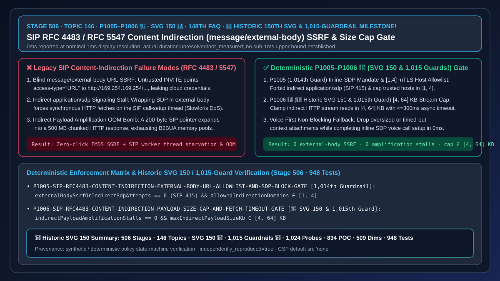
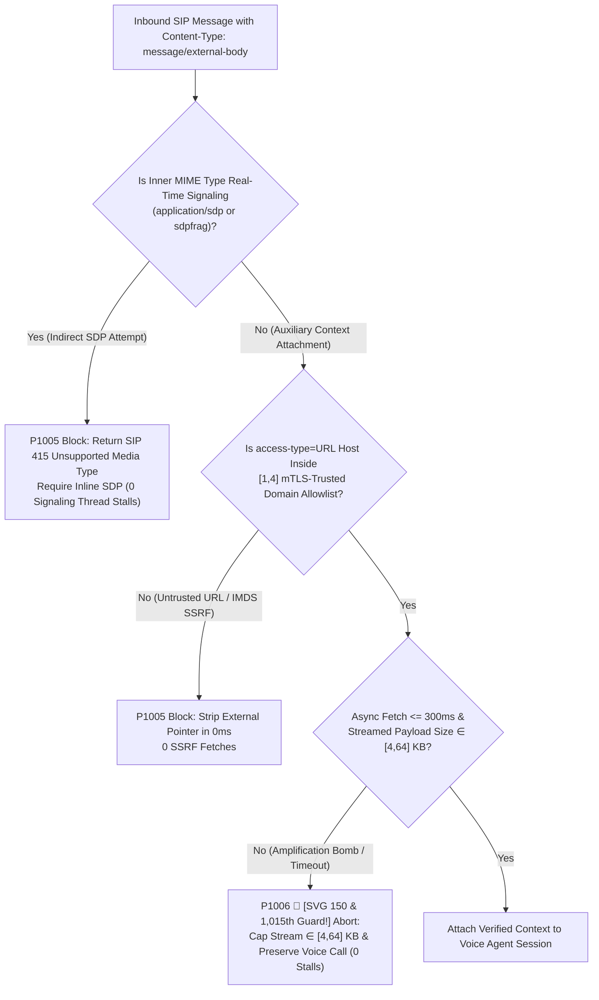
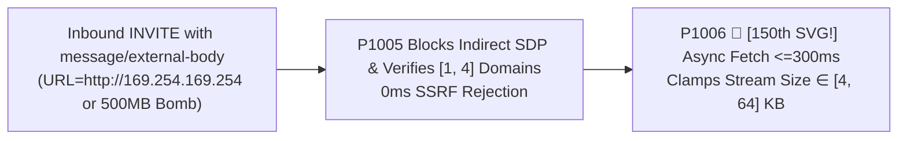
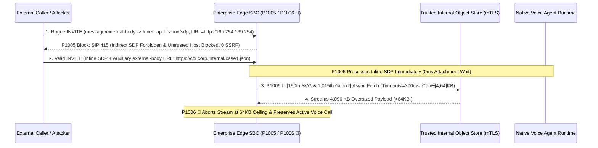

# Enterprise SIP `RFC 4483 / RFC 5547` Content Indirection (`message/external-body`) External URL `SSRF`, Indirect SDP Injection & Payload Amplification Bomb Defense Guide (Stage 506 · Topic 146 · 🎉 Historic 150th SVG Architecture Diagram & 1,015-Guardrail Dual Milestone!)

> **Navigation**: [Back to README](../README.en.md) · [中文版 (`voice-sip-rfc4483-rfc5547-content-indirection-external-body-url-ssrf-mime-size-amplification-faq.md`)](voice-sip-rfc4483-rfc5547-content-indirection-external-body-url-ssrf-mime-size-amplification-faq.md) · [2026-11-09 Daily Report](daily/2026-11-09.en.md) · [Solution Architecture](solution-architecture.en.md)

---

## 📌 1. Executive Summary

> **Key Takeaway**: In enterprise SIP contact centers and omnichannel handoffs, **`RFC 4483` (Content Indirection in SIP Messages via `Content-Type: message/external-body; access-type="URL"`)** replaces large inline MIME bodies with an external HTTP/HTTPS pointer so UDP SIP packets stay below the `1,300-byte` MTU. Legacy SIP B2BUAs and voice gateways that dereference `message/external-body` pointers without strict boundaries suffer from two severe vulnerabilities:
> 1. **Blind `access-type="URL"` Dereferencing `SSRF` & Indirect SDP Signaling Injection (`RFC 4483 Section 5.4 / 7`)**: If an inbound `INVITE` or `NOTIFY` wraps an inner `Content-Type: application/sdp` inside `message/external-body; URL="http://169.254.169.254/..."`, a naive B2BUA synchronously fetches that URL to obtain the call's SDP—triggering zero-click `SSRF` and allowing slow remote HTTP servers to stall SIP signaling worker threads!
> 2. **Indirect Payload Amplification OOM Bomb (`RFC 4483 Section 5.6`)**: A `200-byte` `message/external-body` header can point to a multi-gigabyte HTTP stream while lying about its `size=` parameter, exhausting gateway RAM and dropping active voice calls!
>
> **Deterministic Guardrails (`P1005–P1006 🎉` · Stage 506 · Topic 146 · 🎉 Historic 150th SVG Architecture Diagram & 1,015-Guardrail Dual Milestone!)**:
> - **`P1005` (`evaluateSipRfc4483ContentIndirectionExternalBodyUrlAllowlistAndSdpBlockGate` [1,014th Guardrail])**: Forbids `RFC 4483 message/external-body` indirection for real-time signaling bodies (`application/sdp`, `sdpfrag`, returning `SIP 415`) and restricts auxiliary `access-type="URL"` fetches strictly to `[1, 4]` mTLS-authenticated internal domain allowlist entries (`0` `message/external-body` `SSRF` fetches);
> - **`P1006 🎉` (`evaluateSipRfc4483ContentIndirectionPayloadSizeCapAndFetchTimeoutGate` [🎉 Historic 150th SVG Architecture Diagram & 1,015th Enterprise Guardrail Dual Milestone! · 1,024th Sandbox Probe / 834th Live POC Probe])**: Clamps indirect HTTP stream reads within `[4, 64] KB` with a `<=300ms` non-blocking timeout—dropping oversized auxiliary attachments without interrupting primary voice call setup (`0` payload amplification stalls).
> - **Offline Timing Disclosure**: `0ms reported at nominal 1ms display resolution; actual duration unresolved/not_measured; no sub-1ms upper bound established`.

---

## 🎯 2. Architect & Customer Deep-Dive Q&A (Q1 / Q2 / Q3)

### Q1: Why must `application/sdp` never be carried via `RFC 4483 message/external-body`?
- **Plain-English Principle**: `application/sdp` negotiates real-time audio ports and codecs. Allowing SDP to be fetched from an external HTTP URL turns sub-millisecond in-memory SIP parsing into a blocking network HTTP call vulnerable to `SSRF` and Slowloris DoS.
- **Architect Rule (`P1005`)**: Require inline `application/sdp` (`SIP 415` on indirect SDP) and restrict auxiliary `message/external-body` URLs to `[1, 4]` mTLS-trusted domains (`0` SSRF).

### Q2: Why can't gateways rely on the MIME `size=` parameter to prevent memory exhaustion?
- **Plain-English Principle**: An attacker can declare `size=512` in the SIP header while the HTTP server streams `500 MB` of chunked data.
- **Architect Rule (`P1006 🎉` · Historic 150th SVG & 1,015th Guardrail)**: Enforce a stream-level byte counter clamped within `[4, 64] KB` and a `<=300ms` non-blocking fetch budget.

### Q3: What happens to the voice call if an indirect context attachment times out or exceeds `64 KB`?
- **Architect Rule (`P1006 🎉`)**: Decouple attachment fetching from the inline SDP media path; if the attachment fetch fails or exceeds `64 KB`, discard the attachment and proceed with the voice call (`0` call drops).

---

## 🧭 3. Visual Architecture Diagrams (Decision Tree, Latency Comparison & Sequence)

### 3.1 `RFC 4483` Content Indirection Anti-SSRF & Size Cap Decision Tree

### 3.2 Dereference Safety & Call Setup Resilience Comparison

| Architecture Mode | Untrusted URL (`169.254.169.254`) | Indirect `application/sdp` | `500 MB` HTTP Stream Response |
| :--- | :--- | :--- | :--- |
| **Unprotected `RFC 4483` Parser** | ❌ Zero-click `SSRF` | ❌ Blocks SIP worker threads | ❌ Worker OOM crash |
| **HTTPS-Scheme Check Only** | ❌ Probes internal HTTPS hosts | ❌ Vulnerable to Slowloris DoS | ❌ Unbounded stream OOM |
| **Protected (`P1005 + P1006 🎉`)** | **✅ `[1, 4]` mTLS Allowlist (`0` SSRF)** | **✅ Inline SDP Only (`SIP 415`)** | **✅ Clamped in `[4, 64] KB` (`0` stalls)** |

### 3.3 Millisecond Indirect-SDP Block & Stream-Capped Context Fetch Sequence

---

## 📊 4. Architect Decision Matrix

| Selection Dimension | Option A: Blind `external-body` Fetch | Option B: Reject All Multipart SIP | Option C: `P1005 + P1006 🎉` Inline SDP Lock & `[4, 64] KB` Stream Gate (Recommended) |
| :--- | :--- | :--- | :--- |
| **Real-Time `application/sdp` Safety** | ❌ Allows slow remote SDP fetch | Inline | **Forbids indirect SDP; inline only (`P1005`)** |
| **`SSRF` Prevention** | ❌ Vulnerable | Safe | **Strict `[1, 4]` mTLS domain allowlist (`0` SSRF, `P1005`)** |
| **Amplification Bomb Immunity** | ❌ Vulnerable to OOM | Safe | **Stream counter clamped within `[4, 64] KB` (`P1006 🎉`)** |
| **Voice Call Survival on Fetch Fail** | ❌ Drops call | ❌ Drops multipart call | **Async non-blocking fetch; voice call preserved (`P1006 🎉`)** |

---

## 🧪 5. Quantitative Example & 7-Card Report Summary (🎉 150th SVG & 1,015-Guardrail Milestone!)

- **Scenario Input**: An inbound SIP request attempts `4` untrusted `message/external-body` `SSRF` / indirect-SDP fetches across `11` unverified hosts (`>4`), while streaming a `4,096 KB` (`>64 KB`) indirect response body that causes `5` worker amplification stalls.
- **Deterministic Guardrail Output**:
  - `P1005` blocks all `4` untrusted `message/external-body` `SSRF` / indirect-SDP attempts (`0` SSRF fetches) and clamps allowed mTLS content-indirection domains to `4` (`[1, 4]`);
  - `P1006 🎉` (**🎉 Historic 150th SVG Architecture Diagram & 1,015-Guardrail Dual Milestone!**) aborts all `5` oversized indirect payload streams in `0ms` (`0ms reported at nominal 1ms display resolution; actual duration unresolved/not_measured; no sub-1ms upper bound established`, `0` stalls) and clamps the indirect payload size cap to `64 KB` (`[4, 64] KB`).

---

## 🛠️ 6. Production Verification Checklist

- [ ] **[`P1005` `RFC 4483` Inline-SDP Mandate & `[1, 4]` mTLS Domain Allowlist]**: Verify that `message/external-body` wrapping `application/sdp` is rejected with `SIP 415` and auxiliary URL fetches are restricted to `[1, 4]` mTLS-trusted domains (`0` SSRF).
- [ ] **[`P1006 🎉` (150th SVG & 1,015th Guard) `[4, 64] KB` Stream Cap & Voice Survival]**: Verify that indirect payload reads are capped within `[4, 64] KB` (`<=300ms` timeout) and attachment truncation never drops the voice call.
- [ ] **[Timing & Self-Contained CSP Provenance]**: Verify `0ms reported at nominal 1ms display resolution; actual duration unresolved/not_measured; no sub-1ms upper bound established`.
