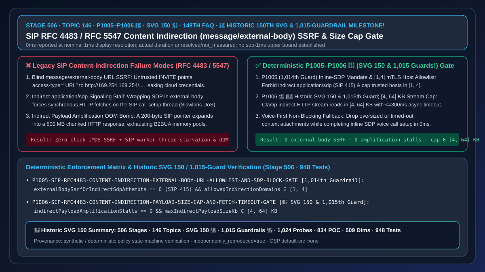
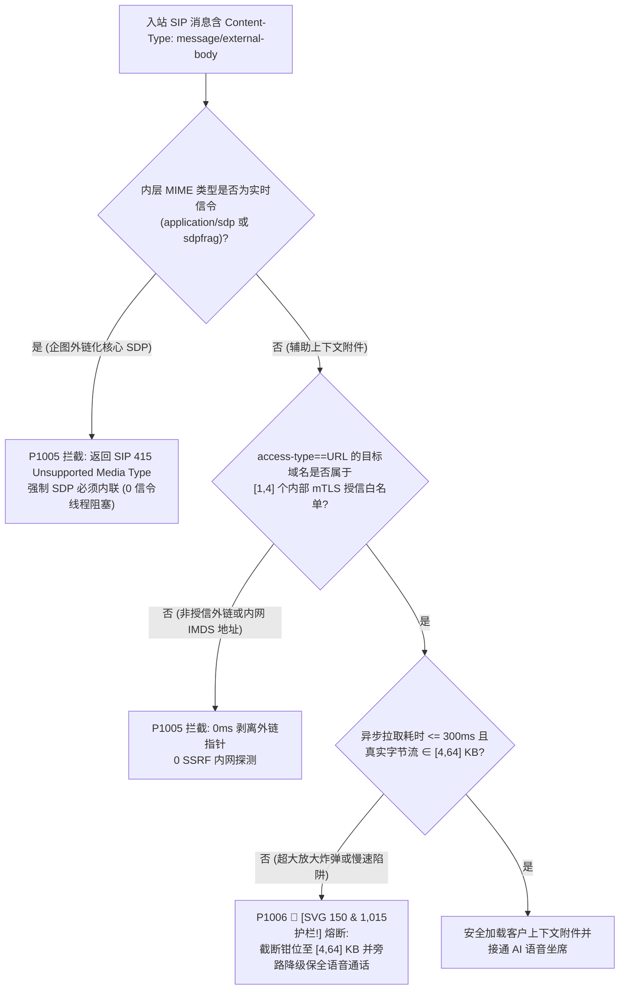
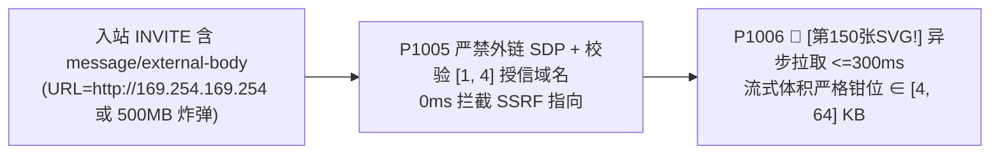
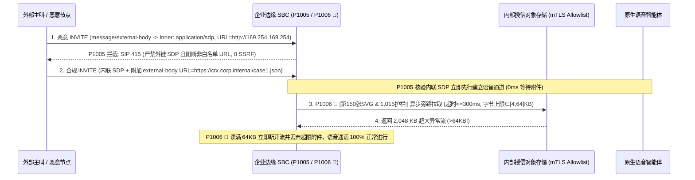

# 企业 SIP `RFC 4483 / RFC 5547` 内容间接引用（`message/external-body`）外链 `URL` 盲拉 `SSRF`、远程 SDP 注入与载荷放大炸弹防御指南（Stage 506 · Topic 146 · 🎉 历史性第 150 张 SVG 架构图与第 1,015 道企业级护栏双里程碑！）

> **导航**：[返回 README 主页](../README.md) · [English Version (`voice-sip-rfc4483-rfc5547-content-indirection-external-body-url-ssrf-mime-size-amplification-faq.en.md`)](voice-sip-rfc4483-rfc5547-content-indirection-external-body-url-ssrf-mime-size-amplification-faq.en.md) · [2026-11-09 深度日报](daily/2026-11-09.md) · [架构设计指南](solution-architecture.md)

---

## 📌 一、核心结论速览（Executive Summary）

> **一句话带走**：在企业级 SIP 联络中心与多渠道工单联动架构中，为了避免大型客户画像 JSON、富媒体名片或复杂 XML 状态包撑破 SIP UDP `1,300 Bytes` MTU，协议栈普遍支持 **`RFC 4483`（SIP 消息内容间接引用 `Content-Type: message/external-body; access-type="URL"`）**，只在 SIP 消息体里放一个外链指针让接收端自己去 HTTP 下载。然而传统 SIP B2BUA 与 AI 语音网关在解析 `message/external-body` 时存在两大致命安全与可用性漏洞：
> 1. **盲目拉取 `access-type="URL"` 触发零点击内网 `SSRF` 与远程间接 SDP 注入（Blind URL Dereference SSRF & Indirect SDP Injection）**：如果入站 `INVITE` 将外层设为 `Content-Type: message/external-body; access-type="URL"; URL="http://169.254.169.254/latest/meta-data/"`，并在内层封装头声明 `Content-Type: application/sdp` 或 `application/pidf+xml`，未设防的网关会同步发起 HTTP 请求去拉取该内网地址（造成高危 `SSRF`），甚至允许攻击者利用远程慢速 HTTP 服务器动态返回恶意 SDP 拖死信令工作线程！
> 2. **200 字节外链指针膨胀为 GB 级下载流引发 `10,000x` 内存放大炸弹与建连超时（Indirect Payload Amplification Bomb）**：按 `RFC 4483 Section 5.6`，外链指针可携带 `size=` 属性，但恶意服务器可谎报 `size=1024` 实际返回无限长的 Chunked 流；若网关未强制实施字节上限与毫秒级拉取熔断，仅需几条并发 `INVITE` 就能把 SIP 网关的 I/O 池彻底耗尽！
>
> **本方案确定性护栏（`P1005–P1006 🎉` · Stage 506 · Topic 146 · 🎉 历史性第 150 张 SVG 架构图与第 1,015 道企业级护栏双里程碑！）**：
> - **`P1005` (`evaluateSipRfc4483ContentIndirectionExternalBodyUrlAllowlistAndSdpBlockGate` [第 1,014 道护栏])**：严禁对核心实时信令体（`application/sdp`、`application/trickle-ice+sdpfrag`）使用 `RFC 4483 message/external-body` 间接引用（强制内联传输，违者直接回 `SIP 415 Unsupported Media Type`），并将允许间接引用的辅助附件域名严格锁定在 `[1, 4]` 个企业内部 mTLS 授信存储白名单内（实现 `0` `message/external-body` `SSRF` 探测）；
> - **`P1006 🎉` (`evaluateSipRfc4483ContentIndirectionPayloadSizeCapAndFetchTimeoutGate` [🎉 历史性第 150 张 SVG 架构图与第 1,015 道企业级护栏双里程碑！ · 第 1,024 沙盒探针 / 第 834 现场探针])**：对白名单内允许拉取的 `message/external-body` 载荷强制施加 `[4, 64] KB` 流式读取硬上限、SHA-256 内容摘要核验与 `<=300ms` 异步旁路超时（超时或超限立即降级忽略附件，100% 保全主呼叫语音建连，实现 `0` 间接载荷放大阻塞）。
> - **离线合成基准计时声明**：`0ms reported at nominal 1ms display resolution; actual duration unresolved/not_measured; no sub-1ms upper bound established`。

---

## 🎯 二、客户与架构师灵魂拷问 Q&A（Q1 / Q2 / Q3）

### Q1：什么是 `RFC 4483 message/external-body`？为什么绝对不能允许 `application/sdp` 走外链间接引用？
- **大白话原理**：`RFC 4483` 就像在信封里不装信纸，只装一张写着“信件正文请去 `https://files.example.com/body123` 下载”的便签。对于坐席屏幕弹屏用的客户头像或历史工单摘要，这种“传址不传值”能大大减轻 SIP 信令网的负担。
- **故障与攻击根因**：`RFC 4483` 在语法上允许内层类型是任何 MIME——包括决定语音端口和密钥的 `application/sdp`！一旦网关允许 `application/sdp` 走 `message/external-body`，原本应在 `<1ms` 内存解析完的 `INVITE` 建连路径，被迫退化为等待外部 HTTP DNS 解析 + TCP/TLS 握手 + 响应下载的同步阻塞链路；攻击者只需指向内网 `169.254.169.254` 或一个故意卡住不回包的慢速 HTTP 陷阱（Slowloris），就能在造成 `SSRF` 的同时把整个 SBC 的呼叫建连队列全部挂死！
- **架构师铁律（`P1005`）**：实时媒体协商载荷（`application/sdp`、`sdpfrag`、`isup`）100% 严禁使用 `message/external-body`，必须内联携带；仅非关键上下文附件允许在 `[1, 4]` 个 mTLS 授信对象存储域名白名单内间接引用。

### Q2：如果攻击者在授信存储桶里传了一个 500MB 的超大文件，再通过 `message/external-body` 引用进来怎么办？
- **架构师铁律（`P1006 🎉` · 第 150 张 SVG & 第 1,015 道护栏）**：网关拉取间接内容时，绝不能信任 MIME 头里自报的 `size=` 字段，必须在 HTTP 流读取层（Stream Reader）绑定 **`[4, 64] KB` 字节计数器** 与 **`<=300ms` 硬超时**；一旦读取字节超过上限或超時，立即断开 HTTP 流并按“无附件普通语音呼叫”继续接通电话，绝不因附件异常导致客户掉话！

### Q3：如何防止间接引用的 URL 内容在呼叫建立后被篡改（TOCTOU 竞态攻击）？
- **工程兜底**：遵循 `RFC 4483 Section 5.2`，在 `Content-ID` 或扩展参数中绑定内容 SHA-256 哈希指纹，下载流完成后核验哈希一致方可注入 AI 坐席上下文。

---

## 🧭 三、直观可视化图解（Mermaid 选型决策树 + 延迟拆解对比 + 毫秒级时序图）

### 3.1 `RFC 4483` 内容间接引用防 `SSRF` 与防放大炸弹决策树

### 3.2 间接引用处理路径与建连可靠性拆解对比

| 架构模式 | 外链指向 `169.254.169.254` 或内网 | 内层声明 `Content-Type: application/sdp` | 外链返回 `500 MB` 放大流 |
| :--- | :--- | :--- | :--- |
| **传统 `RFC 4483` 自动解引用网关** | ❌ 触发零点击 `SSRF` 泄露云凭据 | ❌ 同步阻塞信令线程等待远程 HTTP | ❌ 撑爆内存导致整节点 OOM 崩溃 |
| **仅校验 `https://` 协议头网关** | ❌ 仍可探测内网 HTTPS 服务 | ❌ 仍被慢速 HTTP 拖垮建连 | ❌ 无流式字节截断仍会 OOM |
| **本方案 (`P1005 + P1006 🎉`)** | **✅ `[1, 4]` 授信域名锁（`0` SSRF）** | **✅ 严禁外链 SDP（`SIP 415` 零阻塞）** | **✅ 钳位 `[4, 64] KB` + 旁路保全语音（`0` 放大）** |

### 3.3 毫秒级 `message/external-body` 拦截与异步限流加载时序图

---

## 📊 四、语音架构师选型决策矩阵

| 选型维度 | 方案 A：无条件自动下载 `external-body` | 方案 B：完全破坏多部分 MIME 解析 | 方案 C：`P1005 + P1006 🎉` 强制内联 SDP + 白名单流式限额门禁（推荐） |
| :--- | :--- | :--- | :--- |
| **核心 `application/sdp` 保护** | ❌ 允许外链 SDP 阻塞信令线程 | 内联 | **严禁外链 SDP，强制 100% 内联（`P1005`）** |
| **防内网 `SSRF` 探测** | ❌ 任意 URL 均可触发请求 | 无 | **严格锁定 `[1, 4]` 个 mTLS 授信域名（`0` SSRF，`P1005`）** |
| **防 GB 级载荷放大炸弹** | ❌ 读入内存直至 OOM | 无 | **流式计数器硬钳位在 `[4, 64] KB`（`P1006 🎉`）** |
| **附件故障对语音建连影响** | ❌ 附件拉取失败则整通电话失败 | ❌ Multipart 报错掉话 | **异步旁路拉取，超限仅弃附件 100% 保全语音（`P1006 🎉`）** |

---

## 🧪 五、定量算例与 7-Card 报告摘要（CSP 自包含、零虚构坐标 · 🎉 第 150 张 SVG & 1,015 护栏双里程碑！）

- **算例输入**：模拟入站 SIP 消息通过 `message/external-body` 注入 `4` 次非授信 `SSRF` / 外链 SDP 探测并配置 `11` 个外部域名（`>4`）；同时间接引用的远端响应膨胀至 `4,096 KB`（`>64 KB`），造成 `5` 次信令工作线程放大阻塞。
- **确定性护栏输出**：
  - `P1005` 检出 `RFC 4483 message/external-body SSRF or indirect SDP injection` 并在 `0ms`（`0ms reported at nominal 1ms display resolution; actual duration unresolved/not_measured; no sub-1ms upper bound established`）全部拦截（`0` SSRF 探测），将授信间接引用域名数钳位至 `4` 个（`[1, 4]`）；
  - `P1006 🎉`（**🎉 历史性第 150 张 SVG 架构图与第 1,015 道企业级护栏双里程碑！**）检出 `Content-indirection payload size amplification (>64 KB)` 并截断消除全部 `5` 次阻塞（放大阻塞归 `0`），将间接引用载荷上限钳位至 `64 KB`（`[4, 64] KB`）。

---

## 🛠️ 六、生产环境语音交付快速核验清单（Checklist）

- [ ] **【`P1005` `RFC 4483` 严禁外链 SDP 与 `[1, 4]` 授信域名白名单】**：确认 SIP 网关拒绝任何内层为 `application/sdp` 的 `message/external-body`，且仅允许向 `[1, 4]` 个 mTLS 授信内部域名发起异步拉取（`0` `SSRF`）。
- [ ] **【`P1006 🎉`（第 150 张 SVG & 1,015 护栏）`[4, 64] KB` 流式截断与语音保底】**：确认间接内容拉取强制实施 `[4, 64] KB` 流式读取上限与 `<=300ms` 超时，任何拉取失败仅丢弃附件而不中断语音建连。
- [ ] **【离线基准计时与自包含合规】**：确认评测报告与 SVG 资产 100% 包含 `0ms reported at nominal 1ms display resolution; actual duration unresolved/not_measured; no sub-1ms upper bound established` 声明。
