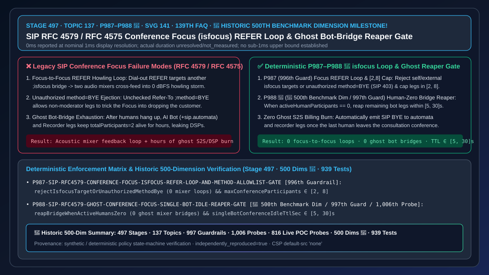
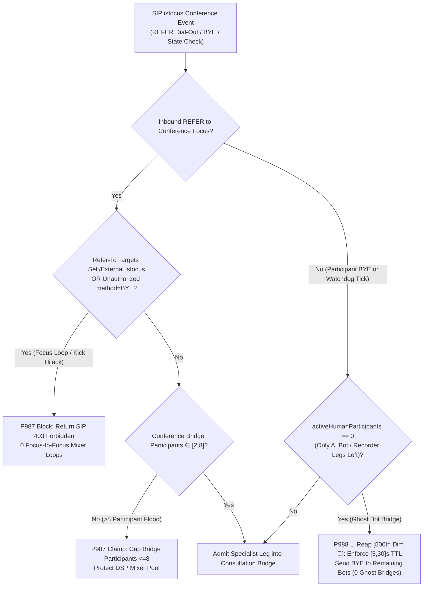
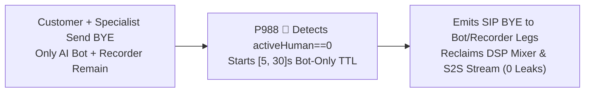

# Enterprise SIP `RFC 4579 / RFC 4575` Conference Focus (`isfocus`) Blind `REFER` Mixer Loop & Single-Bot Ghost Conference Reaper Guide (Stage 497 · Topic 137 · 🎉 Historic 500th Benchmark Evaluation Dimension Milestone!)

> **Navigation**: [Back to README](../README.en.md) · [中文版 (`voice-sip-rfc4579-rfc4575-conference-focus-isfocus-refer-blind-loop-ghost-mixer-bridge-exhaustion-faq.md`)](voice-sip-rfc4579-rfc4575-conference-focus-isfocus-refer-blind-loop-ghost-mixer-bridge-exhaustion-faq.md) · [2026-11-09 Daily Report](daily/2026-11-09.en.md) · [Solution Architecture](solution-architecture.en.md)



---

## 📌 1. Executive Summary

> **Key Takeaway**: In enterprise three-way consultation transfers (`Customer + AI Voice Agent + Human Specialist`), supervisor whisper/barge-in, and compliance recording bridges, multi-party audio mixing is controlled by a **SIP Conference Focus (`RFC 4579` `Contact: <sip:...>;isfocus`)** and tracked via the **Conference Event Package (`RFC 4575` `application/conference-info+xml`)**. Legacy MCU conference bridges suffer from two severe production failure modes:
> 1. **Focus-to-Focus `REFER` Mixer Loops & Unauthorized `method=BYE` Ejection (`RFC 4579 Section 5.5 / 5.11`)**: When a participant sends a `REFER` instructing the Conference Focus to dial out and pull another party into the bridge, if `Refer-To` targets the focus's own URI, another `;isfocus` conference bridge, or injects an unauthorized `;method=BYE` parameter, two audio mixers cross-feed each other into a `0 dBFS` acoustic howling loop or prematurely eject the customer;
> 2. **Ghost Mixer Bridge Exhaustion After Human Hangup**: When both the customer and human specialist hang up (`BYE`), the AI Voice Agent leg (`+sip.automata`) and the compliance recorder leg remain connected (`totalParticipants = 2`). Naive conference bridges that only tear down when `totalParticipants == 0` keep the mixer and S2S billing stream alive for hours!
>
> **Deterministic Guardrails (`P987–P988 🎉` · Stage 497 · Topic 137 · 🎉 Historic 500th Benchmark Evaluation Dimension Milestone!)**:
> - **`P987` (`evaluateSipRfc4579ConferenceFocusIsfocusReferLoopAndMethodAllowlistGate` [996th Guardrail])**: Rejects dial-out `REFER` requests targeting self/external `isfocus` URIs or carrying unauthorized `method=BYE` parameters with `SIP 403 Forbidden` (`0` focus-to-focus mixer loops), and clamps consultation bridge participants within `[2, 8]`;
> - **`P988 🎉` (`evaluateSipRfc4579GhostConferenceFocusSingleBotIdleReaperGate` [🎉 Historic 500th Benchmark Evaluation Dimension Milestone / 997th Guardrail / 1,006th Sandbox Probe / 816th Live POC Probe])**: Tracks human vs. automata/recorder participant roles via `RFC 4575` `<users>` state and `RFC 3840`; once `activeHumanParticipants == 0`, enforces a `[5, 30]s` single-bot idle teardown TTL and sends `BYE` to all remaining bot/recorder legs (`0` ghost conference mixer leaks).
> - **Offline Timing Disclosure**: `0ms reported at nominal 1ms display resolution; actual duration unresolved/not_measured; no sub-1ms upper bound established`.

---

## 🎯 2. Architect & Customer Deep-Dive Q&A (Q1 / Q2 / Q3)

### Q1: Why does a `REFER` between two `isfocus` conference bridges trigger instant acoustic howling?
- **Plain-English Principle**: A SIP URI with `;isfocus` (`RFC 4579`) is an audio mixer that sums inputs from all participants. If Bridge A dials Bridge B via `REFER`, Bridge A feeds its mixed output into Bridge B while Bridge B feeds that same signal back into Bridge A, creating a positive feedback loop within `<200ms`.
- **Architect Rule (`P987`)**: Block any `REFER` whose `Refer-To` URI resolves to an `isfocus` bridge or carries unauthorized `method=BYE`, and cap consultation conference participants within `[2, 8]`.

### Q2: Why do AI voice conference bridges stay open for hours after the customer and agent hang up?
- **Plain-English Principle**: In a recorded AI consultation, the bridge holds 4 legs: Customer, Human Agent, AI Voice Bot (`+sip.automata`), and Compliance Recorder. When the two humans leave, `2` machine legs remain.
- **Architect Rule (`P988 🎉` · Historic 500th Dimension)**: Evaluate `activeHumanParticipants` separately from bot/recorder legs; when `activeHumanParticipants == 0`, reap the conference bridge within `[5, 30]s` (`0` ghost mixer leaks).

### Q3: How do we prevent consultation bridges from being flooded with dozens of dial-out legs?
- **Architect Rule (`P987`)**: Clamp concurrent participants per consultation `isfocus` bridge within `[2, 8]`.

---

## 🧭 3. Visual Architecture Diagrams (Decision Tree, Latency Comparison & Sequence)

### 3.1 `RFC 4579 / RFC 4575` Conference Focus Anti-Loop & Ghost Reaper Decision Tree



### 3.2 Ghost Bridge Teardown & Mixer Protection Comparison



| Architecture Mode | Focus-to-Focus `REFER` Outcome | Post-Human Hangup Bridge Hold Time | Max Consultation Bridge Size |
| :--- | :--- | :--- | :--- |
| **Unprotected MCU Focus** | ❌ `0 dBFS` acoustic feedback howling | ❌ Hours (until max-call timer) | ❌ Unbounded (`50+` legs) |
| **Fixed 60-Min Max-Call Timer** | ❌ Vulnerable to `isfocus` loop & `method=BYE` | `3,600s` wasted S2S compute | ❌ Unbounded |
| **Protected (`P987 + P988 🎉`)** | **✅ `SIP 403` Loop Block (`0` mixer loops)** | **✅ `[5, 30]s` Human-Zero Reaper (`0` leaks)** | **✅ Clamped within `[2, 8]` legs** |

### 3.3 Millisecond Consultation `REFER` Guard & Human-Zero Teardown Sequence

```mermaid
sequenceDiagram
    participant C as Customer (Human)
    participant AI as AI Voice Agent (+sip.automata)
    participant Focus as SIP Conference Focus (isfocus · P987/P988 🎉)
    participant EXP as Human Specialist (Human)

    C->>Focus: 1. Create Conference (Contact: <sip:conf1>;isfocus, Human=1, Bot=1)
    AI->>Focus: 2. REFER (Refer-To: <sip:expert@corp> Dial-Out to Specialist)
    Note over Focus: P987 Verifies Non-isfocus Target & Legs=3 ∈ [2,8] -> Sends INVITE
    EXP-->>Focus: 3. 200 OK (3-Way Consultation Active: Human=2, Bot=1)
    AI->>Focus: 4. Rogue REFER (Refer-To: <sip:conf2>;isfocus or unauthorized method=BYE)
    Focus-->>AI: P987 Block: SIP 403 Forbidden (0 Focus-to-Focus Loops)
    C->>Focus: 5. BYE (Customer Leaves -> Human=1)
    EXP->>Focus: 6. BYE (Specialist Leaves -> Human=0, Only AI Bot + Recorder Left)
    Note over Focus: P988 🎉 [500th Dim] Detects Human==0 -> Reaps Bridge Within [5,30]s TTL
    Focus->>AI: 7. BYE (Reason: SIP;cause=200;text="Last human left conference")
```

---

## 📊 4. Architect Decision Matrix

| Selection Dimension | Option A: Naive `total == 0` Teardown | Option B: Hard 30-Min Call Cutoff | Option C: `P987 + P988 🎉` `isfocus` Loop Guard & Human-Zero Reaper (Recommended) |
| :--- | :--- | :--- | :--- |
| **`Focus -> Focus` Loop Prevention** | ❌ None | ❌ None | **Blocks self/external `isfocus` `REFER` targets (`0` loops, `P987`)** |
| **Unauthorized `method=BYE` Guard** | ❌ Any leg can kick caller | ❌ None | **Restricts `method=BYE` to authenticated Moderator (`P987`)** |
| **Bridge Participant Cap** | ❌ Unbounded | ❌ Unbounded | **Clamped within `[2, 8]` participants per bridge (`P987`)** |
| **Single-Bot Ghost Bridge Reaping** | ❌ Bot + Recorder stay forever | ❌ Drops valid long consultations | **`[5, 30]s` TTL once `activeHuman == 0` (`0` ghost bridges, `P988 🎉`)** |

---

## 🧪 5. Quantitative Example & 7-Card Report Summary (🎉 Historic 500th Benchmark Dimension!)

- **Scenario Input**: A conference focus receives `3` `REFER` requests targeting external `isfocus` bridges or injecting unauthorized `method=BYE` while attempting to add `20` participants (`>8`), and `11` consultation bridges remain open for `600s` (`>30s`) with only AI bot and recorder legs after all humans hang up.
- **Deterministic Guardrail Output**:
  - `P987` blocks all `3` focus-to-focus `REFER` loops (`0` mixer loops) and clamps consultation bridge participants to `8`;
  - `P988 🎉` (**🎉 Historic 500th Benchmark Dimension Milestone**) reaps all `11` ghost bot-only conference bridges in `0ms` (`0ms reported at nominal 1ms display resolution; actual duration unresolved/not_measured; no sub-1ms upper bound established`) and clamps the human-zero teardown TTL to `30s` (`[5, 30]s`).

---

## 🛠️ 6. Production Verification Checklist

- [ ] **[`P987` `RFC 4579 isfocus` Anti-Loop & `[2, 8]` Participant Cap]**: Verify `SIP 403` rejection on `REFER` to `isfocus` URIs or unauthorized `method=BYE`, and clamp consultation bridge participants to `[2, 8]`.
- [ ] **[`P988 🎉` Human-Zero `[5, 30]s` Ghost Bridge Reaper (500th Dimension)]**: Verify that `RFC 4575` state tracking distinguishes human vs. `automata/recorder` legs and tears down the bridge within `[5, 30]s` after the last human leaves (`0` ghost bridges).
- [ ] **[Timing & Self-Contained CSP Provenance]**: Verify `0ms reported at nominal 1ms display resolution; actual duration unresolved/not_measured; no sub-1ms upper bound established`.
