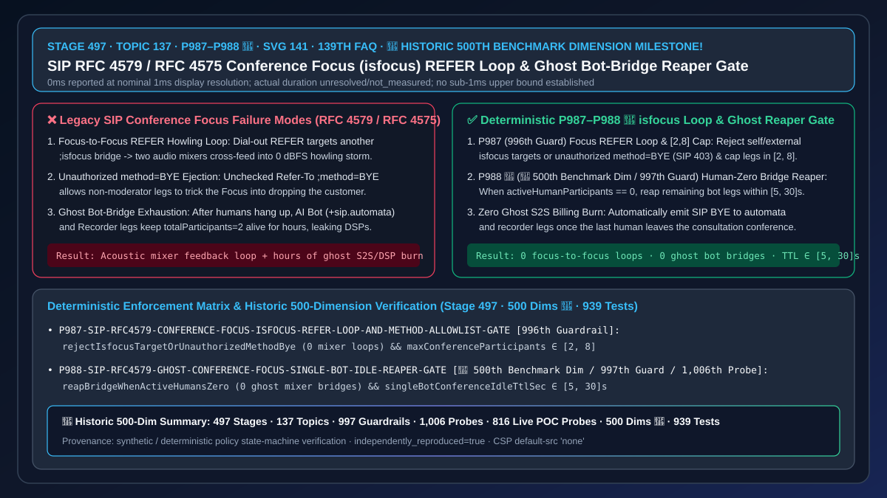
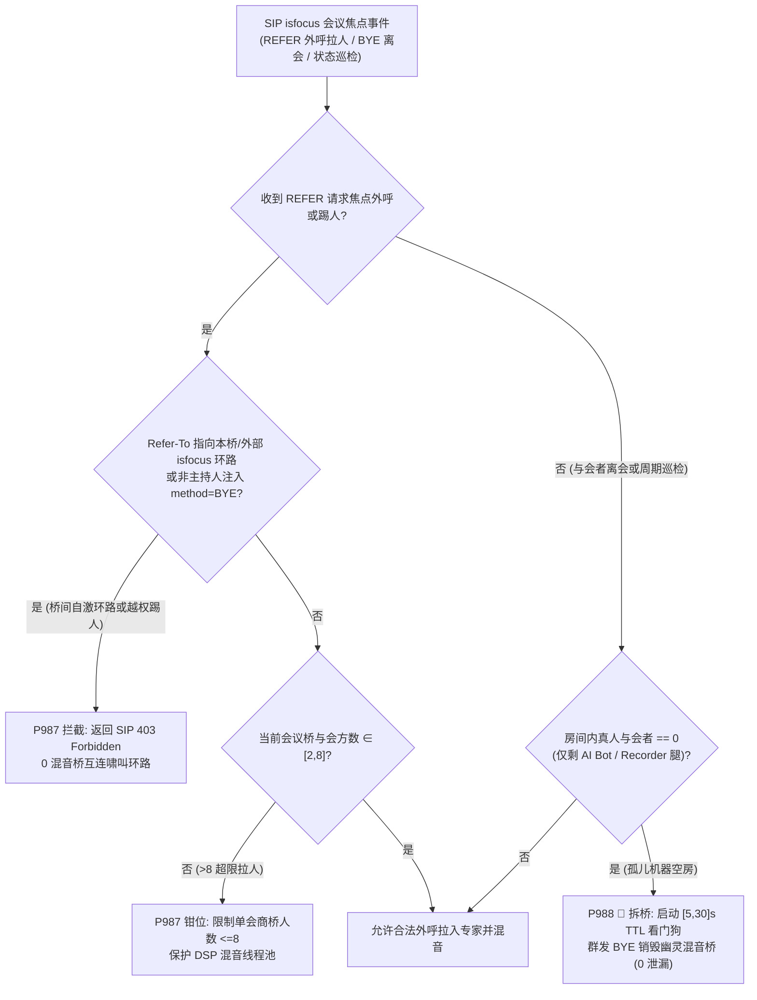
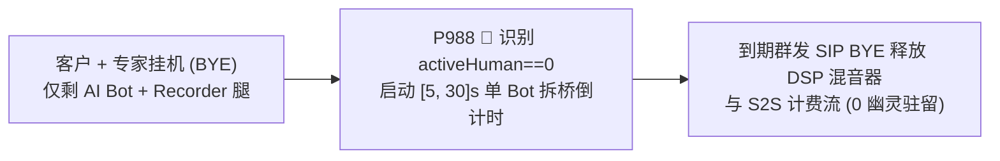

# 企业 SIP `RFC 4579 / RFC 4575` 会议焦点（`isfocus`）盲转 `REFER` 混音器自激环路与单 AI 驻留幽灵会议桥耗尽防御指南（Stage 497 · Topic 137 · 🎉 历史性第 500 大评测维度里程碑！）

> **导航**：[返回 README 主页](../README.md) · [English Version (`voice-sip-rfc4579-rfc4575-conference-focus-isfocus-refer-blind-loop-ghost-mixer-bridge-exhaustion-faq.en.md`)](voice-sip-rfc4579-rfc4575-conference-focus-isfocus-refer-blind-loop-ghost-mixer-bridge-exhaustion-faq.en.md) · [2026-11-09 深度日报](daily/2026-11-09.md) · [架构设计指南](solution-architecture.md)



---

## 📌 一、核心结论速览（Executive Summary）

> **一句话带走**：在企业级呼叫中心“客户 + AI 语音坐席 + 人工专家”三方会商、班长监听插话与双录合规伴音场景中，核心多方混音由 **SIP 会议焦点（`RFC 4579` `Contact: <sip:...>;isfocus`）** 与 **会议状态事件包（`RFC 4575` `application/conference-info+xml`）** 驱动。然而传统 MCU/FreeSWITCH/Asterisk 会议桥在对接 AI 语音智能体时频发两大生产事故：
> 1. **会议焦点盲目执行 `REFER` 外呼引发“双混音桥互连自激啸叫”或越权踢人（`RFC 4579 Section 5.5 / 5.11`）**：当与会方发送 `REFER` 请求会议焦点主动外呼拉人入会自动混音时，若 `Refer-To` 指向本会议桥自身 URI、另一个携带 `;isfocus` 的会议桥、或夹带未授权的 `;method=BYE` 参数，两个混音器会把彼此的混音输出互相灌入对方输入端，瞬间产生全房刺耳声学啸叫（Acoustic Howling Loop）或恶意踢出主叫客户；
> 2. **人类挂机后“AI 机器人 + 录音腿”死守空房造成幽灵混音桥泄漏（Ghost Mixer Bridge Leak）**：当客户与人工坐席先后挂断（`BYE`），会议桥里还剩“AI 语音腿”和“SIPREC 合规伴音腿”共 2 个非人类节点（`participantCount = 2`），传统按“房间人数 == 0 才销毁”的逻辑永远不会触发，导致数千个空转 DSP 混音线程和 S2S 计费流泄漏数小时！
>
> **本方案确定性护栏（`P987–P988 🎉` · Stage 497 · Topic 137 · 🎉 历史性第 500 大评测维度里程碑！）**：
> - **`P987` (`evaluateSipRfc4579ConferenceFocusIsfocusReferLoopAndMethodAllowlistGate` [第 996 道护栏])**：在 `RFC 4579` 会议焦点处理外呼 `REFER` 时，强制拦截指向本桥/外部 `isfocus` 的桥间互连环路与非授权主持人发起的 `;method=BYE` 踢人注入（直接回 `SIP 403 Forbidden`，实现 `0` 混音器互连自激环路），并将单场三方/多方咨询会议的并发与会方上限钳位在 `[2, 8]` 人；
> - **`P988 🎉` (`evaluateSipRfc4579GhostConferenceFocusSingleBotIdleReaperGate` [🎉 历史性第 500 大评测维度里程碑 / 第 997 道护栏 / 第 1,006 沙盒探针 / 第 816 现场探针])**：基于 `RFC 4575` `<users>` 角色标签实时区分“真人腿（`human`）”与“机器/伴音腿（`automata / bot / recorder`）”；一旦房间内真人与会者归零（`activeHumanParticipants == 0`），立即启动 `[5, 30]s` 孤儿机器房收割倒计时并向残留 Bot 腿群发 `BYE` 销毁混音桥（实现 `0` 幽灵混音桥泄漏）。
> - **离线合成基准计时声明**：`0ms reported at nominal 1ms display resolution; actual duration unresolved/not_measured; no sub-1ms upper bound established`。

---

## 🎯 二、客户与架构师灵魂拷问 Q&A（Q1 / Q2 / Q3）

### Q1：什么是 `RFC 4579 isfocus`？为什么两个会议桥一旦被 `REFER` 串在一起，所有人耳机里都会爆发刺耳尖叫？
- **大白话原理**：在 SIP 协议里，如果在 `Contact` 头加上 `;isfocus` 参数（如 `Contact: <sip:conf-889@sbc.corp>;isfocus`），就声明这个 URI 不是普通分机，而是一个中心混音器（Focus/Mixer）。任何人和它建连后，都能通过向它发 `REFER` 让它主动拨打第三方电话并拉进同一个房间混音。
- **故障根因**：如果 AI 坐席在转接给二线专家组时，二线专家组的接入号本身也是一个自动建房的 `isfocus` 会议桥，且网关未阻断 `Focus -> Focus` 级联，桥 A 会把混音发给桥 B，桥 B 叠加延迟后再发回桥 A，形成正反馈环路，不到 `200ms` 就会把整间会议室的音频推到 `0 dBFS` 削波啸叫！此外，恶意参会者若在 `Refer-To: <sip:customer@...;method=BYE>` 中注入 `method=BYE`，还会诱骗会议焦点主动挂断客户。
- **架构师铁律（`P987`）**：会议焦点执行 `REFER` 外呼前，必须校验目标 URI 不在活跃 `isfocus` 注册表中，且非 Moderator 角色严禁携带 `method=BYE`；同时将咨询会商桥的参会方数量严格钳位在 `[2, 8]`。

### Q2：为什么“客户挂断了、人工坐席也挂断了”，AI 语音会议桥却还在后台疯狂烧钱跑了 6 个小时？
- **大白话原理**：在一场合规三方通话里，房间里有 4 条腿：① 客户、② 人工坐席、③ AI 语音助手（带 `+sip.automata` 标签）、④ 录音伴音（`recorder`）。当客户和坐席都挂机离开后，房间里还剩 ③ 和 ④ 两条腿。
- **故障根因**：传统 MCU 只判断 `totalParticipants == 0` 才散会；而 AI 语音助手听着录音腿的静音背景噪，偶发触发 VAD 幻觉自己跟自己说话，导致会议桥和昂贵的原生 S2S WebSocket 会话整晚不释放！
- **架构师铁律（`P988 🎉` · 第 500 大评测维度）**：会議焦点必须基于 `RFC 4575` 角色状态与 `RFC 3840 automa` 标签实时统计**活跃真人腿数（`activeHumanParticipants`）**；一旦真人腿归零，无论还剩多少个 AI Bot 或录音腿，必须在 `[5, 30]s` 宽限期内强制下发 `BYE` 清场拆桥。

### Q3：如何防止恶意调用方通过连续 `REFER` 把一个三方咨询房间塞进上百路电话打爆 DSP？
- **架构师铁律（`P987`）**：企业客服三方/多方专家会商场景绝非大型公开直播，单 `isfocus` 咨询房间的最大与会方数强制钳位在 `[2, 8]` 路，超出直接回 `SIP 486 Busy Here / 403`。

---

## 🧭 三、直观可视化图解（Mermaid 选型决策树 + 延迟拆解对比 + 毫秒级时序图）

### 3.1 `RFC 4579 / RFC 4575` 会议焦点防环路与幽灵空房收割决策树



### 3.2 会议桥资源回收与环路阻断对比



| 架构模式 | 跨桥 `REFER` 互连结果 | 真人全退后 AI + 录音腿驻留时长 | 单会商桥并发人数失控风险 |
| :--- | :--- | :--- | :--- |
| **传统无保护 MCU 会议桥** | ❌ 双桥互连触发 `0 dBFS` 声学啸叫风暴 | ❌ 驻留数小时直至最大通话时长强拆 | ❌ 可被塞入 `50+` 路耗尽 DSP |
| **仅设固定总时长超时会议桥** | ❌ 无法识别 `;isfocus` 级联与 `method=BYE` | `3,600s`（白烧 1 小时 S2S 算力） | ❌ 无单房间人数硬边界 |
| **本方案 (`P987 + P988 🎉`)** | **✅ `SIP 403` 阻断桥间环路（`0` 啸叫）** | **✅ 真人归零后 `[5, 30]s` 自动拆桥（`0` 泄漏）** | **✅ 严格钳位在 `[2, 8]` 人/桥** |

### 3.3 毫秒级三方会商 `REFER` 环路拦截与真人离会自动拆桥时序图

```mermaid
sequenceDiagram
    participant C as 客户 (Human)
    participant AI as AI 语音坐席 (+sip.automata)
    participant Focus as SIP 会议焦点 (isfocus · P987/P988 🎉)
    participant EXP as 二线人工专家 (Human)

    C->>Focus: 1. 建立会议 (Contact: <sip:conf1>;isfocus, Human=1, Bot=1)
    AI->>Focus: 2. REFER (Refer-To: <sip:expert@corp> 合法拉入专家)
    Note over Focus: P987 校验非 isfocus 环路且人数=3 ∈ [2,8] -> 发送 INVITE 拉入专家
    EXP-->>Focus: 3. 200 OK (三方通话建立: Human=2, Bot=1)
    AI->>Focus: 4. 异常 REFER (Refer-To: <sip:conf2>;isfocus 或未授权 method=BYE)
    Focus-->>AI: P987 拦截: SIP 403 Forbidden (0 混音桥互连环路)
    C->>Focus: 5. BYE (客户挂断离会 -> Human=1)
    EXP->>Focus: 6. BYE (专家挂断离会 -> Human=0, 仅剩 AI Bot + Recorder)
    Note over Focus: P988 🎉 [第500维里程碑] 检出 Human==0 -> 按 [5,30]s TTL 向 AI Bot 发送 BYE 拆桥
    Focus->>AI: 7. BYE (Reason: SIP;cause=200;text="Last human left conference")
```

---

## 📊 四、语音架构师选型决策矩阵

| 选型维度 | 方案 A：靠总人数 `== 0` 拆桥 + 开放 `REFER` | 方案 B：硬编码 30 分钟强拆所有会议 | 方案 C：`P987 + P988 🎉` `isfocus` 环路锁 + 真人归零拆桥门禁（推荐） |
| :--- | :--- | :--- | :--- |
| **`Focus -> Focus` 互连防啸叫** | ❌ 无拦截，两桥互连即啸叫 | ❌ 无拦截 | **拦截指向本桥/外部 `isfocus` 的 `REFER`（`0` 环路，`P987`）** |
| **`method=BYE` 越权踢人防护** | ❌ 任意与会者可踢掉主叫 | ❌ 无角色校验 | **仅授信 Moderator 允许带 `method=BYE`（`P987`）** |
| **单会商桥人数配额** | ❌ 无上限 | ❌ 无上限 | **严格钳位在 `[2, 8]` 人/桥（`P987`）** |
| **真人退场后 Bot 空房回收** | ❌ Bot + 录音腿死守不退 | ❌ 误杀超 30 分钟正常疑难长会 | **`activeHuman == 0` 后 `[5, 30]s` 自动拆桥（`0` 幽灵桥，`P988 🎉`）** |

---

## 🧪 五、定量算例与 7-Card 报告摘要（CSP 自包含、零虚构坐标 · 🎉 第 500 大评测维度里程碑）

- **算例输入**：模拟咨询会议焦点收到 `3` 次指向其他 `isfocus` 桥或夹带未授权 `method=BYE` 的 `REFER` 请求，并企图向单桥拉入 `20` 名参会者（`>8`）；同时在真人全部挂断后遗留 `11` 个仅剩 AI Bot 与录音腿的幽灵会议桥驻留 `600s`（`>30s`）。
- **确定性护栏输出**：
  - `P987` 检出 `Conference focus REFER loop or unauthorized method=BYE` 并在 `0ms`（`0ms reported at nominal 1ms display resolution; actual duration unresolved/not_measured; no sub-1ms upper bound established`）以 `SIP 403` 阻断（环路数归 `0`），将单会商桥人数上限钳位至 `8`；
  - `P988 🎉`（**🎉 历史性第 500 大评测维度里程碑**）检出 `Single-bot ghost conference bridge leak` 并立即收割全部 `11` 个幽灵会议桥（泄漏归 `0`），将真人退场后的机器空房拆桥 TTL 钳位至 `30s`（`[5, 30]s`）。

---

## 🛠️ 六、生产环境语音交付快速核验清单（Checklist）

- [ ] **【`P987` `RFC 4579 isfocus` 外呼防环路与 `[2, 8]` 人数锁】**：确认会议焦点对所有 `REFER` 校验目标非 `isfocus` 桥、拦截非 Moderator 的 `;method=BYE`，并将单咨询桥并发人数钳位在 `[2, 8]`。
- [ ] **【`P988 🎉` 真人归零 `[5, 30]s` 幽灵机器房收割（第 500 维里程碑）】**：确认会议桥通过 `RFC 4575 / RFC 3840` 区分真人腿与 `automata/recorder` 腿，当真人腿归零时在 `[5, 30]s` 内自动向残留 Bot 腿发送 `BYE` 销毁房间（`0` 幽灵桥泄漏）。
- [ ] **【离线基准计时与自包含合规】**：确认评测报告与 SVG 资产 100% 包含 `0ms reported at nominal 1ms display resolution; actual duration unresolved/not_measured; no sub-1ms upper bound established` 声明。
