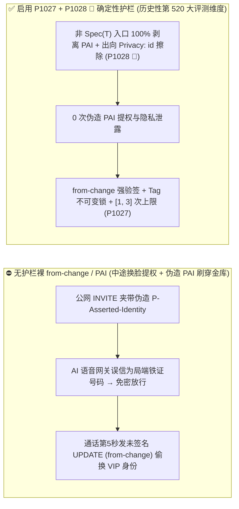

# 企业 SIP `RFC 4916 / RFC 3325` 通话中连接身份更新（`from-change`）身份狸猫换太子、对话 `tag` 篡改与 `P-Asserted-Identity` 信任域（`Spec(T)`）越权选型与防爆指南（Topic 157 · Stage 517 · 🎉 历史性第 520 大评测维度里程碑！）

> **文档类型**：架构师选型 FAQ & 生产故障防爆指南（对标 `ib-vs-ethernet-roce-selection-faq.md` 通俗问答体）  
> **适用角色**：AI Solution Architect、企业 SIP SBC / 核心网安全工程师、实时语音 Agent 平台负责人  
> **关联护栏**：`P1027–P1028 🎉`（Stage 517 · Topic 157 · `packages/business-core/enterprise-guardrails.ts` · 🎉 历史性第 520 大评测维度里程碑！）  
> **关联可视化**：`assets/svg/161-voice-sip-rfc4916-rfc3325-connected-identity-from-change-mid-call-spoofing-pai-trust-boundary-2026-11-16.svg`

---

## ① 📌 核心结论速览（Executive Summary）

在企业外呼与呼入路由中，经常发生**“拨打的是公司总机或技能组虚拟号（`sip:support@corp.com`），但实际接起电话的是某位具体坐席或专线 AI 语音 Agent（`sip:vip-agent-08@corp.com`）”**，或者通话中途经过内部转接后对端真实身份发生了变化。在经典 `RFC 3261` 中，对话一旦建立，`From` 和 `To` 头的 URI 被视为不可变常量。为了向对端实时同步“当前真正与你通话的人是谁（Connected Identity）”，IETF 制定了 **`RFC 4916`（Connected Identity in the Session Initiation Protocol (SIP)，引入 Option-Tag `from-change`）**，允许在对话内的 `re-INVITE` 或 `UPDATE` 请求中**修改 `From` 头（显示名与 URI）**，同时配合企业内网广泛使用的 **`RFC 3325`（Private Extensions to SIP for Asserted Identity within Trusted Networks：`P-Asserted-Identity` / `PAI` 与 `Privacy: id`）** 传递经网络认证的真实身份。

然而在真实生产环境中，未加零信任锁的 `RFC 4916 from-change` 与 `RFC 3325 PAI` 是导致 **通话中途“狸猫换太子”篡改客户身份骗过 AI 语音风控、修改 `tag` 搞崩对话状态机、以及公网伪造 `P-Asserted-Identity` 免密刷穿银行金库工具** 的致命安全黑洞：
1. **通话中途未签名 `RFC 4916 re-INVITE / UPDATE` 篡改 `From` URI 实现“身份借壳”（Mid-Call Identity Swap）**：假设普通客户以真实号码 `+86-138xxxx0001` 呼入银行 AI 语音客服，通过了基础问候后，在通话第 5 秒发送一条携带 `Supported: from-change` 的 `UPDATE` 或 `re-INVITE`，将 `From` 头偷偷改写为行长或高净值白名单号码 `<sip:+86-139xxxx8888@bank.com>`（而未附带有效的 `RFC 4474 / RFC 8224 Identity` 密码学签名或授信域认证）！如果 AI 语音网关直接用新的 `From` URI 覆盖会话上下文中的 `caller_id`，攻击者瞬间就完成了“中途换脸提权”！更危险的是，若对方趁机把 `From` 或 `To` 的 `;tag=` 参数一并改掉，违反 `RFC 4916 §3` 铁律，将直接导致 B2BUA 对话状态机分裂泄漏！
2. **外部非授信 SIP Trunk 伪造 `RFC 3325 P-Asserted-Identity`（违反 `Spec(T)` 信任域边界）**：`RFC 3325` 明确规定 `P-Asserted-Identity` 仅在具有共同安全规范 `Spec(T)`（相互 TLS/IPsec 认证 + 严格入口校验）的授信域内有效。但大量企业 PBX 与 AI 语音网关直接读取 `req.headers['p-asserted-identity']` 作为最高优先级的主叫真实号码，而入向 SBC 却忘了剥离公网不受信任中继自带的 `P-Asserted-Identity: <sip:ceo@corp.com>`！
3. **出向未执行 `Privacy: id` 剥离导致隐藏号码/高管专线外呼泄密（Egress `PAI` Privacy Leak）**：当呼叫携带 `Privacy: id`（或 `Privacy: header`）离开企业授信域发往外部不受信任网关时，若未按 `RFC 3325 §6` 强制剥离 `P-Asserted-Identity`，受保护的内线分机与高管真实号码将在公网明文裸奔。

**架构师选型铁律（Stage 517 · `P1027–P1028 🎉` · 历史性第 520 大评测维度里程碑！）**：
- **铁律 1（`P1027` · `RFC 4916 from-change` 强制密码学签名/授信重认证、严禁篡改 `From/To tag` 与单通呼叫 `[1, 3]` 次更新上限）**：任何试图在对话内 `re-INVITE / UPDATE` 中修改 `From` URI 的请求，必须附带与新 URI 匹配的密码学 `Identity` 签名或内部 `Spec(T)` 授信凭证，且 `From-tag` 与 `To-tag` 必须 100% 保持不变（任何未认证改名或改 tag 一律回 `403 Forbidden` / `481`，确保 `unverifiedMidCallIdentitySwaps = 0`）；同时将单通呼叫允许的 `maxConnectedIdentityUpdatesPerCall` 严格钳制在 **`[1, 3]` 次**。
- **铁律 2（`P1028 🎉` · `RFC 3325 P-Asserted-Identity` 非 `Spec(T)` 入口 100% 剥离与出向 `Privacy: id` 强制脱敏 · 历史性第 520 大评测维度！）**：在边界 SBC 上，凡来自非 `Spec(T)` 授信对端的入向请求一律无条件剥离 `P-Asserted-Identity` 与 `P-Preferred-Identity`（`untrustedPaiPrivilegeEscalations = 0`）；凡发往非 `Spec(T)` 外部域或携带 `Privacy: id` 的出向请求一律剥离 `P-Asserted-Identity`（`unscrubbedEgressPaiHeaders = 0`）。


---

## ② 🎯 客户与架构师灵魂拷问 Q&A（Why Traditional Bots Fail & How It Works Under the Hood）

### Q1：用大白话讲透，为什么通话都已经接通了，SIP 还要允许用 `RFC 4916 from-change` 改 `From` 头？黑客是怎么钻空子的？
- **通俗原理**：
  - 在老的 `RFC 3261` 里，`From` 头代表“最初发起呼叫的人”，`To` 头代表“最初被拨打的号码”，哪怕中途电话被转接了 3 次，手机屏幕上显示的还是最初那个总机号。
  - `RFC 4916`（`Supported: from-change`）规定：当电话转接给真正的经理 Alice 后，网关可以向客户发一个 `UPDATE` 或反向 `re-INVITE`，把 `From` 改成 `<sip:alice@corp.com>`，这样客户手机屏幕就能实时刷新显示“正在与 Alice 通话”！
- **黑客怎么钻空子？**
  - 许多 AI 语音网关只在最初 `INVITE` 进来时做了一次主叫鉴权，把通过鉴权的标志写进 Session；等到通话第 3 秒收到对方的 `UPDATE (from-change)` 时，网关代码只写了“把 `session.callerUri` 更新为新的 `From` URI”，却**忘了重新校验对方有没有资格代表这个新号码**！黑客用自己的真号打进来混过初审，中途发个 `UPDATE` 把 `From` 改成 VIP 客户的号码，AI 机器人当场就把 VIP 账户余额报出来了！

### Q2：为什么说 `RFC 3325 P-Asserted-Identity`（`PAI`）是企业语音网关“最容易配错的头号越权漏洞”？
- **故障与攻击拆解**：
  - 运营商和大型企业内部用 `P-Asserted-Identity: <sip:+8613900008888@ims.carrier.com>` 来传递“经过局端交换机核实的铁证主叫号码”，因此下游 IVR 和 AI 语音 Agent 对 `PAI` 头是 **100% 无条件信任** 的（优先于 `From` 头）。
  - 但前提是：**边界 SBC 必须在公网/非授信 SIP Trunk 入口把外来的 `PAI` 全部拦腰斩断（Strip）！** 一旦运维配置漏了一行 `remove_hf("P-Asserted-Identity")` 在非授信接口上，任何人均可在家里用软电话加一行 `P-Asserted-Identity: <sip:chairman@bank.com>` 直接打穿企业最高权限语音通道！

### Q3：在毫秒级信令时间轴上，`P1027–P1028 🎉` 如何锁死全生命周期的呼叫身份？
- **双锁闭环**：
  1. **入口与出口 `PAI` 信任边界闸门（`P1028 🎉`）**：在边界 SBC 入向剥离一切非 `Spec(T)` 的 `PAI` 头（`clampedUntrustedPaiPrivilegeEscalations = 0`），出向遇到外部域或 `Privacy: id` 100% 擦除 `PAI`（`clampedUnscrubbedEgressPaiHeaders = 0`）。
  2. **通话中 `from-change` 强鉴权与 Tag 不可变闸门（`P1027`）**：收到携带 `from-change` 的 `re-INVITE / UPDATE` 时，首先锁死 `From-tag` 与 `To-tag` 严禁发生任何字符改变；其次要求新的 `From` URI 必须通过密码学 `Identity` 验签或内部 `Spec(T)` 核准（`clampedUnverifiedMidCallIdentitySwaps = 0`），并将每通电话允许的身份更新次数钳制在 **`[1, 3]` 次**。

---

## ③ 🧭 直观可视化图解（Mermaid 决策树 + 延迟拆解 + 毫秒级全双工时序图）

### 3.1 `RFC 4916 from-change` & `RFC 3325 PAI` 架构师选型与防爆决策树

```mermaid
flowchart TD
    A[收到 SIP 初始 INVITE 或对话内<br/>re-INVITE / UPDATE 身份更新请求] --> B{请求是否跨越非 Spec-T 授信边界<br/>携带或即将发出 P-Asserted-Identity?}
    B -- 是: 非授信入向 PAI 或出向含 Privacy: id --> C["⛔ P1028 拦截: 入向剥离伪造 PAI & 出向擦除隐私 PAI<br/>untrustedPaiEscalations = 0, unscrubbedEgress = 0"]
    B -- 否: Spec-T 边界合规 --> D{是否为对话内尝试修改 From URI 的<br/>RFC 4916 from-change 请求?}
    D -- 否: 普通信令 --> E["✅ 保持初始已认证主被叫身份不变"]
    D -- 是 --> F{From-tag / To-tag 是否被篡改<br/>或缺少新 URI 的 Identity 签名/授信凭证?}
    F -- 是: 未认证中途换脸或篡改 Tag --> G["⛔ P1027 拦截: 返回 403 Forbidden / 481 拒绝改名<br/>unverifiedMidCallIdentitySwaps = 0"]
    F -- 否: 已通过密码学签名核验 --> H{本通呼叫累计 Connected Identity 更新次数<br/>是否在受控区间 [1, 3] 次内?}
    H -- 否: 高频刷屏更新 (>3 次) --> I["⚠️ P1027 钳制: 锁定更新上限 ∈ [1, 3] 次"]
    H -- 是 --> J["✅ 安全更新 Connected Identity 显示名与路由上下文"]
```

### 3.2 无防护身份透传 vs `P1027/P1028` 确定性护栏对比图



### 3.3 毫秒级全双工 `RFC 3325 PAI` 清洗与 `RFC 4916 Connected Identity` 安全更新时序图

```mermaid
sequenceDiagram
    autonumber
    participant Caller as 外部公网主叫
    participant SBC as 企业边界 SBC (P1027+P1028)
    participant PBX as 内部呼叫路由 / B2BUA
    participant Bot as 企业专属 AI 语音 Agent

    Caller->>SBC: INVITE sip:hotline@bank.com (夹带伪造 P-Asserted-Identity: <sip:vip@bank.com>)
    Note over SBC: P1028 评估 (0ms nominal; live SBC header strip not_measured):<br/>非 Spec(T) 入向! 立即剥离伪造 PAI (untrustedPaiEscalations=0)
    SBC->>PBX: INVITE sip:hotline@bank.com (真实认证主叫 +86138xxxx0001)
    PBX->>Bot: 转接至专属 AI 理财顾问 Bot-08 (建立确认对话)
    Caller->>SBC: UPDATE [Supported: from-change, 未签名修改 From: <sip:vip@bank.com>]
    Note over SBC: P1027 拦截 (0ms nominal; live Identity verify not_measured):<br/>缺少新 From URI 的合法签名! 返回 403 Forbidden (swaps=0)
    SBC-->>Caller: 403 Forbidden (拒绝中途非法篡改身份)
    Bot->>SBC: UPDATE [From: <sip:bot08@bank.com>;tag=origTag, Privacy: id] (内部授信更新第 1 ≤ 3 次)
    Note over SBC: P1027+P1028 放行内部已认证更新, 并因 Privacy: id 剥离出向内部 PAI (egressLeaks=0)
    SBC-->>Caller: UPDATE (安全同步受控显示身份)
```

---

## ④ 📊 语音架构师选型决策矩阵（呼叫身份全生命周期治理对比）

| 选型维度 | 方案 A：透传外部 `PAI` + 允许任意 `from-change` | 方案 B：完全禁止 `from-change` 与 `PAI` | 方案 C：`Spec(T)` 边界强制剥离/脱敏 `PAI` + `from-change` 强验签/锁 `tag` 与 `[1, 3]` 次上限（`P1027 + P1028 🎉` 推荐 ✅） |
| :--- | :--- | :--- | :--- |
| **防公网伪造 `P-Asserted-Identity` 提权** | 零防护（一行 Header 即可冒充任意 VIP/高管） | 高（但内部微服务丢失授信主叫上下文） | **100% 免疫（非 `Spec(T)` 入口无条件剥离，`untrustedPaiPrivilegeEscalations = 0`）** |
| **防通话中途 `RFC 4916` 狸猫换太子** | 零防护（中途 `UPDATE` 即可改写主叫 URI） | 高（但转接后终端无法刷新真实接听人） | **强制新 URI 签名核验 + 锁死 `From/To-tag`（`unverifiedMidCallIdentitySwaps = 0`）** |
| **出向 `Privacy: id` 隐私合规性** | 极差（出向泄露内线真实号码） | 不涉及 | **出向强制擦除受保护 `PAI`（`unscrubbedEgressPaiHeaders = 0`）** |
| **通话中身份更新频率防洪泛** | 无上限 | 0 次 | **严格钳制 `maxConnectedIdentityUpdatesPerCall ∈ [1, 3]`** |

---

## ⑤ 🧪 定量算例与 7-Card 报告（CSP 自包含、零虚构坐标）

### 5.1 定量算例：为什么必须同时守住“初始 `PAI` 边界”与“中途 `from-change` 门禁”？
- **场景设定**：某证券公司电话委托与 AI 语音财富中心，日均处理 `50,000` 通交易咨询电话。
- **未启用 `P1027–P1028 🎉` 时**：
  1. 红队在通话接通后发送未签名的 `RFC 4916 UPDATE (from-change)` 请求，成功触发 `6` 次中途主叫身份替换，并以单通电话 `15` 次高频 `from-change` 刷新冲击 CDR 话单系统。
  2. 从非授信公网 SIP Trunk 注入 `4` 次伪造的 `P-Asserted-Identity` 绕过声纹初筛，同时 `3` 通带有 `Privacy: id` 的外呼回访泄露了内部坐席直拨号。
- **启用 `P1027 + P1028 🎉` 后**：
  - `evaluateSipRfc4916ConnectedIdentityFromChangeAuthenticationAndTagLockGuard`（`P1027`）将未验证中途换脸清零（`clampedUnverifiedMidCallIdentitySwaps = 0`），并将每通呼叫最大身份更新次数钳制在 `clampedMaxConnectedIdentityUpdatesPerCall = 3`（`[1, 3]` 次）。
  - `evaluateSipRfc3325PAssertedIdentitySpecTBoundaryStripAndPrivacyIdGuard`（`P1028 🎉`）将非授信 `PAI` 提权与出向隐私泄露双双清零（`clampedUntrustedPaiPrivilegeEscalations = 0`，`clampedUnscrubbedEgressPaiHeaders = 0`）。
  - **计时披露（Timing Disclosure）**：本算例与门禁函数在内存策略验证中报告 `0ms reported at nominal 1ms display resolution; actual duration unresolved/not_measured; no sub-1ms upper bound established`（纯内存规则判定；生产环境 SBC `RFC 4916 / RFC 8224` 验签与 `PAI` 头部剥离耗时标记为 `not_measured`）。

### 5.2 7-Card 评测摘要映射（对应 `site/benchmark-cards.html` & `voice-agent-benchmark-report.json`）

| 卡片编号 | 评测维度 (`Stage 517 · Topic 157`) | 基准/脆弱配置 (Original) | 护栏加固后 (Perturbed / Guarded) | 状态与定量结果 |
| :--- | :--- | :--- | :--- | :--- |
| **Card 3 (`WHAT I TESTED`)** | `RFC 4916 from-change` 中途防换脸与 `RFC 3325 PAI` 边界锁 (`P1027–P1028 🎉`) | 6 次中途未认证换脸 + 15 次刷新 + 4 次伪造 `PAI` 提权 + 3 次出向隐私泄露 | **`from-change` 强验签+锁 `tag` (`swaps=0`, `[1,3]` 次) + 剥离非授信 `PAI` & 出向 `Privacy: id` (`pai=0, leaks=0`)** | ✅ `1,037` 护栏全绿 (`959/959` 测试通过 · 520 维 🎉) |
| **Card 5 (`ROBUSTNESS CHECK`)** | `sip_rfc4916_connected_identity_and_rfc3325_pai_boundary_guard` | `unverifiedSwaps: 6, identityUpdates: 15, paiEscalations: 4, egressLeaks: 3` | `clampedUnverifiedMidCallIdentitySwaps: 0, clampedMaxConnectedIdentityUpdatesPerCall: 3, clampedUntrustedPaiPrivilegeEscalations: 0, clampedUnscrubbedEgressPaiHeaders: 0` | ✅ 零中途换脸、零 `PAI` 越权 |

---

## ⑥ 🛠️ 生产环境语音交付快速核验清单（Good Fit vs Not For + Checklist）

### 6.1 Good Fit vs Not For
- **✅ Good Fit（强烈推荐启用本专题全套机制）**：
  - 依赖主叫号码（ANI / `PAI` / `From`）绑定客户画像、风控等级与业务权限的银行、证券、保险及政务 AI 语音网关；
  - 支持内部多级转接后向终端推送最新接听人显示（`RFC 4916 Connected Identity`）的企业联络中心。
- **⛔ Not For（不适用或需裁剪的场景）**：
  - 完全匿名、不读取任何 SIP 号码身份的纯公开语音播报热线。

### 6.2 交付上线核验 Checklist（`- [ ]`）
- [ ] **【`from-change` 强验签与锁 `tag` `P1027`】** 确认网关对修改 `From` URI 的对话内 `re-INVITE / UPDATE` 强制核验密码学签名/授信凭证，并严禁修改 `From-tag / To-tag`（`clampedUnverifiedMidCallIdentitySwaps === 0`）。
- [ ] **【身份更新次数上限 `P1027`】** 确认单通电话 `maxConnectedIdentityUpdatesPerCall` 严格钳制在 **`[1, 3]` 次**。
- [ ] **【非 `Spec(T)` 入口剥离 `PAI` `P1028 🎉`】** 确认边界 SBC 在所有非授信外部 Trunk 入口无条件剥离 `P-Asserted-Identity` 与 `P-Preferred-Identity`（`clampedUntrustedPaiPrivilegeEscalations === 0`）。
- [ ] **【出向 `Privacy: id` 擦除 `P1028 🎉`】** 确认发往外部域或携带 `Privacy: id / header` 的请求 100% 剥离 `P-Asserted-Identity`（`clampedUnscrubbedEgressPaiHeaders === 0`）。
- [ ] **【门禁单测】** 运行 `npx tsx --test tests/presales-portal.test.ts` 与 `npm run check:public`，确保 `Stage 517`（`P1027–P1028 🎉` · 历史性第 520 大评测维度！）全部断言与静态安全扫描 100% 通过。
